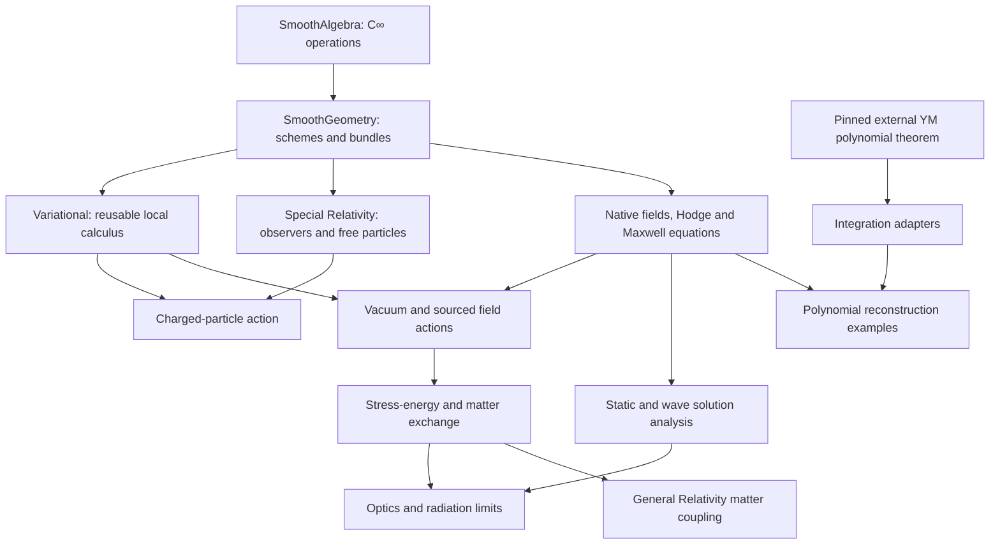

# Research Plan for Electrodynamics over C∞ Geometry

A Lean formalization programme for Chapters III–IX, §§15–80, of
Landau and Lifshitz's *The Classical Theory of Fields*, with separate
extensions for global gauge geometry and macroscopic constitutive laws.

This is the Electrodynamics volume of the classical-field trilogy migrated
from [issue #8](https://github.com/MGYamada/ProjectAInos/issues/8).
[Special Relativity](cinfty-special-relativity.md) owns §§1–14;
[General Relativity](cinfty-general-relativity.md) owns §§81–119.
The organization follows the research-manuscript format of
[C∞ mechanics](cinfty-mechanics.md), but uses the constructed shared schemes,
manifold bundles and curved exterior calculus available in this repository.
It does not inherit the mechanics manuscript's historical infrastructure gaps.

## Implementation plan and current progress

The baseline is `main` at
[`61d8fdf`](https://github.com/MGYamada/ProjectAInos/commit/61d8fdf),
checked on 13 November 2026. A statement marked **proved** below means the
indicated Lean statement with its actual hypotheses; it does not mean that
every assertion in the corresponding textbook section has been formalized.
**Target** means a proposed theorem or construction. **Conditional target**
means that a named analytic result must first be proved or supplied as an
explicit hypothesis. No new theorem is claimed by writing this manuscript.

| Component | Status at the baseline | Reuse and remaining obligation |
| --- | --- | --- |
| C∞ spectra, schemes, localization, open gluing and manifold comparison | Implemented shared foundation | Reuse actual structure sheaves; universal cotangent comparison and arbitrary nonreduced dynamics remain targets |
| Flat forms, pullback, exterior derivative, wedge, Lorentz Hodge and observer reconstruction | Proved shared geometry | Their physical interpretation is specified here; they do not prove Maxwell evolution |
| Local potentials, exact gauge invariance, Bianchi, covariance and two scalar invariants | Proved | [Field](../ProjectAInos/Electrodynamics/Field.lean), [Components](../ProjectAInos/Electrodynamics/Components.lean), [Invariants](../ProjectAInos/Electrodynamics/Invariants.lean), [Covariance](../ProjectAInos/Electrodynamics/Covariance.lean) |
| Actual charged-particle action, Lorentz force, mass shell and gauge endpoint term | Proved on the open timelike jet domain in flat spacetime | [ParticleAction](../ProjectAInos/Electrodynamics/ParticleAction.lean), [LorentzForce](../ProjectAInos/Electrodynamics/LorentzForce.lean), [GaugeAction](../ProjectAInos/Electrodynamics/GaugeAction.lean); curved charged-particle variation remains a bridge target |
| Homogeneous polynomial radial reconstruction | Proved, including nonzero degrees zero and one | [PolynomialRadial](../ProjectAInos/Electrodynamics/PolynomialRadial.lean) and [PolynomialBridge](../ProjectAInos/Electrodynamics/PolynomialBridge.lean); no arbitrary global potential is inferred |
| Maxwell forms on a fixed curved background, current conservation and component equivalence | Proved | [Curved](../ProjectAInos/Electrodynamics/Curved.lean), [Current](../ProjectAInos/Electrodynamics/Current.lean), [CurvedComponents](../ProjectAInos/Electrodynamics/CurvedComponents.lean) |
| Flat vacuum field action and stationarity iff the vacuum equations | Proved; [#44](https://github.com/MGYamada/ProjectAInos/issues/44) is completed | [VacuumAction](../ProjectAInos/Electrodynamics/VacuumAction.lean), with integrability and compact-support hypotheses |
| Sourced and curved field-action derivations; electromagnetic stress tensor and matter exchange | Targets | Preserve the explicit source-sign bridge below; fixed-background equations alone do not supply these proofs |
| Static boundary problems, wave evolution, optics, retarded fields and radiation | Targets or conditional targets | Need independently specified function spaces, domains, boundary conditions and error estimates |
| Nontrivial gauge bundles, media, singular sources and self-force | Separate extensions | Do not silently strengthen the smooth-potential API |

The [electrodynamics API guide](electrodynamics.md) records declaration-level
contracts. The [shared geometry guide](smooth-geometry.md) records the
underlying tensor and form operations. The geometric results delivered by
[#52](https://github.com/MGYamada/ProjectAInos/issues/52) are already on `main`;
they are not pending prerequisites for this document's fixed-background work.

## Abstract

Electrodynamics is organized as geometry of fields, variational dynamics,
and analysis of solutions. A potential is a local one-form or, eventually,
a connection on a principal circle bundle. Its curvature is a two-form.
The equation that curvature is closed belongs to exterior calculus; the
inhomogeneous equation requires an excitation and a source. Vacuum supplies
a metric constitutive law. A field action then gives an independent route
from stationarity to the dynamical equation. Energy, momentum and radiation
require further theorems beyond either of these descriptions.

The C∞ foundation supplies observables, local spaces, descent and the route
to infinitesimal field families. The first implementation works on smooth
manifold schemes with their actual tangent bundles, where integration and
Lorentz signature are already meaningful. Abstract cotangent modules,
nonreduced coefficient families and quotient moduli remain explicit research
tasks. This separation permits useful classical proofs immediately while
retaining the algebraic programme rather than pretending its comparison
theorems have already been established.

## Introduction

### Aim and ownership

Research-plan §4 has four parts: charged matter and local fields; Maxwell
dynamics and conservation; static fields, waves and optics; moving sources
and radiation. The section dictionary below assigns a formal target to each
of the 66 textbook sections in this volume. Its order is a coverage order;
the dependency graph determines implementation order.

The spacetime may be Minkowski or a prescribed curved Lorentz background.
Varying the spacetime metric to define a stress tensor does not by itself
make the metric dynamical. Einstein equations and their coupled solutions
belong to the [GR volume](cinfty-general-relativity.md). The common metric
variation interface must support both uses without importing Einstein
dynamics into the electrodynamics core.

Quantum electrodynamics, operator-valued distributions and quantum
Yang–Mills are not consequences of the classical programme. Their dedicated
design is [#46](https://github.com/MGYamada/ProjectAInos/issues/46).
Classical distributional currents are included here only with their own
test-space and regularity contracts.

### Conventions

The physical spacetime dimension is four. Coordinates are `(t,x,y,z)`, the
metric signature is `(-+++)`, and the standard orientation is
$dt\wedge dx\wedge dy\wedge dz$. Time orientation and spacetime orientation
are separate choices. Natural units set $c=1$ and the vacuum constitutive
normalization to one. A limit involving $c$ restores it explicitly.
For the global programme, manifolds are Hausdorff, second countable and
without boundary; integration regions with boundary receive their own
regularity hypotheses. Smooth means $C^\infty$, except where a finite
regularity theorem is stated explicitly. Local implemented results retain
their original, sometimes weaker, topological assumptions.

For the potential and field, use

$$
A=-\phi\,dt+a_i\,dx^i,\qquad F=dA,
\qquad F_{\mu\nu}=\partial_\mu A_\nu-\partial_\nu A_\mu.
$$

The Hodge operator is determined by
$\alpha\wedge\star\beta=\langle\alpha,\beta\rangle_g\,\mathrm{vol}_g$.
In four Lorentz dimensions its square on $p$-forms is
$(-1)^{p(4-p)+1}$, so it is $-1$ on two-forms and $+1$ on one- and
three-forms. For a future unit observer $u$, the existing convention is

$$
E_u=-\iota_uF,\qquad B_u=\iota_u\star F,
\qquad H=-\star F,\qquad J=\star(j^\flat)=\iota_j\mathrm{vol}_g.
$$

Both $E_u$ and $B_u$ annihilate $u$. Their rest-space norms give the proved
identities

$$
\frac12F_{\mu\nu}F^{\mu\nu}=|B_u|^2-|E_u|^2,
\qquad
\frac14F_{\mu\nu}(\star F)^{\mu\nu}=E_u\mathbin{\cdot}B_u.
$$

The second expression changes sign under orientation reversal. An
orientation change also negates $H$ and $J$, preserving $dH=J$ and the
source vector $j$. It is different from reversing the entire metric sign.

**Source sign contract.** The present public Maxwell source $j$ is defined
by $\nabla_\mu F^{\mu\nu}=j^\nu$. It must not be identified without a bridge
with the matter current obtained by varying the existing positive particle
coupling $+e\int_\gamma A$. With the field action used below, the compatible
matter current is $k=-j$. The derivation appears under
[sourced variation](#sourced-variation-and-the-matter-current).
This document preserves the public conventions and makes that comparison
an explicit future proof obligation.

### Tiers and status

| Tier | Meaning in this volume |
| --- | --- |
| A | Algebraic reasoning over a specified C∞-ring or its modules, once the required constructions exist |
| A* | Finite explicit polynomial, rational or multilinear identities over real coefficients |
| B: name | Uses exactly the named analytic interface described under Towards Lean |
| C | Geometric infrastructure: schemes, bundles, forms, connections, descent or integration on manifolds |
| D | A substantial analytic or global theorem, supplied explicitly until formally proved |
| P | A physical modelling or asymptotic step that must be replaced by a precise statement with hypotheses |

Tier is not proof status. An algebraic target may be unimplemented, and a
geometric theorem may already be proved. A finite coordinate calculation
does not establish an abstract C∞-ring theorem. In particular, a positivity
or convergence assertion over real numbers cannot be transported to an
arbitrary coefficient ring merely by changing its scalar parameter.

## Foundations

### The C∞ base and the manifold comparison

The shared `SmoothAlgebra` library equips real algebras with all finite-arity
smooth operations. `SmoothGeometry` constructs real spectra with their
local C∞ structure sheaves, open restrictions, gluing and the scheme of a
smooth manifold. These are the objects used here, rather than a new
electromagnetic replacement for the spectrum or manifold category.

Joyce's C∞ scheme and module framework supplies the mathematical reference
for further comparisons. His cotangent constructions are not automatically
the project's implemented API. In particular, the general comparison of
universal cotangent sheaves with native smooth one-forms is still a target.
[Joyce, §§2–5](https://arxiv.org/pdf/1001.0023)

**Definition E1 (regular electromagnetic background, C).** A background is
a smooth four-dimensional manifold $M$, its constructed C∞ scheme, a smooth
nondegenerate Lorentz metric $g$, an orientation, and any time orientation
needed by observer or causal statements. Its fields are sections of actual
bundles over $M$. A theorem about retarded propagation additionally specifies
the causal and global hypotheses it needs.

No global frame is part of E1. `LorentzManifold.toScheme` forgets the metric
to the underlying constructed scheme; it is not a construction of Lorentz
metrics on every C∞ scheme. The invariant objects below are defined first
on the native tangent fibres and only then expressed in charts.

**Target E2 (cotangent comparison, C).** On the existing manifold-scheme
class, construct an isomorphism from the universal C∞ cotangent sheaf to
the sheaf of smooth cotangent sections, compatible with restriction,
pullback and exterior powers. Transport the universal derivation to the
implemented exterior derivative on functions. The proof must identify
sheaves and maps, not merely compare their real-point dimensions.

This target depends on the universal module construction and the relevant
local-to-global comparison. Neither $A\cong\Gamma(\operatorname{Spec}A)$
for every C∞-ring nor full faithfulness of the manifold construction is
assumed. Nilpotents remain in structure sheaves. An embedding into
real-valued functions is not an acceptable substitute for retaining them.

### Sections, jets and local Lagrangians

**Definition E3 (first-order field Lagrangian, C).** For a smooth bundle
$E\to M$, a first-order Lagrangian density is a bundle map
$L:J^1E\to\operatorname{Dens}(M)$. On an oriented chart it is represented
by a scalar density in field values and first derivatives. Changes of
trivialization must yield the same density, including the Jacobian.

For the first Maxwell implementation, $E=T^*M$ on a trivializing domain.
Antisymmetrization sends $j^1A$ to $dA$. In the existing flat implementation
this is the concrete map `alternatizeUncurryFin` used in `VacuumAction`.
The future jet-bundle adapter must prove agreement with that map.

The shared `Variational` layer already differentiates actions in fixed
finite-dimensional trivializations. A global bundle-jet theory requires
additional transition and gluing proofs. Those proofs belong to the
shared mathematical layers, while the particular Maxwell Lagrangian and
source law belong to `Electrodynamics`.

**Target E4 (descent of first variation, C, B:INT).** Given a density and
compatible local variations supported in a compact subset of a manifold,
prove chart-independent differentiation of its integral. Glue the local
Euler–Lagrange pairings and boundary currents. Cover independence must be
proved using partitions of unity or an equivalent constructed mechanism.
The scalar model theorem alone does not establish this statement.

### Infinitesimal field families

An intended algebraic interface assigns to a coefficient C∞-ring $B$ a
space of fields over a suitable base change and assigns compatible
restriction maps to morphisms of coefficients. A dual-number family should
recover an infinitesimal variation. This is a design objective, not a
currently implemented representable field space.

**Target E5 (linearized gauge complex, A, C).** After the necessary
cotangent and coefficient-change constructions, compare the sequence

$$
\Omega^0\xrightarrow{d}\Omega^1\xrightarrow{d}\Omega^2
$$

with infinitesimal gauge parameters, variations of potentials and
variations of curvature. Prove compatibility with real-manifold
specialization. For the linear Maxwell equation, add the linearized
Euler–Lagrange map and its Noether identity as a separate complex.

Gauge stabilizers and residual gauge transformations must be retained.
The set of equivalence classes is not automatically a smooth scheme, and
a field-equation ideal is not a theorem that a solution functor is
representable. Derived critical loci and BV are later mathematical projects,
not assumptions used to complete the classical solution theory.

## Local gauge fields and charged particles

### Potentials, curvature and descent

**Definition E6 (local potential, C).** On an open $U\subset M$, a potential
is a sufficiently regular one-form $A$. A gauge function $\chi$ acts by
$A\mapsto A+d\chi$. The curvature is $F=dA$. For smooth data the identities

$$
dF=0,\qquad d(A+d\chi)=dA
$$

follow from $d^2=0$. The existing flat local theorem requires $A\in C^1$
and $\chi\in C^2$ for gauge invariance; Bianchi uses $A\in C^2$.
Regularity is asserted only on the stated open domain.

**Proved endpoint.** `fieldTensor_gauge_on`, `bianchi_on` and
`fieldTensor_pullback_on` expose these facts. The pullback theorem includes
the differentiability of the map and potential. Lorentz/Poincaré covariance
is a specialization, not a new differential operator.

**Target E7 (local reconstruction, C, B:HOM).** On a star-shaped coordinate
domain, construct a homotopy operator for forms with the required parameter
integrability and differentiability. Prove $dK+Kd=\mathrm{id}$ in positive
degree. A closed two-form then has a constructed local potential.
Extend to suitable covers; do not infer global exactness.

**Target E8 (global gauge data, C).** Use a principal $U(1)$ bundle with a
connection, or equivalent transition functions $g_{ij}:U_i\cap U_j\to U(1)$
and compatible local connection forms. Fix the identification of the Lie
algebra with $\mathbb R$ before writing the transition law. Prove that local
curvatures glue to one global two-form and that gauge transformations preserve
it. Nontrivial topology, holonomy and curvature periods require separate
theorems; a closed real two-form need not be a connection curvature for the
chosen normalization.

The initial global-potential theory remains a useful specialization of E8.
It must not be reinterpreted as a classification of all electromagnetic
configurations. The comparison should recover existing potentials on a
trivial bundle with a chosen trivialization.

### The polynomial asset

For a closed homogeneous polynomial curvature of degree $r$, the existing
radial construction gives

$$
A_\nu(x)=\frac{1}{r+2}\sum_\mu x^\mu F_{\mu\nu}(x),
\qquad x^\nu A_\nu=0,\qquad dA=F.
$$

The coefficient $r+2$ comes from the polynomial degree and form degree.
It is not $r+1$. The degree-zero and degree-one regressions distinguish
these denominators. This is a finite polynomial Poincaré statement and
supports E7, but does not prove E7 for arbitrary smooth coefficients.

The imported Maxwell closure has 11 modules from the pinned upstream commit
`3456e5e75cf8d4cd558955a5c7638fba2d68f464`. Its Euclidean four-space,
homogeneous coefficients and radial gauge are explicit. The project bridge
transports coordinate evaluation and differentiation through the time-first /
time-last axis exchange. It supplies no Wick rotation or hyperbolic estimate.
Keep the original namespaces, Apache-2.0 attribution and
[provenance record](../ProjectAInos/External/YM/PROVENANCE.md).

### Actual worldline variation

**Definition E9 (charged action, B:INT).** For a timelike curve $\gamma$ in
the potential domain, use the already implemented flat action

$$
S_{m,e,A}[\gamma]
=-m\int_a^b\sqrt{-g(\dot\gamma,\dot\gamma)}\,ds
 +e\int_a^b A_{\gamma(s)}(\dot\gamma(s))\,ds.
$$

The variational statement uses $a<b$, a $C^2$ reference curve with timelike
velocity on the closed interval, and a $C^2$ potential on an open domain
containing its image. Compactness gives a common admissible neighborhood
for small variations. The square-root expression is not asserted smooth
across the null cone. Positive mass is required for the massive physical
interpretation and for division by mass.

**Proved endpoint.** `stationary_iff_lorentzForce` derives

$$
m\frac{dU^\mu}{ds}=eF^{\mu\nu}\dot\gamma_\nu,
\qquad U=\frac{\dot\gamma}{\sqrt{-g(\dot\gamma,\dot\gamma)}}.
$$

Stationarity is the vanishing derivative of the actual action for all
smooth fixed-endpoint variations. It is not defined to be this equation.
Antisymmetry gives force orthogonality; normalization gives
$g(mU,mU)=-m^2$. At proper time, $\dot\gamma=U$.

Gauge change adds the endpoint term
$e[\chi(\gamma(b))-\chi(\gamma(a))]$. The integral identity needs $C^1$
regularity of $\chi$ along the curve, while the local $C^2$ variational
comparison uses $C^3\chi$ so that the shifted potential is $C^2$.

**Target E10 (curved charged variation, C, B:INT).** Combine the existing
intrinsic massive-particle variation with the first variation of the line
integral of a one-form. Derive the native equation

$$
m\nabla_{\dot\gamma}U=-e\,(\iota_{\dot\gamma}F)^\sharp.
$$

Prove both directions of stationarity equivalence using actual
manifold-valued test families, and recover the flat theorem. Preserve the
endpoint term and parameter hypotheses. Null-particle models use a separate
action or constrained formulation; setting $m=0$ in the massive action
does not construct massless charged dynamics.

## Maxwell equations and field variation

### Premetric equations and constitutive data

**Definition E11 (premetric Maxwell system, C).** On an oriented
four-manifold, let $F,H$ be two-forms and $J$ a three-form. The equations are

$$
dF=0,\qquad dH=J.
$$

They imply $dJ=0$ by $d^2=0$, independently of a metric. A constitutive law
$H=\kappa(F)$ supplies the missing relation. Vacuum chooses
$\kappa=-\star_g$ with this volume's normalization. Treating ordinary forms
requires the explicit orientation convention; an orientation-free treatment
with twisted forms is a future generalization.

**Proved endpoint.** On a smooth Lorentz background, `Curved.currentEquiv`
identifies vector currents with three-form currents. `currentForm_volume`
and `exteriorDerivative_currentForm` prove

$$
J=\iota_j\mathrm{vol}_g,
\qquad dJ=(\nabla_\mu j^\mu)\,\mathrm{vol}_g.
$$

Thus current closedness is equivalent to zero covariant divergence.
`Curved.maxwell_iff_components` connects the form equations to

$$
\nabla_\mu F_{\nu\rho}
+\nabla_\nu F_{\rho\mu}
+\nabla_\rho F_{\mu\nu}=0,
\qquad \nabla_\mu F^{\mu\nu}=j^\nu.
$$

Both inverse-metric factors in the raised equation are required. The native
divergence has the chart formula

$$
\nabla_\mu F^{\mu\nu}
=\frac{1}{\rho_g}\partial_\mu(\rho_g F^{\mu\nu}),
\qquad \rho_g=\sqrt{|\det(g_{\mu\nu})|}.
$$

These statements hold in actual smooth charts and do not require a global
frame. The constructed source of any smooth two-form is conserved; this
does not assert that every prescribed conserved source has a solution.

### The existing vacuum action

**Definition E12 (vacuum functional, B:INT).** In the existing flat theorem,
integrate the standard oriented coefficient of

$$
S_0[A]=-\frac12\int_U dA\wedge\star dA.
$$

The density is $-\tfrac14F_{\mu\nu}F^{\mu\nu}$, equivalently
$\tfrac12(|E|^2-|B|^2)$ in the standard inertial split. The action is
assumed finite on the reference potential. The proved theorem takes a
globally $C^2$ potential, an open region $U$, and smooth variations with
compact support contained in $U$.

The actual derivative and compact-support integration by parts give

$$
\delta S_0[A](\eta)
=-\int_U d\eta\wedge\star F
=-\int_U\eta\wedge d\star F.
$$

The wedge pairing of one- and three-forms is nondegenerate. The fundamental
lemma then gives `VacuumAction.stationary_iff_vacuum`. The equation $dF=0$
comes separately from $F=dA$. Gauge invariance of the functional follows
from equality of curvature; it does not itself establish stationarity.

**Target E13 (curved vacuum functional, C, B:INT).** Construct the integral
on an oriented curved manifold and prove the same variation against compact
one-form tests. The background metric is fixed during this variation.
Derive the native equation and the existing component equivalence. Recover
the flat functional exactly, including its orientation and density sign.

### Sourced variation and the matter current

**Definition E14 (prescribed source functional, C, B:INT).** Fix a smooth
three-form $J$ and define, whenever the reference integrals are finite,

$$
S_J[A]=-\frac12\int_U F\wedge\star F-\int_U A\wedge J.
$$

The source is held fixed in the potential variation. Compactly supported
$\eta$ gives

$$
\delta S_J[A](\eta)
=-\int_U\eta\wedge(d\star F+J).
$$

**Target E15 (sourced stationarity equivalence, C, B:INT).** Under the same
regularity and test-form conditions as E13, stationarity is equivalent to
$d\star F+J=0$, hence $dH=J$. This sign follows from the implemented vacuum
action and the chosen excitation; it is not a choice left to the adapter.

For compactly supported $\chi$, the source action changes by
$-\int d\chi\wedge J=\int\chi\,dJ$. Therefore $dJ=0$ suffices for gauge
invariance, and a converse uses the scalar fundamental lemma. Noncompact
gauge functions require an explicit boundary or decay condition.

For dynamical matter, define its variational current by

$$
\delta_A S_{\mathrm{matter}}(\eta)=\int_U\eta\wedge K,
\qquad K=\iota_k\mathrm{vol}_g.
$$

The total action $S_0+S_{\mathrm{matter}}$ then gives
$d\star F=K$. Comparison with the existing Maxwell source forces

$$
J=-K,\qquad j=-k.
$$

For the particle coupling $+e\int_\gamma A$, $K$ is the distributional
worldline current with positive weight $e$, once that current is constructed.
It is not a smooth source and is not part of E15. Smooth charged matter is
the first coupling target. A future alternative public source convention
would need an explicit migration; this plan does not change the existing one.

### Observer equations and constraint propagation

**Target E16 (inertial 3+1 equivalence, C, A*).** Use the existing
observer reconstruction to derive all four vector Maxwell equations in a
constant inertial rest space. With $k=-j$ and $k=(\rho,\mathbf k)$, the
standard spatial orientation gives

$$
\nabla\cdot E=\rho,\qquad \nabla\cdot B=0,
\qquad \partial_tB+\nabla\times E=0,
\qquad \nabla\times B-\partial_tE=\mathbf k.
$$

The proof must derive these signs from the two-form components and source
bridge. For example $F=t\,dt\wedge dx$ gives $E_x=-t$ and the existing
Maxwell source $j=-\partial_x$, hence $k=\partial_x$. This checks the
inhomogeneous time-dependent equation with a nonzero source.

For a varying observer field, acceleration, expansion and rotation enter
the split. It is a separate theorem rather than substitution of a variable
observer into constant-frame component formulas.

**Target E17 (propagation of constraints, B:PDE).** Given a sufficiently
regular solution of the evolution equations and a conserved prescribed
matter current, prove that initially satisfied electric and magnetic
divergence constraints remain satisfied. Existence of that evolution and
propagation of the constraints are separate conclusions.

## Stress-energy and field–matter exchange

**Definition E18 (electromagnetic stress tensor, C, A*).** The proposed
covariant tensor is

$$
T^{\mathrm{EM}}_{\mu\nu}
=F_{\mu\alpha}F_\nu{}^\alpha
-\frac14g_{\mu\nu}F_{\alpha\beta}F^{\alpha\beta}.
$$

It is symmetric and trace-free in four dimensions. These are target
identities on native tensor bundles, followed by component checks. The
observer energy density must be derived as
$T^{\mathrm{EM}}(u,u)=\tfrac12(|E_u|^2+|B_u|^2)$.

**Target E19 (Hilbert characterization, C, B:MET).** For compactly supported
variations of the inverse metric, with $A$ held fixed, prove

$$
\delta_g S_0=-\frac12\int_U
T^{\mathrm{EM}}_{\mu\nu}\,\delta g^{\mu\nu}\,\mathrm{vol}_g.
$$

Derive the inverse-metric and volume variations, ensure nearby metrics
remain Lorentzian on the compact support, and compare with E18. For a
prescribed three-form source, hold $J$ fixed; holding the vector $j$ fixed
instead changes the metric dependence and requires a different contract.

**Target E20 (local balance, C).** If $dF=0$ and
$\nabla_\mu F^{\mu\nu}=j^\nu$, derive

$$
\nabla_\mu T_{\mathrm{EM}}^{\mu\nu}=F^{\nu\lambda}j_\lambda
=-F^{\nu\lambda}k_\lambda.
$$

The proof expands the derivative using metric compatibility, contracts
Bianchi, and cancels the derivative of $F^2$. Matter satisfying the derived
Lorentz-force balance has the opposite divergence, so total stress is
conserved. An external prescribed current need not possess a supplied
matter stress tensor; in that case only field balance is concluded.

**Target E21 (integral energy and momentum, C, B:STOKES).** On a domain with
controlled boundary flux, integrate E20. For a Killing field $X$, derive
the divergence of $T^{\mu\nu}X_\nu$ and identify the source work term.
In an inertial Minkowski split this yields Poynting's theorem, momentum
balance and angular momentum balance. A local divergence identity is not
a conservation theorem for a noncompact region until flux and integrability
at its boundary are established.

Virial identities require moments and time-boundary control. Continuum
stress models require explicit material variables and constitutive
assumptions. A coordinate-dependent splitting of field and material
momentum must not be presented as a unique intrinsic decomposition.

## Static fields, waves and optics

### Elliptic models and multipoles

**Target E22 (smooth static source, B:ELL).** Start on $\mathbb R^3$ with
a smooth compactly supported charge density $\rho$ and construct the
decaying solution of $-\Delta\phi=\rho$. In normalization one the kernel is
$1/(4\pi|x-y|)$. Prove the potential equation, regularity and uniqueness
within a specified decay class; do not apply the smooth theorem to a delta
source. A point-source solution is a separate distributional identity.

For a smooth compactly supported divergence-free spatial current, construct
the static vector potential in a fixed gauge and derive its magnetic field.
State the gauge and decay conditions making uniqueness meaningful.
Bounded-domain conductor problems require a boundary regularity class and
Dirichlet/Neumann or physical conductor conditions before an existence claim.

**Target E23 (multipole expansion, B:ASYM).** Outside a ball containing a
compact source, expand the Green kernel to a specified order. Bound the
remainder uniformly on an exterior region by a source moment and powers
of source size divided by observation distance. Derive dipole and higher
moments, their translation laws and interaction with a slowly varying
external field. A truncated formal series is not a uniform field estimate.

Electrostatic energy identities require finite energy and integrable source
pairings. Point self-energy is excluded from the smooth finite-energy
formula. Relativistic Coulomb orbits are a test-particle ODE problem on a
domain avoiding the centre, with collision and continuation questions stated
separately. Larmor-type statements require the weak-field/nonrelativistic
approximation and control of the discarded terms.

### Wave equations and causal operators

**Target E24 (flat Lorenz-gauge reduction, A*, B:PDE).** With the current
convention above, impose $\partial_\mu A^\mu=0$. Derive

$$
\Box A^\nu=j^\nu=-k^\nu,
\qquad \Box=-\partial_t^2+\Delta.
$$

Prove the converse to Maxwell under the gauge constraint, and show how a
gauge parameter satisfying its own wave equation changes the gauge.
Gauge fixing requires existence for that scalar equation with stated data;
it does not follow from the algebraic gauge identity alone.

On a curved background, construct the one-form wave operator and derive
the curvature term using the project's curvature sign convention. A
formal replacement of partial by covariant derivatives is insufficient.
The exact operator identity must precede the analytic API that consumes it.

**Target E25 (Green operators, D).** On a specified globally hyperbolic
background, prove or explicitly assume retarded and advanced Green
operators for the relevant normally hyperbolic bundle operator, with
left/right inverse properties on compact test sections and causal support.
Then prove the electromagnetic constraint and gauge compatibility needed
to obtain Maxwell solutions. Global hyperbolicity and function-space
hypotheses are part of the theorem, not fields silently added to every
Lorentz background. The linear PDE reference is
[Bär–Ginoux–Pfäffle](https://arxiv.org/abs/0806.1036).

Plane-wave examples are earlier algebraic gates. For a real null covector
$\ell$ and polarization $a$ with $\ell\mathbin{\cdot}a=0$, use the real
part of a complex plane-wave potential and verify Maxwell directly.
Quotient the polarization by $a\mapsto a+\lambda\ell$ only with a proof
of the gauge identification. Infinite plane waves have infinite total
energy; their local flux is meaningful without claiming finite energy.

Fourier decomposition needs a chosen Schwartz or Sobolev class and Fourier
normalization. Cavity modes add boundary conditions and spectral theorems.
Partially polarized fields require a classical ensemble or time-average
contract and a positive coherency matrix; a density matrix analogy is not
an introduction of quantum states into this classical programme.

### High-frequency limits and diffraction

**Target E26 (geometric optics, C, B:ASYM).** For a family of sufficiently
regular Maxwell fields, define a short-wavelength parameter $\varepsilon$,
a phase and polarization amplitudes. The leading-order calculation gives
a null eikonal covector, transverse polarization and transport along rays.
The next deliverable is an error estimate for an approximate solution in
a stated norm on a region without caustics. The algebraic expansion and
the approximation theorem have different proof statuses.

Narrow-ray transport uses the derivative of the ray flow and a transverse
Jacobi map. Conservation of intensity includes the changing transverse
area. Image formation requires nondegeneracy of that map; its determinant
vanishing identifies the boundary of the simple geometric-optics model.

**Target E27 (diffraction models, B:OSC, P).** Begin with a precisely
defined scalar aperture integral and state the approximation relating it
to a Maxwell boundary problem. Fresnel and far-field approximations are
then separate estimates for that integral, with aperture size, wavelength,
distance and smoothness bounds explicit. Sharp edges may require weaker
regularity. A Fourier pattern alone is not a theorem about the exact
vector electromagnetic field behind an arbitrary obstacle.

## Moving sources, radiation and singular models

### Retarded fields

**Definition E28 (admissible worldline, C).** A prescribed source worldline
is timelike with a specified regularity and domain. For an observation
point away from it, the retarded parameter solves the null-separation
equation with the source event in the past. Require existence and uniqueness
on the stated observation region before using that parameter in a formula.

**Target E29 (retarded construction, B:RET).** Construct the worldline
current as a distribution on compact test one-forms, prove conservation
with the appropriate endpoint assumptions, and apply an established
retarded solution operator. Derive the smooth potential and field off the
worldline. Prove differentiability of the retarded parameter and verify
the inhomogeneous equation distributionally with the source-sign bridge.
Off-source smoothness alone does not identify the delta contribution.

The first controllable case is an inertial source, related to a static
solution by a proved Lorentz transformation. Accelerated sources add
retarded-time derivatives and asymptotic support conditions. The
order-$v^2/c^2$ interaction Lagrangian is an approximation with a specified
source separation and velocity range; it is not an exact reduction of
retarded many-body dynamics.

### Radiation flux and multipole orders

**Target E30 (radiation limit, B:RAD).** Specify a family of large spheres,
retarded time, and a solution with an established asymptotic expansion.
Prove existence of the appropriately rescaled transverse field and of
the limiting stress-energy flux. Justify interchanging the limit and the
angular or time integrals by uniform bounds.

The dipole approximation assumes a compact source small compared with the
relevant wavelength. Higher multipoles require higher controlled moments
and derivatives. The radiation theorem must state the retained order and
an error estimate; a power formula with no small parameter is only a model
identity. Near-zone energy and far-zone outgoing flux are different terms
in the balance law.

Collision spectra require asymptotic incoming/outgoing trajectories and
integrability of acceleration or an explicitly regularized transform.
Low-frequency and ultrarelativistic limits are different parameter
families and should not be interchanged without uniform estimates.
Synchrotron examples combine a prescribed circular orbit with the radiation
construction; accounting for its energy loss requires a backreaction model.

### Self-force and scattering

**Target E31 (radiation-reaction comparison, D, P).** Choose a regularized
extended-charge model, a scaling and a subtraction prescription before
stating an effective equation. Prove the approximation on a finite interval
under explicit bounds. An Abraham–Lorentz or Lorentz–Dirac expression is
initially a proposed effective model, with runaway/preacceleration and
initial-data issues recorded rather than hidden in an existence axiom.

Order reduction is a separate asymptotic theorem. It should compare
solutions of two specified equations under common initial-data and
regularity conditions, rather than replace a higher derivative by a
lower-order force inside an exact equality.

**Target E32 (classical scattering observables, B:RAD, P).** Specify an
incident finite pulse or a normalized periodic experiment, an admissible
trajectory model, and incoming flux. Define differential cross section as
the appropriate outgoing power or energy ratio. Derive the low-amplitude
free-charge result first; bound low- and high-frequency approximations
under separate assumptions. A kinematic ratio does not prove existence
of scattering states or include quantum recoil.

## Constitutive media and the classical boundary

The L&L Volume 8 extension is additional to the §§15–80 coverage map.
Its first object is a constitutive map $\kappa$ between the appropriate
two-form bundles on a prescribed spacetime, possibly depending on material
fields. Smooth local linear laws can be tested first. Positivity, reciprocity
and hyperbolicity are independent assumptions requiring appropriate notions;
none follows from the existence of a bundle map.

**Target E33 (variational constitutive law, C, A*).** Given a fibrewise
energy density whose derivative with respect to $F$ defines excitation,
derive the constitutive law and compare its linearization with $\kappa$.
Specify the pairing and symmetry required for a quadratic density.
An arbitrary dissipative or dispersive medium need not admit this local
action description.

Temporal dispersion requires kernels and causality conditions, spatial
nonlocality changes the local jet model, and dissipation requires a balance
or enlarged-system formulation. The initial extension should therefore
state exactly which material class it covers. Electromagnetic momentum in
matter is described together with the material model and its total stress,
not by asserting one universal field-only formula.

Nonabelian classical gauge theory can later reuse connections and curvature,
but $dF=0$ is replaced by a covariant identity and the action has new
nonlinear terms. The imported polynomial Maxwell theorem is abelian
exterior calculus, not a proof of those extensions. Quantum reconstruction
and any mass-gap claim remain outside this manuscript.

## Landau–Lifshitz correspondence

The chapter and section numbering agrees with the fourth revised English
edition, translated from the sixth Russian edition, and the correspondence
used by issue #8. The [publisher](https://shop.elsevier.com/books/the-classical-theory-of-fields/landau/978-0-08-025072-4)
confirms the edition and chapter structure; the
[book preview](https://books.google.com/books/about/The_Classical_Theory_of_Fields.html?id=QIxD3Z82AagC)
exposes the numbered contents. The preview suppresses the first section title
of each chapter. The entries below are our formalization tasks, not copied
section titles or claims about a particular translation's wording.

Each section has one primary row. Dependencies refer to targets E1–E33 and
analytic interfaces below. **Partial** means a proved core with the listed
extension still open; **proved core** never claims complete textbook coverage.
The targets and additional hypotheses are project design, not a summary
of the textbook's derivations.

### Chapter III: §§15–25

| § | Formalization target and hypotheses | Tier / dependency | Status |
| --- | --- | --- | --- |
| 15 | Introduce the charge parameter in the worldline coupling; separate empirical charge assignments from variational deductions | P, B:INT / E9 | Proved action core; physical identification explicit |
| 16 | Treat potentials as covector sections and transport their coordinate representations | C / E6, SR | Proved flat local core; bundle version target |
| 17 | Derive force from fixed-endpoint stationarity on the open timelike domain | B:INT / E9 | Proved flat core; E10 target |
| 18 | Compare curvature and action under exact gauge changes with the required regularity | C, B:INT / E6, E9 | Proved local core; E8 global target |
| 19 | Derive a stationary-background particle first integral with a specified gauge-compatible symmetry | B:ODE / E9 | Target |
| 20 | Verify and classify uniformly accelerated electric-field trajectories with timelike data | A*, B:ODE / E9 | Nonzero hyperbola proved; general initial-data target |
| 21 | Construct magnetic-field helices and prove their conservation relations | A*, B:ODE / E9 | Target |
| 22 | Solve constant-field motion through a Lorentz-skew linear generator, including degenerate invariant cases | A*, B:ODE / E9 | Target |
| 23 | Connect curvature components, antisymmetry and the native two-form | C, A* / E6 | Proved flat and native-form core |
| 24 | Derive observer field transformations with explicit passive/active and orientation choices | C, A* / E6, SR | Covariance proved; full component catalogue target |
| 25 | Derive observer scalars and classify field normal forms, including nonzero null fields | A*, C / E6 | Two invariants proved; classification target |

### Chapter IV: §§26–35

| § | Formalization target and hypotheses | Tier / dependency | Status |
| --- | --- | --- | --- |
| 26 | Derive the homogeneous equations from exterior differentiation and their rest-space interpretation | C / E6, E16 | Bianchi proved; full 3+1 bridge target |
| 27 | Differentiate the actual field action, retaining integrability and support assumptions | B:INT / E12–E15 | Flat vacuum proved; curved/sourced target |
| 28 | Identify vector and three-form currents, then compare with variational matter current | C / E11, E14 | Native identification proved; sign bridge target |
| 29 | Derive local charge balance and hypersurface charge conservation with controlled boundary flux | C, B:STOKES / E11 | Local divergence proved; integrated balance target |
| 30 | Obtain the inhomogeneous equation variationally and establish its observer decomposition | B:INT, C / E15–E16 | Vacuum action and sourced component core proved; sourced action target |
| 31 | Derive observer energy and Poynting balance with finite integrals | C, B:STOKES / E18–E21 | Target |
| 32 | Relate translation currents to metric variation under actual symmetry and boundary hypotheses | C, B:MET / E19 | Target |
| 33 | Construct the native field stress tensor and prove exchange with the signed matter current | C, A* / E18–E20 | Target |
| 34 | Integrate stress moments to a virial identity with finite spatial moments and time-endpoint control | B:STOKES / E21 | Target |
| 35 | Model smooth charged continuum matter and prove total stress balance on its equations | C, P / E20, GR | Target |

### Chapter V: §§36–45

| § | Formalization target and hypotheses | Tier / dependency | Status |
| --- | --- | --- | --- |
| 36 | Construct decaying electrostatic potentials for smooth compact sources and prove uniqueness | B:ELL / E22 | Target |
| 37 | Compare source-potential and field energy when both integrals are finite | B:ELL, STOKES / E18, E22 | Target; point self-energy excluded |
| 38 | Transport a static source solution by a proper orthochronous Lorentz map | C, B:RET / E22, E29 | Covariance core proved; sourced solution target |
| 39 | Analyze test-particle orbits in a central electric potential away from its singularity | B:ODE / E9, E22 | Target |
| 40 | Define first source moments and bound their far-field truncation error | B:ASYM / E23 | Target |
| 41 | Construct higher multipoles with translation laws and uniform remainder estimates | B:ASYM / E23 | Target |
| 42 | Derive force and torque of a localized source in a controlled external-field expansion | B:ASYM, STOKES / E20, E23 | Target |
| 43 | Construct static magnetic solutions from conserved localized currents | B:ELL / E22 | Target |
| 44 | Compare loop-current moments, far fields and angular momentum under an explicit matter model | B:ASYM, P / E23 | Target |
| 45 | Bound the rotating-frame weak-magnetic-field approximation in a nonrelativistic regime | B:ODE, ASYM, P / E9, Mechanics | Conditional target |

### Chapter VI: §§46–52

| § | Formalization target and hypotheses | Tier / dependency | Status |
| --- | --- | --- | --- |
| 46 | Derive the gauge-fixed wave equation and propagate gauge and divergence constraints | A*, B:PDE / E17, E24 | Target |
| 47 | Verify transverse travelling-wave solutions and their local stress flux | A*, C / E18, E24 | Target |
| 48 | Classify complex polarization amplitudes modulo gauge and recover real fields | A*, C / E24 | Target |
| 49 | Construct Fourier solution formulas in a specified test or energy space | B:FOURIER, PDE / E24 | Conditional target |
| 50 | Define classical polarization averages and prove positivity and transformation of the coherency matrix | A*, B:AVG / E24 | Target |
| 51 | Compare the static Green kernel with its distributional Fourier multiplier, including the zero-frequency prescription | B:FOURIER, ELL / E22 | Conditional target |
| 52 | Establish mode decomposition for a specified cavity and electromagnetic boundary conditions | D / E24, spectral interface | Conditional target |

### Chapter VII: §§53–61

| § | Formalization target and hypotheses | Tier / dependency | Status |
| --- | --- | --- | --- |
| 53 | Derive the eikonal equation from a high-frequency Maxwell family and identify its ray flow | C, B:ASYM / E26 | Formal expansion target; rigorous limit separate |
| 54 | Derive amplitude transport and intensity balance before caustics | C, B:ASYM / E21, E26 | Target |
| 55 | Use a nondegenerate phase generating function to describe angular ray data | C, B:ODE / E26, Mechanics | Target |
| 56 | Linearize the transverse ray map and control a narrow beam on a regular segment | C, B:ODE / E26 | Target |
| 57 | Relate finite-aperture ray maps to image data under explicit invertibility assumptions | C, P / E26 | Target |
| 58 | Bound geometric-optics error and identify the loss of the estimate near caustics or short scales | B:ASYM, P / E26 | Conditional target |
| 59 | Derive a chosen aperture-integral model from stated wave and boundary assumptions | B:OSC, P / E27 | Conditional target |
| 60 | Prove the quadratic-phase diffraction approximation with an explicit remainder | B:OSC, ASYM / E27 | Target |
| 61 | Prove the far-field aperture transform limit in a specified observation regime | B:OSC, ASYM / E27 | Target |

### Chapter VIII: §§62–65

| § | Formalization target and hypotheses | Tier / dependency | Status |
| --- | --- | --- | --- |
| 62 | Construct a causal solution for admissible conserved sources and prove support properties | D, B:RET / E25, E29 | Conditional target |
| 63 | Derive the off-worldline retarded field after proving the retarded parameter exists uniquely | B:RET / E28–E29 | Target |
| 64 | Transform retarded potentials in time under convergence or distributional hypotheses | B:FOURIER, RET / E29 | Conditional target |
| 65 | Derive a controlled order-$v^2/c^2$ interaction approximation for separated slow sources | B:ASYM, P / E29 | Conditional target |

### Chapter IX: §§66–80

| § | Formalization target and hypotheses | Tier / dependency | Status |
| --- | --- | --- | --- |
| 66 | Define outgoing radiative data and obtain a finite large-radius energy flux | B:RAD / E21, E30 | Conditional target |
| 67 | Derive the leading dipole flux with small-source and derivative bounds | B:RAD, ASYM / E23, E30 | Target |
| 68 | Integrate dipole emission along a specified collision trajectory with controlled asymptotic data | B:RAD, ODE / E30 | Target |
| 69 | Bound the low-frequency collision spectrum using prescribed asymptotic velocities | B:FOURIER, ASYM / E30 | Conditional target |
| 70 | Combine a Coulomb scattering orbit with a justified radiation approximation | B:ODE, RAD, P / E22, E30 | Conditional target |
| 71 | Derive the next radiative multipoles and bound terms omitted from the flux | B:RAD, ASYM / E23, E30 | Target |
| 72 | Separate near-zone energy storage from outgoing flux in a controlled expansion | B:RAD, ASYM / E21, E30 | Target |
| 73 | Derive angular concentration and power for a relativistic prescribed worldline | B:RET, RAD / E29–E30 | Target |
| 74 | Evaluate radiation from a magnetic circular orbit and state the external-force approximation | B:RAD, P / E9, E30 | Target |
| 75 | Specify a nonrelativistic radiation-reaction model and compare it with a regularized source family | D, P / E31 | Conditional target |
| 76 | Formulate covariant self-force with a chosen regularization and explicit admissible initial data | D, P / E31 | Conditional target |
| 77 | Establish an ultrarelativistic spectral asymptotic with uniform frequency/angle control | B:FOURIER, ASYM, P / E30 | Conditional target |
| 78 | Derive the weak-wave free-charge scattering observable from a controlled trajectory response | B:ODE, RAD / E32 | Target |
| 79 | Obtain a low-frequency scattering expansion with assumptions on the bound-source response | B:ASYM, P / E32 | Conditional target |
| 80 | Obtain a high-frequency classical scattering regime and state the limits of the classical model | B:ASYM, P / E32 | Conditional target |

The fixed-background curved Maxwell results also supply the electrodynamic
content of L&L §90. That section's primary coverage row is in the
[GR dictionary](cinfty-general-relativity.md#landau-lifshitz-correspondence);
its proof is reused here rather than counted twice.

## Towards Lean

### Existing interfaces and proposed extensions

Existing declarations retain their names and module paths. Proposed names
in this section denote mathematical responsibilities, not frozen Lean
structures. A concrete module should be introduced only when its first
definition and theorem establish the required dependencies.

| Responsibility | Existing owner | Proposed next contract |
| --- | --- | --- |
| C∞-ring operations, spectra and sheaves | `SmoothAlgebra`, `SmoothGeometry` | Universal cotangent and module comparison |
| Native forms, wedge, exterior derivative, Hodge and integration ingredients | `SmoothGeometry` | Chart-independent form integration and bundle-jet descent |
| Generic action differentiation and test variations | `Variational` | Bundle-valued density and compact-support first-variation interface |
| Flat particle variational specialization | `Mechanics`, `SpecialRelativity` | Reuse its admissible-domain theorem; no duplicate action engine |
| Potentials, Maxwell predicates and physical source conventions | `Electrodynamics` | Sourced action, sign bridge, stress and observer equations |
| Imported derivative and coordinate adapters | `Integrations` | Preserve upstream provenance and compare representations explicitly |
| Metric dynamics and coupled Einstein equations | `GeneralRelativity` | Consume the electromagnetic Hilbert stress and matter balance |

Shared mathematical modules may depend on other shared mathematical
modules through an acyclic import graph. They do not import the physical
theories or vendored Yang–Mills. Only the explicit adapter branch uses the
external polynomial asset; ordinary Maxwell geometry does not depend on it.

This diagram is a conceptual dependency graph, not a claim that the shared
packages have a single total import order. Their existing module-level
boundaries remain enforced by `checks/CoreImports.lean`.

### Analytic interfaces

Each interface specifies the theorem consumed by downstream algebra.
An implementation may initially take it as an explicit hypothesis, with
the result labelled conditional, and later replace that premise by a proof.

| Name | Required input and conclusion | Initial use |
| --- | --- | --- |
| INT | Differentiation of a finite action under compactly supported smooth variations, with domination and endpoint terms | E4, E9, E12–E15 |
| HOM | Smooth parameter integral for the radial homotopy operator, differentiation and the homotopy identity | E7 |
| STOKES | Integration of exact forms on a specified domain, oriented boundary and integrable traces or decay | E21 |
| MET | Differentiation of inverse metrics, volume and Hodge through a compactly supported nondegenerate family | E19 |
| ODE | Local existence, uniqueness, parameter dependence and continuation conditions for particle/ray equations | E9, E26 |
| ELL | Elliptic Green solution, boundary/decay uniqueness and regularity in the stated source class | E22 |
| PDE | Cauchy well-posedness in a stated topology, including source compatibility and propagated constraints | E17, E24 |
| FOURIER | Transform/inversion and distributional differentiation with normalization and function-space bounds | Wave and spectral stages |
| AVG | A specified classical measure or averaging procedure, finite second moments and positivity | Polarization mixtures |
| OSC | Oscillatory integral estimates, including critical-point or aperture hypotheses | E27 |
| ASYM | A parameter family, retained order and uniform remainder estimate in a named norm/domain | Multipoles, optics and limits |
| RET | Retarded Green support and retarded-time existence, uniqueness and regularity | E29 |
| RAD | Far-zone field and flux limits with uniform estimates allowing integration and limits to commute | E30–E32 |

The existing real flat INT theorem is reusable now. The table does not
claim that all other interfaces are missing from mathlib or that one
abstract assumption proves every application. Before each implementation,
inspect the pinned library and specify the exact specialization required.

### Mathematical failure cases to preserve

Maintain examples that distinguish a closed non-exact form from a global
curvature $dA$, a nonzero null field from the zero field, and a conserved
source from an arbitrary source. Preserve both orientation choices in the
Hodge tests. Use sources and fields with nonzero derivatives so that a
constant example cannot conceal a wrong divergence or coupling sign.

A coordinate singularity is not automatically a physical source. A field
smooth off a worldline is not automatically its distributional retarded
solution. An infinite plane wave is not a finite-energy scattering state.
These distinctions belong in theorem hypotheses and counterexamples,
rather than being relegated to prose after an overstrong API is defined.

## Milestones

| Stage | Deliverable | Acceptance gate |
| --- | --- | --- |
| ED0 | Consolidated current proof map | Verify declarations, flat/curved distinctions and exact existing regressions |
| ED1 | Sourced flat action and source/matter sign bridge | Derive E15 from the actual functional; nonzero source and gauge tests; recover #44 at zero source |
| ED2 | Curved charged and field variation | Intrinsic manifold test families, compact-support integration, exact flat specialization |
| ED3 | Native Hilbert stress and local exchange | Symmetry, trace, observer positivity, metric variation and E20 with the same current sign |
| ED4 | Integral balances and inertial observer PDE | Poynting/momentum identities with boundaries; both directions of E16; propagated constraints |
| ED5 | Static smooth-source solutions and multipoles | Proved Green formula, uniqueness class, finite-energy identities and remainder bounds |
| ED6 | Wave evolution and gauge fixing | Explicit Cauchy/Green theorem, causal support, constraints and finite-energy examples |
| ED7 | Optics and radiation | Separate exact identities, formal expansions and quantitative approximation theorems |
| ED8 | Global gauge, media and singular/self-force extensions | Independent topology, constitutive or regularization contracts and compatibility with earlier stages |

ED8 is not one indivisible release. Its three extension families can proceed
independently once their dependencies are supplied. The abstract C∞ module
comparison can likewise proceed alongside the real-manifold physics; no
downstream theorem may claim it before the bridge is proved.

Closing issue #8 records the completion of this documentation migration.
These milestones remain research work. The issue's former interface
ratification requirement is retained here: proposed bundle/jet/variation
interfaces require review and concrete comparison theorems before they are
treated as a stable public API.

## Evidence and proof ledger

| Evidence | Existing location | What it establishes |
| --- | --- | --- |
| Gauge, covariance, observer invariants and hyperbolic charged motion | [Examples](../ProjectAInos/Electrodynamics/Examples.lean), field/invariant modules | Machine-checked nonzero physical-sign and action examples |
| Degree-zero and degree-one radial reconstruction | [PolynomialExamples](../ProjectAInos/Electrodynamics/PolynomialExamples.lean) | Correct homogeneous normalization and compatibility, not general smooth reconstruction |
| Nonzero current and curved component bridge | [CurvedExamples](../ProjectAInos/Electrodynamics/CurvedExamples.lean), [CurrentExamples](../ProjectAInos/Electrodynamics/CurrentExamples.lean), [DivergenceExamples](../ProjectAInos/Electrodynamics/DivergenceExamples.lean) | Native source sign, conservation and geometric/component agreement |
| Uniform electric vacuum field on a finite-volume domain | [VacuumActionExamples](../ProjectAInos/Electrodynamics/VacuumActionExamples.lean) | Nonzero curvature, density $1/2$ and actual stationarity |
| Exact flat electromagnetic calculations | [SymPy runner](../experiments/ainos_experiments/verify_electrodynamics.py) | Independent sign, invariant, gauge, radial and worldline checks |
| Exact nonlinear and curved coordinate calculations | [Lorentz SymPy runner](../experiments/ainos_experiments/verify_lorentz_geometry.py) | Hodge/current/density/component comparisons in nonconstant examples |
| Public typed contracts | [Electrodynamics API checks](../checks/ElectrodynamicsAPI.lean) | Existing declarations remain usable under default elaboration settings |

The existing symbolic runners use exact expressions, no random seed and
no floating-point tolerance. This manuscript does not add or report a new
numerical experiment. Future numerical experiments must record parameter
ranges, tolerances, seeds where relevant and failure criteria in their own
ledger. They guide conjectures and test examples; Lean verifies formal claims.

Proposed next regressions are the sourced-action sign with $F=t\,dt\wedge dx$,
the corresponding $J=-K$ matter comparison, nonzero stress divergence, a
smooth compact charge profile, a finite-energy wave packet, and an optical
family whose error can be measured at several parameter values. These are
**planned checks**, not evidence already produced.

For future code increments, require the warning-free Lean build, root-import
and shared-core boundary checks, the public API check and transitive axiom
audit. The only allowed axioms are `propext`, `Classical.choice` and
`Quot.sound`. Physical premises and currently unavailable analytic theorems
remain explicit hypotheses. Experiments use the separate non-required
workflow; documentation generation remains on demand.

## References

- Landau and Lifshitz, *The Classical Theory of Fields*, fourth revised
  English edition, Chapters III–IX. Numbering follows the edition translated
  from the sixth Russian edition. Use section numbers rather than reprint
  page numbers: [publisher record](https://shop.elsevier.com/books/the-classical-theory-of-fields/landau/978-0-08-025072-4),
  [numbered book preview](https://books.google.com/books/about/The_Classical_Theory_of_Fields.html?id=QIxD3Z82AagC).
- Joyce, *Algebraic Geometry over C∞-rings*, version 7, especially §§2–5.
  This supplies the algebraic geometry reference, not an electromagnetic
  theory or a claim about the current Lean implementation:
  [arXiv PDF](https://arxiv.org/pdf/1001.0023).
- Tong, *General Relativity*, §3.2.5, for comparison of Maxwell action and
  form conventions. Convert current degree, epsilon ordering and metric
  signature before comparing equations:
  [author's notes](https://davidtong.org/teaching/general-relativity/grhtml/S3).
- Bär, Ginoux and Pfäffle, *Wave Equations on Lorentzian Manifolds and
  Quantization*, especially the classical bundle-valued wave and Green
  operator results. Only the classical analytic interface is used here:
  [authors' preprint](https://arxiv.org/abs/0806.1036).
- The upstream polynomial Maxwell theorem and imported dependency closure
  are documented in the project's
  [provenance record](../ProjectAInos/External/YM/PROVENANCE.md) and
  [NOTICE](../NOTICE). Imported statements retain their original scope.
- Companion research plans: [C∞ mechanics](cinfty-mechanics.md),
  [Special Relativity](cinfty-special-relativity.md),
  [General Relativity](cinfty-general-relativity.md).
  The [L&L correspondence](landau-lifshitz.md) connects the trilogy to the
  wider project, including the separate Volume 8 constitutive extension.
