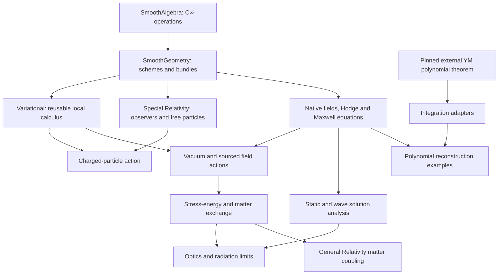

# Research Plan for Electrodynamics over C∞ Geometry

A Lean formalization programme for Chapters III–IX, §§15–80, of
Landau and Lifshitz's *The Classical Theory of Fields*, with separate
extensions for global gauge geometry and macroscopic constitutive laws.

This is the Electrodynamics volume of the classical-field trilogy migrated
from [issue #8](https://github.com/MGYamada/ProjectAinos/issues/8).
[Special Relativity](cinfty-special-relativity.md) owns §§1–14;
[General Relativity](cinfty-general-relativity.md) owns §§81–119.
The organization follows the research-manuscript format of
[C∞ mechanics](cinfty-mechanics.md), but uses the constructed shared schemes,
manifold bundles and curved exterior calculus available in this repository.
It does not inherit the mechanics manuscript's historical infrastructure gaps.

## Implementation plan and current progress

The proof-status baseline is `main` at
[`8bb80ce`](https://github.com/MGYamada/ProjectAinos/commit/8bb80ce), reviewed
on 17 November 2026. **Proved** refers to the cited Lean statement with its
actual hypotheses. **Target** marks a proposed theorem or construction.
A **conditional target** carries a named mathematical or physical premise.

| Component | Status at the baseline | Reuse and remaining obligation |
| --- | --- | --- |
| C∞ spectra, schemes, localization, open gluing and manifold comparison | Implemented shared foundation | Reuse actual structure sheaves; universal cotangent comparison and arbitrary nonreduced dynamics remain targets |
| Flat forms, pullback, exterior derivative, wedge, Lorentz Hodge and observer reconstruction | Proved shared geometry | Their physical interpretation is specified here; they do not prove Maxwell evolution |
| Local potentials, exact gauge invariance, Bianchi, covariance and two scalar invariants | Proved | [Field](../ProjectAinos/Electrodynamics/Field.lean), [Components](../ProjectAinos/Electrodynamics/Components.lean), [Invariants](../ProjectAinos/Electrodynamics/Invariants.lean), [Covariance](../ProjectAinos/Electrodynamics/Covariance.lean) |
| Actual charged-particle action, Lorentz force, mass shell and gauge endpoint term | Proved on the open timelike jet domain in flat spacetime | [ParticleAction](../ProjectAinos/Electrodynamics/ParticleAction.lean), [LorentzForce](../ProjectAinos/Electrodynamics/LorentzForce.lean), [GaugeAction](../ProjectAinos/Electrodynamics/GaugeAction.lean); curved charged-particle variation remains a bridge target |
| Homogeneous polynomial radial reconstruction | Proved, including nonzero degrees zero and one | [PolynomialRadial](../ProjectAinos/Electrodynamics/PolynomialRadial.lean) and [PolynomialBridge](../ProjectAinos/Electrodynamics/PolynomialBridge.lean); no arbitrary global potential is inferred |
| Maxwell forms on a fixed curved background, current conservation and component equivalence | Proved | [Curved](../ProjectAinos/Electrodynamics/Curved.lean), [Current](../ProjectAinos/Electrodynamics/Current.lean), [CurvedComponents](../ProjectAinos/Electrodynamics/CurvedComponents.lean) |
| Flat vacuum field action and stationarity iff the vacuum equations | Proved; [#44](https://github.com/MGYamada/ProjectAinos/issues/44) is completed | [VacuumAction](../ProjectAinos/Electrodynamics/VacuumAction.lean), with integrability and compact-support hypotheses |
| Compact-support Stokes in Euclidean coordinates | Proved | `integral_exteriorDerivative_basis_zero` in [CompactStokes](../ProjectAinos/SmoothGeometry/DifferentialForm/CompactStokes.lean); the curved integration and actual boundary terms have their own contracts |
| Sourced and curved field-action derivations; electromagnetic stress tensor and matter exchange | Targets | Preserve the explicit source-sign bridge below; fixed-background equations alone do not supply these proofs |
| Static boundary problems, wave evolution, optics, retarded fields and radiation | Targets or conditional targets | Need independently specified function spaces, domains, boundary conditions and error estimates |
| Nontrivial gauge bundles, media, singular sources and self-force | Separate extensions | Do not silently strengthen the smooth-potential API |
| Smooth parametric integrals and Hadamard's lemma | Proved in the shared algebra by the mechanics programme | `contDiff_parametric_intervalIntegral`, `SmoothOperation.apply_sub_apply_eq_sum_hadamard`; the smoothness half of the interface HOM |
| Jet C∞-rings in one independent variable, Euler operators and the Noether identity | Proved in `Mechanics` | `JetRing`, `JetRing.euler`, `JetRing.conserved_noetherCharge`; the model for the field jet ring of E3a |
| Hamiltonian particle API: trajectories, Poisson morphisms, Hamilton–Jacobi, generating functions, cyclic co-ordinates | Proved in the shared algebra and `Mechanics` | `IsTrajectory`, `CompleteIntegral.IsHamiltonJacobi`, `GeneratingFunction.IsFree`, `CyclicReduction`; prerequisites of E9a and of §§19–22, 39, 45 and 53–55 |

The [electrodynamics API guide](electrodynamics.md) records declaration-level
contracts. The [shared geometry guide](smooth-geometry.md) records the
underlying tensor and form operations. The geometric results delivered by
[#52](https://github.com/MGYamada/ProjectAinos/issues/52) are already on `main`;
they are not pending prerequisites for this document's fixed-background work.

### Ledger

The ledger gives one status to each of §§15–80, with the vocabulary of the
[mechanics ledger](cinfty-mechanics.md#ledger): *proved* (Lean, no `sorry`,
axioms audited), *proved modulo interface*, *hypothesis*, *evidence* (computer
algebra only), or *informal*. The status refers to the target of the row in the
[dictionary](#landau-lifshitz-correspondence), whose last column records the
baseline. A status is only promoted, and a row whose target is proved only in
part stays at the lower status, with the proved part named. A row is closed
when it is *proved*, or when its remark names the proved part and gives the
reason why the rest is not proved; the rows closed in the second way are
listed after the count. The wave names F1–F26 are those of
[issue #135](https://github.com/MGYamada/ProjectAinos/issues/135), which tracks
completion.

| § | Topic | Status | Lean declarations, or what is missing |
|---:|:---|:---|:---|
| 15 | Elementary particles and their charge | proved | `chargedLagrangian`, `chargedAction`, `chargedAction_eq`, `charged_momentum`, `charged_force`, `stationary_iff_lorentzForce`, `lorentzForce_zero_charge`, `ChargedParticle.hamiltonian_zero_charge`. Scope: the charge is a real parameter of the action of a point particle on flat spacetime; without a charge the action and the Hamiltonian are those of the free particle. That `e` is the measured charge of a particle is a premise |
| 16 | Four-potential of a field | proved | `Potential`, `potentialOf`, `potentialComponent`, `fieldTensor_lorentz`, `fieldTensor_poincare`, `Curved.fieldOf`, `Curved.fieldOf_closed`, `Curved.fieldOf_pullback`, `Curved.fieldOf_ofFlat`, `ChargedParticle.staticPotential`, `ChargedParticle.hamiltonian`, `ChargedParticle.canonical_q_hamiltonian`. Scope: a potential is a one-form on an open set of flat spacetime or on a whole manifold modelled on spacetime; its field is `dA`, which is natural for smooth maps; for static potentials the canonical momentum is `p = π + e a` and the Hamiltonian is `√(m² + Σ πᵢ²) + e φ` |
| 17 | Equations of motion of a charge in a field | proved | `stationary_iff_lorentzForce`, `stationary_properTime`, `lorentzForce_orthogonal`, `mass_shell`, `ChargedParticle.stationary_graph_iff_lorentzForce`, `ChargedParticle.canonical_kineticMomentum_hamiltonian`, `ChargedParticle.canonical_kineticEnergy_hamiltonian`, `ChargedParticle.lorentzForce_staticPotential_zero`, `GeneralRelativity.lineIntegral_family_hasDerivAt`, `GeneralRelativity.chargedAction_variation_hasDerivAt`, `GeneralRelativity.chargedStationary_iff`, `GeneralRelativity.lineIntegral_gauge`, `GeneralRelativity.chargedStationary_gauge_iff`, `GeneralRelativity.chargedStationary_minkowski_iff`. Scope: in flat spacetime the action `−m ∫ dτ + e ∫ A` of a timelike `C²` world line in an open region is stationary under the fixed-endpoint variations if and only if `m dU/ds = e F♯(γ̇)`. On a curved background, a Lorentz metric on an open set `U` of the model space with a `C¹` field of covectors `A` on `U`, the action is stationary under every fixed-endpoint family of curves in `U` if and only if `m ∇_t U = e F(·, γ̇)^♯` with `U = γ̇/s`, that is `m ∇_τ U = −e (ι_U F)^♯` in proper time; a gauge change `A ↦ A + dχ` adds the end-point term `e (χ(γ(b)) − χ(γ(a)))` and leaves the equation unchanged, and for the Minkowski coordinate metric and a flat potential the stationarity is that of the flat action. Not stated: a potential given only on a chart of a general Lorentz manifold, and charges without mass |
| 18 | Gauge invariance | proved | `fieldTensor_gauge_on`, `chargedAction_gauge_on`, `stationary_gauge_iff_on`, `VacuumAction.action_gauge`, `Curved.fieldOf_gaugeShift`, `Curved.source_gaugeShift`, `Curved.maxwell_gaugeShift_iff`, `ChargedParticle.momentumShift_hamiltonian`, `ChargedParticle.magneticTensor_gaugeShift`, `ChargedParticle.isTrajectory_gaugeShift`. Scope: the change `A ↦ A + dχ` by a function, on an open set of flat spacetime and on a whole manifold: the field, the equations of Maxwell and the stationary curves of a charge do not change, the action of a charge changes by the values of `χ` at the ends, and for static potentials the change is a canonical transformation. Potentials on the sets of a cover with transition functions, the connections of a line bundle (E8), are not treated |
| 19 | Constant electromagnetic field | proved | `ChargedParticle.hamiltonian`, `ChargedParticle.isIntegral_hamiltonian`, `ChargedParticle.isIntegral_p_of_cyclic`, `ChargedParticle.isTrajectory_iff_lorentzForce`, `ChargedParticle.flowDomain_hamiltonianField`, `ChargedParticle.measurePreserving_hamiltonianFlow`, `ChargedParticle.stationary_graph_iff_hamilton`, `ChargedParticle.stationary_graph_of_isTrajectory`, `ChargedParticle.isIntegral_p_uniformScalar`, `ChargedParticle.isIntegral_p_landauPotential`. Scope: potentials that do not depend on the time and are smooth on all of space, a mass `m ≠ 0`, `d` space dimensions; the comparison with the action of space-time in three dimensions and for `m > 0`. The energy `√(m² + Σ πᵢ²) + e φ` is the Hamiltonian |
| 20 | Motion in a constant uniform electric field | proved | `ConstantField.stationary_motion`, `ConstantField.deriv_eq_velocity_of_stationary`, `ConstantField.isSimple_electric`, `ConstantField.velocity_electric`, `ConstantField.motion_of_pos`, `ConstantField.motion_eq_hyperbola`, `ChargedParticle.canonical_kineticMomentum_uniformScalar`. Scope: the world line as a function of the proper time for every initial event and four-velocity, with `Ω = e E/m ≠ 0`. The curve `x(y)` in the time of an observer, a catenary, is not derived |
| 21 | Motion in a constant uniform magnetic field | proved | `ConstantField.isSimple_magnetic`, `ConstantField.velocity_magnetic`, `ConstantField.motion_of_neg`, `ConstantField.intervalQuadratic_velocity`, `ChargedParticle.magneticTensor_landauPotential`, `ChargedParticle.isIntegral_p_landauPotential`, `ChargedParticle.canonical_kineticEnergy_hamiltonian`. Scope: the world line as a function of the proper time for every initial event and four-velocity, with `Ω = e B/m ≠ 0`: a helix. The kinetic energy is constant because the magnetic field does no work |
| 22 | Motion in constant uniform electric and magnetic fields | proved | `ConstantField.velocity`, `ConstantField.motion`, `ConstantField.futureTimelike_velocity`, `ConstantField.stationary_motion`, `ConstantField.deriv_eq_velocity_of_stationary`, `ConstantField.generator_quartic`, `ConstantField.velocity_of_scalarInvariant_neg`, `ConstantField.velocity_of_scalarInvariant_pos`, `ConstantField.velocity_of_invariants_zero`, `ConstantField.velocity_of_quartic`, `ConstantField.exists_rates`, `ConstantField.motion_of_zero`, `ConstantField.velocity_nullField`, `ConstantField.velocity_add`, `ConstantField.velocity_uniformField_closed`. Scope: for every constant field the motion exists for all proper times, is unique and is stationary, and the four-velocity has a closed form in each of the four cases of the invariants; the world line has a closed form for a field `α ∧ β` of two covectors. The drift velocity in the time of an observer is not derived |
| 23 | The electromagnetic field tensor | proved | `fieldTensor_apply`, `fieldTensor_component`, `twoForm_swap`, `electric_apply`, `magnetic_apply`, `observer_reconstruction`, `lorentzForce_component`, `ChargedParticle.fieldTensor_staticPotential`, `ChargedParticle.lorentzForce_staticPotential_succ`, `Curved.Field`, `Curved.excitation_flat`. Scope: the field `F = dA` of a potential on an open set of flat spacetime, its components, its electric and magnetic parts for an observer, and the force in three dimensions for static potentials. On a Lorentzian manifold the field is a two-form, and `Curved.excitation_flat` compares it with the flat one |
| 24 | Lorentz transformation of the field | proved | `fieldTensor_lorentz`, `observer_reconstruction`, `electricVector`, `magneticVector`, `twoForm_apply_vectors`, `electric_restObserver_single`, `magnetic_restObserver_single`, `boost_axisVelocity_apply`, `electricVector_boost`, `magneticVector_boost`, `electric_observer_apply`, `magnetic_observer_apply`, `electricVector_moving`, `magneticVector_moving`. Scope: the components of `E` and `B` for the observer with the velocity `V` along the first axis: `E₁`, `γ (E₂ − V B₃)`, `γ (E₃ + V B₂)` and `B₁`, `γ (B₂ + V E₃)`, `γ (B₃ − V E₂)`. They are the components of the pullback of the field by the inverse boost, and of the electric and the magnetic covector of that observer on its axes. The formula for a velocity in another direction, which follows by a rotation, is not stated |
| 25 | Invariants of the field | proved | `scalarInvariant_observer`, `pseudoscalarInvariant_observer`, `scalarInvariant_lorentz`, `pseudoscalarInvariant_lorentz`, `scalarInvariant_vectors`, `pseudoscalarInvariant_vectors`, `ConstantField.generator_cube_eq`, `ConstantField.generator_dualGenerator`, `ConstantField.generator_quartic`, `ConstantField.generator_cube_of_pseudoscalarInvariant`, `ConstantField.pseudoscalarInvariant_of_isSimple`, `ConstantField.scalarInvariant_uniformField`, `ConstantField.pseudoscalarInvariant_uniformField`, `ConstantField.scalarInvariant_nullField`, `ConstantField.nullField_ne_zero`. Scope: the invariants `B² − E²` and `E · B`, and the four kinds of a field that they give, stated for the linear map `F♯`: `F♯³ = κ F♯` with `κ > 0`, `κ < 0` or `κ = 0` when `E · B = 0`, the last with a field that is not zero, and for `E · B ≠ 0` the sum of a part with `F♯² = a²` and a part with `F♯² = −b²`. A frame in which the electric and the magnetic field are parallel is not constructed |
| 26 | The first pair of Maxwell's equations | proved | `bianchi_on`, `bianchi_components`, `exteriorDerivative_three`, `exteriorDerivative_spatial`, `exteriorDerivative_temporal`, `homogeneous_of_closed`, `homogeneous_fieldTensor`, `Curved.Maxwell.homogeneous_covariant`. Scope: on flat spacetime, in the frame of the co-ordinates, `dF = 0` gives `div B = 0` and `∂_t B + curl E = 0` at every point where the field is differentiable, and these hold for the field of a `C²` potential. The converse and the integral forms over surfaces and curves are not stated |
| 27 | The action function of the electromagnetic field | proved | `VacuumAction.hasDerivAt_action`, `VacuumAction.stationary_iff_vacuum`, `SourcedAction.lagrangian`, `SourcedAction.lagrangian_zero`, `SourcedAction.hasDerivAt_action`, `SourcedAction.stationary_iff`, `SourcedAction.stationary_iff_excitation`, `SourcedAction.action_gaugeShift`, `SourcedAction.action_gaugeShift_eq_iff`, `SourcedAction.Examples.stationary_example`. Scope: flat spacetime, a `C²` potential and a prescribed `C²` current three-form, variations that are smooth with compact support in an open region, and an integrable density; the action is stationary if and only if `dH = J`, and it is invariant under the gauge changes with compact support if and only if `dJ = 0`. On a curved background (E13, F12), for a metric given by coefficients on an open set `U` of the model space, a smooth potential on `U` and a prescribed continuous current: `Curved.potentialStationary_iff_sourced`, `Curved.maxwell_iff_potentialStationary`, `Curved.potentialStationary_matter_iff`, and at the Minkowski metric the flat functional with its orientation and density (`potentialDensity_minkowski`, `potentialAction_minkowski`). The functional on a general oriented manifold is not stated |
| 28 | The four-dimensional current vector | proved | `Curved.currentEquiv`, `Curved.currentForm_volume`, `SourcedAction.matterCurrentForm`, `SourcedAction.coefficient_wedge_interior_volume`, `SourcedAction.lagrangian_matterCurrentForm`, `SourcedAction.currentForm_minkowski`, `SourcedAction.matterCurrentForm_eq_currentForm`, `SourcedAction.stationary_iff_matterCurrent`. Scope: a smooth matter current `k = (ρ, 𝐤)` on flat spacetime has the current form `J = −ι_k vol`; the source term of the Lagrangian is then `+A(k) = −φρ + a · 𝐤`, with the sign of the coupling `e A(γ̇)` of a charge, and `k = −j` for the vector `j` of `Curved.Maxwell`. The current of point charges, a distribution, is not constructed |
| 29 | The equation of continuity | proved | `Curved.exteriorDerivative_currentForm`, `Curved.current_closed_iff_divergence`, `Curved.divergence_zero_of_source`, `divergence4`, `coefficient_exteriorDerivative_matterCurrentForm`, `exteriorDerivative_matterCurrentForm_eq_zero_iff`, `divergence4_eq_zero_of_stationary`, `charge_balance`. Scope: `d(−ι_k vol) = −(div k) vol` for a differentiable current; where the action is stationary for a `C³` potential, `div k = 0`; for a `C¹` current with `div k = 0` on a box of the co-ordinates, the change of the charge in the spatial box is minus the flux through its faces. Regions other than boxes are not treated |
| 30 | The second pair of Maxwell equations | proved | `VacuumAction.stationary_iff_vacuum`, `Curved.sourced_iff_divergence`, `Curved.maxwell_iff_components`, `SourcedAction.stationary_iff_excitation`, `electricVector_excitation`, `magneticVector_excitation`, `inhomogeneous_of_excitation`, `maxwell_of_stationary`, `SourcedAction.Examples.maxwell_example`. Scope: on flat spacetime, in the frame of the co-ordinates, the equation `dH = −ι_k vol` of the excitation `H = −⋆F` gives `div E = ρ` and `curl B − ∂_t E = 𝐤`, and the four equations hold where the action with the current of the matter is stationary; the field `t dt ∧ dx` with the current `∂x` is an instance. The integral forms are not stated |
| 31 | Energy density and energy flux | proved | `energyDensity`, `poyntingVector`, `poynting_local`, `energyCurrent`, `box_divergence`, `energy_balance`, `stressForm_observer`. Scope: on flat spacetime, in the frame of the co-ordinates, `∂_t u + div S = −E · 𝐤` at every point where the field is differentiable and the equations of Maxwell hold; for a `C²` field, on a box of the co-ordinates the energy in the spatial box changes by minus the flux of `S` through its faces and minus the work `∫∫ E · 𝐤`; for every observer the energy density is `½ (|E_u|² + |B_u|²)`. Regions other than boxes are not treated |
| 32 | The energy-momentum tensor | proved | `FieldJetRing.divergence_stress`, `FieldJetRing.conserved_stress`, `FieldJetRing.conserved_noetherCurrent`, `FieldJetRing.symmetricStress`, `FieldJetRing.symmetricStress_add_stress`, `FieldJetRing.symmetricStress_add_stress_mem`, `FieldJetRing.divergence_belinfante`, `FieldJetRing.conserved_symmetricStress`, `CoordinateMetric.hasDerivAt_integral_maxwellDensity`, `CoordinateMetric.maxwellStress`, `Electrodynamics.maxwellStress_minkowski`, `Electrodynamics.prolongation_symmetricStress`, `Electrodynamics.hilbertStress_eq_neg_canonical`. Scope: the canonical tensor of the translations `T^μ_ν = Σₐ A_{a,ν} π^μ_a − δ^μ_ν L` is conserved in every jet ring for a Lagrangian of the first order; for the Lagrangian `−¼ F²` of a one-form with a constant symmetric matrix, the symmetric tensor `Θ^μ_ν = F^{μa} F_{νa} + δ^μ_ν L` satisfies `Θ^μ_ν + T^μ_ν + Σₐ Dₐ(F^{μa} A_ν) = −A_ν E_μ`, the added term is divergence-free identically and `Θ` is conserved; on the jet of a smooth potential in Minkowski space `Θ` is `η^{μα} T_{αν}` with the Hilbert tensor that the variation of the metric gives, so on a solution the Hilbert tensor is minus the canonical tensor minus the divergence of `F^{μa} A_ν`. Not stated: the comparison for a general Lagrangian, on a curved background, and with boundary terms; the integrated charges |
| 33 | Energy-momentum tensor of the electromagnetic field | proved | `stressForm`, `stressForm_symm`, `stressForm_trace`, `stressForm_observer`, `stressForm_zero_zero`, `stressForm_zero_succ`, `stressForm_succ_succ`, `raisedStress`, `divergence_raisedStress_zero`, `divergence_raisedStress_succ`, `maxwellStress`, `forceDensity`, `momentum_local`, `momentum_balance`. Scope: on flat spacetime, `T(v, w) = g⁻¹(ι_v F, ι_w F) − ¼ g(v, w) F²` is symmetric and trace-free, `T(u, u)` is the energy density of every observer, its components in the frame of the co-ordinates are the energy density, the vector of Poynting and the stress of Maxwell, and with the equations of Maxwell `∂_μ T^{μν} = −F^ν{}_λ k^λ`, with the balance of the momentum on a box. Its characterization by the variation of the metric is `Electrodynamics.maxwellStress_minkowski` with `CoordinateMetric.hasDerivAt_integral_maxwellDensity` (F12), for a metric given by coefficients on an open set; the native tensor on a Lorentzian manifold is not constructed |
| 34 | The virial theorem | proved | `virialMoment`, `virial_box`, `integral_Icc_eq_intervalIntegral`, `tendsto_average_spatialTrace`, `tendsto_average_energy_add_fourTrace`, `energy_add_fourTrace`, `fourTrace_raisedStress`, `ChargedDust.tendsto_average_energy_sub_restMass`, `Virial.Examples.improvementStress_conserved`, `Virial.Examples.tendsto_average_spatialTrace_improvement`. Scope: a smooth stress tensor; finite motion is support in one spatial box for all times, with a bounded virial moment (decision 6 on #135). The moment `∫ x_α T^{0α}` over a box changes by the integral of the spatial trace (the identity of §34 on a box), so the time average of the spatial trace tends to zero, and the averaged energy is minus the averaged four-trace. The stress of the field is trace-free, and for charged dust the averaged energy tends to the rest mass. The improvement stress of a bump is conserved, supported in a box and has a nonzero spatial trace, an instance of every hypothesis; the dust corollary has only the static neutral instance, since charged dust cannot be at rest. Not stated: point charges, whose stress is a distribution, and decay at infinity in place of support |
| 35 | The energy-momentum tensor for macroscopic bodies | proved | `ChargedDust`, `ChargedDust.current`, `ChargedDust.matterStress`, `ChargedDust.divergence_matterStress`, `lorentzForce_zero_eq`, `lorentzForce_succ_eq`, `total_stress_conserved`. Scope: charged dust on flat spacetime, with the stress `μ U^μ U^ν`: if the mass is conserved, the dust moves by the Lorentz force of `LorentzForce` and the field satisfies the equations of Maxwell with the current `ρₑ U`, then `∂_μ (T_EM^{μν} + T_m^{μν}) = 0`. A body with a pressure, `(p + ε) u^μ u^ν + p g^{μν}`, is not treated |
| 36 | Coulomb's law | proved | `Potential.newtonPotential`, `Potential.laplacian_newtonPotential`, `Potential.contDiff_newtonPotential`, `Potential.abs_newtonPotential_le`, `Potential.norm_fderiv_newtonPotential_le`, `Potential.tendsto_newtonPotential_cocompact`, `Potential.eq_newtonPotential_of_tendsto`, `Potential.eq_zero_of_harmonic_of_tendsto`, `Potential.integral_newtonKernel_mul_laplacian`, `Electrostatics.neg_laplacian_newtonPotential`, `Electrostatics.maxwell_electrostaticPotential`, `Electrostatics.flux_pointChargeField`. Scope: a `C²` charge density of compact support on ℝ³. Its potential `φ(x) = ∫ρ(y)/(4π|x − y|) dy` is as smooth as `ρ` and solves `−Δφ = ρ`. Outside the support, `|φ| ≤ Q/(4π(|x| − a))` and `|∇φ| ≤ Q/(4π(|x| − a)²)`. It is the only solution that tends to zero at infinity (maximum principle). The static field `E = −∇φ` solves Maxwell's equations. The point source is the pairing `∫ K Δχ = −χ(0)`, and the field of a point charge has the flux `q` through every sphere. Not stated: the excitation of a point charge as a closed form that is not exact |
| 37 | Electrostatic energy of charges | proved | `ElectrostaticEnergy.integral_mul_newtonPotential_eq_double`, `ElectrostaticEnergy.integral_mul_newtonPotential_eq_integral_sq`, `ElectrostaticEnergy.electrostaticEnergy_eq`, `ElectrostaticEnergy.integral_pointCharge_energy_outside`, `ElectrostaticEnergy.tendsto_pointCharge_energy`, `ElectrostaticEnergy.not_integrable_pointCharge_energy`. Scope: a `C²` charge density of compact support. The three energies `½∫ρφ`, `½∬ρ(x)ρ(y)/(4π|x − y|)` and `½∫|E|²` are finite and equal, with an instance. For a point charge the field energy outside the radius `ε` is `q²/(8πε)`, so its self-energy is infinite |
| 38 | The field of a uniformly moving charge | proved | `matterCurrentForm_lorentz`, `excitation_lorentz`, `excitation_pullback`, `excitation_of_inhomogeneous`, `MovingCharge.StaticSolution`, `MovingCharge.maxwell_movingScalar`, `MovingCharge.electricField_movingScalar`, `MovingCharge.magneticField_movingScalar`, `MovingCharge.electricField_movingCoulomb`, `MovingCharge.movingCoulomb_field`, `MovingCharge.maxwell_movingNewton`. Scope: the sourced field equation and the current are carried by every proper Lorentz map. A static solution, given or the Newton potential of §36, boosted along an axis solves Maxwell's equations with the moving current `γρ(1, V, 0, 0)`; then `E′` follows from the boost, and `B = V × E`. Off its world line, the field of a uniformly moving point charge is (38.8), `E = q(1 − V²)R/(4πR³(1 − V² sin²θ)^{3/2})`, with `R` measured from the present position |
| 39 | Motion in the Coulomb field | proved | `CoulombMotion.coulombHamiltonian`, `CoulombMotion.isIntegral_pφ`, `CoulombMotion.canonical_orbitX`, `CoulombMotion.canonical_orbitY`, `CoulombMotion.rosette`, `CoulombMotion.perihelion_iff`, `CoulombMotion.two_pi_lt_two_pi_div_rosetteRate`, `CoulombMotion.isTrajectory_circular`, `CoulombMotion.orbit_hyperbolic`, `CoulombMotion.orbit_linear`, `CoulombMotion.fall_to_centre`, `CoulombMotion.not_isTrajectory_of_sq_le`, `CoulombMotion.exists_r_lt_of_not_mem_flowDomain`. Scope: a relativistic test charge with `m > 0` in the potential `α/r`, in the polar chart `s = log r` away from the centre. The angular momentum is an integral, and the orbit functions `X`, `Y` turn by `κ = √(1 − α²/ℓ²)` per radian of the angle, so for `ℓ² > α²` the orbit is a rosette whose perihelia are `2π|ℓ|/√(ℓ² − α²)` apart, with a circular orbit as instance. For attraction with `ℓ² ≤ α²` the spiral forms hold on intervals of a solution, and every solution leaves the domain of the flow in finite time, with the radius below every `ε` before (fall to the centre). Not stated: the limit `r → 0` at the end of the domain and any continuation after the collision |
| 40 | The dipole moment | proved | `Potential.abs_newtonKernel_sub_dipole_le`, `Multipole.totalCharge`, `Multipole.dipoleMoment`, `Multipole.abs_newtonPotential_sub_dipole_le`, `Multipole.dipoleMoment_translate`, `Multipole.neg_gradient_dipolePotential`. Scope: a continuous charge density supported in the ball of radius `a`. The potential is `Q/(4π|x|) + ⟪d, x⟫/(4π|x|³)` up to `(∫|ρ| y²)/(4π(|x| − a)³)`, uniformly on `|x| > a`. Under a translation `d` changes by `−Qb`, and the dipole field is `(3⟪n, d⟫n − d)/(4π|x|³)` |
| 41 | Multipole moments | proved | `Potential.norm_iteratedFDeriv_newtonKernel_le`, `Potential.newtonKernel_taylor_le`, `Potential.iteratedFDeriv_newtonKernel_comp_perm`, `Potential.sum_iteratedFDeriv_newtonKernel_snoc_snoc`, `Multipole.multipoleTerm`, `Multipole.abs_newtonPotential_sub_multipole_le`, `Multipole.quadrupoleMoment`, `Multipole.quadrupoleMoment_trace`, `Multipole.multipoleTerm_two_eq`, `Multipole.abs_newtonPotential_sub_moments_le`, `Multipole.multipoleTerm_translate`. Scope: every order `n`, with a constant `Cₙ` that depends only on `n` (homogeneity and compactness), explicit through order two. The derivatives of the kernel are symmetric and trace-free. The quadrupole moment is trace-free and gives `ΣDᵢⱼxᵢxⱼ/(8π|x|⁵)`. The first multipole that does not vanish is independent of the origin. `Multipole.multipoleTerm_eq_sphericalMoments` gives the exact reduction of each Cartesian Taylor term to 2ℓ + 1 real spherical moments for continuous compactly supported densities |
| 42 | System of charges in an external field | proved | `Multipole.abs_externalEnergy_sub_le`, `Multipole.norm_externalForce_sub_le`, `Multipole.norm_externalTorque_sub_le`, `Multipole.abs_externalEnergy_dipolePotential_sub_le`, `Multipole.bumpCharge_external_instance`. Scope: a continuous charge in a ball, and an external potential `ψ` with `Δψ(0) = 0` whose next derivative is bounded by `B` on the ball. The energy is `Qψ(0) + d·∇ψ(0) + (1/6)ΣDᵢⱼ∂ᵢ∂ⱼψ(0)` with remainder `(∫|ρ|y³)B/6`, the force `QE(0) + (d·∇)E(0)` with remainder `(∫|ρ|y²)B/2`, and the torque `d × E(0)` with remainder `(∫|ρ|y²)B`. A neutral source in the field of a point dipole is the dipole–dipole case. For two continuous extended sources in strictly separated enclosing balls, `Multipole.hasSum_interactionEnergy` sums the mutual energy in spherical components. The force and torque bounds above use the external field interface. |
| 43 | Constant magnetic field | proved | `Magnetostatics.vectorPotential`, `Magnetostatics.div3_vectorPotential`, `Magnetostatics.laplacian_vectorPotential`, `Magnetostatics.div3_magneticField3`, `Magnetostatics.curl3_magneticField3`, `Magnetostatics.vectorPotential_unique`, `Magnetostatics.magneticField3_unique`, `Magnetostatics.magneticField3_eq_biotSavart`, `Magnetostatics.maxwell_staticVector`, `Magnetostatics.ringCurrent_ne_zero`. Scope: a smooth, divergence-free current of compact support. The vector potential `a = ∫ j/(4π|x − y|)` is in Coulomb gauge with `Δa = −j`, and `B = curl a` satisfies `div B = 0` and `curl B = j`. Both are unique among decaying solutions. Outside the support, B is given by Biot–Savart. The potential solves Maxwell's equations on space-time with the current `(0, j)`. A ring current is an instance. Not stated: the field of a line current, a closed form that is not exact |
| 44 | Magnetic moments | proved | `MagneticMoment.integral_current_eq_zero`, `MagneticMoment.integral_moment_symm`, `MagneticMoment.magneticMoment`, `MagneticMoment.norm_vectorPotential_sub_dipole_le`, `MagneticMoment.StationaryFlow`, `MagneticMoment.rigidRotation`, `MagneticMoment.magneticMoment_flow`, `MagneticMoment.torque_uniformField`. Scope: smooth, divergence-free currents of compact support. Their integral vanishes and their first moments are antisymmetric, so the vector potential is `m × x/(4π|x|³)` up to `(∫|j| y²)/(4π(|x| − a)³)`. The explicit matter model is a stationary flow with one ratio `e/m`, with a rigidly rotating instance. Its moment is `(e/2m)` times its angular momentum, and the torque in a uniform field is `m × B` |
| 45 | Larmor's theorem | proved | `Larmor.symmetricGauge`, `Larmor.magneticTensor_symmetricGauge`, `Larmor.hamiltonian_eq_rotating`, `Larmor.systemHamiltonian_eq_rotating`, `Larmor.larmorField_eq`, `Larmor.norm_sub_le_larmor`, `Larmor.norm_sub_le_larmor_of_hamiltonianField`, `Larmor.norm_exampleOrbit_sub_le`. Scope: nonrelativistic charges with a common ratio `eₐ/mₐ = γ` in a uniform `B` in the symmetric gauge (decision 7 on #135). The Hamiltonian is exactly the rotating-frame Hamiltonian at `Ω_L = γB/2` plus `Σₐ (eₐ²/8mₐ)|B × qₐ|²`, for one particle and for `N`. For given solutions of the two systems that stay in a set where the rotating field is `K`-Lipschitz and `Σᵢ qᵢ² ≤ R²`, the difference is at most `c|B|²R t e^{Kt}` in the sup norm, so a Coulomb potential is admitted away from collisions. An explicit oscillator example satisfies every hypothesis. Not stated: a bound uniform in time |
| 46 | The wave equation | proved | `box`, `lorenzDivergence`, `divergence3_electricField_fieldTensor`, `curl_magneticField_sub_fieldTensor`, `maxwell_iff_box_of_lorenz`, `excitation_iff_box_of_lorenz`, `lorenzDivergence_gaugeShift`, `lorenz_gaugeShift`, `box_lorenzDivergence`, `eq_zero_of_box_eq_zero`, `lorenzDivergence_eq_zero_of_initial`, `constraint_propagation`. Scope: potentials of class `C²` (`C³` where the gauge condition is propagated) on an open set. In Lorenz gauge Maxwell's equations are equivalent to `□A_ν = −k_ν`, in vector form and in form. A gauge function with `□χ = −L` gives the Lorenz gauge and the same field. The Lorenz condition propagates, since `□L = 0` when the current is conserved. A solution of the wave equation with vanishing initial data and spatial support in a box vanishes, by the energy identity. The divergence constraints are preserved. Not stated: the existence of the gauge function, and finite speed of propagation |
| 47 | Plane waves | proved | `planeWave`, `fieldTensor_planeWave`, `lorenzDivergence_planeWave`, `box_planeWave`, `vacuum_planeWave`, `scalarInvariant_planeWave`, `pseudoscalarInvariant_planeWave`, `fieldTensor_planeWave_ne_zero`, `transverse_planeWave`, `transverse_of_vacuum`. Scope: `C²` profiles `f(ℓx)a`. For null `ℓ` and `⟨ℓ, a⟩ = 0` the plane wave is a vacuum solution with both invariants zero, nonzero where `f′ ≠ 0`. For `ℓ = κ(dt − n·dx)`, `E·n = 0`, `B = n × E`, `|E| = |B|`, the energy density is `|E|²`, the Poynting vector `|E|²n` and the stress `|E|²ℓℓ/κ²`. A vacuum field that depends only on `t − n·x` has constant longitudinal parts. Only the local flux is stated; an infinite plane wave has infinite energy |
| 48 | Monochromatic plane waves | proved | `monochromatic`, `vacuum_monochromatic`, `monochromatic_eq_gaugeShift`, `fieldTensor_monochromatic_eq_iff`, `finrank_polarization_quotient`, `electricVector_monochromatic`, `exists_phase_orthogonal`, `wavevector_boost`, `frequency_boost`. Scope: complex amplitudes `a + ib` represented by real pairs `(a, b)`. Two pairs give the same field exactly when they differ by multiples of `ℓ`, realized by a gauge function. For a nonzero null `ℓ`, the transverse amplitudes modulo `ℓ` form a space of dimension 2, the two polarizations. The electric field traces an ellipse with orthogonal axes after a change of phase, with the circular case. Under an axis boost the frequency is `κ′ = γκ(1 − V n₁)`, with the aberration of the direction |
| 49 | Spectral resolution | proved | `Spectral.eq_integral_fourierComponent`, `Spectral.integral_sq_eq_integral_sq_fourier`, `Spectral.integral_sq_eq_integral_Ioi_fourierComponent`, `Fourier.waveSolution`, `Fourier.contDiff_waveSolution`, `Fourier.wave_waveSolution`, `Fourier.waveSolution_zero`, `Fourier.deriv_waveSolution_zero`, `Fourier.fourierEnergy_waveSolution`, `Spectral.box_re_waveSolution`. Scope: Schwartz data, in Mathlib's normalization. A Schwartz signal is the integral of its Fourier components (49.1), and `∫f² = π⁻¹∫_{ω>0}|f_ω|²` (49.8). The Fourier solution of the wave equation, written as a Fourier integral on the light cone, is smooth in `(t, x)`, takes the given data and conserves the energy at each frequency. Its real part solves the wave equation on space-time. Not stated: the solution as a Schwartz function in space |
| 50 | Partially polarized light | proved | `Coherence.coherenceAverage`, `Coherence.posSemidef_coherenceAverage`, `Coherence.HasCoherenceMatrix`, `Coherence.HasCoherenceMatrix.posSemidef`, `Coherence.HasCoherenceMatrix.mulVec`, `Coherence.stokes`, `Coherence.stokes_sq_le`, `Coherence.degreeOfPolarization_le_one`, `Coherence.exists_decomposition`, `Coherence.posSemidef_iff_trace_det`, `Coherence.hasCoherenceMatrix_const`, `Coherence.hasCoherenceMatrix_incoherent`, `Coherence.hasCoherenceMatrix_unpolarized`. Scope: a classical ensemble, a continuous complex amplitude averaged over `[0, T]`, and the long-time limit as the named premise `HasCoherenceMatrix`, with instances. The averages and their limit are positive semidefinite and transform as `A J A†` under a linear element. The Stokes parameters satisfy `s₁² + s₂² + s₃² ≤ s₀²`, so `0 ≤ P ≤ 1`. The matrix decomposes into a polarized and an unpolarized part, and a 2×2 matrix is positive exactly when it is Hermitian with nonnegative trace and determinant. Constant, incoherent and unpolarized amplitudes give `P = 1`, intermediate `P`, and `P = 0` |
| 51 | The Fourier resolution of the electrostatic field | proved | `Potential.integral_newtonKernel_mul_fourier`, `CoulombFourier.fourier_newtonPotential_apply`, `CoulombFourier.fourier_electricField_apply`, `CoulombFourier.fourier_newtonPotential_add_const`, `CoulombFourier.tendsto_newtonPotential_add_const_iff_fourier`, `CoulombFourier.fourier_eq_of_tendsto`, `CoulombFourier.fourier_boundedTempered_newtonPotential_apply`. Scope: a smooth charge of compact support. By Gaussian subordination, the Newton kernel pairs with the transform of every Schwartz function as the symbol `1/(4π²|ξ|²)`. So the potential has the transform `𝓕ρ/(4π²|ξ|²)` and the field `−2πiξ𝓕φ`, in pairing form and in `𝓢′`. Adding a constant adds `c δ₀`, so the decaying solution is the one with no part at `ξ = 0`. Not stated: the classification of all tempered solutions, which differ by harmonic polynomials and need the structure of distributions supported at a point |
| 52 | Characteristic vibrations of the field | proved | `CavityModes.conductingMode_maxwell`, `CavityModes.conductingMode_boundary_cross`, `CavityModes.conductingMode_unitCube`, `CavityModes.boxCoeff_partial`, `CavityModes.hasDerivAt_boxCoeff_of_box`, `CavityModes.transverse_boxCoeff`, `CavityModes.hasDerivAt_boxCoeff_of_maxwell`, `CavityModes.hasSum_sq_boxCoeff`, `CavityModes.fieldEnergy_eq_tsum`. Scope: the periodic box of L&L (decision 9 on #135) with Coulomb-gauge fields. Each Fourier coefficient oscillates with `ω_k = |K|`, the coefficients are transverse, and the field energy is the sum over the modes of `V(|ȧ_k|² + ω_k²|a_k|²)/2`. The explicit modes of a perfectly conducting rectangular cavity solve Maxwell's equations with `n × E = 0` and `n·B = 0` on the walls, with an instance in the unit cube. In a conducting cylinder of any positive radius R, the axisymmetric axial modes solve Maxwell’s equations even on the axis. The boundary conditions hold on both end plates and on the wall when J₀(kR) = 0. Such frequencies are unbounded, with on-axis electric amplitude k (`cylinderMode_maxwell`, `cylinderMode_side`, `cylinderMode_endPlates`, `exists_cylinderMode`). Completeness of the conducting cavity modes and the spectrum of general domains remain open |
| 53 | Geometrical optics | proved | `Wave.waveOperator_mul_cos`, `Wave.waveOperator_mul_sin`, `Wave.waveOperator_highFrequencyWave`, `Optics.Eikonal.highFrequencyPotential`, `box_highFrequencyPotential`, `lorenzDivergence_highFrequencyPotential`, `leading_eq_zero_iff`, `lightlike_of_isRay`, `maxwell_highFrequencyPotential_iff_of_eikonal`, `box_eq_zerothOrder_iff`, `maxwell_planeWavePotential`, `Optics.RayOptics.isTrajectory_rayHamiltonian_iff`, `isRay_of_isHamiltonJacobi`, `isHamiltonJacobi_linearIndex`, `fermat`. Scope: flat vacuum with the real phase ansatz `a cos(ψ/ε) + b sin(ψ/ε)` on an open set; the expansion of `□` in powers of `1/ε` is an exact identity. The leading coefficient vanishes iff `ψ` solves the null eikonal equation, the Lorenz condition at leading order is the transversality of the amplitudes, and with the eikonal equation the rays (the raised gradient) are straight null lines; the vacuum equations hold at the two leading orders iff the eikonal and transport equations hold. In a medium the rays of the Hamiltonian `(|p|² − n²)/2` are trajectories by a complete integral (constant and linear-gradient index, polynomial complete integrals), and Fermat's principle: for `n > 0` and the parametrization `|γ′| = n`, stationarity of the optical length is the ray equation `γ″ = ∇(n²/2)`. The approximation of an exact solution is §58 (ED40) |
| 54 | Intensity | proved | `Optics.Eikonal.subleading_eq_zero_iff_transport`, `hasDerivAt_comp_ray_of_transport`, `currentDivergence_intensity`, `divergence_intensityCurrent_eq_zero`, `divergence_totalIntensityCurrent_eq_zero`, `intensity_mul_det_eq`, `intensity_mul_det_radial`, `divergence_intensityCurrent_spherical`. Scope: the ansatz of §53. The `ε⁻¹` coefficient vanishes iff the amplitudes are transported, `2⟨da, dψ⟩ + a□ψ = 0`, along the rays; transport alone makes the intensity current `½(a² + b²)∂^μψ` divergence-free; and for a given local flow of a smooth field whose orbits stay in the region, the intensity times the Jacobian of the ray tube is constant (the change of the transverse area). The spherical wave and a radial flow are instances (ED40) |
| 55 | The angular eikonal | proved | `Optics.AngularEikonal.exists_localInverse_momentumMap`, `exists_angularEikonal`, `fderiv_angularEikonal`, `rayMap_symplectic`, `exists_rayMap`, `exists_rayMap_symplectic`, `Free.rayMap_isPoissonHom`, `angularEikonal_paraxialEikonal`, `angularEikonal_thinLens`, `freeRayMap_symplectic`, `not_isInvertible_fderiv_momentumMap_freePropagation`. Scope: transverse planes with transverse momenta between homogeneous media, `C²` point eikonals on open sets. The angular eikonal exists where the derivative of the momentum map is invertible, with `∂f/∂p = r` and `∂f/∂p′ = −r′`; where the mixed Hessian is invertible the ray map exists and is canonical; for a globally smooth free generating function it is a Poisson morphism. The paraxial thin lens with a gap is an instance of all three; free propagation has an invertible mixed Hessian but no angular eikonal (ED37) |
| 56 | Narrow bundles of rays | proved | `Riccati.matrix_eq_of_hasDerivAt`, `Riccati.isUnit_one_add_smul`, `Riccati.hasDerivAt_log_det`, `Riccati.eq_div_sqrt_det`, `Optics.NarrowBundle.gradient_ray`, `hessian_hasDerivAt`, `hessian_ray`, `principalRadius_add`, `focal_iff`, `amplitude_ray`, `amplitude_tendsto_focal`, `transverseMap_hasDerivAt`, `norm_beam_sub_linear_le`, `amplitude_tendsto_sphericalFront`, `focal_cylindricalFront_iff`. Scope: the curvature transport for a `C³` static eikonal in a homogeneous medium, on a ray segment in its domain; the linearized ray map for a smooth index on all of space, on compact segments of the flow domain. The Hessian obeys `H′ = −H²`, so `H(l) = H₀(1 + lH₀)⁻¹`, the principal radii become `R + l`, focal points are the zeros of `det(1 + lH₀)`, and the transported amplitude is `a₀ det(1 + lH₀)^{−1/2}`, which diverges at a focal point; a narrow beam deviates from the linearized map by `O(δ²)`. Spherical and cylindrical fronts are instances (ED38) |
| 57 | Image formation with broad bundles of rays | proved | `Optics.Imaging.hasDerivAt_opticalLength`, `opticalLength_eq`, `eikonal_variation_eq`, `sine_condition`, `IsAbsoluteInstrument.opticalLength_curve_eq`, `IsAbsoluteInstrument.norm_fderiv_eq`, `IsAbsoluteInstrument.isSimilarity`, `Similarity.exists_linearIsometryEquiv_of_norm_fderiv`, `opticalLength_segmentFamily`, `sine_condition_shiftedSegment`. Scope: smooth ray families given as data in a smooth medium on an open set, with stigmatism as a hypothesis; absolute instruments with a tangent ray in every direction. The first variation of the optical length with moving ends is the boundary term `n⟨t̂, δr⟩`, so the rays between conjugate points have equal optical lengths and a stigmatic bundle satisfies the sine condition `n y sin θ = n′ y′ sin θ′` (in inner-product form); an absolute instrument preserves the optical length of every curve, so it is a similarity with ratio `n/n′` (Maxwell, Carathéodory). An instrument limited to a cone of directions is not covered (ED39) |
| 58 | The limits of geometrical optics | proved | `Wave.energy`, `Wave.hasDerivAt_energy`, `Wave.sqrt_energy_le`, `Optics.Limits.IsGeometricalOptics`, `IsGeometricalOptics.waveOperator_eq`, `sqrt_energy_sub_le`, `exists_sqrt_energy_sub_le`, `sq_mul_energy_add_shift`, `energy_sub_add_energy_sub_le`, `sqrt_energy_potentialComponent_sub_le`, `sqrt_energy_sub_le_spherical`, `NarrowBundle.amplitude_tendsto_focal`. Scope: flat vacuum, given exact solutions with bounded spatial support on `[0, T]` and the Cauchy data of the approximation, amplitudes solving the eikonal and transport equations on their supports. The energy inequality `√E(t) ≤ √E(0) + ∫ ‖□w‖` gives an error energy bounded independently of `ε`; for the pair of waves with phases `ψ` and `ψ + επ/2` (the real and imaginary parts of `(a − ib)e^{iψ/ε}`) the energy is `ε⁻²` times the leading intensity, so the relative error is `O(ε)`; componentwise for a Lorenz-gauge vacuum potential. The estimate is lost at caustics, where the transported amplitude diverges (§56). An exact spherical shell is an instance. A lower bound for a single real wave, which needs non-stationary phase, is not stated (ED41) |
| 59 | Diffraction | informal | Closed with a stated remainder. Proved (F20): `Diffraction.apertureField`, `rayleighKernel_eq_fderiv_sphericalWave`, `contDiffOn_apertureField`, `helmholtz_apertureField`, `tendsto_apertureField_boundary`, `IsRadiating`, `apertureField_isRadiating`, `norm_mul_apertureField_le`, `norm_radiation_apertureField_le`, `integral_ball_rayleighKernel`, with the aperture bump as instance: for continuous aperture data of compact support in the plane, the Rayleigh–Sommerfeld field `∫ u₀(y)(−2∂_z G_k)(x − y, z) dy` is smooth on `z > 0`, solves the Helmholtz equation, takes the boundary values `u₀` (the kernel is the Poisson kernel times `e^{ikR}(1 − ikR)`) and satisfies the Sommerfeld radiation condition with explicit rates. Not proved: the relation of the scalar model to the Maxwell screen problem — Kirchhoff's boundary values are not the trace of a solution, and the vector screen problem is a mixed boundary problem with edge singularities (Meixner's conditions) that needs weak solutions in `H(curl)` with traces, which neither Mathlib nor the library has; and the uniqueness of the radiating half-space problem, which needs Green's representation on balls, the reflection principle for Helmholtz and Rellich's lemma (ED42) |
| 60 | Fresnel diffraction | proved | `Diffraction.fresnelField`, `fresnelKernel`, `norm_apertureField_sub_fresnelField_le`, `norm_rayleighKernel_sub_fresnelKernel_le`, `phase_sub_sqrt_le`, `norm_apertureField_sub_fresnelField_apertureBump_le`. Scope: the aperture model of §59, every `z > 0`. The Fresnel field `(k/2πiz) e^{ikz} ∫ u₀(y) e^{ik|x−y|²/2z} dy` approximates the aperture field with the explicit remainder `(k/2πz)(kρ⁴/8z³ + ρ²/z² + 1/(kz)) ‖u₀‖₁`, where `ρ` bounds `|x − y|` on the support; the `1/(kz)` term is the near-field part of the kernel. For the half-plane aperture `tendsto_fresnelField_edge` takes the large-aperture limit of these fields. With signed edge distance in Fresnel length units, `normSq_edgeAmplitude` gives the intensity [(½ + C)² + (½ + S)²]/2, including ¼ at the edge |
| 61 | Fraunhofer diffraction | proved | `Diffraction.fraunhoferAmplitude`, `tendsto_fraunhofer`, `norm_fraunhofer_sub_le`, `babinet`, `babinet_fraunhoferAmplitude`, `tendsto_babinet_planeWave`, `babinet_disc`. Scope: the aperture model of §59, a unit direction with `n_z > 0`, `D → ∞`. `D e^{−ikD} u(Dn)` tends to `(k n_z/2πi) ∫ u₀(y) e^{−ik n·y} dy`, the Fourier transform of the aperture, at the rate `O(ka²/D + a/D + 1/(kD))` with explicit constants; the `1/(kD)` term, from the near field of the kernel, corrects the outline's rate. Babinet's principle holds for integrable data, and for the plane wave at normal incidence as an improper limit over discs (ED42) |
| 62 | The retarded potentials | proved | `Wave.retardedIntegral`, `Wave.integral_wave_div_norm`, `Wave.wave_retardedIntegral`, `Wave.contDiff_retardedIntegral`, `Wave.retardedIntegral_eq_zero_of_support`, `Wave.retardedIntegral_eq_zero_of_far`, `Wave.SubluminalSupport`, `retardedPotential`, `lorenz_retardedPotential`, `box_retardedPotential`, `maxwell_retardedPotential`, `excitation_retardedPotential`, `retardedPotential_eq_zero_of_le`, `eq_retardedScalar`, `maxwell_retardedPotential_circulatingCurrent`. Scope: flat space-time, and `C²` sources whose support moves slower than light. No Green-operator hypothesis is used: the retarded integral `∫ f(t − |y|, x − y)/(4π|y|) dy` is explicit. The identity `∫ (□f)(t − |y|, x − y)/(4π|y|) dy = f(t, x)` is proved by a smooth cut-off about `y = 0`, so the integral solves the wave equation; it is as smooth as the source and vanishes where the past cone misses the support. For a conserved current the retarded potentials satisfy the Lorenz condition and Maxwell's equations, with causal support, and they are the unique solutions that vanish in the past with bounded spatial support. A circulating current is an instance. The curved causal Green operator of E25 is not used by any row |
| 63 | The Liénard–Wiechert potentials | proved | `SubluminalWorldline`, `SubluminalWorldline.existsUnique_retardedTime`, `retardedTime_lt_iff`, `contDiffOn_retardedTime`, `hasFDerivAt_retardedTime`, `lienardWiechert`, `lorenzDivergence_lienardWiechert`, `box_lienardWiechert_zero`, `box_lienardWiechert_succ`, `maxwell_lienardWiechert`, `electricVector_lienardWiechert`, `magneticVector_lienardWiechert`, `lienardWiechert_axisWorldline`, `SubluminalWorldline.integral_lightCone`, `integral_scalarPotential_mul_box`, `integral_vectorPotential_mul_box`, `integral_potentialComponent_mul_box`. Scope: smooth world lines with speed bounded by `v₀ < 1` for all times (uniform, rest and circular instances), in the library's Heaviside–Lorentz units. The retarded time exists, is unique and is smooth off the world line; the potentials (63.4)–(63.5) satisfy the Lorenz condition and the vacuum equations there, with the fields (63.8)–(63.9) split into the velocity and acceleration fields, and the uniform motion is the moving Coulomb field of §38. The point charge is the source of the field in the sense of test functions: `∫ φ box χ = −e ∫ χ(t, r(t)) dt` and `∫ aᵢ box χ = −e ∫ ṙᵢ χ(t, r(t)) dt` for `C²` functions `χ` of compact support, by the light-cone change of variables, whose Jacobian `1 − ŷ·ṙ` cancels the denominator (ED30, ED31) |
| 64 | Spectral resolution of the retarded potentials | proved | `timeFourier`, `fourier_retardedIntegral`, `helmholtz_timeFourier`, `helmholtz_fourier_retardedIntegral`, `fourier_retardedPotential`, `helmholtz_fourier_retardedPotential`, `fourier_retardedPotential_circulatingCurrent`. Scope: sources with compact support in space-time, in Mathlib's normalization `∫ e^{−2πiνt} f dt`. The time transform of the retarded potential is `∫ e^{−2πiν|y|} k̂(ν, x − y)/(4π|y|) dy` (L&L's `e^{ikR}/R`), and it solves the Helmholtz equation `(Δ + (2πν)²)Â_μ = −k̂_μ`. The circulating current is an instance. The time transform of the far-zone amplitude of a point charge is stated with §69 (`CollisionSpectrum.fourier_radiationAmplitude`) |
| 65 | The Lagrangian to terms of second order | proved | `Wave.retardedIntegral_slow_expansion`, `SlowSource.scalar_expansion`, `SlowSource.vector_expansion`, `SlowSource.darwinVector_eq`, `eulerLagrange_rigidLagrangian`, `SlowSource.force_eq_darwin`, `darwinInteraction_pointLimit`, `darwinLagrangian`, `darwinLagrangian_pointLimit`, `slowWorldline`, `lienardWiechert_sub_darwin`, `eulerLagrange_darwinLagrangian`, `force_eq_darwinLagrangian`, `force_eq_darwinLagrangian_example`. Scope: prescribed slow motions (decision 9), with the slowness `κ` and Heaviside–Lorentz units; self-fields are excluded, as in Landau–Lifshitz. For a smooth conserved source the retarded integral is expanded in `κ` with an explicit remainder, the Darwin-gauge potentials are (65.6) with explicit remainders, and the force of the retarded field on a rigid charge is the Euler–Lagrange expression of the Darwin interaction to order `κ²`. For point charges on prescribed slow paths with bounded derivatives, the Liénard–Wiechert field is the field of the point Darwin potentials with errors `O(κ³)` in `E` and `O(κ²)` in `B` at separated points; the Euler–Lagrange expression of (65.7) for one charge, the others prescribed, is exactly its kinetic term plus the Lorentz force of the point Darwin potentials of the others; so the force from the Liénard–Wiechert fields of the others equals the interaction part of the Euler–Lagrange expression of (65.7) up to `O(κ³)`, uniformly for separations in `[δ, ρ]` (ED36) |
| 66 | The field of a system of charges at large distances | proved | `Wave.LocalizedSupport`, `Wave.tendstoUniformlyOn_mul_retardedIntegral`, `Wave.exists_bound_mul_retardedIntegral_sub`, `Wave.farAmplitude_spaceDeriv`, `Radiation.radiationAmplitude`, `Radiation.radiatedPower`, `Radiation.tendstoUniformlyOn_mul_electricField`, `tendstoUniformlyOn_mul_magneticField`, `radiationAmplitude_currentRate_zero`, `tendsto_sphereFlux_poynting`, `exists_bound_electricField_sub_cross`, `tendsto_sphereFlux_poynting_circulatingCurrent`. Scope: flat space-time, `C²` conserved currents supported in a fixed ball for all times; limits at fixed retarded time, uniform on the sphere and for the retarded time in compact sets. `R` times the retarded potential tends to the amplitude `(4π)⁻¹ ∫ k(u + ⟨n, y⟩, y) dy` with a rate `C/R`; `R B → ∂ᵤÃ × n` and, by charge conservation, `R E → n⟨n, ∂ᵤÃ⟩ − ∂ᵤÃ`, with `E − B × n = O(1/R²)`; the Poynting flux through the sphere of radius `R` at the time `u + R` tends to `∫ |n × ∂ᵤÃ|² dσ` (ED32) |
| 67 | Dipole radiation | proved | `Radiation.LocalizedSource`, `slowCurrent`, `divergence4_slowCurrent`, `dipoleMoment`, `hasDerivAt_dipoleMoment`, `deriv_deriv_dipoleMoment`, `dipolePower_sub_le`, `dipoleAngular`, `dipolePower_oscillatingDipole`. Scope: the slow family `(ρ(κt, x), κ𝐣(κt, x))`, `0 < κ ≤ 1`, of a smooth conserved current supported in a fixed ball with bounded time derivatives of the current (the size small compared with the wavelength). The radiated power is `κ⁴|d̈(κu)|²/(6π) + O(κ⁶)` with an explicit constant (L&L's `2d̈²/3c³` in Heaviside–Lorentz units), and the angular density is `(|d̈|² − ⟨n, d̈⟩²)/(16π²)` to `O(κ⁵)`; the oscillating dipole is an instance with a nonzero leading term (ED34) |
| 68 | Dipole radiation during collisions | proved | `Radiation.Collision.dipolePower`, `acceleration`, `hasDerivAt_velocity_coulomb`, `dipole_eq_reducedCharge_smul`, `integrable_dipoleAcceleration_coulomb`, `integral_inv_orbitRadius_sq`, `totalEnergy`, `integral_dipolePower_eq`, `integral_norm_sq_fourier`, `spectralDensity`, `spectral_eq`, `spectral_eq_coulomb`, `effectiveRadiation`, `IsEffectiveFinite`, `CoulombRadiation.effectiveRadiation_repulsive`, `not_isEffectiveFinite_attractive`. Scope (decision 15 on #135): the emission is the dipole power of §67 along the nonrelativistic Coulomb scattering orbit, a model statement; the dipole of two charges is the reduced charge times the separation. The dipole acceleration is integrable and square integrable (`φ̇ = ℓ/r²`), the total radiated energy is a radial quadrature over the two branches of the orbit, and by Plancherel, proved here for `L¹ ∩ L²` against Mathlib's `L²` Fourier transform, it is the integral of the spectral density. The effective radiation `∫ ΔE 2πρ dρ` is finite for repulsion, `(2/9) e² v∞³ a`, and diverges for attraction, where the dipole approximation fails at small impact parameters (ED45) |
| 69 | Radiation of low frequency in collisions | proved | `Radiation.CollisionSpectrum.complexify`, `dipoleSpectrum`, `observerTime`, `retardedOfObserver`, `amplitude`, `velocityAmplitude`, `observedAmplitude`, `angularSpectrum`, `hasDerivAt_velocityAmplitude_retardedOfObserver`, `radiationAmplitude_eq_deriv`, `fourier_radiationAmplitude`, `tendsto_fourier_acceleration`, `tendsto_dipoleSpectrum`, `tendsto_two_mul_dipoleSpectrum`, `tendsto_relativisticSpectrum`, `tendsto_two_mul_relativisticSpectrum`, `integral_observedAmplitude`, `integral_two_mul_norm_sq_velocityAmplitude`, `tendsto_angularSpectrum_arctanWorldline`. Scope (decision 15 on #135): the spectral density is that of the far-zone radiation amplitude of a given world line slower than light with integrable acceleration and asymptotic velocities; its identification with the flux at infinity over all times for an unbounded world line is outside. The amplitude is the derivative in the observer time `t = τ − n·r(τ)` of `(e/4π) n × (n × v)/(1 − n·v)`, so its time transform tends as `ν → 0` to the jump of that quantity (69.2); the nonrelativistic dipole spectrum tends to `(2/3)(e²/4π)|Δv|²` (69.1), and the low-frequency limit is the continuity of the transform at `ν = 0`. For a sudden start the sphere integral is `(e²/2π)(ln((1 + v)/(1 − v))/v − 2)`; for two nonzero asymptotic velocities it is not stated. A world line with an arctan velocity profile is the instance (ED46) |
| 70 | Radiation in the case of Coulomb interaction | informal | Closed with a stated remainder. Proved (F22b): `CoulombRadiation.keplerAngle`, `keplerRadius`, `keplerPeriod_eq`, `keplerPeriod_eq_semiMajor`, `keplerAcceleration_eq_smul`, `keplerPosition_cross_velocity`, `integral_inv_one_add_mul_cos_sq`, `average_dipolePower_kepler`, `average_dipolePower_kepler_semiMajor`, `totalEnergy_hyperbolic`, `integral_inv_pow_four_div_sqrt`, `harmonicCoeff`, `harmonicCoeff_eq_fourierCoeffOn`, `harmonic_decomposition`, `tsum_harmonic`, `timeOfAngle`, `spectrum_hyperbolic`: on an explicit Kepler ellipse (built as the flow of the angle, with Newton's law, the areal law, Kepler's third law and periodicity proved) the period average of the dipole power in closed form; the energy radiated in a hyperbolic collision in closed form, `(2/3)(1/4π) e² v∞³ a² ((3a² + ρ²)φ₀ − 3aρ)/ρ⁵`, for both signs of the interaction; the harmonic decomposition of the power on the ellipse with Parseval, its sum evaluated to the closed form; and the spectrum of a hyperbolic collision as an integral over the polar angle. Not proved: the closed forms of the spectral resolution (70.x), the identification of the harmonic coefficients with `J_n(nε)`, `J′_n(nε)` and of the hyperbolic spectrum with Hankel functions of imaginary order — Mathlib's `Complex.besselJ` is defined only by its series, with no integral representation, recurrence, derivative relation or Kapteyn series (its own TODO lists Bessel's integrals), and there are no `Y`, `K`, `I` or Hankel functions; the identification would also need the eccentric-anomaly substitution of the orbit (ED45) |
| 71 | Quadrupole and magnetic dipole radiation | proved | `Radiation.quadrupoleMoment`, `magneticMoment`, `deriv_deriv_deriv_quadrupoleMoment`, `deriv_deriv_magneticMoment`, `power_sub_le`, `power_general`, `power_oscillatingQuadrupole`. Scope: the slow family of §67. Where `d̈` vanishes at the retarded time, the power is `κ⁶(1/4π)[(1/180) Σ D'''ᵢⱼ² + (2/3)|m̈|²] + O(κ⁷)` with an explicit constant, and the quadrupole–magnetic cross term vanishes; without that hypothesis the `κ⁶` coefficient carries the explicit cross term of the dipole amplitude with its second-order correction. The oscillating quadrupole, with `d = 0` and power `κ⁶ sin²(κu)(∫χ)²/(30π) + O(κ⁷)`, is an instance (ED34) |
| 72 | The field of the radiation at near distances | proved | `Radiation.NearZone.dipolePotential`, `box_sphericalWave`, `lorenz_dipolePotential`, `maxwell_dipolePotential`, `electricField_dipolePotential`, `magneticField_dipolePotential`, `nearZoneEnergy`, `nearZoneEnergy_eq`, `sphereFlux_eq`, `integral_sphereFlux_eq`, `tendsto_sphereFlux`, `oscillatingMoment_instance`, `pulseMoment_instance`. Scope: the point dipole with a smooth moment `d(t)`, exact off the origin. The fields have all three orders in `1/r`; the flux through the sphere of radius `R` is exactly `|d̈(t − R)|²/(6π) + dQ_R/dt` with the near-zone energy `Q_R = (|d + Rḋ|² + R²|ḋ|²)/(12πR³) ≥ 0` at the retarded time, and for a moment of compact support in time the radiated energy `∫ |d̈|²/(6π)` does not depend on `R` (ED33) |
| 73 | Radiation from a rapidly moving charge | proved | `Radiation.Relativistic.sq_mul_inner_poyntingVector_lightCone`, `tendsto_sq_mul_inner_poyntingVector_lightCone`, `tendsto_sq_mul_inner_poyntingVector_mul_lightCone`, `fderiv_retardedTime_time_lightCone`, `angularPower`, `integral_lienard`, `integral_angularPower`, `integral_inner_mul_angularPower`, `norm_sq_fourAcceleration`, `tendsto_integral_power_lightCone`. Scope: prescribed smooth world lines slower than light (§63), with the far zone taken along the light cone of the retarded position, `(τ + ρ, r(τ) + ρn)` with `ρ → ∞`. The radial Poynting flux is an explicit polynomial in `1/ρ`; its leading term gives the angular distribution `e²|n × ((n − v) × v̇)|²/(16π²(1 − n·v)⁶)` per unit time of the observer and (73.9) with `(1 − n·v)⁵` per unit retarded time, the factor being `∂τ/∂t`. Liénard's formula (73.4) gives the total power `(2/3)(e²/4π)γ⁶(|v̇|² − |v × v̇|²)`, minus `(2/3)(e²/4π)` times the square of the four-acceleration, and the radiated momentum along `v` is `|v|²` times the power (ED35) |
| 74 | Synchrotron radiation | informal | Closed with a stated remainder. Proved: `Radiation.Synchrotron.integral_angularPower_circular`, `synchrotronPower_eq_gamma`, `angularPower_circular`, `tendsto_integral_power_lightCone_circular`, `integral_integral_angularPower_circular`, `lossPerTurn_eq`, `lossPerTurn_div_energy`, `mul_lossPerTurn_le`, `hasDerivAt_momentum_circular`, `synchrotronPower_eq_magnetic`, for the prescribed circular orbit: the total power `(2/3)(e²/4π)γ⁴v²Ω²`, its angular distribution, the loss per turn, its ratio `(4π/3)(e²/4π)γ³v²|Ω|/m` to the energy with the condition under which the reaction is negligible over `N` turns, and the orbit as a solution of `d(mγv)/dt = e v × B` when `mγΩ = −eB`. Not proved: the harmonic intensities (74.x) with `J_{2n}` and `J′_{2n}`, because Mathlib's Bessel functions have no integral representation and no Kapteyn series, and the ultrarelativistic spectrum with the Macdonald functions `K_{1/3}`, `K_{2/3}`, which needs uniform stationary-phase asymptotics; the harmonic decomposition with Fourier coefficients and Parseval is within reach and not stated (ED35) |
| 75 | Radiation damping | informal | Closed with a stated remainder. Proved (F23b): `RadiationReaction.DampingBounds`, `dampingField_expansion`, `lorentzDensity_expansion`, `selfMass`, `selfEnergy`, `selfForce_darwin`, `selfForce_expansion`, `trace_selfMass`, `selfForce_expansion_oscillating`, `dampingForce`, `work_dampingForce_eq`, `runaway`, `abrahamLorentz_free`, `abrahamLorentz_free_eq_zero`, `IsReducedOscillator`, `reducedOscillator`, `reducedOscillator_free`, `abrahamLorentz_residual`, for prescribed motion: the `κ³` term of the electric field of a slow localized source is the uniform field `(2/3)(1/4π) d⃛` with an `O(κ⁴)` remainder (75.5); the self-force of a rigid even charge on a slow bounded path is `−δm v̇ + (2/3)(e²/4π) v̈ + O(κ⁴)`, with the electromagnetic mass tensor `δm` of trace `4U` (the 4/3 problem) and exact `κ²`, `κ³` coefficients; the work of the damping force is `−(2/3)(e²/4π)∫|v̇|²` plus the Schott term; the free Abraham–Lorentz equation has runaway solutions, and bounded acceleration forces `v̇ = 0`; the reduced charged oscillator is damped with `γ = e²ω₀²/(12πm)`. Not proved: that solutions of the self-consistent regularized extended-charge dynamics converge to the effective equation as the size tends to zero — the self-consistent motion is a retarded functional differential equation with a state-dependent delay, for which Mathlib and the library have no existence theory, and the limit needs mass renormalization (`δm` diverges as the size shrinks) with estimates uniform in the size (ED44) |
| 76 | Radiation damping in the relativistic case | informal | Closed with a stated remainder. Proved (F23b): `RadiationReaction.lorentzDiracForce`, `lorentzDirac_orthogonal`, `lorentzDiracForce_eq_of_unit`, `lorentzDirac_nonrelativistic`, `landauLifshitzForce`, `landauLifshitz_orthogonal`, `lorentzDirac_eq_landauLifshitz`, `radiatedMomentumRate`, `integral_lorentzDirac_eq`, `lorentzDiracForce_hyperbolaVelocity`, `landauLifshitzForce_hyperbola`, `integral_radiatedMomentumRate_hyperbola`, `lorentzDirac_nonrelativistic_hyperbolic`: for given world lines, the Lorentz–Dirac force is orthogonal to the four-velocity and reduces at rest to §75's force; the Landau–Lifshitz reduced force (76.3) in an external field is orthogonal to `u` and equals the Lorentz–Dirac force along the undamped motion; the integral of the Lorentz–Dirac force is the change of the Schott term minus the radiated four-momentum; in hyperbolic motion both forces vanish and the radiation is balanced by the Schott term. Not proved: the derivation of the covariant self-force from a regularized relativistic extended charge (the Liénard–Wiechert field of a point charge is singular on the world line, and the library has no Born-rigid extended charge or Dirac's tube average), and the selection of physical solutions (runaways, preacceleration, the asymptotic condition) (ED44) |
| 77 | Spectral resolution of the radiation in the ultrarelativistic case | informal | Closed with a stated remainder. Proved: `Radiation.Ultrarelativistic.integral_indicator_outsideCone_le`, `integral_indicator_outsideCone_le_uniform`, `tendsto_concentrationBound`, `integral_one_sub_inner_mul_angularPower`, `angularPower_smul_smul`, `angularPower_smul_of_inner_eq_zero`: for every acceleration, the fraction of the instantaneous power of §73 outside the cone of half-angle `c/γ` about `v` is at most `π²/(2c²)`, uniformly in the speed, from the exact mean `1 − β` of `1 − cos θ`. Not proved: the spectral asymptotic (77.x) with uniform control in frequency and angle, and the characteristic frequency `γ³|Ω|`, which need uniform stationary-phase asymptotics with coalescing critical points (Airy type); Mathlib has neither stationary phase nor Airy functions (ED35) |
| 78 | Scattering by free charges | proved | `Scattering.Thomson.exists_trajectory`, `exists_properTimeTrajectory`, `norm_trajectory_sub_firstOrder_le`, `incidentFlux_eq`, `crossSection_eq`, `differentialCrossSection_eq`, `integral_differentialCrossSection`, `differentialCrossSection_unpolarized`. Scope: the nonrelativistic motion of a charge in a smooth bounded wave, with global existence (and the relativistic proper-time motion), the response `x₀ + aξ + O(a²)` on finite intervals, emission by Larmor's formula at `v = 0`, no recoil. The period-averaged emitted power of the first-order response divided by the incident flux `|E₀|²/2` is Thomson's `σ_T = (8π/3)(e²/4πm)²`, with the angular distribution `sin²ψ` and its unpolarized mean `(1 + cos²θ)/2` (ED43) |
| 79 | Scattering of low-frequency waves | proved | `Scattering.LowFrequency.boundResponse_equation`, `crossSection_oscillator`, `abs_crossSection_sub_le`, `orientationAverage`, `crossSection_polarizable`, `orientationAverage_polarizabilityCrossSection`, `boundResponse_radiationReaction`. Scope: the harmonic bound charge in steady state, the stated response model. `σ(ω) = σ_T ω⁴/((ω₀² − ω²)² + 4γ²ω²)`, Rayleigh's law `|σ/σ_T − (ω/ω₀)⁴| ≤ 12(ω/ω₀)⁶` for `ω ≤ ω₀/2`, `|γ| ≤ ω₀`, and the average over polarization directions of a polarizability `tr(α²)/3`; with the friction of radiation damping, L&L's `τ²ω⁶` denominator (ED43) |
| 80 | Scattering of high-frequency waves | proved | `Scattering.HighFrequency.abs_crossSection_sub_thomson_le`, `crossSection_tendsto_thomson`, `coherentFactor`, `HasPairDensities`, `tendsto_coherentFactor`, `tendsto_coherentFactor_uniformConfiguration`. Scope: the oscillator model, and positions with absolutely continuous pair laws. `σ(ω) → σ_T` with the bound `σ_T·4(ω₀² + 2γ²)/ω²`, and the mean of `|Σ e^{iq·r_a}|²` tends to `N` as `|q| → ∞` (Riemann–Lebesgue), so the scattering becomes incoherent. The quantum regime (`ħω` comparable to `mc²`, recoil) is outside the classical model (ED43) |

Count: 60 proved, 6 informal.

Closed with a stated remainder: §59 (the relation to the Maxwell screen problem and the uniqueness of the half-space problem); §70 (the Bessel and Hankel closed forms of the spectral resolution); §74 (the harmonic intensities with Bessel functions and the ultrarelativistic spectrum with Macdonald functions); §75 (the limit of the self-consistent extended-charge dynamics); §76 (the derivation of the covariant self-force and the selection of physical solutions); §77 (the spectral asymptotics with uniform control in frequency and angle, which need Airy-type stationary phase).

### After the mechanics programme

The [mechanics ledger](cinfty-mechanics.md#ledger) records all 52 sections as
*proved* in their stated scopes, with the final delivery in
[#114](https://github.com/MGYamada/ProjectAinos/issues/114). The following
prerequisites support the particle, ray and approximation targets in this volume.

**Prerequisites that now exist.** They are in the shared algebra or in
`Mechanics`. They are not electrodynamic results.

| Use in this plan | Declarations | What they do not cover |
| --- | --- | --- |
| HOM: a smooth parameter integral and its derivative (E7) | `hasFDerivAt_parametric_intervalIntegral`, `contDiff_parametric_intervalIntegral`, `contDiff_infty_parametric_intervalIntegral_limits` | The homotopy identity for forms of positive degree. In degree zero it is Hadamard's lemma, `SmoothOperation.apply_sub_apply_eq_sum_hadamard` |
| Local Lagrangians in jets (E3, E5) | `JetRing`, `JetRing.totalDeriv`, `JetRing.euler`, `JetRing.euler_totalDeriv`, `JetRing.totalDeriv_energy`, `JetRing.conserved_noetherCharge`, `StandardJet.jetRing` | More than one independent variable; bundles |
| Jets and actual solutions (E4) | `StandardJet.prolongation`, `StandardJet.IsSolution`, `StandardJet.isSolution_firstOrder_iff_stationary` | Fields; chart-independent integration |
| Hamiltonian form of charged motion (E9a, §§19–22) | `PhaseSpace.canonical`, `isTrajectory_canonical_iff`, `IsTrajectory.lift_eq_of_isIntegral`, `CyclicReduction.isIntegral_p_of_cyclic`; `LinearODE.propagator` for a constant-field momentum equation | The charged Hamiltonian, its comparison with the worldline equation, and continuation for the chosen model |
| A central electric field (§39) | `CentralField.isPoissonHom_polarCoordinates`, `CentralField.reductionHom_radialHamiltonian`, `integral_comp_eq_integral_div_sqrt_turning`, `KeplerModel.IsKeplerMotion.conic` | The relativistic effective radial equation, its turning-point hypotheses, and fall to the centre |
| The rotating frame (§45) | `RotatingFrame.hamiltonian`, `RotatingFrame.canonical_velocity_hamiltonian` | The magnetic term, and a bound for the term that is neglected |
| Rays (§§53–56) | `CompleteIntegral.isTrajectory_of_isHamiltonJacobi`, `GeneratingFunction.IsFree.isPoissonHom_transformation`, `Stackel.System.hasDerivAt_momentum_of_jacobi`, `NonlinearODE.contDiffOn_flow` | The Maxwell eikonal limit and the ray Hamiltonian on its regular domain |
| Collision and scattering inputs (§§68–70, 78–80) | `Scattering.IsFactor.tendsto_velocity_atTop`, `Scattering.IsFactor.tendsto_velocity_atBot`, `Scattering.Coulomb.crossSection_coulomb_abs` | Electromagnetic emission, spectral integrability and backreaction |
| Constraint ideals and quotients (E5) | `SmoothRingCon.ofIdeal`, `PoissonStructure.IsCoisotropic`, `PoissonStructure.Reduction` | Spaces of fields; the quotient by gauge transformations |

**Analytic prerequisites and limits.**

- *Flows.* `SmoothGeometry.NonlinearODE.flow` is jointly smooth on its open
  `flowDomain` for a globally smooth field on a Banach space. Use that
  domain for the particle and ray equations. For a field given only on a
  regular open set, start with a supplied solution or construct a local
  extension and prove agreement while its flow stays in the domain.
  Completeness needs a separate proof. Constant-field momentum evolution
  can start with `SmoothGeometry.LinearODE.propagator`.
- *Hamiltonians that depend on time.* E9a starts with an autonomous
  Hamiltonian for a static field. Time-dependent fields need an extended
  phase space or a nonautonomous Hamiltonian API.
- *Measures and singular integrals.* Mechanics supplies exact turning-point
  and scattering-tail integrals, and `Scattering.crossSection_apply` computes
  the pushforward density on an inverse branch. For §§68–70 and 78–80, the
  measures of the electromagnetic observables and the required time/angle
  integrability must be established in the specified radiation model.
- *Asymptotic statements.* Use `Variational.exists_second_order_bound` for
  smooth finite-parameter Taylor estimates and mechanics' small-angle result
  as a model for handling parameter-dependent singularities. ASYM, OSC and
  RAD still need the bounds and limit-interchange hypotheses of each field model.
- *Coefficients with singularities.* The free C∞-ring has globally smooth
  coefficients. For a Coulomb branch use a position chart such as `s = log r`,
  an adjoined inverse, or an open-domain formulation. The proved Stäckel
  separation applies on an open box satisfying its radicand hypotheses.

**Proof design.**

1. *HOM is half discharged.* The smoothness of the radial homotopy operator
   and differentiation under its integral follow from the shared parametric
   integral. E7 keeps one obligation, the identity `dK + Kd = id` in the
   native exterior calculus.
2. *E3a,* the field jet ring, under
   [Sections, jets and local Lagrangians](#sections-jets-and-local-lagrangians).
   It gives the local identities of §§29, 32 and 33 as algebra, before any
   integral.
3. *E9a,* the Hamiltonian form of charged motion, under
   [Actual worldline variation](#actual-worldline-variation). The first
   integrals of §19 along a given trajectory become algebra.
4. *§§39, 45 and 53–55* have their prerequisites, and their rows say which
   part is an identity and which part is an approximation.
5. *A stage ED-A* collects E3a and E9a. It needs no analytic hypothesis and
   can precede ED1.
6. *Completion criterion.* The criterion that closed the mechanics issue is
   adopted for §§15–80. A row is closed when it is proved, or when it names
   its proved part and gives the reason why the rest is not proved. A status
   is only promoted, and a promotion in a restricted scope writes the scope
   in the row. A theorem whose hypotheses are identities in a free C∞-ring
   comes with an instance (note M66 of the
   [mechanics notes](mechanics-notes.md)).

## Abstract

Electrodynamics is organized as geometry of fields, variational dynamics,
and analysis of solutions. A potential is a local one-form or, eventually,
a connection on a principal circle bundle. Its curvature is a two-form.
The equation that curvature is closed belongs to exterior calculus; the
inhomogeneous equation requires an excitation and a source. Vacuum supplies
a metric constitutive law. A field action then gives an independent route
from stationarity to the dynamical equation. Energy, momentum and radiation
require further theorems beyond either of these descriptions.

The C∞ foundation supplies observables, local spaces, descent and the route
to infinitesimal field families. The first implementation works on smooth
manifold schemes with their actual tangent bundles, where integration and
Lorentz signature are already meaningful. Abstract cotangent modules,
nonreduced coefficient families and quotient moduli remain explicit research
tasks. This separation permits useful classical proofs immediately while
retaining the algebraic programme rather than pretending its comparison
theorems have already been established.

## Introduction

### Aim and ownership

Research-plan §4 has four parts: charged matter and local fields; Maxwell
dynamics and conservation; static fields, waves and optics; moving sources
and radiation. The section dictionary below assigns a formal target to each
of the 66 textbook sections in this volume. Its order is a coverage order;
the dependency graph determines implementation order.

The spacetime may be Minkowski or a prescribed curved Lorentz background.
Varying the spacetime metric to define a stress tensor does not by itself
make the metric dynamical. Einstein equations and their coupled solutions
belong to the [GR volume](cinfty-general-relativity.md). The common metric
variation interface must support both uses without importing Einstein
dynamics into the electrodynamics core.

Quantum electrodynamics, operator-valued distributions and quantum
Yang–Mills are not consequences of the classical programme. Their dedicated
design is [#46](https://github.com/MGYamada/ProjectAinos/issues/46).
Classical distributional currents are included here only with their own
test-space and regularity contracts.

### Conventions

The physical spacetime dimension is four. Coordinates are `(t,x,y,z)`, the
metric signature is `(-+++)`, and the standard orientation is
$dt\wedge dx\wedge dy\wedge dz$. Time orientation and spacetime orientation
are separate choices. Natural units set $c=1$ and the vacuum constitutive
normalization to one. A limit involving $c$ restores it explicitly.
For the global programme, manifolds are Hausdorff, second countable and
without boundary; integration regions with boundary receive their own
regularity hypotheses. Smooth means $C^\infty$, except where a finite
regularity theorem is stated explicitly. Local implemented results retain
their original, sometimes weaker, topological assumptions.

For the potential and field, use

$$
A=-\phi\,dt+a_i\,dx^i,\qquad F=dA,
\qquad F_{\mu\nu}=\partial_\mu A_\nu-\partial_\nu A_\mu.
$$

The Hodge operator is determined by
$\alpha\wedge\star\beta=\langle\alpha,\beta\rangle_g\,\mathrm{vol}_g$.
In four Lorentz dimensions its square on $p$-forms is
$(-1)^{p(4-p)+1}$, so it is $-1$ on two-forms and $+1$ on one- and
three-forms. For a future unit observer $u$, the existing convention is

$$
E_u=-\iota_uF,\qquad B_u=\iota_u\star F,
\qquad H=-\star F,\qquad J=\star(j^\flat)=\iota_j\mathrm{vol}_g.
$$

Both $E_u$ and $B_u$ annihilate $u$. Their rest-space norms give the proved
identities

$$
\frac12F_{\mu\nu}F^{\mu\nu}=|B_u|^2-|E_u|^2,
\qquad
\frac14F_{\mu\nu}(\star F)^{\mu\nu}=E_u\mathbin{\cdot}B_u.
$$

The second expression changes sign under orientation reversal. An
orientation change also negates $H$ and $J$, preserving $dH=J$ and the
source vector $j$. It is different from reversing the entire metric sign.

**Source sign contract.** The present public Maxwell source $j$ is defined
by $\nabla_\mu F^{\mu\nu}=j^\nu$. It must not be identified without a bridge
with the matter current obtained by varying the existing positive particle
coupling $+e\int_\gamma A$. With the field action used below, the compatible
matter current is $k=-j$. The derivation appears under
[sourced variation](#sourced-variation-and-the-matter-current).
This document preserves the public conventions and makes that comparison
an explicit future proof obligation.

### Tiers and status

| Tier | Meaning in this volume |
| --- | --- |
| A | Algebraic reasoning over a specified C∞-ring or its modules, once the required constructions exist |
| A* | Finite explicit polynomial, rational or multilinear identities over real coefficients |
| B: name | Uses exactly the named analytic interface described under Towards Lean |
| C | Geometric infrastructure: schemes, bundles, forms, connections, descent or integration on manifolds |
| D | A substantial analytic or global theorem, supplied explicitly until formally proved |
| P | A physical modelling or asymptotic step that must be replaced by a precise statement with hypotheses |

Tier is not proof status. An algebraic target may be unimplemented, and a
geometric theorem may already be proved. A finite coordinate calculation
does not establish an abstract C∞-ring theorem. In particular, a positivity
or convergence assertion over real numbers cannot be transported to an
arbitrary coefficient ring merely by changing its scalar parameter.

## Foundations

### The C∞ base and the manifold comparison

The shared `SmoothAlgebra` library equips real algebras with all finite-arity
smooth operations. `SmoothGeometry` constructs real spectra with their
local C∞ structure sheaves, open restrictions, gluing and the scheme of a
smooth manifold. These are the objects used here, rather than a new
electromagnetic replacement for the spectrum or manifold category.

Joyce's C∞ scheme and module framework supplies the mathematical reference
for further comparisons. His cotangent constructions are not automatically
the project's implemented API. In particular, the general comparison of
universal cotangent sheaves with native smooth one-forms is still a target.
[Joyce, §§2–5](https://arxiv.org/pdf/1001.0023)

**Definition E1 (regular electromagnetic background, C).** A background is
a smooth four-dimensional manifold $M$, its constructed C∞ scheme, a smooth
nondegenerate Lorentz metric $g$, an orientation, and any time orientation
needed by observer or causal statements. Its fields are sections of actual
bundles over $M$. A theorem about retarded propagation additionally specifies
the causal and global hypotheses it needs.

No global frame is part of E1. `LorentzManifold.toScheme` forgets the metric
to the underlying constructed scheme; it is not a construction of Lorentz
metrics on every C∞ scheme. The invariant objects below are defined first
on the native tangent fibres and only then expressed in charts.

**Target E2 (cotangent comparison, C).** On the existing manifold-scheme
class, construct an isomorphism from the universal C∞ cotangent sheaf to
the sheaf of smooth cotangent sections, compatible with restriction,
pullback and exterior powers. Transport the universal derivation to the
implemented exterior derivative on functions. The proof must identify
sheaves and maps, not merely compare their real-point dimensions.

This target depends on the universal module construction and the relevant
local-to-global comparison. Neither $A\cong\Gamma(\operatorname{Spec}A)$
for every C∞-ring nor full faithfulness of the manifold construction is
assumed. Nilpotents remain in structure sheaves. An embedding into
real-valued functions is not an acceptable substitute for retaining them.

### Sections, jets and local Lagrangians

**Definition E3 (first-order field Lagrangian, C).** For a smooth bundle
$E\to M$, a first-order Lagrangian density is a bundle map
$L:J^1E\to\operatorname{Dens}(M)$. On an oriented chart it is represented
by a scalar density in field values and first derivatives. Changes of
trivialization must yield the same density, including the Jacobian.

For the first Maxwell implementation, $E=T^*M$ on a trivializing domain.
Antisymmetrization sends $j^1A$ to $dA$. In the existing flat implementation
this is the concrete map `alternatizeUncurryFin` used in `VacuumAction`.
The future jet-bundle adapter must prove agreement with that map.

The shared `Variational` layer already differentiates actions in fixed
finite-dimensional trivializations. A global bundle-jet theory requires
additional transition and gluing proofs. Those proofs belong to the
shared mathematical layers, while the particular Maxwell Lagrangian and
source law belong to `Electrodynamics`.

**Target E3a (field jet ring, A).** Generalize the jet ring of mechanics,
`JetRing`, from one independent variable to `n`. The data are a C∞-ring with
co-ordinates `x^μ` and field co-ordinates `u^a_J` for the multi-indices `J`,
commuting total derivatives `D_μ`, and the vector fields `∂/∂u^a_J`, with
`[∂/∂u^a_J, D_μ] = ∂/∂u^a_{J−μ}` and zero when `μ` does not occur in `J`.
The standard model is the free C∞-ring on these co-ordinates, as
`StandardJet.jetRing` is for paths. Prove in every such ring that the Euler
operators annihilate total divergences, Noether's first identity for a
prolonged vector field with its current, and the second identity for a
symmetry that depends on an arbitrary function. For the Maxwell Lagrangian
these are, as identities of the ring: the divergence identity
`D_ν E^ν(L) = 0` of gauge invariance, the canonical stress tensor of the
translations, and its difference from the symmetric tensor of E18, which is
a total divergence modulo the ideal of the field equations. A smooth field on a chart gives a morphism from the standard
model to the smooth functions on its domain, as `StandardJet.prolongation`
does for a path; this is the bridge to E4. Mechanics proved the one-variable
statements in this way (`JetRing.euler_totalDeriv`,
`JetRing.conserved_noetherCharge`, `JetRing.totalDeriv_energy`), without
integration. The jet ring gives local identities only; the integral balances
still need INT and STOKES.

*Status.* The ring, its total derivatives with their commutation, the Euler
operators with `Eₐ(D_μ F) = 0`, Noether's first identity and the canonical
stress tensor for a Lagrangian of the first order, the standard model and the
prolongation of a field are proved in
[`Variational/FieldJet`](../ProjectAinos/Variational/FieldJet/Basic.lean)
([guide](variational.md#jet-rings-of-fields)). For the Lagrangian of a
one-form with a constant symmetric matrix, the invariance under the gauge
variation, the identity `Σₐ Dₐ Eₐ(L) = 0`, the momenta `−F^{μa}` and the
conservation of the canonical stress tensor are proved in
[`Variational/FieldJet/Quadratic.lean`](../ProjectAinos/Variational/FieldJet/Quadratic.lean).
The second identity for a general Lagrangian is not stated, and the difference
of the canonical tensor from the symmetric one belongs to E18.

**Target E4 (descent of first variation, C, B:INT).** Given a density and
compatible local variations supported in a compact subset of a manifold,
prove chart-independent differentiation of its integral. Glue the local
Euler–Lagrange pairings and boundary currents. Cover independence must be
proved using partitions of unity or an equivalent constructed mechanism.
The scalar model theorem alone does not establish this statement.

### Infinitesimal field families

An intended algebraic interface assigns to a coefficient C∞-ring $B$ a
space of fields over a suitable base change and assigns compatible
restriction maps to morphisms of coefficients. A dual-number family should
recover an infinitesimal variation. This is a design objective, not a
currently implemented representable field space.

**Target E5 (linearized gauge complex, A, C).** After the necessary
cotangent and coefficient-change constructions, compare the sequence

$$
\Omega^0\xrightarrow{d}\Omega^1\xrightarrow{d}\Omega^2
$$

with infinitesimal gauge parameters, variations of potentials and
variations of curvature. Prove compatibility with real-manifold
specialization. For the linear Maxwell equation, add the linearized
Euler–Lagrange map and its Noether identity as a separate complex.

Gauge stabilizers and residual gauge transformations must be retained.
The set of equivalence classes is not automatically a smooth scheme, and
a field-equation ideal is not a theorem that a solution functor is
representable. Derived critical loci and BV are later mathematical projects,
not assumptions used to complete the classical solution theory.

## Local gauge fields and charged particles

### Potentials, curvature and descent

**Definition E6 (local potential, C).** On an open $U\subset M$, a potential
is a sufficiently regular one-form $A$. A gauge function $\chi$ acts by
$A\mapsto A+d\chi$. The curvature is $F=dA$. For smooth data the identities

$$
dF=0,\qquad d(A+d\chi)=dA
$$

follow from $d^2=0$. The existing flat local theorem requires $A\in C^1$
and $\chi\in C^2$ for gauge invariance; Bianchi uses $A\in C^2$.
Regularity is asserted only on the stated open domain.

**Proved endpoint.** `fieldTensor_gauge_on`, `bianchi_on` and
`fieldTensor_pullback_on` expose these facts. The pullback theorem includes
the differentiability of the map and potential. Lorentz/Poincaré covariance
is a specialization, not a new differential operator.

**Target E7 (local reconstruction, C, B:HOM).** On a star-shaped coordinate
domain, construct a homotopy operator for forms with the required parameter
integrability and differentiability. Prove $dK+Kd=\mathrm{id}$ in positive
degree. A closed two-form then has a constructed local potential.
Extend to suitable covers; do not infer global exactness.

The analytic half of HOM is proved in the shared algebra: the integral over
`[0, 1]` of a smooth function of a point and the parameter is smooth in the
point, and its derivative is the integral of the derivative
(`contDiff_parametric_intervalIntegral`,
`hasFDerivAt_parametric_intervalIntegral`). In degree zero the homotopy
identity is Hadamard's lemma, which is proved. What remains for E7 is the
operator on forms of positive degree and its identity.

**Target E8 (global gauge data, C).** Use a principal $U(1)$ bundle with a
connection, or equivalent transition functions $g_{ij}:U_i\cap U_j\to U(1)$
and compatible local connection forms. Fix the identification of the Lie
algebra with $\mathbb R$ before writing the transition law. Prove that local
curvatures glue to one global two-form and that gauge transformations preserve
it. Nontrivial topology, holonomy and curvature periods require separate
theorems; a closed real two-form need not be a connection curvature for the
chosen normalization.

The initial global-potential theory remains a useful specialization of E8.
It must not be reinterpreted as a classification of all electromagnetic
configurations. The comparison should recover existing potentials on a
trivial bundle with a chosen trivialization.

### The polynomial asset

For a closed homogeneous polynomial curvature of degree $r$, the existing
radial construction gives

$$
A_\nu(x)=\frac{1}{r+2}\sum_\mu x^\mu F_{\mu\nu}(x),
\qquad x^\nu A_\nu=0,\qquad dA=F.
$$

The coefficient $r+2$ comes from the polynomial degree and form degree.
It is not $r+1$. The degree-zero and degree-one regressions distinguish
these denominators. This is a finite polynomial Poincaré statement and
supports E7, but does not prove E7 for arbitrary smooth coefficients.

The imported Maxwell closure has 11 modules from the pinned upstream commit
`3456e5e75cf8d4cd558955a5c7638fba2d68f464`. Its Euclidean four-space,
homogeneous coefficients and radial gauge are explicit. The project bridge
transports coordinate evaluation and differentiation through the time-first /
time-last axis exchange. It supplies no Wick rotation or hyperbolic estimate.
Keep the original namespaces, Apache-2.0 attribution and
[provenance record](../ProjectAinos/External/YM/PROVENANCE.md).

### Actual worldline variation

**Definition E9 (charged action, B:INT).** For a timelike curve $\gamma$ in
the potential domain, use the already implemented flat action

$$
S_{m,e,A}[\gamma]
=-m\int_a^b\sqrt{-g(\dot\gamma,\dot\gamma)}\,ds
 +e\int_a^b A_{\gamma(s)}(\dot\gamma(s))\,ds.
$$

The variational statement uses $a<b$, a $C^2$ reference curve with timelike
velocity on the closed interval, and a $C^2$ potential on an open domain
containing its image. Compactness gives a common admissible neighborhood
for small variations. The square-root expression is not asserted smooth
across the null cone. Positive mass is required for the massive physical
interpretation and for division by mass.

**Proved endpoint.** `stationary_iff_lorentzForce` derives

$$
m\frac{dU^\mu}{ds}=eF^{\mu\nu}\dot\gamma_\nu,
\qquad U=\frac{\dot\gamma}{\sqrt{-g(\dot\gamma,\dot\gamma)}}.
$$

Stationarity is the vanishing derivative of the actual action for all
smooth fixed-endpoint variations. It is not defined to be this equation.
Antisymmetry gives force orthogonality; normalization gives
$g(mU,mU)=-m^2$. At proper time, $\dot\gamma=U$.

Gauge change adds the endpoint term
$e[\chi(\gamma(b))-\chi(\gamma(a))]$. The integral identity needs $C^1$
regularity of $\chi$ along the curve, while the local $C^2$ variational
comparison uses $C^3\chi$ so that the shifted potential is $C^2$.

**Target E9a (Hamiltonian form of charged motion, A).** Fix an inertial
observer, and let the potentials `φ` and `a` not depend on time and be
smooth on all of space. Then

$$
H=\sqrt{m^2+\|p-e\,a\|^2}+e\,\varphi
$$

is an element of the canonical phase space `PhaseSpace (Fin 3)` of the
shared algebra. Prove with `isTrajectory_canonical_iff` that along a
trajectory the velocity is `(p − e a)/√(m² + ‖p − e a‖²)` and the kinetic
momentum `p − e a` satisfies the three-dimensional Lorentz force law; that
the energy is constant; that a co-ordinate on which the potentials do not
depend has a constant canonical momentum
(`CyclicReduction.isIntegral_p_of_cyclic`); and that the gauge change
`a ↦ a + ∇χ` is the canonical transformation `p ↦ p + e∇χ`. The uniform
fields of §§20–22 are instances with potentials that are linear in the
co-ordinates. The comparison with `stationary_iff_lorentzForce` is the
Legendre correspondence of SR-D4. The Legendre API of mechanics does not
give it as it stands, for the reason stated in the
[SR volume](cinfty-special-relativity.md#after-the-mechanics-programme): the
relativistic Lagrangian is not an element of a free ring in the velocity. A
field that depends on time is outside this target.

*Status.* Proved in
[`Electrodynamics/Hamiltonian.lean`](../ProjectAinos/Electrodynamics/Hamiltonian.lean)
for `d` space dimensions, with the potentials as elements of the free ring of
the positions. The comparison with `stationary_iff_lorentzForce` is
`stationary_graph_iff_hamilton` in
[`Electrodynamics/StaticField.lean`](../ProjectAinos/Electrodynamics/StaticField.lean);
it goes through the equation of the Lorentz force in three dimensions. The
flow exists for all times and points
(`ChargedParticle.flowDomain_hamiltonianField`).

For §22, specify constant `F` on all of Minkowski spacetime and `m > 0`.
In proper time the velocity solves a constant-coefficient linear ODE with a
Lorentz-skew generator. The shared `LinearODE.propagator` and
`lorentzForce_orthogonal` supply the solution method and the mass-shell
calculation. The target is to construct the position by integrating the
velocity, prove preservation of future unit timelikeness, and compare the
result with the existing electric hyperbola. This step can precede the
spatial Legendre comparison.

*Status.* Proved in
[`Electrodynamics/ConstantField.lean`](../ProjectAinos/Electrodynamics/ConstantField.lean):
the motion, its uniqueness, the closed forms for a field of two covectors and
for parallel fields. `ConstantField.motion_eq_hyperbola` is the comparison
with the hyperbola.

**Target E10 (curved charged variation, C, B:INT).** Combine the existing
intrinsic massive-particle variation with the first variation of the line
integral of a one-form. Derive the native equation

$$
m\nabla_{\dot\gamma}U=-e\,(\iota_{\dot\gamma}F)^\sharp.
$$

Prove both directions of stationarity equivalence using actual
manifold-valued test families, and recover the flat theorem. Preserve the
endpoint term and parameter hypotheses. Null-particle models use a separate
action or constrained formulation; setting $m=0$ in the massive action
does not construct massless charged dynamics.

## Maxwell equations and field variation

### Premetric equations and constitutive data

**Definition E11 (premetric Maxwell system, C).** On an oriented
four-manifold, let $F,H$ be two-forms and $J$ a three-form. The equations are

$$
dF=0,\qquad dH=J.
$$

They imply $dJ=0$ by $d^2=0$, independently of a metric. A constitutive law
$H=\kappa(F)$ supplies the missing relation. Vacuum chooses
$\kappa=-\star_g$ with this volume's normalization. Treating ordinary forms
requires the explicit orientation convention; an orientation-free treatment
with twisted forms is a future generalization.

**Proved endpoint.** On a smooth Lorentz background, `Curved.currentEquiv`
identifies vector currents with three-form currents. `currentForm_volume`
and `exteriorDerivative_currentForm` prove

$$
J=\iota_j\mathrm{vol}_g,
\qquad dJ=(\nabla_\mu j^\mu)\,\mathrm{vol}_g.
$$

Thus current closedness is equivalent to zero covariant divergence.
`Curved.maxwell_iff_components` connects the form equations to

$$
\nabla_\mu F_{\nu\rho}
+\nabla_\nu F_{\rho\mu}
+\nabla_\rho F_{\mu\nu}=0,
\qquad \nabla_\mu F^{\mu\nu}=j^\nu.
$$

Both inverse-metric factors in the raised equation are required. The native
divergence has the chart formula

$$
\nabla_\mu F^{\mu\nu}
=\frac{1}{\rho_g}\partial_\mu(\rho_g F^{\mu\nu}),
\qquad \rho_g=\sqrt{|\det(g_{\mu\nu})|}.
$$

These statements hold in actual smooth charts and do not require a global
frame. The constructed source of any smooth two-form is conserved; this
does not assert that every prescribed conserved source has a solution.

### The existing vacuum action

**Definition E12 (vacuum functional, B:INT).** In the existing flat theorem,
integrate the standard oriented coefficient of

$$
S_0[A]=-\frac12\int_U dA\wedge\star dA.
$$

The density is $-\tfrac14F_{\mu\nu}F^{\mu\nu}$, equivalently
$\tfrac12(|E|^2-|B|^2)$ in the standard inertial split. The action is
assumed finite on the reference potential. The proved theorem takes a
globally $C^2$ potential, an open region $U$, and smooth variations with
compact support contained in $U$.

The actual derivative and compact-support integration by parts give

$$
\delta S_0[A](\eta)
=-\int_U d\eta\wedge\star F
=-\int_U\eta\wedge d\star F.
$$

The wedge pairing of one- and three-forms is nondegenerate. The fundamental
lemma then gives `VacuumAction.stationary_iff_vacuum`. The equation $dF=0$
comes separately from $F=dA$. Gauge invariance of the functional follows
from equality of curvature; it does not itself establish stationarity.

**Target E13 (curved vacuum functional, C, B:INT).** Construct the integral
on an oriented curved manifold and prove the same variation against compact
one-form tests. The background metric is fixed during this variation.
Derive the native equation and the existing component equivalence. Recover
the flat functional exactly, including its orientation and density sign.

### Sourced variation and the matter current

**Definition E14 (prescribed source functional, C, B:INT).** Fix a smooth
three-form $J$ and define, whenever the reference integrals are finite,

$$
S_J[A]=-\frac12\int_U F\wedge\star F-\int_U A\wedge J.
$$

The source is held fixed in the potential variation. Compactly supported
$\eta$ gives

$$
\delta S_J[A](\eta)
=-\int_U\eta\wedge(d\star F+J).
$$

**Target E15 (sourced stationarity equivalence, C, B:INT).** Under the same
regularity and test-form conditions as E13, stationarity is equivalent to
$d\star F+J=0$, hence $dH=J$. This sign follows from the implemented vacuum
action and the chosen excitation; it is not a choice left to the adapter.

The first delivery is the flat prescribed-source theorem. Reuse
`VacuumAction.hasDerivAt_action` and differentiate the linear term in `A`
under the reference integrability assumption. The existing nonzero electric
source example determines the sign for a regression on a bounded domain.
The zero-source case should recover `VacuumAction.stationary_iff_vacuum`.

For compactly supported $\chi$, the source action changes by
$-\int d\chi\wedge J=\int\chi\,dJ$. Therefore $dJ=0$ suffices for gauge
invariance, and a converse uses the scalar fundamental lemma. Noncompact
gauge functions require an explicit boundary or decay condition.

For dynamical matter, define its variational current by

$$
\delta_A S_{\mathrm{matter}}(\eta)=\int_U\eta\wedge K,
\qquad K=\iota_k\mathrm{vol}_g.
$$

The total action $S_0+S_{\mathrm{matter}}$ then gives
$d\star F=K$. Comparison with the existing Maxwell source forces

$$
J=-K,\qquad j=-k.
$$

For the particle coupling $+e\int_\gamma A$, $K$ is the distributional
worldline current with positive weight $e$, once that current is constructed.
It is not a smooth source and is not part of E15. Smooth charged matter is
the first coupling target. A future alternative public source convention
would need an explicit migration; this plan does not change the existing one.

*Status.* E14 and E15 on flat spacetime are proved in
[`Electrodynamics/SourcedAction.lean`](../ProjectAinos/Electrodynamics/SourcedAction.lean),
with the change of the action under a gauge change with compact support and
the converse by the fundamental lemma. The current of smooth matter, with
`J = −K` and `+A(k)` as the source term, is in
[`Electrodynamics/MatterCurrent.lean`](../ProjectAinos/Electrodynamics/MatterCurrent.lean),
and the regression on a bounded domain is
[`Electrodynamics/SourcedActionExamples.lean`](../ProjectAinos/Electrodynamics/SourcedActionExamples.lean).

### Observer equations and constraint propagation

**Target E16 (inertial 3+1 equivalence, C, A*).** Use the existing
observer reconstruction to derive all four vector Maxwell equations in a
constant inertial rest space. With $k=-j$ and $k=(\rho,\mathbf k)$, the
standard spatial orientation gives

$$
\nabla\cdot E=\rho,\qquad \nabla\cdot B=0,
\qquad \partial_tB+\nabla\times E=0,
\qquad \nabla\times B-\partial_tE=\mathbf k.
$$

The proof must derive these signs from the two-form components and source
bridge. For example $F=t\,dt\wedge dx$ gives $E_x=-t$ and the existing
Maxwell source $j=-\partial_x$, hence $k=\partial_x$. This checks the
inhomogeneous time-dependent equation with a nonzero source.

For a varying observer field, acceleration, expansion and rotation enter
the split. It is a separate theorem rather than substitution of a variable
observer into constant-frame component formulas.

*Status.* The derivation of the four equations in the frame of the
co-ordinates, with these signs and the example, is proved in
[`Electrodynamics/ThreePlusOne.lean`](../ProjectAinos/Electrodynamics/ThreePlusOne.lean).
The converse, from the vector equations to the forms, and the moving frames
are not stated.

**Target E17 (propagation of constraints, B:PDE).** Given a sufficiently
regular solution of the evolution equations and a conserved prescribed
matter current, prove that initially satisfied electric and magnetic
divergence constraints remain satisfied. Existence of that evolution and
propagation of the constraints are separate conclusions.

## Stress-energy and field–matter exchange

**Definition E18 (electromagnetic stress tensor, C, A*).** The proposed
covariant tensor is

$$
T^{\mathrm{EM}}_{\mu\nu}
=F_{\mu\alpha}F_\nu{}^\alpha
-\frac14g_{\mu\nu}F_{\alpha\beta}F^{\alpha\beta}.
$$

It is symmetric and trace-free in four dimensions. These are target
identities on native tensor bundles, followed by component checks. The
observer energy density must be derived as
$T^{\mathrm{EM}}(u,u)=\tfrac12(|E_u|^2+|B_u|^2)$.

**Target E19 (Hilbert characterization, C, B:MET).** For compactly supported
variations of the inverse metric, with $A$ held fixed, prove

$$
\delta_g S_0=-\frac12\int_U
T^{\mathrm{EM}}_{\mu\nu}\,\delta g^{\mu\nu}\,\mathrm{vol}_g.
$$

Derive the inverse-metric and volume variations, ensure nearby metrics
remain Lorentzian on the compact support, and compare with E18. For a
prescribed three-form source, hold $J$ fixed; holding the vector $j$ fixed
instead changes the metric dependence and requires a different contract.

**Target E20 (local balance, C).** If $dF=0$ and
$\nabla_\mu F^{\mu\nu}=j^\nu$, derive

$$
\nabla_\mu T_{\mathrm{EM}}^{\mu\nu}=F^{\nu\lambda}j_\lambda
=-F^{\nu\lambda}k_\lambda.
$$

The proof expands the derivative using metric compatibility, contracts
Bianchi, and cancels the derivative of $F^2$. Matter satisfying the derived
Lorentz-force balance has the opposite divergence, so total stress is
conserved. An external prescribed current need not possess a supplied
matter stress tensor; in that case only field balance is concluded.

**Target E21 (integral energy and momentum, C, B:STOKES).** On a domain with
controlled boundary flux, integrate E20. For a Killing field $X$, derive
the divergence of $T^{\mu\nu}X_\nu$ and identify the source work term.
In an inertial Minkowski split this yields Poynting's theorem, momentum
balance and angular momentum balance. A local divergence identity is not
a conservation theorem for a noncompact region until flux and integrability
at its boundary are established.

Virial identities require moments and time-boundary control. Continuum
stress models require explicit material variables and constitutive
assumptions. A coordinate-dependent splitting of field and material
momentum must not be presented as a unique intrinsic decomposition.

*Status.* On flat spacetime E18 is proved as the bilinear form `stressForm`
in
[`Electrodynamics/StressTensor.lean`](../ProjectAinos/Electrodynamics/StressTensor.lean),
with its symmetry, its trace, the energy of an observer and its components,
and E20 as `divergence_raisedStress_zero` and `divergence_raisedStress_succ`.
The balances of the energy and the momentum on a box of E21 are in
[`Electrodynamics/EnergyMomentum.lean`](../ProjectAinos/Electrodynamics/EnergyMomentum.lean),
and the conservation of the total stress with charged dust is in
[`Electrodynamics/ChargedDust.lean`](../ProjectAinos/Electrodynamics/ChargedDust.lean).
The balance for a Killing field, the angular momentum and the virial are not
proved.

## Static fields, waves and optics

### Elliptic models and multipoles

**Target E22 (smooth static source, B:ELL).** Start on $\mathbb R^3$ with
a smooth compactly supported charge density $\rho$ and construct the
decaying solution of $-\Delta\phi=\rho$. In normalization one the kernel is
$1/(4\pi|x-y|)$. Prove the potential equation, regularity and uniqueness
within a specified decay class; do not apply the smooth theorem to a delta
source. A point-source solution is a separate distributional identity.

For a smooth compactly supported divergence-free spatial current, construct
the static vector potential in a fixed gauge and derive its magnetic field.
State the gauge and decay conditions making uniqueness meaningful.
Bounded-domain conductor problems require a boundary regularity class and
Dirichlet/Neumann or physical conductor conditions before an existence claim.

**Target E23 (multipole expansion, B:ASYM).** Outside a ball containing a
compact source, expand the Green kernel to a specified order. Bound the
remainder uniformly on an exterior region by a source moment and powers
of source size divided by observation distance. Derive dipole and higher
moments, their translation laws and interaction with a slowly varying
external field. A truncated formal series is not a uniform field estimate.

Electrostatic energy identities require finite energy and integrable source
pairings. Point self-energy is excluded from the smooth finite-energy
formula. Relativistic Coulomb orbits are a test-particle ODE problem on a
domain avoiding the centre, with collision and continuation questions stated
separately. Larmor-type statements require the weak-field/nonrelativistic
approximation and control of the discarded terms.

### Wave equations and causal operators

**Target E24 (flat Lorenz-gauge reduction, A*, B:PDE).** With the current
convention above, impose $\partial_\mu A^\mu=0$. Derive

$$
\Box A^\nu=j^\nu=-k^\nu,
\qquad \Box=-\partial_t^2+\Delta.
$$

Prove the converse to Maxwell under the gauge constraint, and show how a
gauge parameter satisfying its own wave equation changes the gauge.
Gauge fixing requires existence for that scalar equation with stated data;
it does not follow from the algebraic gauge identity alone.

On a curved background, construct the one-form wave operator and derive
the curvature term using the project's curvature sign convention. A
formal replacement of partial by covariant derivatives is insufficient.
The exact operator identity must precede the analytic API that consumes it.

**Target E25 (Green operators, D).** On a specified globally hyperbolic
background, prove or explicitly assume retarded and advanced Green
operators for the relevant normally hyperbolic bundle operator, with
left/right inverse properties on compact test sections and causal support.
Then prove the electromagnetic constraint and gauge compatibility needed
to obtain Maxwell solutions. Global hyperbolicity and function-space
hypotheses are part of the theorem, not fields silently added to every
Lorentz background. The linear PDE reference is
[Bär–Ginoux–Pfäffle](https://arxiv.org/abs/0806.1036).

Plane-wave examples are earlier algebraic gates. For a real null covector
$\ell$ and polarization $a$ with $\ell\mathbin{\cdot}a=0$, use the real
part of a complex plane-wave potential and verify Maxwell directly.
Quotient the polarization by $a\mapsto a+\lambda\ell$ only with a proof
of the gauge identification. Infinite plane waves have infinite total
energy; their local flux is meaningful without claiming finite energy.

Fourier decomposition needs a chosen Schwartz or Sobolev class and Fourier
normalization. Cavity modes add boundary conditions and spectral theorems.
Partially polarized fields require a classical ensemble or time-average
contract and a positive coherency matrix; a density matrix analogy is not
an introduction of quantum states into this classical programme.

### High-frequency limits and diffraction

**Target E26 (geometric optics, C, B:ASYM).** For a family of sufficiently
regular Maxwell fields, define a short-wavelength parameter $\varepsilon$,
a phase and polarization amplitudes. The leading-order calculation gives
a null eikonal covector, transverse polarization and transport along rays.
The next deliverable is an error estimate for an approximate solution in
a stated norm on a region without caustics. The algebraic expansion and
the approximation theorem have different proof statuses.

Narrow-ray transport uses the derivative of the ray flow and a transverse
Jacobi map. Conservation of intensity includes the changing transverse
area. Image formation requires nondegeneracy of that map; its determinant
vanishing identifies the boundary of the simple geometric-optics model.

**Target E27 (diffraction models, B:OSC, P).** Begin with a precisely
defined scalar aperture integral and state the approximation relating it
to a Maxwell boundary problem. Fresnel and far-field approximations are
then separate estimates for that integral, with aperture size, wavelength,
distance and smoothness bounds explicit. Sharp edges may require weaker
regularity. A Fourier pattern alone is not a theorem about the exact
vector electromagnetic field behind an arbitrary obstacle.

## Moving sources, radiation and singular models

### Retarded fields

**Definition E28 (admissible worldline, C).** A prescribed source worldline
is timelike with a specified regularity and domain. For an observation
point away from it, the retarded parameter solves the null-separation
equation with the source event in the past. Require existence and uniqueness
on the stated observation region before using that parameter in a formula.

**Target E29 (retarded construction, B:RET).** Construct the worldline
current as a distribution on compact test one-forms, prove conservation
with the appropriate endpoint assumptions, and apply an established
retarded solution operator. Derive the smooth potential and field off the
worldline. Prove differentiability of the retarded parameter and verify
the inhomogeneous equation distributionally with the source-sign bridge.
Off-source smoothness alone does not identify the delta contribution.

The first controllable case is an inertial source, related to a static
solution by a proved Lorentz transformation. Accelerated sources add
retarded-time derivatives and asymptotic support conditions. The
order-$v^2/c^2$ interaction Lagrangian is an approximation with a specified
source separation and velocity range; it is not an exact reduction of
retarded many-body dynamics.

### Radiation flux and multipole orders

**Target E30 (radiation limit, B:RAD).** Specify a family of large spheres,
retarded time, and a solution with an established asymptotic expansion.
Prove existence of the appropriately rescaled transverse field and of
the limiting stress-energy flux. Justify interchanging the limit and the
angular or time integrals by uniform bounds.

The dipole approximation assumes a compact source small compared with the
relevant wavelength. Higher multipoles require higher controlled moments
and derivatives. The radiation theorem must state the retained order and
an error estimate; a power formula with no small parameter is only a model
identity. Near-zone energy and far-zone outgoing flux are different terms
in the balance law.

Collision spectra require asymptotic incoming/outgoing trajectories and
integrability of acceleration or an explicitly regularized transform.
Low-frequency and ultrarelativistic limits are different parameter
families and should not be interchanged without uniform estimates.
Synchrotron examples combine a prescribed circular orbit with the radiation
construction; accounting for its energy loss requires a backreaction model.

### Self-force and scattering

**Target E31 (radiation-reaction comparison, D, P).** Choose a regularized
extended-charge model, a scaling and a subtraction prescription before
stating an effective equation. Prove the approximation on a finite interval
under explicit bounds. An Abraham–Lorentz or Lorentz–Dirac expression is
initially a proposed effective model, with runaway/preacceleration and
initial-data issues recorded rather than hidden in an existence axiom.

Order reduction is a separate asymptotic theorem. It should compare
solutions of two specified equations under common initial-data and
regularity conditions, rather than replace a higher derivative by a
lower-order force inside an exact equality.

**Target E32 (classical scattering observables, B:RAD, P).** Specify an
incident finite pulse or a normalized periodic experiment, an admissible
trajectory model, and incoming flux. Define differential cross section as
the appropriate outgoing power or energy ratio. Derive the low-amplitude
free-charge result first; bound low- and high-frequency approximations
under separate assumptions. A kinematic ratio does not prove existence
of scattering states or include quantum recoil.

## Constitutive media and the classical boundary

The L&L Volume 8 extension is additional to the §§15–80 coverage map.
Its first object is a constitutive map $\kappa$ between the appropriate
two-form bundles on a prescribed spacetime, possibly depending on material
fields. Smooth local linear laws can be tested first. Positivity, reciprocity
and hyperbolicity are independent assumptions requiring appropriate notions;
none follows from the existence of a bundle map.

**Target E33 (variational constitutive law, C, A*).** Given a fibrewise
energy density whose derivative with respect to $F$ defines excitation,
derive the constitutive law and compare its linearization with $\kappa$.
Specify the pairing and symmetry required for a quadratic density.
An arbitrary dissipative or dispersive medium need not admit this local
action description.

Temporal dispersion requires kernels and causality conditions, spatial
nonlocality changes the local jet model, and dissipation requires a balance
or enlarged-system formulation. The initial extension should therefore
state exactly which material class it covers. Electromagnetic momentum in
matter is described together with the material model and its total stress,
not by asserting one universal field-only formula.

Nonabelian classical gauge theory can later reuse connections and curvature,
but $dF=0$ is replaced by a covariant identity and the action has new
nonlinear terms. The imported polynomial Maxwell theorem is abelian
exterior calculus, not a proof of those extensions. Quantum reconstruction
and any mass-gap claim remain outside this manuscript.

## Landau–Lifshitz correspondence

The chapter and section numbering agrees with the fourth revised English
edition, translated from the sixth Russian edition, and the correspondence
used by issue #8. The [publisher](https://shop.elsevier.com/books/the-classical-theory-of-fields/landau/978-0-08-025072-4)
confirms the edition and chapter structure; the
[book preview](https://books.google.com/books/about/The_Classical_Theory_of_Fields.html?id=QIxD3Z82AagC)
exposes the numbered contents. The preview suppresses the first section title
of each chapter. The entries below are our formalization tasks, not copied
section titles or claims about a particular translation's wording.

Each section has one primary row. Dependencies refer to targets E1–E33 and
analytic interfaces below. **Partial** means a proved core with the listed
extension still open; **proved core** never claims complete textbook coverage.
The targets and additional hypotheses are project design, not a summary
of the textbook's derivations.

### Chapter III: §§15–25

| § | Formalization target and hypotheses | Tier / dependency | Status |
| --- | --- | --- | --- |
| 15 | Introduce the charge parameter in the worldline coupling; separate empirical charge assignments from variational deductions | P, B:INT / E9 | Proved action core; physical identification explicit |
| 16 | Treat potentials as covector sections and transport their coordinate representations | C / E6, SR | Proved flat local core; bundle version target |
| 17 | Derive force from fixed-endpoint stationarity on the open timelike domain | B:INT / E9 | Proved (E9 flat; E10 in F12 on an open set of the model space, with the flat case) |
| 18 | Compare curvature and action under exact gauge changes with the required regularity | C, B:INT / E6, E9 | Proved local core; E8 global target |
| 19 | Derive a stationary-background particle first integral with a specified gauge-compatible symmetry | A, B:ODE / E9, E9a | Target; along a given trajectory the first integral is algebra (E9a) |
| 20 | Verify and classify uniformly accelerated electric-field trajectories with timelike data | A*, B:ODE / E9 | Nonzero hyperbola proved; general initial-data target |
| 21 | Construct magnetic-field helices and prove their conservation relations | A*, B:ODE / E9 | Target |
| 22 | Solve constant-field motion through a Lorentz-skew linear generator, including degenerate invariant cases | A*, B:ODE / E9 | Target |
| 23 | Connect curvature components, antisymmetry and the native two-form | C, A* / E6 | Proved flat and native-form core |
| 24 | Derive observer field transformations with explicit passive/active and orientation choices | C, A* / E6, SR | Covariance proved; full component catalogue target |
| 25 | Derive observer scalars and classify field normal forms, including nonzero null fields | A*, C / E6 | Two invariants proved; classification target |

### Chapter IV: §§26–35

| § | Formalization target and hypotheses | Tier / dependency | Status |
| --- | --- | --- | --- |
| 26 | Derive the homogeneous equations from exterior differentiation and their rest-space interpretation | C / E6, E16 | Bianchi proved; full 3+1 bridge target |
| 27 | Differentiate the actual field action, retaining integrability and support assumptions | B:INT / E12–E15 | Flat vacuum and sourced proved; curved on an open set of the model space proved (E13, F12), with the flat functional |
| 28 | Identify vector and three-form currents, then compare with variational matter current | C / E11, E14 | Native identification proved; sign bridge target |
| 29 | Derive local charge balance and hypersurface charge conservation with controlled boundary flux | C, B:STOKES / E11 | Local divergence proved; integrated balance target |
| 30 | Obtain the inhomogeneous equation variationally and establish its observer decomposition | B:INT, C / E15–E16 | Vacuum action and sourced component core proved; sourced action target |
| 31 | Derive observer energy and Poynting balance with finite integrals | C, B:STOKES / E18–E21 | Target |
| 32 | Relate translation currents to metric variation under actual symmetry and boundary hypotheses | A, C, B:MET / E3a, E19 | Proved (F12) for the free field in Minkowski space: the Hilbert tensor is minus the canonical tensor up to a divergence-free term on solutions |
| 33 | Construct the native field stress tensor and prove exchange with the signed matter current | C, A* / E18–E20 | Target |
| 34 | Integrate stress moments to a virial identity with finite spatial moments and time-endpoint control | B:STOKES / E21 | Proved (F16-1): the moment identity on a box, the time averages for a stress supported in a box with a bounded moment, and an instance |
| 35 | Model smooth charged continuum matter and prove total stress balance on its equations | C, P / E20, GR | Target |

### Chapter V: §§36–45

| § | Formalization target and hypotheses | Tier / dependency | Status |
| --- | --- | --- | --- |
| 36 | Construct decaying electrostatic potentials for smooth compact sources and prove uniqueness | B:ELL / E22 | Proved (F16-2): the Newton potential with `−Δφ = ρ`, its decay, uniqueness and the point-source pairing |
| 37 | Compare source-potential and field energy when both integrals are finite | B:ELL, STOKES / E18, E22 | Proved (F16-2): the three equal energies, and the divergent field energy of a point charge |
| 38 | Transport a static source solution by a proper orthochronous Lorentz map | C, B:RET / E22, E29 | Proved (F16-2): the transport of the sourced equation, the boosted static solution and (38.8) |
| 39 | Analyze test-particle orbits in a central electric potential away from its singularity | A, B:ODE / E9a, E22, Mechanics | Proved (F16-1): the relativistic rosette with its perihelion spacing, the spiral orbits and the fall to the centre with collision |
| 40 | Define first source moments and bound their far-field truncation error | B:ASYM / E23 | Proved (F16-3): the dipole expansion with a uniform explicit remainder |
| 41 | Construct higher multipoles with translation laws and uniform remainder estimates | B:ASYM / E23 | Proved (F16-3): every order with uniform remainders, the quadrupole, the translation law and the exact spherical decomposition in every degree |
| 42 | Derive force and torque of a localized source in a controlled external-field expansion | B:ASYM, STOKES / E20, E23 | Proved (F16-3): energy, force and torque with explicit remainders |
| 43 | Construct static magnetic solutions from conserved localized currents | B:ELL / E22 | Proved (F16-3): the Coulomb-gauge vector potential, `curl B = j`, uniqueness and Maxwell's equations |
| 44 | Compare loop-current moments, far fields and angular momentum under an explicit matter model | B:ASYM, P / E23 | Proved (F16-3): the moment, its far field, the ratio `e/2m` for a stationary flow and the torque |
| 45 | Bound the rotating-frame weak-magnetic-field approximation in a nonrelativistic regime | A, B:ODE, ASYM, P / E9a, Mechanics | Proved (F16-1): the exact identity for charges with a common `e/m` and the bound `c|B|²R t e^{Kt}` for given solutions |

### Chapter VI: §§46–52

| § | Formalization target and hypotheses | Tier / dependency | Status |
| --- | --- | --- | --- |
| 46 | Derive the gauge-fixed wave equation and propagate gauge and divergence constraints | A*, B:PDE / E17, E24 | Proved (F17-1): Maxwell ⇔ `□A = −k` in Lorenz gauge, the gauge change, uniqueness and the propagation of the constraints |
| 47 | Verify transverse travelling-wave solutions and their local stress flux | A*, C / E18, E24 | Proved (F17-1): transverse plane waves with their local energy, flux and stress |
| 48 | Classify complex polarization amplitudes modulo gauge and recover real fields | A*, C / E24 | Proved (F17-1): gauge classes, two polarizations, the ellipse and the Doppler effect |
| 49 | Construct Fourier solution formulas in a specified test or energy space | B:FOURIER, PDE / E24 | Proved (F17-2): Schwartz data, a smooth Fourier solution with its data and energy, and (49.8) |
| 50 | Define classical polarization averages and prove positivity and transformation of the coherency matrix | A*, B:AVG / E24 | Proved (F17-1): positivity, transformation, the Stokes bound and the decomposition, with instances |
| 51 | Compare the static Green kernel with its distributional Fourier multiplier, including the zero-frequency prescription | B:FOURIER, ELL / E22 | Proved (F17-2): the pairing with `1/(4π²|ξ|²)`, the field, and the prescription against constants |
| 52 | Establish mode decomposition for a specified cavity and electromagnetic boundary conditions | D / E24, spectral interface | Proved (F17-2): the periodic box with its modes and energy, explicit rectangular modes, and an unbounded family of axisymmetric cylindrical modes |

### Chapter VII: §§53–61

| § | Formalization target and hypotheses | Tier / dependency | Status |
| --- | --- | --- | --- |
| 53 | Derive the eikonal equation from a high-frequency Maxwell family and identify its ray flow | A, C, B:ASYM / E26, Mechanics | Proved (F19a): the exact expansion, the null eikonal and its rays, the leading orders of Maxwell's equations, rays in a medium and Fermat's principle |
| 54 | Derive amplitude transport and intensity balance before caustics | C, B:ASYM / E21, E26 | Proved (F19a): transport, the conserved intensity current and the intensity of a ray tube |
| 55 | Use a nondegenerate phase generating function to describe angular ray data | A, C, B:ODE / E26, Mechanics | Proved (F19b): the angular eikonal under an invertible momentum map and the canonical ray map |
| 56 | Linearize the transverse ray map and control a narrow beam on a regular segment | C, B:ODE / E26 | Proved (F19b): the Riccati law of the curvature, focal points, the amplitude and the narrow beam |
| 57 | Relate finite-aperture ray maps to image data under explicit invertibility assumptions | C, P / E26 | Proved (F19b): equal optical lengths, the sine condition and Maxwell's theorem on absolute instruments |
| 58 | Bound geometric-optics error and identify the loss of the estimate near caustics or short scales | B:ASYM, P / E26 | Proved (F19a): the energy estimate of the error, relative `O(ε)` for the pair of phases, and the loss at focal points |
| 59 | Derive a chosen aperture-integral model from stated wave and boundary assumptions | B:OSC, P / E27 | Closed with a stated remainder (F20): the Rayleigh–Sommerfeld field with its boundary values and radiation; the Maxwell screen problem and uniqueness not stated |
| 60 | Prove the quadratic-phase diffraction approximation with an explicit remainder | B:OSC, ASYM / E27 | Proved (F20): the Fresnel approximation with an explicit remainder |
| 61 | Prove the far-field aperture transform limit in a specified observation regime | B:OSC, ASYM / E27 | Proved (F20): the Fraunhofer limit with its rate and Babinet's principle |

### Chapter VIII: §§62–65

| § | Formalization target and hypotheses | Tier / dependency | Status |
| --- | --- | --- | --- |
| 62 | Construct a causal solution for admissible conserved sources and prove support properties | D, B:RET / E25, E29 | Proved (F21a): the explicit flat retarded integral, its causal support, the Lorenz gauge and Maxwell's equations, without a Green-operator hypothesis |
| 63 | Derive the off-worldline retarded field after proving the retarded parameter exists uniquely | B:RET / E28–E29 | Proved (F21b): the unique smooth retarded time, the potentials and fields off the world line, and the point charge as the source in the sense of test functions |
| 64 | Transform retarded potentials in time under convergence or distributional hypotheses | B:FOURIER, RET / E29 | Proved (F21a): the time transform of the retarded potentials of compactly supported sources and the Helmholtz equation |
| 65 | Derive a controlled order-$v^2/c^2$ interaction approximation for separated slow sources | B:ASYM, P / E29 | Proved (F21b): the slow expansion, the Darwin gauge, and the force on point charges as the Euler–Lagrange expression of (65.7) to order `κ²` |

### Chapter IX: §§66–80

| § | Formalization target and hypotheses | Tier / dependency | Status |
| --- | --- | --- | --- |
| 66 | Define outgoing radiative data and obtain a finite large-radius energy flux | B:RAD / E21, E30 | Proved (F22a): the far-field amplitude, the transverse fields at infinity and the limit of the Poynting flux at fixed retarded time |
| 67 | Derive the leading dipole flux with small-source and derivative bounds | B:RAD, ASYM / E23, E30 | Proved (F22a): the dipole power of the slow family with an `O(κ⁶)` remainder |
| 68 | Integrate dipole emission along a specified collision trajectory with controlled asymptotic data | B:RAD, ODE / E30 | Proved (F22b): the radiated energy of the Coulomb collision with its spectrum and the effective radiation |
| 69 | Bound the low-frequency collision spectrum using prescribed asymptotic velocities | B:FOURIER, ASYM / E30 | Proved (F22b): the low-frequency limits (69.1), (69.2) of the far-zone amplitude spectrum |
| 70 | Combine a Coulomb scattering orbit with a justified radiation approximation | B:ODE, RAD, P / E22, E30 | Closed with a stated remainder (F22b): the Kepler and hyperbolic energies and the harmonic decomposition; the Bessel and Hankel closed forms not stated |
| 71 | Derive the next radiative multipoles and bound terms omitted from the flux | B:RAD, ASYM / E23, E30 | Proved (F22a): the quadrupole and magnetic-dipole power with an `O(κ⁷)` remainder |
| 72 | Separate near-zone energy storage from outgoing flux in a controlled expansion | B:RAD, ASYM / E21, E30 | Proved (F22a): the exact near-zone split of the flux of a point dipole |
| 73 | Derive angular concentration and power for a relativistic prescribed worldline | B:RET, RAD / E29–E30 | Proved (F23a): the angular distribution along the light cone and Liénard's formula |
| 74 | Evaluate radiation from a magnetic circular orbit and state the external-force approximation | B:RAD, P / E9, E30 | Closed with a stated remainder (F23a): the power, angular distribution and loss per turn of the circular orbit; the Bessel harmonics are not stated |
| 75 | Specify a nonrelativistic radiation-reaction model and compare it with a regularized source family | D, P / E31 | Closed with a stated remainder (F23b): the damping field, the self-force expansion for prescribed motion, the Schott term, runaways and the reduced oscillator |
| 76 | Formulate covariant self-force with a chosen regularization and explicit admissible initial data | D, P / E31 | Closed with a stated remainder (F23b): the Lorentz–Dirac and Landau–Lifshitz forces with their identities |
| 77 | Establish an ultrarelativistic spectral asymptotic with uniform frequency/angle control | B:FOURIER, ASYM, P / E30 | Closed with a stated remainder (F23a): the angular concentration in the cone `c/γ`; the spectral asymptotics are not stated |
| 78 | Derive the weak-wave free-charge scattering observable from a controlled trajectory response | B:ODE, RAD / E32 | Proved (F23b): Thomson's cross section of the first-order response |
| 79 | Obtain a low-frequency scattering expansion with assumptions on the bound-source response | B:ASYM, P / E32 | Proved (F23b): the bound-charge cross section and Rayleigh's law |
| 80 | Obtain a high-frequency classical scattering regime and state the limits of the classical model | B:ASYM, P / E32 | Proved (F23b): the free-charge limit and the incoherence at short wavelengths |

The fixed-background curved Maxwell results also supply the electrodynamic
content of L&L §90. That section's primary coverage row is in the
[GR dictionary](cinfty-general-relativity.md#landau-lifshitz-correspondence);
its proof is reused here rather than counted twice.

## Towards Lean

### Existing interfaces and proposed extensions

Existing declarations retain their names and module paths. Proposed names
in this section denote mathematical responsibilities, not frozen Lean
structures. A concrete module should be introduced only when its first
definition and theorem establish the required dependencies.

| Responsibility | Existing owner | Proposed next contract |
| --- | --- | --- |
| C∞-ring operations, spectra and sheaves | `SmoothAlgebra`, `SmoothGeometry` | Universal cotangent and module comparison |
| Native forms, wedge, exterior derivative, Hodge and integration ingredients | `SmoothGeometry` | Chart-independent form integration and bundle-jet descent |
| Generic action differentiation and test variations | `Variational` | Bundle-valued density and compact-support first-variation interface |
| Flat particle variational specialization | `Mechanics`, `SpecialRelativity` | Reuse its admissible-domain theorem; no duplicate action engine |
| Potentials, Maxwell predicates and physical source conventions | `Electrodynamics` | Sourced action, sign bridge, stress and observer equations |
| Imported derivative and coordinate adapters | `Integrations` | Preserve upstream provenance and compare representations explicitly |
| Metric dynamics and coupled Einstein equations | `GeneralRelativity` | Consume the electromagnetic Hilbert stress and matter balance |

Shared mathematical modules may depend on other shared mathematical
modules through an acyclic import graph. They do not import the physical
theories or vendored Yang–Mills. Only the explicit adapter branch uses the
external polynomial asset; ordinary Maxwell geometry does not depend on it.

This diagram is a conceptual dependency graph, not a claim that the shared
packages have a single total import order. Their existing module-level
boundaries remain enforced by `checks/CoreImports.lean`.

### Analytic interfaces

Each interface specifies the theorem consumed by downstream algebra.
An implementation may initially take it as an explicit hypothesis, with
the result labelled conditional, and later replace that premise by a proof.

| Name | Required input and conclusion | Initial use |
| --- | --- | --- |
| INT | Differentiation of a finite action under compactly supported smooth variations, with domination and endpoint terms | E4, E9, E12–E15 |
| HOM | Smooth parameter integral for the radial homotopy operator, differentiation and the homotopy identity | E7; the parameter integral and its differentiation are proved in the shared algebra |
| STOKES | Integration of exact forms on a specified domain, oriented boundary and integrable traces or decay | Euclidean compact support is proved by `integral_exteriorDerivative_basis_zero`. E13 and E21 need the chart or boundary version appropriate to their domains |
| MET | Differentiation of inverse metrics, volume and Hodge through a compactly supported nondegenerate family | E19 |
| ODE | Local existence, uniqueness, parameter dependence and continuation conditions for particle/ray equations | E9 and E26 can reuse `NonlinearODE.contDiffOn_flow` on the constructed flow domain. Fields smooth only on a regular open set need a supplied solution or a proved local construction |
| ELL | Elliptic Green solution, boundary/decay uniqueness and regularity in the stated source class | E22 |
| PDE | Cauchy well-posedness in a stated topology, including source compatibility and propagated constraints | E17, E24 |
| FOURIER | Transform/inversion and distributional differentiation with normalization and function-space bounds | Wave and spectral stages |
| AVG | A specified classical measure or averaging procedure, finite second moments and positivity | Polarization mixtures |
| OSC | Oscillatory integral estimates, including critical-point or aperture hypotheses | E27 |
| ASYM | A parameter family, retained order and uniform remainder estimate in a named norm/domain | Multipoles, optics and limits |
| RET | Retarded Green support and retarded-time existence, uniqueness and regularity | E29 |
| RAD | Far-zone field and flux limits with uniform estimates allowing integration and limits to commute | E30–E32 |

The existing real flat INT theorem is reusable now, and so is the parameter
integral of HOM. The table does not
claim that all other interfaces are missing from mathlib or that one
abstract assumption proves every application. Before each implementation,
inspect the pinned library and specify the exact specialization required.

### Mathematical failure cases to preserve

Maintain examples that distinguish a closed non-exact form from a global
curvature $dA$, a nonzero null field from the zero field, and a conserved
source from an arbitrary source. Preserve both orientation choices in the
Hodge tests. Use sources and fields with nonzero derivatives so that a
constant example cannot conceal a wrong divergence or coupling sign.

A coordinate singularity is not automatically a physical source. A field
smooth off a worldline is not automatically its distributional retarded
solution. An infinite plane wave is not a finite-energy scattering state.
These distinctions belong in theorem hypotheses and counterexamples,
rather than being relegated to prose after an overstrong API is defined.

## Milestones

| Stage | Deliverable | Acceptance gate |
| --- | --- | --- |
| ED0 | Consolidated current proof map | Verify declarations, flat/curved distinctions and exact existing regressions |
| ED-A | Algebraic layer on the shared Poisson and jet APIs | E9a with nonzero uniform-field instances; E3a with the Maxwell identities; no analytic hypothesis |
| ED1 | Sourced flat action with a prescribed smooth current | Derive E15 from the actual functional; nonzero source and compact gauge tests; recover #44 at zero source |
| ED2 | Curved charged and field variation | Intrinsic manifold test families, compact-support integration, exact flat specialization |
| ED3 | Native Hilbert stress and local exchange | Symmetry, trace, observer positivity and metric variation; derive `J = -K` for an actual smooth matter model before the coupled balance |
| ED4 | Integral balances and inertial observer PDE | Poynting/momentum identities with boundaries; both directions of E16; propagated constraints |
| ED5 | Static smooth-source solutions and multipoles | Proved Green formula, uniqueness class, finite-energy identities and remainder bounds |
| ED6 | Wave evolution and gauge fixing | Explicit Cauchy/Green theorem, causal support, constraints and finite-energy examples |
| ED7 | Optics and radiation | Separate exact identities, formal expansions and quantitative approximation theorems |
| ED8 | Global gauge, media and singular/self-force extensions | Independent topology, constitutive or regularization contracts and compatibility with earlier stages |

ED8 is not one indivisible release. Its three extension families can proceed
independently once their dependencies are supplied. The abstract C∞ module
comparison can likewise proceed alongside the real-manifold physics; no
downstream theorem may claim it before the bridge is proved.

ED1 can start from the existing flat variational API. The autonomous
Hamiltonian work of ED-A can proceed in parallel, with the worldline
comparison consuming SR-D4. The many-variable field jets of E3a have their
own acceptance check for commuting total derivatives. The inverse metric and
volume variation lemmas in GR stage G2 supply ED3's metric input. G3 can then
consume the electromagnetic stress and balance laws.
[Metric variations](cinfty-general-relativity.md#metric-variations-and-preservation-of-signature)

Follow the mechanics delivery process with a small number of pull
requests that each close several rows, typed examples in a check file run by
`checks/run.sh`, and a note for each observation that changes an interface.
The [completion criterion](#after-the-mechanics-programme) decides when the
volume is done.

Closing issue #8 records the completion of this documentation migration.
These milestones remain research work. The issue's former interface
ratification requirement is retained here: proposed bundle/jet/variation
interfaces require review and concrete comparison theorems before they are
treated as a stable public API.

## Evidence and proof ledger

| Evidence | Existing location | What it establishes |
| --- | --- | --- |
| Gauge, covariance, observer invariants and hyperbolic charged motion | [Examples](../ProjectAinos/Electrodynamics/Examples.lean), field/invariant modules | Machine-checked nonzero physical-sign and action examples |
| Degree-zero and degree-one radial reconstruction | [PolynomialExamples](../ProjectAinos/Electrodynamics/PolynomialExamples.lean) | Correct homogeneous normalization and compatibility, not general smooth reconstruction |
| Nonzero current and curved component bridge | [CurvedExamples](../ProjectAinos/Electrodynamics/CurvedExamples.lean), [CurrentExamples](../ProjectAinos/Electrodynamics/CurrentExamples.lean), [DivergenceExamples](../ProjectAinos/Electrodynamics/DivergenceExamples.lean) | Native source sign, conservation and geometric/component agreement |
| Uniform electric vacuum field on a finite-volume domain | [VacuumActionExamples](../ProjectAinos/Electrodynamics/VacuumActionExamples.lean) | Nonzero curvature, density $1/2$ and actual stationarity |
| Exact flat electromagnetic calculations | [SymPy runner](../experiments/ainos_experiments/verify_electrodynamics.py) | Independent sign, invariant, gauge, radial and worldline checks |
| Exact nonlinear and curved coordinate calculations | [Lorentz SymPy runner](../experiments/ainos_experiments/verify_lorentz_geometry.py) | Hodge/current/density/component comparisons in nonconstant examples |
| Public typed contracts | [Electrodynamics API checks](../checks/ElectrodynamicsAPI.lean) | Existing declarations remain usable under default elaboration settings |
| Shared prerequisites from the mechanics programme | [Flow](../checks/FlowAPI.lean), [linear propagator](../checks/LinearODEAPI.lean), [scattering](../checks/ScatteringAPI.lean), [reduction](../checks/ReductionAPI.lean), and [curve jets](../checks/MechanicsJetAPI.lean) | Typed contracts for the reusable prerequisites in [After the mechanics programme](#after-the-mechanics-programme) |

The existing symbolic runners use exact expressions, no random seed and
no floating-point tolerance. This manuscript does not add or report a new
numerical experiment. Future numerical experiments must record parameter
ranges, tolerances, seeds where relevant and failure criteria in their own
ledger. They guide conjectures and test examples; Lean verifies formal claims.

Proposed next regressions are the sourced-action sign with $F=t\,dt\wedge dx$,
the corresponding $J=-K$ matter comparison, nonzero stress divergence, a
smooth compact charge profile, a finite-energy wave packet, and an optical
family whose error can be measured at several parameter values. These are
**planned checks**, not evidence already produced.

For future code increments, require the warning-free Lean build, root-import
and shared-core boundary checks, the public API check and transitive axiom
audit. The only allowed axioms are `propext`, `Classical.choice` and
`Quot.sound`. Physical premises and currently unavailable analytic theorems
remain explicit hypotheses. Experiments use the separate non-required
workflow; documentation generation remains on demand.

## References

- Landau and Lifshitz, *The Classical Theory of Fields*, fourth revised
  English edition, Chapters III–IX. Numbering follows the edition translated
  from the sixth Russian edition. Use section numbers rather than reprint
  page numbers: [publisher record](https://shop.elsevier.com/books/the-classical-theory-of-fields/landau/978-0-08-025072-4),
  [numbered book preview](https://books.google.com/books/about/The_Classical_Theory_of_Fields.html?id=QIxD3Z82AagC).
- Joyce, *Algebraic Geometry over C∞-rings*, version 7, especially §§2–5.
  This supplies the algebraic geometry reference, not an electromagnetic
  theory or a claim about the current Lean implementation:
  [arXiv PDF](https://arxiv.org/pdf/1001.0023).
- Tong, *General Relativity*, §3.2.5, for comparison of Maxwell action and
  form conventions. Convert current degree, epsilon ordering and metric
  signature before comparing equations:
  [author's notes](https://davidtong.org/teaching/general-relativity/grhtml/S3).
- Bär, Ginoux and Pfäffle, *Wave Equations on Lorentzian Manifolds and
  Quantization*, especially the classical bundle-valued wave and Green
  operator results. Only the classical analytic interface is used here:
  [authors' preprint](https://arxiv.org/abs/0806.1036).
- The upstream polynomial Maxwell theorem and imported dependency closure
  are documented in the project's
  [provenance record](../ProjectAinos/External/YM/PROVENANCE.md) and
  [NOTICE](../NOTICE). Imported statements retain their original scope.
- Companion research plans: [C∞ mechanics](cinfty-mechanics.md),
  [Special Relativity](cinfty-special-relativity.md),
  [General Relativity](cinfty-general-relativity.md).
  The [L&L correspondence](landau-lifshitz.md) connects the trilogy to the
  wider project, including the separate Volume 8 constitutive extension.
