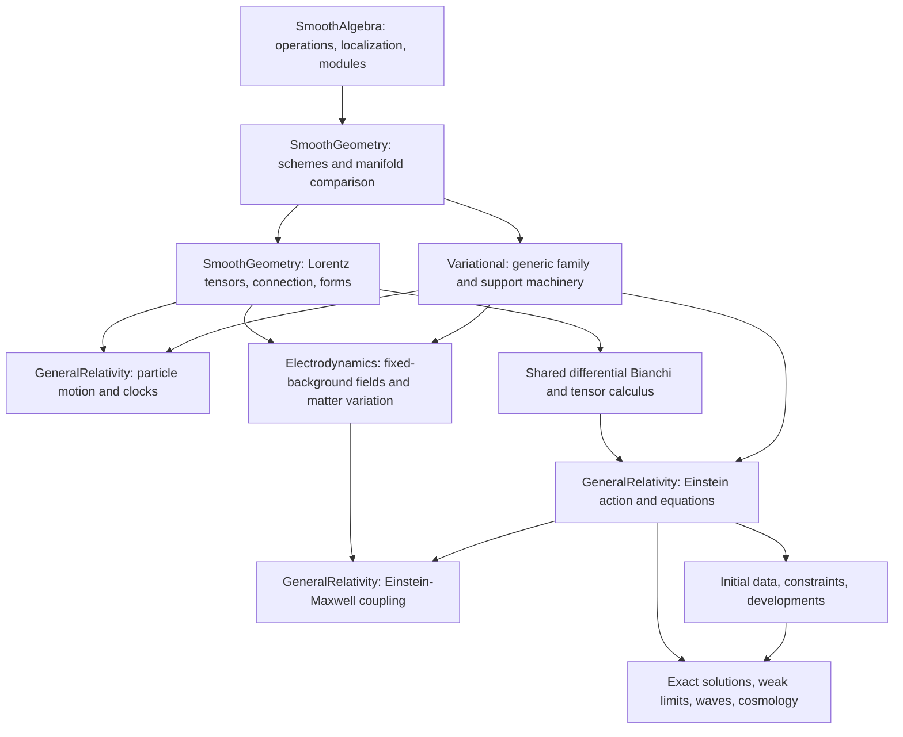

# Research Plan for General Relativity over C∞ Geometry

A Lean formalization programme for Landau–Lifshitz, *The Classical Theory of
Fields*, fourth edition, Chapters X–XIV, §§81–119.

This is the third part of the C∞ relativity and field-theory trilogy:
[Special Relativity](cinfty-special-relativity.md),
[Electrodynamics](cinfty-electrodynamics.md), and General Relativity.
It follows the research-manuscript structure of
[C∞ mechanics](cinfty-mechanics.md), while using the subsequently constructed
[shared smooth geometry](smooth-geometry.md).
The [research outline](../README.md) remains the subject-level plan;
[the GR implementation guide](general-relativity.md) records existing APIs.

The proof-status baseline is `main` at
[`8bb80ce`](https://github.com/MGYamada/ProjectAinos/commit/8bb80ce), reviewed
on 17 November 2026. It includes the native Lorentz geometry and particle
limit tracked by [#52](https://github.com/MGYamada/ProjectAinos/issues/52)
and the flat Maxwell action from
[#44](https://github.com/MGYamada/ProjectAinos/issues/44). This is the GR
volume of the design from [#8](https://github.com/MGYamada/ProjectAinos/issues/8).

## Implementation plan and current progress

The existing library already goes substantially beyond a coordinate
prototype. Its Lorentz metrics, connections, curvature, differential forms,
and particle variations live on actual tangent bundles.
The next major step is to make the metric dynamical.

| Component | Status at the baseline | Next obligation |
| --- | --- | --- |
| Smooth rings, real spectra, localizations, schemes, open gluing | Constructed | Complete/fair rings, Γ–Spec comparison, universal cotangent modules |
| Manifolds as C∞ schemes | Constructed for the documented finite-dimensional models | Full faithfulness and broader comparison domains |
| Smooth Lorentz metrics and native tensors | Constructed | Generic tensor covariant derivatives needed by field dynamics (trilinear tensors done in F10) |
| Levi-Civita connection and curvature | Constructed, including coordinate covariance and algebraic Bianchi | Differential and contracted Bianchi identities (done in F10) |
| Ricci and scalar curvature | Constructed intrinsic contractions | Einstein tensor and its divergence identity (done in F10) |
| Geodesics and parallel transport | Local existence/uniqueness and finite-segment transport proved | Geodesic deviation, global causal geometry, completeness questions |
| Local inertial coordinates and local flatness | Proved, with their different hypotheses | Applications to observers and gravitational measurements |
| Proper time and particle variational principles | Proved on arbitrary supported Lorentz manifolds | Charged curved motion and coupled matter models |
| Native exterior calculus, volume, Hodge and divergence | Constructed | Integration interfaces for varying metrics and hypersurfaces |
| Compact-support Stokes in Euclidean coordinates | Proved | `integral_exteriorDerivative_basis_zero`. Transport to chart-supported densities and then to an oriented manifold |
| Fixed-background Maxwell equations | Proved form/component equivalence and current conservation | Metric variation and Einstein–Maxwell coupling |
| Controlled Newtonian particle limit | Proved for time-dependent coefficient families | The separate Newtonian limit of the gravitational field equations |
| Einstein–Hilbert action, Einstein equations and stress-energy | First variation of the relative action (F11), Hilbert tensors of a scalar and a Maxwell field and the equivalence of stationarity with the Einstein equations (F12), for coefficients on an open set of the model space | Variations supported in a chart of a manifold; conservation from the matter equations |
| Exact gravitating solutions, gravitational waves and cosmology | Planned | Explicit solution checks before existence or classification claims |
| C∞-derivations, dual numbers, tangent points and quotients by ideals | Constructed in the shared algebra by the mechanics programme | The universal cotangent module `Ω_A` and its comparison |
| Jet C∞-rings for curves and their comparison with stationary paths | Constructed in `Mechanics` | Jets of fields and of the metric |
| Hamiltonian particle API: Hamilton's equations along curves, Noether's theorem for brackets, cyclic co-ordinates, reduction, quadrature | Constructed in the shared algebra and `Mechanics` | The comparison of the geodesic Hamiltonian with native geodesics is proved for charts on all of the model space (F14); charts whose curves leave them at a finite parameter are not covered |

“Constructed” means that the relevant objects and advertised properties have
Lean definitions and proofs. A future theorem statement, a symbolic calculation,
or a reference to a classical result does not change that status.
The detailed evidence table near the end identifies the actual source modules.

### Ledger

The ledger gives one status to each of §§81–119, with the vocabulary of the
[mechanics ledger](cinfty-mechanics.md#ledger): *proved* (Lean, no `sorry`,
axioms audited), *proved modulo interface*, *hypothesis*, *evidence* (computer
algebra only), or *informal*. The status refers to the target of the row in the
[dictionary](#landau-lifshitz-correspondence), whose last column records the
baseline. A status is only promoted, and a row whose target is proved only in
part stays at the lower status, with the proved part named. A row is closed
when it is *proved*, or when its remark names the proved part and gives the
reason why the rest is not proved; the rows closed in the second way are
listed after the count. The wave names F1–F26 are those of
[issue #135](https://github.com/MGYamada/ProjectAinos/issues/135), which tracks
completion.

| § | Topic | Status | Lean declarations, or what is missing |
|---:|:---|:---|:---|
| 81 | Gravitational fields in nonrelativistic mechanics | proved | `NewtonianMetricFamily`, `native_acceleration_error`, `exists_uniform_newtonian_limit`, `exists_newtonian_limit_with_rate`. Scope: the motion of a particle in a given family of metrics with uniform bounds through two derivatives; the family is not required to solve the field equations (§99) |
| 82 | The gravitational field in relativistic mechanics | proved | `LorentzMetric`, `LorentzManifold`, `LorentzMetric.opposite`, `CoordinateMetric.toLorentzMetric`, `CoordinateMetric.ofCriterion`, `Minkowski.exists_lorentzFrame_convention`, `LorentzMetric.spatialForm_nonneg`, `LorentzMetric.spatialForm_pos`, `Minkowski.radar`, `Minkowski.radar_distance`, `Minkowski.exists_radar`. Scope: in the convention `(−+++)`, an observer is a timelike vector `u` at an event; it reads time from the proper time of its worldline and distances from the spatial form `γ_u(v, w) = g(v, w) − g(u, v) g(u, w)/g(u, u)`, which is positive on every displacement not along `u` and whose square root `√(γ_u(v, v))` is half the proper time of a light signal sent to a neighbouring event `v` and back, and the event of the worldline at the middle of the signal is simultaneous with `v`; a metric may be given by smooth coefficients on an open set of the model space; no time orientation is used |
| 83 | Curvilinear co-ordinates | proved | `chartField_transition`, `leviCivita_chart_transition`, `chartChristoffel_transformation`, `chartCurvature_transformation`. Scope: the overlap of two smooth charts of the manifold |
| 84 | Distances and time intervals | proved | `properTime`, `properTime_integrable`, `properTime_add`, `properTime_reparametrize`, `properTime_chart`, `exists_finite_properTime_parameter`, `properTime_coordinate`, `properTime_atRest`, `Minkowski.spatialForm_timeAxis`, `CoordinateMetric.spatialMetric_pos`, `Minkowski.orthogonal_timeAxis_iff`. Scope: for a metric given by coefficients on an open set of the model space, the proper time of a smooth curve is `∫ √(−g_{μν} ẋ^μ ẋ^ν) dt` (the integrand is zero where the curve is spacelike); an observer at rest on `[a, b]` has `dτ = √(−g₀₀) dx⁰`; the spatial metric `γ_{ij} = g_{ij} − g_{0i} g_{0j}/g_{00}` does not depend on `dx⁰` and is positive definite where `g₀₀ < 0`; two neighbouring events are simultaneous for the observer at rest when `dx⁰ = −g_{0i} dx^i/g_{00}`, the event that the radar signal of §82 (`Minkowski.radar`) singles out. The length of a finite path is stated only where the spatial metric does not depend on `x⁰` (the rotating circle of §89); in general it depends on the slice. The relations `γ^{ij} = g^{ij}` and `−g = −g₀₀ det γ` are not stated |
| 85 | Covariant differentiation | informal | Closed with a stated remainder. Proved: `leviCivita` on vector fields with `leviCivita_chart_components`; `Tensor.bilinearCovariantDerivative` on covariant two-tensors with `LorentzMetric.bilinearCovariantDerivative_chart` and the divergence `LorentzMetric.bilinearDivergenceCovector`; `twoFormDerivative` with `twoFormDerivative_chart`; `Tensor.ContMDiffTensorialAt.mkHom₃` and `Tensor.trilinearCovariantDerivative` on tangent-valued trilinear tensors for any connection on the tangent bundle, and on the curvature `LorentzMetric.curvatureDerivative` with `chartCurvatureDerivative_eq`. Each is the Leibniz correction on locally `C¹` fields. Not proved: the derivatives of covectors, of contravariant and mixed tensors of rank two, and of the general shapes of `Tensor.Shape`. The pinned Mathlib defines a covariant derivative on one vector bundle and induces none on its dual, hom or tensor bundles, and the library has no such construction; each type above is built by its own tensoriality argument |
| 86 | The relation of the Christoffel symbols to the metric tensor | proved | `leviCivita`, `isLeviCivita_leviCivita`, `IsLeviCivita.eq_leviCivita`, `christoffel_eq`, `chartChristoffel_eq`, `chartChristoffel_symmetric` |
| 87 | Motion of a particle in a gravitational field | proved | `quadraticStationary_iff_geodesic`, `freeStationary_iff_acceleration`, `freeStationary_iff_tangential`, `freeStationary_iff_localGeodesic`, `exists_geodesic`, `geodesic_unique`. Scope: variations with fixed end points; the action of a massive particle along a timelike curve, the quadratic action without a causal restriction |
| 88 | The constant gravitational field | proved | `LorentzMetric.IsKillingField`, `LorentzMetric.IsKillingField.pairing_eq`, `LorentzMetric.killingNorm_mul_observedFrequency_eq`, `CoordinateMetric.isKillingField_of_invariant`, `SchwarzschildExterior.killingNorm_mul_observedFrequency_eq`, `GeodesicHamiltonian.isTrajectory_iff`, `GeodesicHamiltonian.isIntegral_vectorMomentum_iff_killing`, `GeodesicHamiltonian.isIntegral_p_of_metric_independent`, `GeodesicHamiltonian.killingNorm_mul_frequency_eq`. Scope: on a Lorentz manifold in the convention `(−+++)`, the pairing `g(K, γ̇)` of a Killing field is constant along a given geodesic on any convex set of parameters, and the observers that move along a timelike Killing field measure frequencies with `N ω = const`, `N = √(−g(K, K))`; the ray need not be null. A metric whose coefficients do not depend on `x^k` has the Killing field `∂_k`; the exterior Schwarzschild field on `r > 2M`, `0 < θ < π` is the instance, with the red shift along every geodesic segment, radial rays included. In the Hamiltonian form, for a chart whose domain is all of `ℝⁿ` with coefficients in the free C∞-ring, the trajectories of `½ g^{μν} p_μ p_ν` are the geodesics of the chart defined for all values of the affine parameter, with `p_μ = g_{μν} ẋ^ν`, and `ξ^μ p_μ` is an integral exactly when `L_ξ g = 0`; its instances are the curve at rest and the straight lines of constant coefficients (`isTrajectory_rest`, `isTrajectory_line`) and the equatorial plane of the exterior field in the co-ordinate `r = 2M + eˢ`, where no radial geodesic along which `r` changes is a trajectory |
| 89 | Rotation | proved | `RotatingFrame.metric`, `RotatingFrame.form_eq_pullback`, `RotatingFrame.hasDerivAt_toInertial`, `RotatingFrame.properTime_static`, `RotatingFrame.spatialForm_radial`, `RotatingFrame.circumference_circle`, `RotatingFrame.synchronization_circle`, `RotatingFrame.killingNorm_mul_observedFrequency_eq`. Scope: Minkowski space in co-ordinates that rotate about the `z` axis, on the domain `Ω²(x² + y²) < 1` where the rotating time axis is timelike: the clocks at rest, the radial lengths, the circumference `2πρ/√(1 − Ω²ρ²)` of a circle about the axis, the synchronization gap along that circle, and the frequency shift between observers at rest |
| 90 | The equations of electrodynamics in the presence of a gravitational field | proved | `Curved.Maxwell`, `Curved.maxwell_iff_components`, `Curved.sourced_iff_divergence`, `Curved.current_closed_iff_divergence`, `CoordinateMetric.potentialAction`, `CoordinateMetric.hasDerivAt_potentialAction`, `CoordinateMetric.isPotentialStationary_iff`, `CoordinateMetric.twoFormDivergence_eq_iff`, `Curved.potentialStationary_iff_sourced`, `Curved.maxwell_iff_potentialStationary`, `Curved.potentialStationary_matter_iff`, `Electrodynamics.potentialAction_minkowski`, `chargedAction`, `lineIntegral_family_hasDerivAt`, `chargedStationary_iff`, `chargedStationary_gauge_iff`, `chargedStationary_minkowski_iff`. Scope: the Maxwell equations `dF = 0`, `dH = J` with `H = −⋆F`, `J = ⋆(j♭)` on every smooth oriented Lorentz four-manifold, with their covariant and component forms and the conservation of the current. On a fixed background given by coefficients on an open set `U` of `ℝ⁴`, the action `∫ (−¼ F_{ab} F^{ab} − A_b j^b) √|g| d⁴x` of a smooth potential with a prescribed continuous current is stationary under every smooth variation with compact support in `U` if and only if `∇_a F^{ab} = j^b`, that is `dH = J` for the native field and current; with the coupling `+A_b k^b` of a matter current the source is `−k`, and at the Minkowski metric the functional is the flat one. On a Lorentz metric on `U` the action of a charge is stationary under every fixed-endpoint family of curves if and only if `m ∇_τ U = −e (ι_U F)^♯`, with gauge invariance and the flat case. Not stated: the actions on a manifold beyond one chart, the joint variation of the field and of point charges, whose current is a distribution, and the exchange of stress between the field and the matter on a curved background |
| 91 | The curvature tensor | proved | `curvature`, `curvature_apply`, `curvatureTensor`, `chartCurvature_eq`, `curvature_naturality`, `isLocallyMinkowski_iff_curvature_eq_zero` |
| 92 | Properties of the curvature tensor | proved | `curvature_swap`, `curvature_first_bianchi`, `curvature_skewAdjoint`, `curvature_pair_interchange`, `ricci_symmetric`, `curvature_second_bianchi`, `chartCurvatureDerivative_bianchi`, `ricci_contracted_bianchi`, `einstein`, `einstein_symmetric`, `contract_einstein`, `einstein_divergence_eq_zero`, `ExponentialConformalExample.metric_einstein_ne_zero`, `ExponentialConformalExample.metric_curvatureDerivative_ne_zero`. Scope: every smooth Lorentz metric, in either convention and every dimension; the identities hold at each point for any tangent vectors. The regression is the metric `e^{2z}(−dt² + dx² + dy² + dz²)` on `ℝ⁴`, with `∇R ≠ 0`, `G ≠ 0` and `∇^a Ric_{az} = ½ ∂_z R ≠ 0` |
| 93 | The action function for the gravitational field | proved | `CoordinateMetric.IsAdmissible`, `CoordinateMetric.eventually_isAdmissible`, `CoordinateMetric.addVariation`, `CoordinateMetric.hasDerivAt_inverseVariation`, `CoordinateMetric.hasDerivAt_variationFamily_density`, `palatini_algebra`, `CoordinateMetric.hasDerivAt_scalarDensity`, `CoordinateMetric.integral_fderiv_density_mul_variationVector`, `CoordinateMetric.hasDerivAt_integral_scalarDensity`, `CoordinateMetric.scalarDensity_eq_toLorentzMetric`, `CoordinateMetric.toLorentzMetric_einstein_chartField`, `CoordinateMetric.eulerLagrangeDensity_eq`, `EinsteinHilbert.eventually_relativeAction_integrand`, `EinsteinHilbert.hasDerivAt_relativeAction`, `EinsteinHilbert.hasDerivAt_relativeAction_conformal`, `EinsteinHilbert.exists_deriv_relativeAction_conformal_ne_zero`. Scope: a metric given by coefficients on an open set `U` of the model space and a smooth symmetric variation `h` with compact support in `U`. For every `ε` near `0` the form `g + εh` is a Lorentz metric on `U`, and the relative action `ΔS(ε) = (1/2κ) ∫ ((R_ε − 2Λ)√|g_ε| − (R − 2Λ)√|g|) d⁴x` integrates the difference of the native Lagrangians; `ΔS'(0) = (1/2κ) ∫ (G_{ik} + Λ g_{ik}) δg^{ik} √|g| d⁴x` with `δg^{ik} = −g^{im} h_{mn} g^{nk}` and the native Einstein tensor, because the term `g^{ik} δR_{ik} √|g| = ∂_a(√|g| V^a)` has compact support and integrates to zero. The shared statements hold in every dimension and either convention, the action is stated in four dimensions and `(−+++)`. The regression is the metric `e^{2z}η` of §92 with `h = fη`, where `ΔS'(0) = −(1/2κ) ∫ f (6 + 4Λ e^{2z})` is not zero for a bump function even when `Λ = 0`. Not stated: a variation supported in a chart of a general Lorentz manifold (it needs the extension by zero and the comparison of charts), and the tensorial forms `δΓ = ½ g^{-1}(∇h + ∇h − ∇h)` and `V^a = ∇_b h^{ab} − ∇^a tr h`; the vector `V^a` is written with `δΓ` |
| 94 | The energy-momentum tensor | proved | `EinsteinEquations.MatterAction`, `MatterAction.scalarField`, `MatterAction.maxwellField`, `CoordinateMetric.hasDerivAt_integral_scalarFieldDensity`, `CoordinateMetric.scalarStress`, `CoordinateMetric.hasDerivAt_integral_maxwellDensity`, `CoordinateMetric.maxwellStress`, `CoordinateMetric.maxwellStress_symm`, `CoordinateMetric.sum_inv_mul_maxwellStress`, `LorentzMetric.SatisfiesEinstein.divergence_eq_zero`, `EinsteinEquations.divergence_stress_eq_zero`, `EinsteinEquations.scalarStress_minkowski_zero_zero`, `Electrodynamics.maxwellStress_minkowski`. Scope: a metric given by coefficients on an open set `U` of `ℝ⁴` and smooth symmetric variations with compact support in `U`. The Hilbert tensor is derived from the actual relative action, `δS_m = −½ ∫ T_{ik} δg^{ik} √|g| d⁴x`, for a scalar field, `T_{ik} = ∂_iφ ∂_kφ − ½ g_{ik}(g^{ab} ∂_aφ ∂_bφ + m²φ²)` with `T₀₀ = ½(φ̇² + |∇φ|² + m²φ²)` in Minkowski space, and for a fixed electromagnetic field, `T_{ik} = F_{ib} F_k{}^b − ¼ g_{ik} F²`, symmetric, trace-free in four dimensions and equal to the tensor of §33 in Minkowski space; a matter action carries its Hilbert tensor as a theorem, not as a datum. The source of the Einstein equations is conserved, `∇^a T_{ab} = 0`, by the contracted Bianchi identity, for every smooth Lorentz metric that satisfies them. On a fixed background the conservation follows from the field equation of the matter: the action of the scalar field is stationary under every compactly supported variation of the field exactly when `□φ = m² φ` (`CoordinateMetric.hasDerivAt_fieldAction`, `EinsteinEquations.isFieldStationary_iff_kleinGordon`), and `∇^a T_{ab} = (□φ − m² φ) ∂_bφ` (`CoordinateMetric.divergenceOf_scalarStress`, `EinsteinEquations.divergence_scalarStress`, `EinsteinEquations.divergence_scalarStress_eq_zero`); `φ = e^{m x}` in Minkowski space is a solution (`EinsteinEquations.kleinGordon_exp`). Not stated: the conservation for the fixed electromagnetic field from the Maxwell equations on a curved background, the derivation from the invariance under diffeomorphisms for a general matter action, and the Hilbert tensors of dust or of a fluid |
| 95 | The Einstein equations | proved | `EinsteinEquations.IsStationary`, `EinsteinEquations.hasDerivAt_totalAction`, `EinsteinEquations.isStationary_iff`, `EinsteinEquations.isStationary_iff_satisfiesEinstein`, `CoordinateMetric.integral_inverseVariation_eq_zero_iff`, `CoordinateMetric.IsEinstein`, `CoordinateMetric.satisfiesEinstein_bilinearOf_iff`, `LorentzMetric.SatisfiesEinstein`, `SatisfiesEinstein.contract`, `SatisfiesEinstein.ricci_eq`, `SatisfiesEinstein.ricci_eq_four`, `EinsteinEquations.ricci_eq_of_isStationary`, `EinsteinEquations.minkowski_isStationary_vacuum`, `EinsteinEquations.minkowski_isStationary_constantScalar`, `EinsteinEquations.conformal_not_isStationary_vacuum`. Scope: for `κ ≠ 0`, a constant `Λ` and a matter action with its Hilbert tensor, the total relative action `ΔS_g + ΔS_m` is stationary under every smooth symmetric variation of the metric with compact support in `U` if and only if `G_{ik} + Λ g_{ik} = κ T_{ik}` on `U`, the native Einstein equations of the Lorentz metric on `U`; this is an equivalence for given fields, not the existence of a metric for a given source. The trace `(1 − n/2) R + nΛ = κ T^a{}_a` and, away from dimension two, the trace-reversed form `Ric = κ(T − T^a{}_a g/(n − 2)) + 2Λ g/(n − 2)` hold for every smooth Lorentz metric that satisfies the equations. Regressions: Minkowski space in vacuum with `Λ = 0`, and with a constant scalar field `c` and `Λ = −κ m² c²/2`, is stationary; the curved metric `e^{2z} η` in vacuum is not |
| 96 | The energy-momentum pseudotensor of the gravitational field | informal | Closed with a stated remainder. Proved (F13): `CoordinateMetric.superpotentialDensity`, `CoordinateMetric.superpotential`, `superpotential_antisymm`, `divergence_divergence_superpotential`, `divergence_superpotential_eq`, `pseudotensor`, `pseudotensor_eq_zero`, `pseudotensor_symm`, `divergence_total_eq_zero`, `pseudotensor_algebra`, `CoordinateMetric.superpotential_eq`, `CoordinateMetric.fderiv_christoffelOf`, `CoordinateMetric.pseudotensor_eq`, `pseudotensor_second_algebra`, `pseudotensor_quadratic`. For a metric given by coefficients on an open set, `λ^{iklm} = |g| (g^{ik} g^{lm} − g^{il} g^{km})` and `h^{ikl} = ∂_m λ^{iklm}` is antisymmetric in `k, l`, so `∂_k ∂_l h^{ikl} = 0`; at a point where the first derivatives of the coefficients vanish, `∂_l h^{ikl} = 2 |g| G^{ik}` (96.5); the pseudotensor defined by `2 |g| (G^{ik} + t^{ik}) = ∂_l h^{ikl}` vanishes there and is symmetric, and with `G^{ik} = κ T^{ik}` the total `|g| (κ T^{ik} + t^{ik})` is conserved (96.8). At every point of the open set, `t^{ik}` is half the braces of (96.9) in the Christoffel symbols and the inverse metric (`pseudotensor_eq`; the factor `c⁴/16πk` is absorbed in `t`). Not proved: the energy and momentum (96.16) as integrals over a spacelike hypersurface, their conservation and their four-vector character. They need the decay of the metric and of the matter at spatial infinity and co-ordinates that are Galilean there; the library has no interface for such an asymptotic structure, which belongs to the distant field of §105 (F24) |
| 97 | The synchronous reference system | proved | `LorentzMetric.familyVelocity_pairing_eq`, `LorentzMetric.familyVelocity_orthogonal`, `CoordinateMetric.IsSynchronous`, `CoordinateMetric.extrinsicRate`, `CoordinateMetric.metricRate`, `CoordinateMetric.sliceRicci`, `IsSynchronous.inv_zero`, `IsSynchronous.christoffel_zero_zero`, `IsSynchronous.christoffel_zero_zero_succ`, `IsSynchronous.christoffel_succ_zero_succ`, `IsSynchronous.christoffel_zero_succ_succ`, `IsSynchronous.isGeodesicOn_timeLine`, `IsSynchronous.ricci_zero_zero`, `IsSynchronous.ricci_zero_succ`, `IsSynchronous.ricci_succ_succ`, `DeSitterSlicing.isSynchronous`, `DeSitterSlicing.extrinsicRate_eq`, `DeSitterSlicing.ricci_eq`. Scope: for a family of geodesics whose velocities have the same metric norm, a variation field orthogonal to the velocity at one time stays orthogonal (the lemma of Gauss), so geodesics normal to a slice with unit velocity give synchronous co-ordinates; for a metric given by coefficients on an open set of `ℝ⁴` with `g_{00} = −1` and `g_{0α} = 0`, the time lines are geodesics in the proper time orthogonal to the slices, `Γ^k_{00} = 0`, `Γ^α_{0β} = ½ κ^α_β`, `Γ^0_{αβ} = ½ ∂_t γ_{αβ}`, and the Ricci tensor is (97.11)–(97.13): `R_{00} = −½ ∂_t κ^α_α − ¼ κ^α_β κ^β_α`, `R_{0α} = ½ (κ^β_{α;β} − κ^β_{β;α})` and `R_{αβ} = P_{αβ} + ½ ∂_t κ_{αβ} + ¼ (κ^γ_γ κ_{αβ} − κ_{αγ} κ^γ_β − κ^γ_α κ_{γβ})` with the covariant derivative and the Ricci tensor `P` of the slices. The regression is de Sitter space `−dt² + e^{2t}(dx² + dy² + dz²)`, synchronous with `κ^α_β = 2 δ^α_β` and `Ric = 3 g`. Not stated: the existence of the normal geodesics from a slice and of the co-ordinates they define (the geodesic flow of a metric smooth only on an open set and the inverse function theorem; the family is data, as for every field smooth only on an open set), and the focusing of the time lines, planned with the equation of Raychaudhuri (F25) |
| 98 | The tetrad representation of the Einstein equations | proved | `LorentzMetric.OrthonormalFrame`, `OrthonormalFrame.sum_coord_smul`, `OrthonormalFrame.form_eq_sum`, `OrthonormalFrame.bilinear_ext`, `OrthonormalFrame.rotation`, `OrthonormalFrame.commutator`, `OrthonormalFrame.rotation_antisymm`, `OrthonormalFrame.commutator_eq`, `OrthonormalFrame.rotation_eq`, `OrthonormalFrame.curvatureComponent_eq`, `OrthonormalFrame.ricci_field`, `OrthonormalFrame.ricci_field_eq`, `OrthonormalFrame.scalarCurvature_eq`, `OrthonormalFrame.einstein_field`, `OrthonormalFrame.einstein_eq_iff`, `LorentzMetric.satisfiesEinstein_iff_frames`, `OrthonormalFrame.transition_orthonormal`, `CoordinateMetric.minkowskiFrame`. Scope: a smooth orthonormal frame `E_a` on an open set of a smooth Lorentz manifold, in either convention and every dimension. The rotation coefficients `γ_{abc} = g(∇_{E_c} E_a, E_b)` are antisymmetric in `a, b`, the coefficients `λ_{abc} = g(E_a, [E_b, E_c])` of the commutators are `γ_{abc} − γ_{acb}`, and `γ_{abc} = ½ (λ_{abc} + λ_{bca} − λ_{cab})`; the frame components of the curvature are given by `γ`, `λ` and the frame derivatives of `γ` (the second structure equation of Cartan in components), the Ricci, scalar and Einstein tensors follow, and the Einstein equations hold if and only if their frame components hold in the frames of a cover; two orthonormal frames differ by a Lorentz matrix, and the coordinate fields of the Minkowski metric are a frame. Not stated: the existence of a smooth orthonormal frame near every point, and the Ricci tensor written with `λ` alone, as Landau–Lifshitz give it |
| 99 | Newton's law | informal | Planned (F18). It is not §81: here the metric solves the field equations |
| 100 | The centrally symmetric gravitational field | proved | `SphericalAnsatz.metric`, `SphericalAnsatz.christoffelOf_eq`, `SphericalAnsatz.ricciOf_eq`, `SphericalAnsatz.einsteinOf_eq`, `SchwarzschildExterior.ricciOf_eq_zero`, `SchwarzschildExterior.satisfiesEinstein_zero`, `SchwarzschildExterior.ricci_eq_zero`, `SphericalAnsatz.birkhoff`, `SphericalAnsatz.birkhoff_timeChange`, `SphericalAnsatz.ricciOf_schwarzschildData`, `SphericalAnsatz.mass_schwarzschildData`, `EddingtonFinkelstein.ricciOf_eq_zero`. Scope: units `G = c = 1`. The ansatz (100.1) `−A dt² + B dr² + r² dΩ²` with `A, B` smooth and positive on open `I × J`, `J ⊆ (0, ∞)`, `0 < θ < π`, has the Christoffel symbols, Ricci and Einstein components (100.3)–(100.5) at every point. The exterior Schwarzschild metric on `r > 2M` (`M ≥ 0`) has `Ric = 0` in co-ordinates and natively and satisfies the vacuum Einstein equations. Birkhoff: for preconnected `I`, `J`, the Ricci tensor of the ansatz vanishes if and only if `B = r/(r − 2M)` and `A = f(t)(1 − 2M/r)` with `2M < r` on `J` (`M` may be negative), that is the exterior field after a change of time, with a unique mass. In Eddington–Finkelstein co-ordinates the field is a vacuum metric on all of `r > 0`. Not stated: the reduction of a metric with an isometric `SO(3)` action to (100.1), and charts covering the axis or the whole sphere |
| 101 | Motion in a centrally symmetric gravitational field | proved | `SchwarzschildExterior.isKillingField_rotationField`, `SchwarzschildExterior.planar_motion`, `SchwarzschildExterior.energy_eq`, `SchwarzschildExterior.radial_sq_eq`, `SchwarzschildExterior.hasDerivAt_sweptAngle_eq_div`, `SchwarzschildExterior.deriv_effectivePotential_eq_zero_iff`, `SchwarzschildExterior.deriv_deriv_effectivePotential_pos_iff`, `SchwarzschildExterior.deriv_effectivePotential_light_eq_zero_iff`, `SchwarzschildExterior.isGeodesicOn_circular`, `SchwarzschildExterior.angle_between_apsides`, `SchwarzschildExterior.perihelion_advance_between_perihelia`, `SchwarzschildExterior.perihelion_advance_bounds_semiMajor`, `SchwarzschildExterior.deflection_bound`, `SchwarzschildExterior.deflection_bound_sweptAngle`, `GeodesicHamiltonian.SchwarzschildEquatorial.isTrajectory_iff_isGeodesicOn`. Scope: native geodesics of the exterior field given on a convex set of parameters. The motion is in a plane through the centre, and `E`, `L` and `κ` are constant, with `ṙ² = E² − (1 − 2M/r)(κ + L²/r²)` and the swept angle at the rate `L/r²`. For `M > 0`, circular orbits exist exactly for `L²(R − 3M) = MR²` and are stable exactly for `R > 6M`; the photon circle is at `3M`; the circular orbits are explicit geodesics. A bound orbit given between two apsides sweeps the exact apsidal integral in each half (the simple-apsides condition is derived), and the advance between perihelia lies within `4πM²(2u₁ + u₂)²` of `3πM(u₁ + u₂) = 6πM/(a(1 − e²))` (101.7) for `2M(2u₁ + u₂) ≤ 1/4`. For a ray given from its closest approach to infinity, the deflection angle `χ` defined from the outgoing half (L&L (18.1)) satisfies `|χ + 4M/ρ| ≤ C(M/ρ)²` for small `2M/ρ` (101.9), with constants that are not explicit. The chart geodesics of the geodesic Hamiltonian of the equatorial plane are its native geodesics (the comparison of stage G-H). Not stated: the existence of a non-circular bound orbit and of a ray from infinity for `M > 0`, and the symmetry of the incoming half of a ray |
| 102 | Gravitational collapse of a spherical body | informal | Planned (F25). Proved (F14): in ingoing Eddington–Finkelstein co-ordinates the Schwarzschild field is a vacuum metric on `r > 0` (`EddingtonFinkelstein.ricciOf_eq_zero`); the ingoing radial null ray crosses `r = 2M` (`exists_ingoingRay_lt`); inside `r = 2M` every causal vector with `dv > 0` has `dr < 0` (`radial_lt_zero_of_causal`); the form pulls back to the exterior form (`form_toEddington`) |
| 103 | Gravitational collapse of a dustlike sphere | informal | Planned (F25) |
| 104 | Gravitational collapse of nonspherical and rotating bodies | proved | `Kerr.metric`, `Kerr.christoffelOf_eq`, `Kerr.ricciOf_eq_zero`, `Kerr.satisfiesEinstein_zero`, `Kerr.ricci_eq_zero`, `Kerr.isKillingField_time`, `Kerr.isKillingField_angle`, `Kerr.ergoregion_iff`, `Kerr.ergoregion_nonempty`, `Kerr.form_rotating_neg_iff`, `Kerr.omegaMinus_pos`, `Kerr.tendsto_omegaPlus`, `Kerr.tendsto_omegaMinus`, `Kerr.tendsto_inverse_rr`, `Kerr.form_zero_toAngle`. Scope: the Kerr metric (104.1) for `M > 0`, `a² ≤ M²` in Boyer–Lindquist co-ordinates with `χ = cos θ` on the exterior `r > r₊ = M + √(M² − a²)`, `−1 < χ < 1`, `t, φ ∈ ℝ`, with the ergoregion included. Its Christoffel symbols are certified, `Ric = 0` holds in co-ordinates and natively, and it satisfies the vacuum Einstein equations; `∂_t` and `∂_φ` are Killing fields. The ergoregion is `r² − 2Mr + a²χ² < 0` and is nonempty for `a ≠ 0`. A stationary observer `∂_t + Ω∂_φ` is timelike exactly for `Ω₋ < Ω < Ω₊`, with `Ω₋ > 0` in the ergoregion for `a > 0` (frame dragging) and `Ω± → a/(r₊² + a²)` at the horizon. `g^{rr} = Δ/Σ → 0` at `r₊`, and `a = 0` is the exterior Schwarzschild field through `θ = arccos χ`. The scope column puts collapse and uniqueness outside the target (decision 2 on #135). Not stated: the event horizon as a global causal boundary, the end state of collapse, uniqueness, the region `r ≤ r₊`, the axis, and a chart across the horizon |
| 105 | Gravitational fields at large distances from bodies | informal | Planned (F24) |
| 106 | The equations of motion of a system of bodies in the second approximation | informal | Planned (F24) |
| 107 | Weak gravitational waves | informal | Planned (F18) |
| 108 | Gravitational waves in curved space-time | informal | Planned (F24) |
| 109 | Strong gravitational waves | informal | Planned (F18) |
| 110 | Radiation of gravitational waves | informal | Planned: needs the retarded Green operator (F24) |
| 111 | Isotropic space | proved | `SpaceForm.coefficient`, `SpaceForm.christoffelOf_eq`, `SpaceForm.curvatureOf_eq`, `SpaceForm.ricciOf_eq`, `SpaceForm.sphere_embedding`, `SpaceForm.sphereHomeomorph`, `SpaceForm.hyperboloid_embedding`, `SpaceForm.hyperboloidHomeomorph`, `SpaceForm.sphere_firstFundamentalForm`, `SpaceForm.hyperboloid_firstFundamentalForm`, `SpaceForm.integral_inv_conformalFactor_pow_three`. Scope: explicit models, the alternative of the dictionary. The conformally flat metric `ψ_k⁻² δ` with `ψ_k = 1 + k|x|²/4` has the curvature `k(δ^l_i h_jm − δ^l_j h_im)` and `Ric = 2k h` (111.1)–(111.2). For `k = 1`, ℝ³ is the sphere `S³` minus a point; for `k = −1`, the ball `|x| < 2` is the whole hyperboloid `H³`; `k = 0` is ℝ³. Both are stated by embeddings with their homeomorphisms and the pulled-back metric. The closed space of radius `a` has volume `2π²a³`. Not stated: the local classification of homogeneous isotropic three-metrics |
| 112 | The closed isotropic model | proved | `FLRW.metric`, `FLRW.einsteinOf_eq`, `FLRW.divergenceOf_perfectFluidStress`, `FLRW.isEinstein_iff_friedmann`, `FLRW.satisfiesEinstein_iff_friedmann`, `FLRW.continuity_of_friedmann`, `FLRW.second_of_first_of_continuity`, `FLRW.curvature_sign`, `CosmologicalModels.isEinstein_closedDust`, `CosmologicalModels.isEinstein_closedRadiation`, `CosmologicalModels.hasDerivAt_closedDustTime`, `CosmologicalModels.closedDustTime_pi_sub_zero`, `CosmologicalModels.tendsto_closedDust_age`. Scope: the metric `−N² dt² + a² ψ_k⁻² dx²` with a lapse on an open set of times, and a comoving perfect fluid with `ρ, p` functions of time. The Einstein equations hold if and only if both Friedmann equations do; the continuity equation `ρ̇ + 3H(ρ + p) = 0` follows from them without dividing by `H`, and conversely where `ȧ ≠ 0`; `k` has the sign of `ρ − 3H²/κ`. The closed dust (112.8) and radiation models in conformal time are exact solutions, with cosmic time `t = a₀(η − sin η)`; from the singularity to the maximal expansion `a_m` the age is `πa_m/2`. Not stated: the existence and uniqueness of solutions of the Friedmann equation through `a = 0` |
| 113 | The open isotropic model | proved | `CosmologicalModels.isEinstein_openDust`, `CosmologicalModels.isEinstein_openRadiation`, `CosmologicalModels.isEinstein_flatDust`, `CosmologicalModels.isEinstein_flatRadiation`, `CosmologicalModels.hasDerivAt_openDustTime`, `CosmologicalModels.open_expands_forever`, `CosmologicalModels.open_strictMonoOn`. Scope: the Poincaré-ball chart of all of `H³` and the flat chart. The open dust (113.3) and radiation models and the flat ones are exact solutions in conformal time, with cosmic time `t = a₀(sinh η − η)`. For `k ≤ 0`, `Λ = 0` and `ρ ≥ 0` (with `ρ > 0` when `k = 0`), a solution of the first Friedmann equation that expands at one time expands at all times of a preconnected interval |
| 114 | The red shift | proved | `CosmologicalRedshift.comoving_isGeodesicOn`, `CosmologicalRedshift.observedFrequency_eq`, `CosmologicalRedshift.scale_mul_frequency_eq`, `CosmologicalRedshift.redshift_eq`, `CosmologicalRedshift.isGeodesicOn_deSitterRay`, `CosmologicalRedshift.redshift_deSitterRay`. Scope: comoving observers of the isotropic metric for every `k` and lapse; their world lines are geodesics in the proper time for `N = 1`. Along a null geodesic given on a convex set of parameters, `a · ω` is constant for the frequency `ω` that the comoving observers measure, so `1 + z = a(t_obs)/a(t_em)` (114.2). A radial ray of de Sitter space is an explicit instance. Distance–redshift relations are not stated |
| 115 | Gravitational stability of an isotropic universe | informal | Planned (F24) |
| 116 | Homogeneous spaces | proved | `StructureConstants.ofBianchi`, `StructureConstants.existsUnique_bianchi`, `StructureConstants.jacobi_ofBianchi_iff`, `StructureConstants.jacobi_iff`, `StructureConstants.jacobi_bianchiIX`, `HomogeneousSpace.InvariantFrame`, `HomogeneousSpace.Data.metric`, `HomogeneousSpace.Data.form_frameField`, `HomogeneousSpace.Data.commutator_frame`, `HomogeneousSpace.Data.ricci_frame`, `HomogeneousSpace.Data.ricci_eq_zero_iff`, `HomogeneousSpace.Data.einstein_iff`, `HomogeneousSpace.Data.ricci_eq_zero_iff_diagonal`, `HomogeneousSpace.ricci_eq_zero_iff_bianchiIX`, `HomogeneousSpace.InvariantFrame.bianchiI`, `HomogeneousSpace.InvariantFrame.bianchiII`, `HomogeneousSpace.InvariantFrame.bianchiV`, `HomogeneousSpace.InvariantFrame.bianchiIX`, `HomogeneousSpace.ricci_kasnerModel_eq_zero`. Scope: a given invariant frame (decision 5 on #135): three vector fields with components smooth on a nonempty open set of ℝ³, a dual coframe and constants `C^c_{ab}` with `[X_a, X_b] = Σ C^c_{ab} X_c`, and a triad `e(t)` with a smooth inverse on an open set of times. The metric `−dt² + Σ_k (θ^k)²`, `θ^k = Σ e_{ka} ω^a`, has the orthonormal frame `∂_t`, `Σ f_{ai} X_a`, commutator coefficients that depend on the time alone, and frame components of the Ricci tensor given by Cartan's structure equations in these coefficients and their time derivatives. The full field equations on the domain, in vacuum and with a comoving perfect fluid, are equivalent to ordinary differential equations on `I`. Structure constants decompose uniquely into a symmetric `n` and a vector `a` (L&L (116.8)), the Jacobi identity is `n a = 0`, and the canonical types I–IX satisfy it. Diagonal models of class A have the closed-form Ricci tensor (the type IX equations of §118). Invariant frames of the types I, II, V and IX are given explicitly; the Kasner metric is a vacuum solution of type I through the frame reduction. Not stated: the group of motions and Lie's third theorem, the classification of the structure constants up to a change of frame, and the existence of an invariant frame for a given homogeneous space |
| 117 | The flat anisotropic model | proved | `Kasner.metric`, `Kasner.ricciOf_eq`, `Kasner.einsteinOf_eq`, `Kasner.isEinstein_iff`, `Kasner.ricciOf_kasner_eq_zero_iff`, `Kasner.isEinstein_kasner`, `Kasner.volume_kasner`, `Kasner.kasner_ranges`, `Kasner.eq_kasnerExponents`, `Kasner.kasnerExponents_inv`, `Kasner.chartCurvature_kasner_ne_zero`, `Kasner.isEinstein_dustKasner`, `Kasner.tendsto_dustKasner_nhdsGT`, `Kasner.tendsto_dustKasner_atTop`. Scope: `t > 0`, `x ∈ ℝ³`. The diagonal metric `−dt² + Σ a_α(t)² dx_α²` with its tables; the Einstein equations with a comoving perfect fluid are a constraint and three evolution equations. The Kasner metric `a_α = t^{p_α}` is Ricci flat if and only if `Σp = Σp² = 1` or `p = 0` (117.3); the ordered exponents lie in `−1/3 ≤ p₁ ≤ 0 ≤ p₂ ≤ 2/3 ≤ p₃ ≤ 1` and are `(0, 0, 1)` or the Lifshitz–Khalatnikov triple `p(u)`, `u ≥ 1` (117.5)–(117.6), with `u ↦ 1/u` exchanging the last two; apart from the permutations of `(1, 0, 0)` the curvature component `R^α_{0α0} = p_α(p_α − 1)/t²` is nonzero everywhere. The declared matter model is dust: `a_α = t^{p_α}(t + t₀)^{2/3 − p_α}` with `ρ = 4/(3κ t(t + t₀))`, Kasner as `t → 0⁺` and isotropic as `t → ∞`. Not stated: the approach of a general solution with matter to the Kasner regime |
| 118 | Oscillating regime of approach to a singular point | informal | Open research target (F25) |
| 119 | The time singularity in the general cosmological solution of the Einstein equations | informal | Open research target; the focusing of a congruence of geodesics is the planned proved part (F25) |

Count: 25 proved, 14 informal.

Closed with a stated remainder: §85 (the derivatives of covectors, of contravariant and mixed tensors, and of the general tensor shapes); §96 (the energy and momentum as integrals over a spacelike hypersurface, their conservation and their four-vector character).

### After the mechanics programme

The [mechanics ledger](cinfty-mechanics.md#ledger) records all 52 sections as
*proved* in their stated scopes, with the final delivery in
[#114](https://github.com/MGYamada/ProjectAinos/issues/114). The results below
support the geodesic, orbital, and asymptotic proofs in this volume.

**Prerequisites that now exist.** They are in the shared algebra or in
`Mechanics`. They are not results about gravitation.

| Use in this plan | Declarations | What they do not cover |
| --- | --- | --- |
| The chain rule of the universal derivation | `SmoothDerivation`, `FreeSmoothRing.derivationEquiv`, `SmoothDerivation.equivInfinitesimalAut` | The module `Ω¹_A`, its sheaf and the comparison with the cotangent bundle |
| Dual-number coefficients, as for `g + εh` | `SmoothRing (DualNumber A)`, `TangentPoint` | Signature over a nonreduced base |
| Algebraic jets of curves (§87) | `StandardJet.jetRing`, `StandardJet.prolongation`, `StandardJet.isSolution_firstOrder_iff_stationary`, `JetRing.metricLagrangian`, `JetRing.euler_metricLagrangian_eq` | The second jet of a metric; curvature |
| Geodesics as a Hamiltonian system (§§87, 88, 101) | `PhaseSpace.canonical`, `isTrajectory_canonical_iff`, `PoissonStructure.isIntegral_iff_hamiltonian_eq_zero`, `IsTrajectory.lift_eq_of_isIntegral` | Comparison with the native geodesic equation and the domain of each physical trajectory |
| Cyclic co-ordinates and effective potentials (§101) | `CyclicReduction.reductionHom_bijective`, `CyclicReduction.isTrajectory_restriction`, `CentralField.reductionHom_radialHamiltonian` | Co-ordinates with singular coefficients |
| Orbit and scale-factor integrals (§§101, 112, 113) | `integral_comp_eq_integral_div_sqrt`, `integral_comp_eq_integral_div_sqrt_turning`, `sub_eq_integral_one_div_sqrt`, `Scattering.integral_angleDensity_eq`, `Scattering.tendsto_angle_atTop` | The relativistic radial or scale-factor equation, simple-turning-point hypotheses, and convergence in the chosen exterior regime |
| The Hamilton–Jacobi method (§101) | `CompleteIntegral.isTrajectory_of_isHamiltonJacobi`, `CompleteIntegral.isHamiltonJacobi_nested_of_separated`, `Stackel.System.hasDerivAt_momentum_of_jacobi` | A relativistic instance on its regular coordinate domain, with the required separation and nondegeneracy proofs |
| Smooth local flow and its first variation (§§87, 97) | `NonlinearODE.contDiffOn_flow`, `NonlinearODE.hasDerivAt_fderiv_of_isLocalFlow`, `LinearODE.propagator` | Realization in the geodesic chart and domain hypotheses for a regular slice congruence |
| The Newtonian comparison (§§81, 99, 101, 106) | `KeplerModel.IsKeplerMotion.conic`, `Kepler.IsFrame.rungeLenz_hamiltonian`, `TwoBody.reducedMassHom_bijective` | Relativistic corrections |
| Constraints in finite dimension | `PoissonStructure.IsCoisotropic`, `PoissonStructure.Reduction`, `PoissonStructure.toReduction_bijective` | Phase spaces of fields |

**Analytic prerequisites and limits.**

- *Flows.* `SmoothGeometry.NonlinearODE.flow` is jointly smooth on its open
  `flowDomain` for a globally smooth Banach-space field. Native geodesic
  existence and uniqueness are already available locally. For Jacobi fields
  and slice congruences, construct smooth dependence for the chart system
  using a local extension and uniqueness, or state the result for a
  supplied family of solutions. The chart domain limits the flow, and slice
  coordinates also need a regularity condition before caustics. Einstein
  evolution has a separate PDE contract.
- *Orbit integrals.* Mechanics proves apsidal integrals across simple
  turning points and angular limits for scattering to infinity. For §101,
  derive the timelike and null radial equations and establish their
  turning-point and integrability hypotheses. Then state the perihelion
  shift and light-deflection approximations with separate error bounds.
- *Asymptotic statements.* Reuse `Variational.exists_second_order_bound`
  for a smooth scalar family on a compact parameter set. The uniform
  particle limit of §81 models the trajectory estimate, with coefficient
  bounds, a common interval, and a controlled initial error.
- *Coefficients with singularities.* A free C∞-ring is the ring of smooth
  functions on all of `ℝⁿ`, and a theorem for coefficient functions in it
  does not apply to `1 − 2G_NM/r`, to `1/a` or to `1/sin²θ`. Mechanics used
  a global chart (`s = log r`) or an adjoined inverse whose relation is kept
  as an element. For the Schwarzschild exterior, `s = log (r − 2G_NM)` is a
  global chart of the radial domain.
- *Parametric integrals.* The interval result and the dominated derivative
  theorem in `Variational.hasDerivAt_action` supply proof patterns. For G2,
  derive a common compact support and an integrable bound for the derivative
  of the relative metric density, first in a chart and then on the manifold.

**Proof design.**

1. *G-H,* the Hamiltonian particle layer, under
   [Particle action and its existing variational equivalences](#particle-action-and-its-existing-variational-equivalences).
   It is algebra on the shared Poisson API and can proceed in parallel with
   G1–G3.
2. *§88:* the conservation of the Killing energy along a given geodesic is
   part of G-H. The redshift statement keeps its hypotheses.
3. *§101 and G6:* the effective potential is the reduction with respect to
   the cyclic co-ordinates `t` and `φ`, and the orbit integrals come from
   the quadrature lemmas, on an interval without a turning point and between
   two simple turning points (`integral_comp_eq_integral_div_sqrt_turning`).
   For null scattering, use an exact angular integral and a proved tail
   bound before estimating deflection in the weak-field regime.
4. *§§112, 113 and G8:* for a density that is a function of the scale
   factor, the Friedmann equation has the form `ȧ² = F(a)`. On an interval
   where `ȧ > 0` the time is the integral of `1/√F` over the
   scale factor (`sub_eq_integral_one_div_sqrt`). The parametric solutions
   are verified in the ring of smooth functions of time, as the solutions of
   the oscillator were.
5. *Smooth jets versus formal jets:* for curves the algebraic jet ring and
   its comparison exist. For the metric, the field jet ring E3a of the
   [ED volume](cinfty-electrodynamics.md#sections-jets-and-local-lagrangians)
   is the proposed carrier; the contracted Bianchi identity is then the
   second Noether identity of the invariance under diffeomorphisms. This is
   a later comparison and does not replace G1.
6. *Completion criterion.* The criterion that closed the mechanics issue is
   adopted for §§81–119. A row is closed when it is proved, or when it names
   its proved part and gives the reason why the rest is not proved. A status
   is only promoted, and a promotion in a restricted scope writes the scope
   in the row. A theorem whose hypotheses are identities in a free C∞-ring
   comes with an instance (note M66 of the
   [mechanics notes](mechanics-notes.md)).

## Abstract

General relativity treats the spacetime metric as a field whose dynamics must
be derived and whose solutions must be analysed. A C∞ foundation separates
three mathematical jobs: smooth observables and their local algebra; geometric
objects on the resulting space; and analytic statements about variation,
evolution, and limits. The project already constructs the first two jobs for
ordinary smooth Lorentz manifolds and a substantial part of particle analysis.
This manuscript specifies how to continue to Einstein dynamics without
turning a field equation, an existence theorem, or a physical approximation
into an implicit axiom.

The first field-dynamics target uses smooth compactly supported variations of
the covariant metric on an open region. It proves signature preservation,
differentiates the actual Einstein–Hilbert density, integrates its divergence
term, and realizes arbitrary symmetric test tensors. Stationarity then becomes
equivalent to Einstein's equations with the stated matter variation contract.
Boundary actions, noncompact charges, global evolution, and singular spaces
are subsequent targets with their own hypotheses.

Every section of the chosen Landau–Lifshitz edition has one correspondence row.
Rows distinguish existing proofs, planned exact theorems, and precise targets
for physical or asymptotic arguments. The C∞ formulation retains nilpotents
and allows future deformation theory, but does not claim that Lorentz metrics,
integration, or general Einstein solution spaces already exist over arbitrary
nonreduced coefficient rings.

## Introduction

### Aim and relation to the trilogy

The SR volume fixes flat spacetime, observers, relativistic motion, and
conventions for energy and momentum. The ED volume develops the electromagnetic
field on fixed backgrounds and then its stress-energy and matter coupling.
This volume supplies varying geometry, its field equations, and gravitating
systems. Maxwell equations on a curved fixed background therefore remain an
ED subject even when their required geometry is shared with GR.

The target is a formalization programme, not a second copy of the API guide.
For each proposed construction it records the intended objects, theorem
conclusions, analytic premises, and a proof route that can be implemented.
The design should remain useful when the implementation changes module names.
Actual declaration names below are reserved for existing declarations;
new names in the architecture section are explicitly proposals.

### Conventions

The physical spacetime dimension is four, with signature `(-+++)` and
time-first coordinates `(t,x,y,z)`. Unless a limit reinstates it explicitly,
`c = 1`. Newton's constant is denoted `G_N > 0`, the gravitational coupling
is `κ = 8πG_N`, and the cosmological constant is a real parameter `Λ`.
The shared geometric APIs retain both Lorentz conventions.

Time orientation, spacetime orientation, and a choice of observer are separate
data. None is silently recovered from a coordinate label.
Volume-density arguments use the positive density; oriented-form arguments
state the orientation they require. Compact support is relative to the open
domain in which a theorem is asserted.

The curvature and Ricci conventions are those of the implemented library:

$$
R(X,Y)Z=\nabla_X\nabla_YZ-\nabla_Y\nabla_XZ-\nabla_{[X,Y]}Z,
\qquad
\operatorname{Ric}(u,v)=\operatorname{tr}(w\mapsto R(w,u)v).
$$

The scalar curvature is the inverse-metric contraction of Ricci. The proposed
Einstein tensor is `Ein(g) = Ric(g) − (R(g)/2) g`. Textbook component formulas
must be translated through these conventions before becoming theorem targets.
An overall signature reversal is supported by geometry; physical action and
stress-energy conventions must be translated as well.

For a timelike curve, `s = sqrt(−g(T,T))`, `dτ = s dt`, and `U = T/s`.
Thus `g(U,U) = −1`. A massless worldline is represented by a nonzero null
tangent and an affine parameter; dividing its velocity by proper speed is
not an admissible definition.

The electromagnetic conventions are shared with the ED manuscript:
`F = dA`, `H = −⋆F`, `J = ⋆(j♭)`, and `dH = J`.
The signed current `j` in this sourced API is distinguished from a matter
charge current `k` defined by positive minimal coupling `+e∫A`.
The future coupled-action bridge proves `J = −K`, hence `j = −k`, when
`K = ⋆(k♭)` is obtained from that matter variation.

### Tiers and status

The tiers describe infrastructure needed by a proof, independently of whether
that proof is currently implemented. They preserve the distinctions in the
mechanics manuscript while giving GR its required analytic interfaces.

| Tier | Meaning in this manuscript |
| --- | --- |
| [A] | Algebra over a specified C∞ ring or its specified modules; no analytic existence claim |
| [A*] | A finite concrete identity, such as a matrix, curvature-component, or rational ansatz calculation |
| [B: name] | A theorem using only the named analytic interface in addition to earlier results |
| [C] | Geometric infrastructure: manifolds, bundles, sheaves, connections, forms, or hypersurfaces |
| [D] | A major analytic/global theorem, initially an explicit hypothesis if not proved |
| [P] | A physical or asymptotic argument replaced by a stated mathematical target |

The named [B] interfaces are `Variation`, `Support`, `Stokes`, `ODE`,
`Limit`, and `Asymptotics`, specified under Towards Lean.
An [A*] check of one solution never proves [D] existence for arbitrary data.
A [P] row identifies what is to be proved; it does not allow an approximation
to masquerade as equality in the original nonlinear theory.

## Foundations

### Constructed C∞ geometry

On an open set `U` of a smooth manifold, the algebra of smooth real-valued
observables carries every finite-arity smooth operation by composition.
Restrictions preserve those operations. The project retains this structure
when passing through sheaves, stalks, localizations, and gluing.
Its real spectrum uses points `A → ℝ` that preserve smooth operations.

For an arbitrary C∞ ring, the structure sheaf cannot be replaced by the
collection of values at real points. Nilpotent elements can have zero residue
at every real point and still carry meaningful infinitesimal information.
The constructed point localizations and their stalk comparison retain it.
General localization is a separate inverse-adjoining construction; an infinite
intersection of nonvanishing loci need not be open.

The current manifold comparison identifies the actual smooth-function sheaf
on Euclidean space with the constructed spectrum, then uses charts to obtain
a scheme on a boundaryless finite-dimensional manifold. It provides induced
maps and their identity/composition laws. The comparison currently uses
models `Fin n → ℝ` and a carrier in `Type`.

These are implementation facts recorded in the
[smooth geometry guide](smooth-geometry.md#comparing-manifolds-with-schemes),
not assumptions supplied by the physics layer.
The mathematical C∞ scheme framework comes from
[Joyce's treatment](https://arxiv.org/abs/1001.0023).
Full faithfulness, complete/fair ring theory, and the Γ–Spec adjunction are
separate pending results. No GR theorem may silently use `A ≅ Γ(Spec A)`
for an unrestricted C∞ ring.

### What a spacetime adds

A spacetime in the implemented sector is a smooth manifold with a smooth
nondegenerate symmetric bilinear metric of Lorentz signature on its actual
tangent bundle. `LorentzManifold.toScheme` supplies the underlying C∞ scheme.
The metric adds data; it does not alter that scheme's structure sheaf.

Pointwise Lorentz signature is witnessed by a linear equivalence at each
point. It does not choose a smooth global orthonormal frame.
The topology and smoothness of sections use actual bundle charts.
Norm estimates needed by analytic arguments belong to finite coordinate
models or spaces of curves, rather than to an invented preferred norm on
each native Lorentz tangent fibre.

Proposed **spacetime data contract** [C]: retain the current manifold and
metric objects and add orientation, time orientation, or a specified region
only to interfaces that use them. Global causal conditions, such as global
hyperbolicity, are predicates proved for a model or explicit hypotheses.
They are not fields of the minimal Lorentz metric structure.

### Cotangent modules and infinitesimal coefficients

The algebraic continuation seeks a universal C∞ derivation

$$
d_A:A\longrightarrow\Omega^1_A,
\qquad
d_A\Phi_f(a)=\sum_i\Phi_{\partial_i f}(a)\,d_Aa_i.
$$

Its universal property represents derivations satisfying the smooth chain
rule. Derivations with this chain rule are implemented as `SmoothDerivation`,
and for a free ring they are determined by their values on the generators.
The representing module `Ω¹_A` is not constructed. Sheafifying these modules
and comparing them with the existing smooth
cotangent bundle is a theorem to prove, not a change of notation.
On the manifold sector, exterior powers and tensor operations must agree
with the native bundles already used in Lorentz geometry.

Proposed **cotangent comparison** [A,C]: for each supported manifold chart,
construct a module/sheaf isomorphism taking universal `df` to the actual
manifold differential, prove compatibility on overlaps, and glue it.
The proof needs the universal property, chart generation, and the smooth
chain rule. Its scope must name the category of sheaves and modules involved.

For a test ring with nilpotents, formal metric perturbations may be encoded
by symmetric bilinear forms with invertible determinant. Invertibility of
`g + εh` for `ε² = 0` has a finite inverse formula and is an [A] target;
the C∞-ring structure on `A[ε]` that it uses exists.
Lorentz signature and positivity are not defined by ordering nilpotents.
A future family notion must specify the real-point signature and its
compatibility with base change before being used in physics.

### Smooth jets versus formal jets

Current curvature and variational formulas use actual derivatives in charts
or on native bundles. A coordinate first or second jet records values of
these derivatives with their transformation laws. A universal algebraic jet
ring is a different object. For curves it is constructed in `Mechanics`,
with its comparison: a smooth path is a solution in the jet ring exactly when
the action is stationary. For the jets of a metric the comparison remains to
be constructed.

Proposed **metric jet compatibility** [A*,C]: prove that the coordinate
formula for curvature depends on the second jet of the metric on the
nondegenerate locus and that transition maps include the required derivative
terms. Then identify this formula with the existing native curvature.
Only after this theorem may an algebraic jet calculation be advertised as
a calculation of the native geometric object.

Formal Einstein equations over test rings can eventually define a solution
functor. Neither its representability nor a quotient by diffeomorphisms is
assumed here. Gauge stabilizers and singular solution strata make an ordinary
set quotient inadequate for a general moduli theorem.
Derived or stack-level descriptions remain research extensions, not prerequisites
for the real smooth-manifold field equations.

## Geometry and motion

### Connections, tensors, and curvature

The shared library constructs the Levi-Civita connection from the metric,
proves torsion-freeness and metric compatibility, and proves uniqueness under
the stated differentiability conditions. It also derives Christoffel formulas
and their inhomogeneous transition law on actual smooth chart overlaps.
Riemann curvature is tensorial, smooth, and natural under metric-preserving maps.

Existing mixed tensor bundles, contractions, products, permutations, and
pullbacks supply the representation of future field equations.
Covariant tensors can be pulled back along arbitrary smooth maps, including
dimension-changing and singular maps. Such a pullback can be degenerate;
it is not automatically a Lorentz metric on the source.

Proposed **tensor derivative extension** [C]: start with the mixed tensors
needed for the curvature derivative and the covariant two-tensors needed for
metric variation. Prove the Leibniz and contraction rules used in both Bianchi
identities and the variation of the connection. Then extend to the remaining
finite tensor shapes and compare with the existing two-form derivative. Use
bundle-local extension independence on each chart.

The algebraic first Bianchi identity is already proved. The next target is
the differential identity

$$
(\nabla_XR)(Y,Z)+(\nabla_YR)(Z,X)+(\nabla_ZR)(X,Y)=0.
$$

Proposed **differential Bianchi** [C]: for the smooth metric, prove the
displayed equality as an endomorphism-valued tensor identity. A chart proof
may cancel second derivatives of connection coefficients and then descend by
the tensor derivative comparison. An intrinsic proof may use commutator
identities, provided all local regularity requirements remain explicit.

Proposed **contracted Bianchi** [C]: contraction and metric compatibility give
`∇ᵃRic_ab = (1/2)∇_b R`, hence `∇ᵃEin_ab = 0`.
This is a geometric theorem for every smooth Lorentz metric. Einstein's
equations are not a premise, and matter conservation is not its definition.

Delivered in F10: `Tensor.trilinearCovariantDerivative` differentiates a
tangent-valued trilinear tensor for any connection on the tangent bundle, and
`LorentzMetric.curvatureDerivative` is its value on the curvature, with the
direction last. `curvature_second_bianchi` takes the intrinsic route, with the
co-ordinate fields of a chart as a frame; `ricci_contracted_bianchi` is proved at
the centre of an inertial chart, and `einstein_divergence_eq_zero` follows. The
four-dimensional regression is `ExponentialConformalExample`
([GR01, GR08, GR09](general-relativity-notes.md)).

### Inertial charts, tidal effects, and transport

Two implemented statements have different meanings. At a point, an inertial
chart can make `g = η`, `Γ = 0`, and the first metric derivatives vanish.
If curvature vanishes near a point, a Minkowski chart exists on a possibly
smaller neighborhood; conversely, curvature vanishes on a Minkowski chart's
domain. The curved conformal example distinguishes pointwise inertia from
this neighborhood statement.

The existing transport results construct unique parallel fields on finite
regular segments, metric-preserving endpoint maps, and composition and reversal
for finite piecewise paths. Within the chosen Minkowski chart neighborhood,
transport depends only on its endpoints. Flatness on an arbitrary larger
region does not by itself remove holonomy or prove global path independence.

Proposed **Jacobi equation** [B: Variation,C]: for a smooth two-parameter family
whose time curves are affine geodesics, let `T` and `V` be its tangent and
variation fields. Prove

$$
\nabla_T\nabla_TV+R(V,T)T=0.
$$

The proof uses commuting parameter fields, torsion-freeness, the curvature
convention above, and differentiation of the geodesic equation.
The converse realization of a Jacobi field requires smooth dependence of
geodesic initial data; it is a distinct ODE theorem.
Tidal measurements use curvature components in a transported observer frame,
with the frame and its transport specified as part of the experiment.

### Particle action and its existing variational equivalences

The quadratic and massive actions are

$$
S_2[\gamma]=\frac12\int_a^b g(T,T)\,dt,
\qquad
S_m[\gamma]=-m\int_a^b\sqrt{-g(T,T)}\,dt.
$$

Existing native manifold families are jointly C² near the finite reference
segment and fix both endpoints for nearby variation parameters. Actual
derivatives of the actions satisfy intrinsic endpoint formulas.
Localized chart families realize the test fields used in the fundamental lemma.
For `a < b`, quadratic stationarity is equivalent to affine geodesic motion.

For positive mass and a timelike reference curve, massive stationarity gives
`∇_T T = (s'/s)T`, and is equivalent to regular local affine reparametrization.
The finite proper-time inverse is constructed on a whole finite timelike
segment, rather than assumed from a pointwise normalization formula.
Quadratic-stationary curves with nonzero null initial velocity preserve that
property along the finite segment.

Proposed **curved charged particle bridge** [B: Variation,C]: add `e∫γ*A`
for a smooth local one-form potential whose domain contains the curve and
admissible variations. Derive the covariant Lorentz force and its gauge
endpoint term. Prove exact agreement with the existing flat theorem under
the Minkowski specialization. The support/localization argument must preserve
timelikeness uniformly on the compact reference segment.
Delivered (F12) for a Lorentz metric on an open set of the model space and a `C¹`
potential there: `chargedStationary_iff`, `lineIntegral_gauge` and
`chargedStationary_minkowski_iff`.

Proposed **Hamiltonian particle layer** (stage G-H) [A]: take a chart whose
domain is all of `ℝⁿ` and whose inverse metric coefficients `g^{μν}` are
elements of the free C∞-ring on the co-ordinates, and set
`H = ½ g^{μν}(x) p_μ p_ν` in the canonical phase space of the shared algebra.

- Prove with `isTrajectory_canonical_iff` that a curve is a trajectory of `H`
  exactly when its positions satisfy the geodesic equation of the chart and
  `p = g(ẋ, ·)`. Compare with `quadraticStationary_iff_geodesic`.
- For a vector field `ξ` of the chart,
  `{ξ^μ p_μ, H} = −½ (L_ξ g⁻¹)^{μν} p_μ p_ν`. So `ξ^μ p_μ` is an integral of
  the motion exactly when `ξ` is a Killing field
  (`PoissonStructure.isIntegral_iff_hamiltonian_eq_zero`), and a co-ordinate
  on which the metric does not depend has a constant momentum.
- `H` is an integral, and the ideal `(H + m²/2)` is coisotropic. This is the
  mass shell, shared with SR-D8 of the SR volume.
- For cyclic co-ordinates, `CyclicReduction.reductionHom_bijective` gives the
  reduced Hamiltonian of the remaining co-ordinates. For a static spherical
  metric, with the energy and the angular momentum fixed, this is the radial
  problem with its effective potential.

A chart with singular coefficients is not an instance. The Schwarzschild
exterior is given in a chart whose coefficients are smooth on all of `ℝⁿ`,
for example the equatorial plane with the co-ordinates `(t, s, φ)`,
`r = 2G_NM + exp s`, and the angle read on the real line. That an orbit
stays in such a plane is a separate statement, as it was for the central
field of mechanics. G-H is about given curves; the existence of geodesics
stays with the native ODE results.

### Stationary observers and rotation

Proposed **Killing conservation** [C]: if `K` satisfies the Killing equation
and `γ` is an affine geodesic, prove that `g(K,T)` is constant along `γ`.
Use the metric product rule, the geodesic equation, and the antisymmetry of
the Killing derivative. An arbitrary coordinate vector is not a Killing field.

For a stationary region with timelike Killing field `K`, stationary observers
have velocity `K/sqrt(−g(K,K))`. A null geodesic exchanged between two such
observers gives a frequency-ratio theorem from the same conserved pairing.
Existence of the connecting ray is an explicit input until independently proved.

Rotating coordinates are first tested on Minkowski spacetime. The domain
where the rotating time vector is timelike must be stated, and the resulting
shift terms retained. A nonzero connection in these coordinates does not
constitute curvature. Sagnac-type timing is a theorem about specified paths
and observers, with synchronization and endpoint events fixed.

## Einstein dynamics

### Metric variations and preservation of signature

The first metric-variation sector is a finite-dimensional Hausdorff,
second-countable smooth boundaryless manifold with an orientation and an
open region `U`, with a fixed smooth Lorentz metric `g` and a smooth symmetric
covariant tensor `h` whose topological support is compact in `U`.
Set `g_ε = g + εh` on `U` and use `g` outside the support.
These analytic-sector hypotheses support partitions of unity, extension of
compact chart tests, and integration. They do not strengthen the minimal
assumptions of the already constructed C∞ scheme or Lorentz geometry.

Proposed **admissible variation theorem** [B: Support,C]: there exists an open
parameter interval around zero on which every `g_ε` is Lorentz, jointly smooth
in parameter and position, and agrees with `g` off one compact set.
Proof: choose finitely many charts over the support, use openness of the fixed
inertia class for symmetric matrices, extract a uniform parameter bound,
and glue the unchanged exterior. Do not choose a smooth global Lorentz frame.

This theorem permits arbitrary compactly supported symmetric `h`; it is
stronger than assuming a convenient family of diagonal metric perturbations.
For proofs requiring higher regularity in the parameter, the chosen family
is polynomial in `ε` and smooth in position.
Finite-regularity variants may be added after the smooth theorem is established.

Proposed **elementary variation formulas** [A*,B: Variation]: with
`h_ab = δg_ab`, prove

$$
\delta g^{ab}=-g^{ac}g^{bd}h_{cd},\qquad
\delta d\mu_g=\frac12\operatorname{tr}_g(h)\,d\mu_g,
$$

and

$$
\delta\Gamma^a{}_{bc}
=\frac12g^{ad}(\nabla_bh_{cd}+\nabla_ch_{bd}-\nabla_dh_{bc}).
$$

Although the connection coefficients themselves are not a tensor, the
difference and first variation of two connections are tensors.
Prove that distinction through the connection transformation law.
The inverse-matrix derivative and density derivative precede the curvature
variation; they are independently reusable in the ED stress-energy theorem.

### Einstein–Hilbert variation with compact support

Define the gravitational density and, when integrable, its action by

$$
\mathcal L_{\mathrm{EH}}(g)=\frac1{2\kappa}(R_g-2\Lambda)d\mu_g,
\qquad
S_{\mathrm{EH},U}(g)=\int_U\mathcal L_{\mathrm{EH}}(g).
$$

For a noncompact background on which the total action diverges, use the
relative action `∫U (L_EH(g_ε) − L_EH(g))`, whose integrand has compact support.
The first theorem differentiates this finite relative action. It does not
assign a physical derivative to a divergent absolute integral.

Proposed **curvature variation identity** [B: Variation,C]: for the covariant
variation `h`, prove

$$
\delta R=-\operatorname{Ric}^{ab}h_{ab}
+\nabla_a\bigl(\nabla_bh^{ab}-\nabla^a\operatorname{tr}_g h\bigr).
$$

Here both indices of `h` are raised by the unvaried metric.
The proof first differentiates the coordinate curvature formula, identifies
the tensorial connection variation, and then uses metric compatibility.
All derivatives are derivatives of the actual parameter family.

Proposed **compact Einstein–Hilbert first variation** [B: Variation,Stokes,C]:

$$
\left.\frac{d}{d\varepsilon}\right|_0\Delta S_{\mathrm{EH},U}
=-\frac1{2\kappa}\int_U
\bigl(\operatorname{Ein}^{ab}+\Lambda g^{ab}\bigr)h_{ab}\,d\mu_g.
$$

The divergence term integrates to zero because the variation is compactly
supported in `U`. Differentiation under the integral is justified on one
common compact set, with a parameter-uniform dominating bound derived from
smoothness and compactness. The tensor identity alone is not this theorem.

Start with a variation supported inside one oriented chart. Use the existing
coordinate density formula for divergence to reduce the integral to a
compactly supported coordinate derivative. Prove the chart comparison before
gluing with a partition of unity. Use a four-dimensional curved example with
nonzero Einstein tensor to test the variation sign.

This design follows the standard metric-variation route, with conventions
checked against [Tong's action discussion](https://davidtong.org/teaching/general-relativity/grhtml/S4).
The compact-support contract and its proof obligations are this project's
chosen initial implementation scope.

### Matter variation and the Einstein equation

For a smooth matter field `ψ`, the initial matter interface is a relative
action together with proved metric and field variation formulas on `U`.
Its symmetric Hilbert tensor is characterized by

$$
\delta_gS_m[g,\psi](h)=\frac12\int_U T^{ab}h_{ab}\,d\mu_g.
$$

Equivalently, varying the inverse metric gives
`δS_m = −(1/2)∫ T_ab δg^{ab} dμ_g`.
The interface requires the formula to be a theorem of the concrete action;
an arbitrary tensor supplied by the caller is only a prescribed source model.

Proposed **stationarity equivalence** [B: Variation,Support,Stokes,C]: for
`κ > 0`, smooth fields, and the proved matter variation contract, stationarity
of the total relative action under every compactly supported metric variation
is equivalent on `U` to

$$
\operatorname{Ein}_{ab}+\Lambda g_{ab}=\kappa T_{ab}.
$$

Proof: combine first variations, test in a chart using a bump times each
symmetric basis tensor, apply the scalar fundamental lemma, and cover `U`.
The signature-preservation theorem realizes every such test as an actual
Lorentz metric family. Conversely, the equation makes every first variation
zero. This proves an equivalence for fields already supplied, not existence
of a metric solving a prescribed stress tensor.

Define the Einstein equation as a predicate on metric, matter, coupling, and
cosmological constant. A spacetime metric is never required to satisfy it as
part of the general geometric structure.
Tracing the equation and deriving its trace-reversed form are [A*] targets;
division by the dimension-dependent coefficient requires its nonvanishing.

### Conservation and electromagnetic coupling

The contracted Bianchi identity implies `∇ᵃT_ab = 0` for a solution with
constant `κ ≠ 0` and constant `Λ`. A separate Noether theorem should derive
matter conservation from diffeomorphism invariance and the matter equations.
Comparing these routes exposes missing source or boundary terms.

For the Maxwell action, the target Hilbert tensor is

$$
T^{\mathrm{EM}}_{ab}
=F_{ac}F_b{}^c-\frac14g_{ab}F_{cd}F^{cd}.
$$

Proposed **Maxwell metric variation** [B: Variation,C]: keep the two-form `F`
fixed while varying the metric, derive this tensor from the actual action,
and prove symmetry, gauge invariance, and its zero trace in four dimensions.
The derivation varies both inverse metrics and the volume density.
The stress tensor is defined before any field equation is imposed.

For the existing Maxwell source convention, the planned exchange law is
`∇_a T_EM^{ab} = F^{bλ}j_λ`. Positive matter coupling yields `j = −k`, so
matter force density `F^{bλ}k_λ` cancels the field divergence.
The coupled action must prove this sign bridge and total conservation.
For a prescribed source term `−∫A∧J`, metric variation holds the three-form
`J` fixed; holding its derived vector `j` fixed would be a different variation.

The first smooth matter examples are a scalar field and a smooth Maxwell
field. Point-particle self-fields, products of distributions, and radiation
reaction require separate regularity/renormalization models.
Einstein–Maxwell solution verification may use a supplied smooth charged
matter tensor, with its constitutive assumptions stated explicitly.

### Boundary actions and gravitational energy

Compact support avoids a boundary variational problem in the first milestone.
Later, a non-null hypersurface with induced metric, unit normal, and second
fundamental form will support a boundary-corrected action.
Its sign depends on normal orientation and whether the boundary is timelike
or spacelike; both must occur in the theorem statement.

Proposed **Dirichlet boundary variation** [B: Stokes,C]: derive the normal
derivative term in the Einstein–Hilbert variation, construct the matching
extrinsic-curvature boundary term, and prove cancellation for fixed induced
metric. Null boundaries and corners are further extensions with different
data, rather than special cases obtained by dividing by a zero normal norm.

Gravitational energy requires a separate API for coordinate-dependent
pseudotensors and geometric boundary charges. A pseudotensor identity may
produce a conserved coordinate expression but does not make that expression
a covariant local stress-energy tensor.
Asymptotic mass, angular momentum, and flux need explicit falloff, parity
where appropriate, integration domains, and admissible asymptotic coordinate
changes. Their existence is an analytic theorem, not a consequence of notation.

## Initial data and gravitating systems

### Hypersurfaces and constraints

The first hypersurface interface uses a smooth spacelike embedding with
future unit normal `n`, induced Riemannian metric `h`, and
`K(X,Y) = −g(∇_X n,Y)`. This sign is fixed before deriving evolution formulas.
Gauss, Codazzi, and the normal evolution identities must follow from the
existing ambient connection and curvature through the actual embedding.

Proposed **constraint projection theorem** [C]: a spacetime satisfying the
Einstein equation induces data obeying

$$
{}^{(3)}R+(\operatorname{tr}K)^2-|K|^2=2\kappa\rho+2\Lambda,
\qquad
D_jK^j{}_i-D_i\operatorname{tr}K=\kappa J_i,
$$

where `ρ = T(n,n)` and `J(X) = −T(n,X)`.
The proof projects the field equation, uses Gauss–Codazzi, and checks these
signs against the normal convention. Conversely, constraints alone do not
supply a spacetime development.

The lapse is positive, and the shift is a tangent vector field on the slice.
Evolution in a chosen foliation must record both; a convenient synchronous
choice may fail after a caustic. The ADM decomposition supplies the model for
this part of the design, with the original authors' formulation available in
[The Dynamics of General Relativity](https://arxiv.org/abs/gr-qc/0405109).

### Local development and gauge

Proposed **reduced evolution contract** [D]: a selected hyperbolic gauge and
regularity class admit local evolution for initial data satisfying stated
analytic and compatibility assumptions. The output includes a spacetime
region, initial embedding, metric regularity, and uniqueness in the declared
gauge. Until proved, this is a named theorem parameter at downstream uses.

Proposed **constraint propagation** [B: ODE or D,C]: prove a homogeneous
evolution equation for the gauge and constraint residuals and obtain their
vanishing from zero initial data by the relevant uniqueness theorem.
Only then does a reduced-system solution become a full Einstein solution.
Geometric uniqueness identifies developments up to a diffeomorphism respecting
the initial embedding, not equality of all coordinate component functions.

The first implementation should use smooth data and local statements.
Sobolev regularity, maximal globally hyperbolic development, continuous
dependence, and stability are independent [D] milestones.
No global theorem is inferred from a finite collection of exact solutions.

### Newtonian gravity: motion and field limits

The existing `NewtonianMetricFamily` allows time-dependent potential and
controlled corrections to all metric blocks. On a common coordinate domain,

$$
g_{tt}=-c^2-2\Phi+c^{-2}A_c,\qquad
g_{ti}=c^{-2}B_{c,i},\qquad
g_{ij}=\delta_{ij}+c^{-2}H_{c,ij}.
$$

Uniform C² bounds, bounded velocities, compact trajectory tubes, and a large
`c` tail yield the native acceleration estimate and common-interval trajectory
convergence at order `c⁻²` when initial errors have that order.
This is a theorem about particle motion in a supplied family of metrics.
It does not prove that the family solves Einstein's equation or that `Φ`
satisfies a Poisson equation.

Proposed **Newtonian field limit** [P,B: Limit,C]: choose a one-parameter
family solving the Einstein–matter equations, specify physical-time units,
the scaling of stress-energy, `Λ`, and all metric blocks, and prove the
appropriately scaled field residual tends to `ΔΦ − 4πG_Nρ`.
Require enough uniform derivative control to pass to curvature and control
the remainders on the common region. Initially set `Λ = 0` for this theorem.

The first field-limit proof may use a restricted weak, slowly varying ansatz,
with its actual spatial metric corrections derived from the field equations.
It must not silently reuse the broader motion family if that family lacks
the constraints needed by the field limit. A compatibility theorem then
combines field and trajectory limits to obtain Newtonian self-consistent
motion for the overlapping hypotheses.

### Spherical vacuum geometry and measurements

The first exact GR field example is the Schwarzschild exterior with `M > 0`
and domain `r > 2G_NM` in units `c = 1`. Construct the metric as a Lorentz
metric, prove its curvature components, and verify `Ric = 0`.
The proposed metric is

$$
g=-f(r)\,dt^2+f(r)^{-1}\,dr^2+r^2h_{S^2},
\qquad f(r)=1-\frac{2G_NM}{r},
$$

where $h_{S^2}$ is the unit round sphere metric.
The radial/angular coordinate domain and sphere charts must be explicit.

Proposed **spherical classification** [B: ODE,C]: on an appropriate connected
spherically symmetric vacuum region with nondegenerate area-radius gradient,
derive the reduced equations and prove local equivalence to a Schwarzschild
member. This requires an actual symmetry/quotient hypothesis and is stronger
than checking one coordinate ansatz. Degenerate cases need separate statements.

Geodesic energy and angular momentum follow from proved Killing fields.
Effective-potential identities, circular-orbit radii and stability are first
finite/local targets. Perihelion and light-deflection approximations require
error estimates in a specified small parameter, not just a truncated series.
Time-delay measurements specify observer worldlines and reception events.

### Horizons, collapse, and rotating solutions

The pole at `r = 2G_NM` in exterior coordinates is not itself a curvature
singularity. Construct overlapping regular coordinates, prove the transition
and metric agreement, and show extension across the candidate horizon.
Curvature invariants then distinguish the center's divergent curvature.

An event horizon is a global causal boundary, defined relative to a suitable
asymptotic completion; a null coordinate hypersurface is not sufficient.
Trapped surfaces use both null expansions and their sign conventions.
Statements about apparent and event horizons retain their different data.

For spherical collapse, the initial target supplies smooth interior and
exterior solutions and an explicit matching hypersurface. Prove the induced
metric and extrinsic-curvature matching conditions before claiming a glued
solution without a thin shell. Dust collapse adds a specified density and
four-velocity, conservation laws, and the interval before shell crossing.

Rotating vacuum solutions begin with metric verification on stated regular
domains, then ergoregions, Killing horizons, and geodesic integrals.
Black-hole uniqueness, generic nonspherical collapse, and stability require
global hypotheses and substantial independent analysis. A successful Kerr
component calculation is not a proof of any of those conclusions.

Post-Newtonian many-body targets use a controlled expansion of smooth sources
or a separately specified singular-source model. Parameter scaling, matching,
gauge, and remainder norms belong in the theorem. Conservation identities
provide consistency checks but do not prove the approximation's validity.

## Gravitational waves and cosmology

### Linearized geometry and gauge

For a genuine smooth family `g_ε = η + εh`, the linearized Einstein operator
is the derivative at zero of the native Einstein tensor.
Proposed **linearization theorem** [B: Variation,C]: compute that derivative,
prove its flat coordinate formula, and prove invariance under the infinitesimal
diffeomorphism change `h ↦ h + L_Xη`.
This compares actual derivatives with the formal first-order expression.

Set `bar h = h − (tr_η h/2)η`. Under the harmonic condition
`∂ᵃ bar h_ab = 0`, the target is
`Ein^(1)_ab(h) = −(1/2)□ bar h_ab`, where `□ = −∂t² + Δ`.
The identity is distinct from existence of a gauge transformation imposing
the condition; that transformation requires solving a wave equation.

Plane-wave examples specify null wave covectors, polarization tensors, and
residual gauge transformations. Counting two physical polarizations must
identify the quotient space and exclude the zero/null-degenerate cases
where the rank argument changes. Geodesic deviation provides a tensorial
observable for their tidal effect.

The weak-field and radiation programme is checked against the author-written
[weak-gravity notes](https://davidtong.org/teaching/general-relativity/grhtml/S5).
The formal targets below add explicit domains, analytic contracts, and
remainder obligations rather than adopting qualitative smallness statements.

### Propagation, exact waves, and emission

Proposed **curved-background linearization** [B: Variation,C]: differentiate
Einstein's equation about a supplied solution, retain curvature terms and
matter variations, and derive the gauge identity on that background.
Short-wavelength propagation is a separate asymptotic theorem with a
specified wavelength parameter, phase, amplitude bounds, and remainder.

Exact wave metrics give an independent test of the nonlinear field equations.
Construct one regular plane-fronted example, verify its metric signature and
Ricci tensor, and compare its weak-amplitude limit with linearized data.
Do not label a metric exact merely because its first-order residual vanishes.

For radiation from a source, first prove a retarded solution theorem for the
linearized operator under a stated Green-operator contract and conserved
compact source. Then derive far-zone and slow-source expansions with uniform
error control on the chosen observation region.
The quadrupole flux is a target for that controlled expansion, not an exact
power formula for every solution of the nonlinear equations.

Gravitational-wave energy is quadratic in the perturbation and requires an
averaging or asymptotic-flux definition. Each such definition specifies gauge
invariance to its claimed order. Global mass loss and nonlinear stability
remain [D] extensions with asymptotic and causal hypotheses.

### Isotropic models

Take an interval `I`, a three-manifold with a constant-curvature Riemannian
metric `h_k`, and a smooth positive scale factor `a : I → ℝ`.
Construct `g = −dt² + a(t)² h_k` on the product.
Prove the connection and curvature formulas before asserting Einstein dynamics.
The spatial topology and curvature parameter `k` are explicit model choices.

For comoving perfect-fluid matter with density `ρ`, pressure `p`, unit
velocity $u=\partial_t$, stress
$T=(\rho+p)u^\flat\otimes u^\flat+p\,g$, and a specified equation of state,
the targets are

$$
H^2+\frac{k}{a^2}=\frac{\kappa\rho}{3}+\frac{\Lambda}{3},
\qquad
\frac{a''}{a}=-\frac{\kappa}{6}(\rho+3p)+\frac{\Lambda}{3},
\qquad
\rho'+3H(\rho+p)=0,
$$

with `H = a'/a`. Prove equivalence with the relevant Einstein components and
show which equations follow from the others on domains where any division is
valid. At a turning point `H = 0`, avoid an invalid division by `H`.
Existence and continuation for a chosen equation of state require ODE results.

A redshift theorem compares frequencies measured by comoving observers along
a specified null geodesic and obtains the scale-factor ratio. Conformal-time
coordinates are constructed only where `a > 0`, with explicit interval maps.
Distance-redshift relations need the spatial curvature and observation setup.

### Perturbations, anisotropy, and singularity

For cosmological perturbations, choose variables and a gauge or prove gauge
invariance of the claimed observables. Derive the linearized constraint and
evolution system from an actual metric/matter family. A growth exponent in
one Fourier mode is not nonlinear stability of the full spacetime.

Homogeneous anisotropic models use a specified Lie group or homogeneous space,
its invariant frame and structure constants, and a time-dependent positive
spatial metric. The symmetry reduction must be proved to preserve the full
field equations, rather than merely substituting fewer variables into an action.
Kasner-type solutions provide exact algebraic parameter tests.

Oscillatory approach to a cosmological singularity is a research programme
with separate model-level and genericity statements. Start with finite
transition identities and explicitly controlled intervals in a selected
homogeneous model. General claims about typical solutions remain [D,P].

Proposed **focusing interface** [C,B: ODE]: derive Raychaudhuri's equation
for a specified hypersurface-orthogonal geodesic congruence, define its
expansion, shear and vorticity, and prove that vorticity vanishes. Under the
appropriate Ricci convergence inequality and initial negative expansion,
prove a finite-parameter focusing bound on a regular segment long enough
to reach that bound, or loss of congruence regularity before it. Use unit
proper-time parametrization for timelike curves and affine parametrization
with a defined screen-space expansion for null curves. A nonzero vorticity
term requires an additional bound and is not covered by this first theorem.

Singularity theorems use energy, causality, global, and genericity hypotheses
to conclude geodesic incompleteness. That conclusion does not itself identify
a curvature blow-up point inside the manifold. Conversely, one divergent
curvature component in a singular chart is insufficient for incompleteness.
Those distinctions control the targets assigned to the final LL sections.

<a id="landau-lifshitz-correspondence"></a>

## Landau–Lifshitz correspondence

The section numbers follow the fourth edition of Volume 2, whose chapter and
section allocation was checked against the publisher-supplied
[Google Books contents](https://books.google.com/books/about/The_Classical_Theory_of_Fields.html?id=QIxD3Z82AagC).
The topic labels below are paraphrases. Targets, premises, and status are this
project's design, not claims that the textbook already supplies formal proofs.
There is exactly one row for each integer from 81 through 119.

`Existing + planned` means that the row contains a proved ingredient and a
new obligation. It does not mark the whole textbook section complete.
The dependency names refer to the interfaces and milestones below.

| § | Topic and formalization target | Hypotheses and boundary | Tier / dependency | Status |
| --- | --- | --- | --- | --- |
| 81 | Newtonian gravitational motion: recover the acceleration and trajectory limit | Common C² coefficient bounds, bounded velocities, compact tube; potential supplied | [P,B: Limit] / motion foundation | Existing; field sourcing remains separate |
| 82 | Relativistic gravity: define metric spacetime and physical observers | Lorentz metric; time orientation only when used | [C] / spacetime contract | Existing geometry; observer applications planned |
| 83 | Coordinates: prove tensor and connection transition rules | Actual smooth chart overlap and invertible chart derivative | [C] / native tensor calculus | Existing principal rules |
| 84 | Local clock and distance measurements: compare observer rest metrics and proper time | Timelike observer, specified simultaneous events or spatial slice | [C,B: ODE] / observers | Existing clocks; general measurement design planned |
| 85 | Covariant differentiation: extend the connection to all tensor types | Smooth sections and the stated derivative regularity | [C] / tensor derivative extension | Closed with a remainder (F10): vectors, covariant two-tensors, two-forms and tangent-valued trilinear tensors; covectors, contravariant and mixed tensors and the general shapes not constructed |
| 86 | Metric connection: derive uniqueness and Christoffel coefficients | Smooth nondegenerate Lorentz metric, torsion-free compatibility | [C] / Levi-Civita | Existing |
| 87 | Free gravitational motion: identify stationary curves with geodesics | Fixed endpoints; massive reference timelike, quadratic case allows null | [B: Variation,C] / particle foundation | Existing variational equivalences |
| 88 | Stationary gravitational effects: prove Killing energy and redshift | Timelike Killing region and a supplied connecting null geodesic | [A,C,B: ODE] / G-H, Killing theory | Planned; conservation along a given geodesic is algebra in G-H |
| 89 | Rotating observations: compute stationary-domain clocks and timing | Explicit rotating chart, timelike range, prescribed paths and events | [A*,C] / observers | Planned |
| 90 | Electromagnetism on curved backgrounds: form/component equations and coupling | Oriented four-dimensional metric, current sign contract; smooth fields | [C,B: Variation] / ED bridge | Proved (F12): existing Maxwell, and the actions of the field with a prescribed current and of a charge on an open set of the model space, with their flat cases |
| 91 | Curvature: construct the native tensor and its coordinate expression | Smooth metric; local extension regularity retained | [C] / curvature | Existing |
| 92 | Curvature identities: prove differential and contracted Bianchi | Tensor derivative and metric-compatible contraction | [C] / G1 | Proved (F10), with a four-dimensional regression |
| 93 | Gravitational action: differentiate the actual relative action | Compactly supported symmetric variation, signature preservation | [B: Variation,Stokes,C] / G2 | Proved (F11) for coefficients on an open set of the model space, with a four-dimensional curved regression; chart-supported variations on a manifold not stated |
| 94 | Matter response: derive Hilbert stress-energy and conservation | Concrete differentiable matter action, field equations for conservation | [B: Variation,C] / G3 | Proved (F12) for a scalar field and a fixed Maxwell field on an open set of the model space, with conservation through the Einstein equations and, for the scalar field, from its own field equation |
| 95 | Einstein dynamics: prove stationarity equivalence and trace reversal | κ positive, constant Λ, realized arbitrary compact metric tests | [C,B: Support] / G3 | Proved (F12) for `κ ≠ 0` on an open set of the model space, with native trace and trace reversal |
| 96 | Gravitational energy bookkeeping: distinguish pseudotensors and charges | Declared coordinates or asymptotic structure, convergence and flux bounds | [A*,C,D] / boundary and charge interfaces | Closed with a remainder (F13): the coordinate identities and the expression (96.9); the charges at infinity not stated |
| 97 | Synchronous slicing: construct local geodesic coordinates and constraints | Spacelike initial slice, positive lapse; restrict before caustics | [C,B: ODE] / G4 | Proved (F13) for given normal geodesics and for synchronous coefficients on an open set, with the constraint components of the Ricci tensor |
| 98 | Frame formulation: prove tetrad/metric equation equivalence locally | Local coframe, Lorentz transition maps, torsion-free connection | [A*,C] / frame and Einstein APIs | Proved (F13) for a given smooth orthonormal frame on an open set |
| 99 | Newtonian field equation: derive a controlled Poisson limit | Einstein–matter family, explicit scaling and derivative remainders | [P,B: Limit,C] / G5 | Planned; distinct from §81 |
| 100 | Spherical vacuum fields: verify Schwarzschild and prove local classification | Regular spherical domain; extra symmetry assumptions for classification | [A*,C,B: ODE] / G6 | Proved (F14): Schwarzschild in co-ordinates and natively; Birkhoff within the ansatz (100.1) on preconnected open sets of times and radii |
| 101 | Spherical-field trajectories: orbital integrals and controlled observations | Timelike/null geodesics, turning-point domains, small-parameter bounds | [A,A*,B: ODE,Asymptotics] / G-H, G6 | Proved (F14) for given geodesics: integrals, circular orbits, the perihelion advance with an explicit bound and the deflection of light with a quadratic remainder |
| 102 | Spherical collapse: match interior/exterior geometry and track trapping | Specified matter solution, junction data, causal domains | [C,D] / G4,G6 | Planned (F25); the horizon-regular chart and the inward direction inside `r = 2M` proved (F14) |
| 103 | Dust collapse: derive reduced evolution and matching | Nonnegative density, dust conservation, pre-shell-crossing interval | [C,B: ODE,D] / matter and junctions | Planned |
| 104 | Rotation and nonspherical collapse: exact rotating metrics and bounded claims | Regular metric domain; global collapse/uniqueness hypotheses separate | [A*,C,D,P] / G6 | Proved (F14, PR B): Kerr on its exterior domain with a certified Christoffel table, Killing fields, ergoregion, frame dragging and the Schwarzschild limit |
| 105 | Far gravitational fields: define asymptotic moments and charges | Quantified decay, admissible coordinate changes, finite flux | [C,B: Asymptotics,D] / G5,G7 | Planned |
| 106 | Corrections to many-body motion: justify an expansion with remainder | Smooth-source or explicit singular model, gauge and scale separation | [P,B: Asymptotics,D] / G5 | Planned |
| 107 | Weak waves: derive the linearized Einstein operator and polarizations | Actual metric family, harmonic gauge, nonzero null wave covector | [A*,B: Variation,C] / G7 | Planned |
| 108 | Waves on curved geometry: background linearization and short-wave transport | Background solution, controlled wavelength family and remainder | [C,P,B: Asymptotics] / G7 | Planned |
| 109 | Nonlinear wave geometries: verify exact examples | Smooth Lorentz domain and exact Ricci residual, not only first order | [A*,C] / G7 | Planned |
| 110 | Gravitational emission: derive retarded multipoles and radiation flux | Conserved source, Green contract, far-zone and slow-source bounds | [P,B: Asymptotics,D] / G7 | Planned |
| 111 | Spatial isotropy: build constant-curvature spatial models | Homogeneity/isotropy or explicit model, topology stated | [C] / G8 | Proved (F15a): explicit conformally flat models with their embeddings, `Ric = 2k h` and the volume of the closed space |
| 112 | Positive-curvature expansion: derive and solve selected Friedmann models | Positive scale factor, equation of state, physical interval | [A*,C,B: ODE] / G8 | Proved (F15a): Einstein ⇔ Friedmann with a lapse and a comoving fluid; the closed dust and radiation solutions with their cosmic time |
| 113 | Negative-curvature expansion: derive the corresponding evolution | Chosen hyperbolic spatial model, matter and initial data | [A*,C,B: ODE] / G8 | Proved (F15a): the open and flat dust and radiation solutions, and perpetual expansion |
| 114 | Cosmological photon measurements: prove the scale-factor redshift law | Comoving observers and specified null propagation | [C,B: ODE] / G8 | Proved (F15a): `a ω` is constant along null geodesics, `1 + z = a_obs/a_em` |
| 115 | Cosmological perturbations: state and analyse gauge-aware growth | Background solution, perturbation variables, mode/domain assumptions | [C,D,P] / G7,G8 | Planned |
| 116 | Homogeneous spatial geometry: derive invariant-frame reductions | Structure constants and compatible homogeneous metric | [A*,C] / G8 | Proved (F15b): for a given invariant frame and triad, the field equations are equivalent to ordinary differential equations; the Bianchi decomposition and the Jacobi condition; the diagonal class-A equations and the frames of types I, II, V and IX |
| 117 | Anisotropic flat cosmology: verify Kasner-type models | Parameter constraints, positive-time domain, declared matter model | [A*,C] / G8 | Proved (F15b): the Kasner conditions with the case `p = 0`, the parametrisation and ranges, and the dust-filled solution with its two limits |
| 118 | Oscillatory singular approach: formalize selected transition estimates | Specified homogeneous model and controlled asymptotic intervals | [P,B: Asymptotics,D] / G9 | Open research target |
| 119 | General cosmological singularity claims: distinguish focusing and incompleteness | Explicit energy, causality, global and genericity premises | [C,D,P] / G9 | Open research target |

The supplemental initial-value, boundary, and error-control machinery is not
assigned extra LL section numbers. It supplies missing mathematical premises
for the corresponding rows rather than expanding the source's numbering.

## Towards Lean

### Ownership and dependency architecture

The diagram shows logical dependency, not a command to introduce cyclic
module imports. Shared modules may use the other shared cores while their
actual Lean import graph stays acyclic. No shared core imports project physics
or the vendored Yang–Mills library.



The geometric differential Bianchi identity belongs in `SmoothGeometry`;
the Einstein equation as a physical predicate belongs in `GeneralRelativity`.
Generic parameter integration, support, and fundamental-lemma tools belong
in `Variational` or the shared mathematical core appropriate to their types.
The metric source of a concrete electromagnetic action belongs in ED; its
coupling to Einstein's equation belongs in GR.

Project-authored adapters for external Yang–Mills material remain under
`Integrations`. The present GR programme imports none of that theory merely
to obtain abelian differential forms. The shared-core boundary continues to
be checked by [CoreImports](../checks/CoreImports.lean).

### Proposed interfaces

The following are design names, not declarations reported as implemented.
They should wrap or extend existing native types rather than duplicate them.

| Proposed interface | Inputs and output | Required laws |
| --- | --- | --- |
| `CompactMetricVariation` | Background metric, open region, compactly supported symmetric tangent, actual parameter family | Reference value, derivative, common support, Lorentz interval |
| `RelativeMetricAction` | Pair of metrics agreeing off compact support | Finite integral and actual parameter derivative |
| `MatterMetricVariation` | Concrete matter action and candidate smooth symmetric tensor | Hilbert first-variation theorem with fixed field data |
| `EinsteinEquation` | Metric, T, κ, Λ | A predicate, with trace and covariance lemmas |
| `SpacelikeInitialData` | Slice, Riemannian metric, K, matter data | Constraint predicates and explicit embedding comparison |
| `Development` | Initial data and spacetime with initial embedding | Induced-data equations, Einstein/matter equations, causal scope |
| `ControlledMetricFamily` | Parameter family on a common domain and specified derivatives | Norm bounds, scaling, remainder estimates |
| `AsymptoticChargeData` | End, falloff, surfaces, candidate flux expression | Integrability, limit existence, admissible-coordinate invariance |

Avoid a universal “GR assumptions” structure collecting unrelated deep
theorems. Each downstream theorem receives precisely the analytic contract it
uses. A supplied development theorem should not imply a Green operator,
asymptotic completeness, or cosmic censorship by an overbroad typeclass.

### Analytic interfaces

**Variation.** Given a jointly smooth scalar density supported in one compact
set for parameters near zero, prove differentiation of its integral and
continuity of the derivative. A metric-family adapter derives these hypotheses
from signature preservation and local formulas. If an absolute action is used,
its integrability is separately supplied or proved. The case of an integral
over an interval with a parameter in a finite-dimensional space is proved in
the shared algebra (`contDiff_parametric_intervalIntegral`).

**Support.** Construct chart-local symmetric tensor tests with arbitrary value
at a point, smooth compact support in the region, and extension by zero.
Prove they arise as admissible metric variations. Patch tests as needed using
the manifold's actual bump/partition-of-unity infrastructure and its stated
topological hypotheses.

**Stokes.** `integral_exteriorDerivative_basis_zero` proves the Euclidean
compact-support identity. Combine it with the native chart formula for
divergence and the coordinate volume density to prove the chart-supported
identity for G2. The global compact-support theorem needs the chart gluing
argument. Hypersurface boundary integration also needs traces, normals and
orientation.

**ODE.** Reuse local geodesic and transport results and the jointly smooth
`NonlinearODE.flow` on `flowDomain`. Chart-local geodesic or cosmological
systems need a supplied family or a local construction with agreement on the
regular domain. Use the variational equation of a local flow for initial-data
derivatives. State continuation and regularity up to chart exit, a caustic,
metric degeneracy or a singular coefficient as applicable.

**Limit.** A family on a common domain carries explicit coordinate norms and
uniform derivative bounds. Output estimates precede convergence theorems.
Separate residual convergence, solution existence on a common interval, and
trajectory/field convergence; each needs additional information.

**Asymptotics.** State the small/large parameter, compact or weighted norm,
observation region, and differentiability of remainders. Radiation and
post-Newtonian arguments consume this contract. Formal power series alone
prove algebraic coefficient identities, not quantitative approximation.

### Theorem packaging and compatibility

Every new definition receives a minimal consumer example under default
elaborator options. Tensor conventions are tested through nonzero examples,
not only zero-curvature or vacuum identities.
Coordinate specializations must be equalities with the native construction.
Public abstractions should expose enough evaluation and naturality lemmas
that physical users do not re-prove bundle trivialization facts.

Keep dimensional generality where it pays: tensor identities and differential
Bianchi can be proved for every supported Lorentz dimension. Fix four
dimensions for the initial Einstein–Maxwell contract and physical examples.
The cosmological equations use a three-dimensional spatial factor explicitly.

The minimum regression set includes the nonlinear Minkowski chart, a genuinely
curved conformal metric, a nonzero metric variation, and a Maxwell field with
nonzero source. Degenerate pullbacks, zero mass, null velocities, reversed
orientation, and whole-metric sign reversal must enter only statements whose
types and hypotheses support them.

## Milestones

Each milestone is a separately reviewable body of proofs. Documentation
completion closes the design task; these proof milestones remain future work.

| ID | Deliverable | Acceptance condition |
| --- | --- | --- |
| G0 | Ratify the shared/public API design and trilogy conventions | Review current interfaces, explicit hypotheses, source-current signs and module ownership; record decisions without marking unproved results complete |
| G-H | Hamiltonian particle layer on the shared Poisson API | Geodesic Hamiltonian with its chart comparison, Killing momenta as integrals, reduction with respect to cyclic co-ordinates, an exterior Schwarzschild chart as an instance |
| G1 | Curvature covariant derivative, differential Bianchi, Einstein tensor | Native smooth identities, coordinate comparison, contracted divergence zero, nonzero-curvature regressions |
| G2 | Compact metric variations and Einstein–Hilbert derivative | Uniform signature interval, inverse metric and density derivatives, actual relative action derivative and vanishing compact divergence term |
| G3 | Matter Hilbert tensor and Einstein stationarity equivalence | Realized arbitrary symmetric tests, both implications, scalar/Maxwell examples, signed exchange law |
| G4 | Hypersurfaces, constraints and local development contracts | Gauss–Codazzi signs, projection theorem, gauge/constraint propagation scope; any unproved PDE theorem named explicitly |
| G5 | Newtonian field and controlled approximation programme | Poisson residual limit with scaling and bounds, compatibility with the proved particle limit |
| G6 | Spherical and rotating exact geometry | Native solution verification, coordinate extensions, measurement hypotheses; classification/collapse kept separate |
| G7 | Linearized gravity and gravitational radiation | Actual derivative, gauge identities, exact/nonlinear comparison, retarded and flux contracts |
| G8 | Isotropic and homogeneous cosmological models | Full-equation reduction, scale-factor positivity, explicit ODE intervals and model examples |
| G9 | Focusing, global causal results and singularity targets | Precise conclusions and explicit [D] premises; no genericity claims inferred from examples |
| G10 | Universal cotangent and nonreduced deformation comparison | Compatibility with existing native geometry and explicit test-ring scope; no assumed moduli representability |

G1 is delivered (wave F10 of
[#135](https://github.com/MGYamada/ProjectAinos/issues/135)), and G2 (wave F11)
for a metric given by coefficients on an open set of the model space. G3 (wave F12) is
delivered for a scalar field and a fixed Maxwell field in the same scope, with the conservation
that follows from the field equation of the scalar field; the signed exchange law on a curved
background is not stated. The
signature and density parts of G2 can proceed in parallel and supply shared
metric-variation lemmas for the electromagnetic stress tensor. G3 combines
the completed gravitational variation with concrete matter variational laws.
G4's geometric constraints can proceed before its deep evolution theorem.
G6/G8 exact examples can proceed once the field predicate exists, while their
global or stability conclusions wait for the required analytic milestones.
G10 is a parallel foundation programme and does not block real-manifold GR.
G-H uses the existing foundation and the shared algebra, and can proceed
before G1.

A milestone is delivered as in the mechanics programme: a small number of
pull requests that each close several rows, typed examples in a check file
run by `checks/run.sh`, and a note for each observation that changes an
interface. The [completion criterion](#after-the-mechanics-programme) decides
when the volume is done.

The classical-to-QFT boundary is an explicit later interface: classical
solution spaces, symplectic/constraint reduction, and linearized observables
may become inputs to quantization, but this manuscript does not construct a
Hilbert space, quantum gravitational field, or ultraviolet completion.
The dedicated quantum field theory design remains in
[#46](https://github.com/MGYamada/ProjectAinos/issues/46).
The scalar QFT prototype is a neighboring formalization with different
assumptions, not a proof of that correspondence.

## Evidence and proof ledger

### Existing Lean evidence

The entries below describe source present at the proof-status baseline. The
[GR guide](general-relativity.md) and
[geometry guide](smooth-geometry.md) give finer regularity and API details.

| Existing claim | Source and verified declaration or object |
| --- | --- |
| C∞ scheme and manifold comparison | [Manifold schemes](../ProjectAinos/SmoothGeometry/Manifold/Scheme.lean): `Manifold.scheme`, `schemeMap`; [Lorentzian](../ProjectAinos/SmoothGeometry/Lorentzian.lean): `LorentzManifold.toScheme` |
| Native metric duality | [Dual](../ProjectAinos/SmoothGeometry/Lorentzian/Dual.lean): `flat`, `sharp`, `lower`, `raise` and smoothness/inverse laws |
| Levi-Civita connection | [LeviCivita](../ProjectAinos/SmoothGeometry/Lorentzian/LeviCivita.lean), [Christoffel](../ProjectAinos/SmoothGeometry/Lorentzian/Christoffel.lean): native construction and coordinate comparison |
| Algebraic curvature and Bianchi | [Curvature](../ProjectAinos/SmoothGeometry/Lorentzian/Curvature.lean): `curvature`, `curvature_first_bianchi`; [CurvatureSymmetry](../ProjectAinos/SmoothGeometry/Lorentzian/CurvatureSymmetry.lean): pair identities |
| Ricci and scalar curvature | [Ricci](../ProjectAinos/SmoothGeometry/Lorentzian/Ricci.lean): `ricci`, `ricci_symmetric`, `ricci_smooth`, `scalarCurvature` |
| Native motion and transport | [Geodesic](../ProjectAinos/SmoothGeometry/Lorentzian/Geodesic.lean), [MotionODE](../ProjectAinos/SmoothGeometry/Lorentzian/MotionODE.lean), [ParallelTransport](../ProjectAinos/SmoothGeometry/Lorentzian/ParallelTransport.lean) |
| Local flatness equivalence | [LocalFlatnessConverse](../ProjectAinos/SmoothGeometry/Lorentzian/LocalFlatnessConverse.lean): `isLocallyMinkowski_iff_curvature_eq_zero` |
| Quadratic and massive stationarity | [ManifoldStationary](../ProjectAinos/GeneralRelativity/ManifoldStationary.lean): `quadraticStationary_iff_geodesic`, `freeStationary_iff_tangential` |
| Finite proper-time parametrization and null preservation | [ManifoldMotion](../ProjectAinos/GeneralRelativity/ManifoldMotion.lean): `freeStationary_finite_properTime`, `QuadraticStationary.null_initial` |
| Exact SR specialization | [SpecialRelativity](../ProjectAinos/GeneralRelativity/SpecialRelativity.lean): `properTime_minkowski`, `freeAction_minkowski` |
| Native curved Maxwell components | [CurvedComponents](../ProjectAinos/Electrodynamics/CurvedComponents.lean): `source_eq_twoFormDivergence`, `maxwell_iff_components` |
| Flat vacuum Maxwell action | [VacuumAction](../ProjectAinos/Electrodynamics/VacuumAction.lean): `stationary_iff_vacuum` |
| Compact-support Stokes in Euclidean coordinates | [CompactStokes](../ProjectAinos/SmoothGeometry/DifferentialForm/CompactStokes.lean): `integral_exteriorDerivative_basis_zero` |
| Smooth flow and first variation | [Flow](../ProjectAinos/SmoothGeometry/ODE/Flow.lean): `contDiffOn_flow`. [FlowVariation](../ProjectAinos/SmoothGeometry/ODE/FlowVariation.lean): `hasDerivAt_fderiv_of_isLocalFlow` |
| Uniform particle Newtonian limit | [NewtonianLimit](../ProjectAinos/GeneralRelativity/NewtonianLimit.lean): `exists_uniform_newtonian_limit`, `exists_newtonian_limit_with_rate` |
| Nontrivial trajectory regression | [NewtonianLimitExamples](../ProjectAinos/GeneralRelativity/NewtonianLimitExamples.lean): `polynomial_trajectory_limit` |
| Shared prerequisites from the mechanics programme | [Reduction](../ProjectAinos/SmoothAlgebra/Poisson/Reduction.lean): `PoissonStructure.Reduction`; [CyclicReduction](../ProjectAinos/Mechanics/Poisson/CyclicReduction.lean): `CyclicReduction.reductionHom_bijective`; [Quadrature](../ProjectAinos/Mechanics/Quadrature.lean): `integral_comp_eq_integral_div_sqrt`; [Trajectory](../ProjectAinos/Mechanics/Poisson/Trajectory.lean): `IsTrajectory` |

The nonlinear flat chart and conformal curved example test coordinate
covariance, connection terms, and nonzero curvature independently.
The native proper-time equalities with SR are functional equalities, not just
matching numbers for a single straight worldline.
The Newtonian example uses a time-dependent potential and nonzero corrections;
its proved trajectory estimate is stronger than a symbolic leading term.

### Existing independent experiments

The installed `ainos_experiments.verify_lorentz_geometry` runner contains exact
SymPy checks for the geometry, clocks, particle variations, curved Maxwell
identities, and Newtonian examples documented in the current guides.
They check formulas and signs independently of Lean's simplifier.
No new GR experiment is claimed as executed by this design manuscript.

Existing exact checks use rational or symbolic data, so they do not need a
random seed or numerical tolerance. A future SciPy solver experiment must
record its model parameters, domain, initial data, solver, tolerances, and
step/termination controls. A numerical trajectory is evidence about the
chosen example, never a substitute for a theorem of existence or convergence.

### Proposed evidence, not yet implemented

| Experiment or theorem regression | What it should detect |
| --- | --- |
| Nonconstant symmetric metric perturbation of a curved background | Missing inverse-metric, density, or connection-variation terms |
| Compact variation with a nonzero local divergence term | Incorrect removal of the term before integration |
| Maxwell metric variation with a nonzero source | Stress-tensor sign and the `j = −k` matter-current bridge |
| Schwarzschild exterior and horizon-regular chart | Confusion between coordinate singularity and curvature divergence |
| FLRW metric at a turning point of the scale factor | Invalid division by Hubble rate in equation equivalences |
| Pure-gauge linearized perturbation | Failure of the linearized Einstein gauge identity |
| Exact wave metric and its amplitude derivative | Confusion between exact and first-order solutions |
| Weak-field family with specified matter scaling | Confusion between particle Newton limit and Poisson field limit |
| Constraint-violating initial data | Missing compatibility hypotheses in a development statement |
| Kasner parameters outside their constraint locus | Overstated vacuum classification or symbolic simplification |

### Verification gates

Formal implementation continues to use the required **Lean build** job:
warnings are errors, all library modules enter the root import, public
consumer checks run under default elaborator options, and transitive axioms
are audited. The only allowed axioms are `propext`, `Classical.choice`, and
`Quot.sound`. Physical field equations and deep analytic premises are explicit
hypotheses or predicates, never extra axioms.

The existing local commands relevant to this volume are:

```sh
lake build --wfail ProjectAinos
lake exe mk_all --check --lib ProjectAinos
lake env lean -DwarningAsError=true checks/GeneralRelativityAPI.lean
lake env lean -DwarningAsError=true checks/LorentzGeometryAPI.lean
lake env lean -DwarningAsError=true checks/AxiomAudit.lean
experiments/.venv/bin/python -m ainos_experiments.verify_lorentz_geometry
```

Experiment changes run the separate non-required **Experiments** workflow.
Documentation changes use the handbook tests and link validation described in
[the build guide](build.md). API generation remains on demand and separate
from the required Lean job.
This manuscript does not report a fresh run of the commands above.

## References

- Landau and Lifshitz, *The Classical Theory of Fields*, fourth edition,
  Volume 2, Chapters X–XIV. The section map uses the
  [publisher-supplied contents](https://books.google.com/books/about/The_Classical_Theory_of_Fields.html?id=QIxD3Z82AagC).
  The plan paraphrases its topics and supplies independent formal targets.
- Dominic Joyce, [*Algebraic Geometry over C∞-rings*](https://arxiv.org/abs/1001.0023),
  especially the ring, localization, and scheme framework. The current
  implementation scope and pending comparison results are documented locally.
- David Tong, [*General Relativity*, Einstein equations](https://davidtong.org/teaching/general-relativity/grhtml/S4),
  for the metric-action and matter conventions used as a comparison source.
- David Tong, [*General Relativity*, weak gravity](https://davidtong.org/teaching/general-relativity/grhtml/S5),
  for comparison of linearized equations and radiation approximations.
- Arnowitt, Deser and Misner, [*The Dynamics of General Relativity*](https://arxiv.org/abs/gr-qc/0405109),
  the authors' account of the canonical initial-data formulation.
- Project Ainos, [C∞ mechanics](cinfty-mechanics.md),
  [shared geometry](smooth-geometry.md),
  [GR proof map](general-relativity.md), and
  [Landau–Lifshitz subject map](landau-lifshitz.md).

The source references guide mathematical formulation; only the linked Lean
declarations establish the claims marked existing. Every remaining target
retains its stated hypotheses, analytic dependencies, and proof status.
