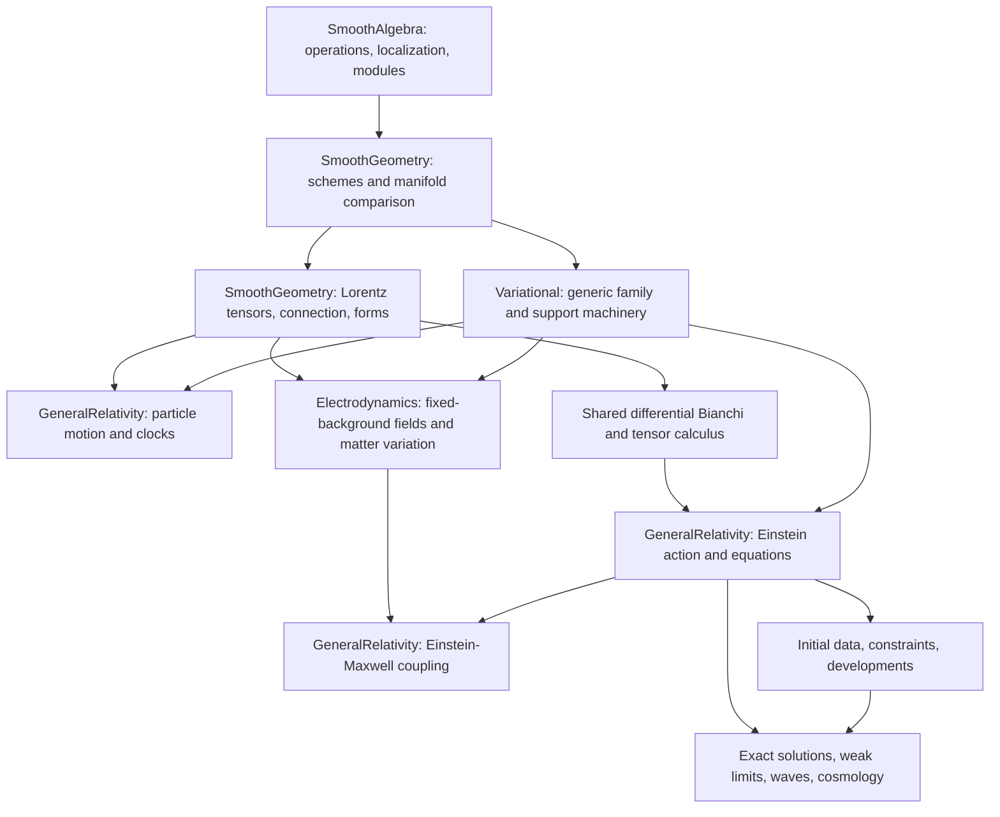

# Research Plan for General Relativity over C∞ Geometry

A Lean formalization programme for Landau–Lifshitz, *The Classical Theory of
Fields*, fourth edition, Chapters X–XIV, §§81–119.

This is the third part of the C∞ relativity and field-theory trilogy:
[Special Relativity](cinfty-special-relativity.md),
[Electrodynamics](cinfty-electrodynamics.md), and General Relativity.
It follows the research-manuscript structure of
[C∞ mechanics](cinfty-mechanics.md), while using the subsequently constructed
[shared smooth geometry](smooth-geometry.md).
The [research outline](../README.md) remains the subject-level plan;
[the GR implementation guide](general-relativity.md) records existing APIs.

The proof-status baseline is `main` at `61d8fdf` on 13 November 2026,
including the merged work tracked by #52 and the flat Maxwell action from #44.
This document completes the GR design contribution to
[issue #8](https://github.com/MGYamada/ProjectAInos/issues/8).
Writing the programme does not complete its future mathematical milestones,
the remaining API design review, or the classical-to-quantum correspondence.

## Implementation plan and current progress

The existing library already goes substantially beyond a coordinate
prototype. Its Lorentz metrics, connections, curvature, differential forms,
and particle variations live on actual tangent bundles.
The next major step is to make the metric dynamical.

| Component | Status at the baseline | Next obligation |
| --- | --- | --- |
| Smooth rings, real spectra, localizations, schemes, open gluing | Constructed | Complete/fair rings, Γ–Spec comparison, universal cotangent modules |
| Manifolds as C∞ schemes | Constructed for the documented finite-dimensional models | Full faithfulness and broader comparison domains |
| Smooth Lorentz metrics and native tensors | Constructed | Generic tensor covariant derivatives needed by field dynamics |
| Levi-Civita connection and curvature | Constructed, including coordinate covariance and algebraic Bianchi | Differential and contracted Bianchi identities |
| Ricci and scalar curvature | Constructed intrinsic contractions | Einstein tensor and its divergence identity |
| Geodesics and parallel transport | Local existence/uniqueness and finite-segment transport proved | Geodesic deviation, global causal geometry, completeness questions |
| Local inertial coordinates and local flatness | Proved, with their different hypotheses | Applications to observers and gravitational measurements |
| Proper time and particle variational principles | Proved on arbitrary supported Lorentz manifolds | Charged curved motion and coupled matter models |
| Native exterior calculus, volume, Hodge and divergence | Constructed | Integration interfaces for varying metrics and hypersurfaces |
| Fixed-background Maxwell equations | Proved form/component equivalence and current conservation | Metric variation and Einstein–Maxwell coupling |
| Controlled Newtonian particle limit | Proved for time-dependent coefficient families | The separate Newtonian limit of the gravitational field equations |
| Einstein–Hilbert action, Einstein equations and stress-energy | Planned | Compactly supported metric variations first |
| Exact gravitating solutions, gravitational waves and cosmology | Planned | Explicit solution checks before existence or classification claims |

“Constructed” means that the relevant objects and advertised properties have
Lean definitions and proofs. A future theorem statement, a symbolic calculation,
or a reference to a classical result does not change that status.
The detailed evidence table near the end identifies the actual source modules.

## Abstract

General relativity treats the spacetime metric as a field whose dynamics must
be derived and whose solutions must be analysed. A C∞ foundation separates
three mathematical jobs: smooth observables and their local algebra; geometric
objects on the resulting space; and analytic statements about variation,
evolution, and limits. The project already constructs the first two jobs for
ordinary smooth Lorentz manifolds and a substantial part of particle analysis.
This manuscript specifies how to continue to Einstein dynamics without
turning a field equation, an existence theorem, or a physical approximation
into an implicit axiom.

The first field-dynamics target uses smooth compactly supported variations of
the covariant metric on an open region. It proves signature preservation,
differentiates the actual Einstein–Hilbert density, integrates its divergence
term, and realizes arbitrary symmetric test tensors. Stationarity then becomes
equivalent to Einstein's equations with the stated matter variation contract.
Boundary actions, noncompact charges, global evolution, and singular spaces
are subsequent targets with their own hypotheses.

Every section of the chosen Landau–Lifshitz edition has one correspondence row.
Rows distinguish existing proofs, planned exact theorems, and precise targets
for physical or asymptotic arguments. The C∞ formulation retains nilpotents
and allows future deformation theory, but does not claim that Lorentz metrics,
integration, or general Einstein solution spaces already exist over arbitrary
nonreduced coefficient rings.

## Introduction

### Aim and relation to the trilogy

The SR volume fixes flat spacetime, observers, relativistic motion, and
conventions for energy and momentum. The ED volume develops the electromagnetic
field on fixed backgrounds and then its stress-energy and matter coupling.
This volume supplies varying geometry, its field equations, and gravitating
systems. Maxwell equations on a curved fixed background therefore remain an
ED subject even when their required geometry is shared with GR.

The target is a formalization programme, not a second copy of the API guide.
For each proposed construction it records the intended objects, theorem
conclusions, analytic premises, and a proof route that can be implemented.
The design should remain useful when the implementation changes module names.
Actual declaration names below are reserved for existing declarations;
new names in the architecture section are explicitly proposals.

### Conventions

The physical spacetime dimension is four, with signature `(-+++)` and
time-first coordinates `(t,x,y,z)`. Unless a limit reinstates it explicitly,
`c = 1`. Newton's constant is denoted `G_N > 0`, the gravitational coupling
is `κ = 8πG_N`, and the cosmological constant is a real parameter `Λ`.
The shared geometric APIs retain both Lorentz conventions.

Time orientation, spacetime orientation, and a choice of observer are separate
data. None is silently recovered from a coordinate label.
Volume-density arguments use the positive density; oriented-form arguments
state the orientation they require. Compact support is relative to the open
domain in which a theorem is asserted.

The curvature and Ricci conventions are those of the implemented library:

$$
R(X,Y)Z=\nabla_X\nabla_YZ-\nabla_Y\nabla_XZ-\nabla_{[X,Y]}Z,
\qquad
\operatorname{Ric}(u,v)=\operatorname{tr}(w\mapsto R(w,u)v).
$$

The scalar curvature is the inverse-metric contraction of Ricci. The proposed
Einstein tensor is `Ein(g) = Ric(g) − (R(g)/2) g`. Textbook component formulas
must be translated through these conventions before becoming theorem targets.
An overall signature reversal is supported by geometry; physical action and
stress-energy conventions must be translated as well.

For a timelike curve, `s = sqrt(−g(T,T))`, `dτ = s dt`, and `U = T/s`.
Thus `g(U,U) = −1`. A massless worldline is represented by a nonzero null
tangent and an affine parameter; dividing its velocity by proper speed is
not an admissible definition.

The electromagnetic conventions are shared with the ED manuscript:
`F = dA`, `H = −⋆F`, `J = ⋆(j♭)`, and `dH = J`.
The signed current `j` in this sourced API is distinguished from a matter
charge current `k` defined by positive minimal coupling `+e∫A`.
The future coupled-action bridge proves `J = −K`, hence `j = −k`, when
`K = ⋆(k♭)` is obtained from that matter variation.

### Tiers and status

The tiers describe infrastructure needed by a proof, independently of whether
that proof is currently implemented. They preserve the distinctions in the
mechanics manuscript while giving GR its required analytic interfaces.

| Tier | Meaning in this manuscript |
| --- | --- |
| [A] | Algebra over a specified C∞ ring or its specified modules; no analytic existence claim |
| [A*] | A finite concrete identity, such as a matrix, curvature-component, or rational ansatz calculation |
| [B: name] | A theorem using only the named analytic interface in addition to earlier results |
| [C] | Geometric infrastructure: manifolds, bundles, sheaves, connections, forms, or hypersurfaces |
| [D] | A major analytic/global theorem, initially an explicit hypothesis if not proved |
| [P] | A physical or asymptotic argument replaced by a stated mathematical target |

The named [B] interfaces are `Variation`, `Support`, `Stokes`, `ODE`,
`Limit`, and `Asymptotics`, specified under Towards Lean.
An [A*] check of one solution never proves [D] existence for arbitrary data.
A [P] row identifies what is to be proved; it does not allow an approximation
to masquerade as equality in the original nonlinear theory.

## Foundations

### Constructed C∞ geometry

On an open set `U` of a smooth manifold, the algebra of smooth real-valued
observables carries every finite-arity smooth operation by composition.
Restrictions preserve those operations. The project retains this structure
when passing through sheaves, stalks, localizations, and gluing.
Its real spectrum uses points `A → ℝ` that preserve smooth operations.

For an arbitrary C∞ ring, the structure sheaf cannot be replaced by the
collection of values at real points. Nilpotent elements can have zero residue
at every real point and still carry meaningful infinitesimal information.
The constructed point localizations and their stalk comparison retain it.
General localization is a separate inverse-adjoining construction; an infinite
intersection of nonvanishing loci need not be open.

The current manifold comparison identifies the actual smooth-function sheaf
on Euclidean space with the constructed spectrum, then uses charts to obtain
a scheme on a boundaryless finite-dimensional manifold. It provides induced
maps and their identity/composition laws. The comparison currently uses
models `Fin n → ℝ` and a carrier in `Type`.

These are implementation facts recorded in the
[smooth geometry guide](smooth-geometry.md#comparing-manifolds-with-schemes),
not assumptions supplied by the physics layer.
The mathematical C∞ scheme framework comes from
[Joyce's treatment](https://arxiv.org/abs/1001.0023).
Full faithfulness, complete/fair ring theory, and the Γ–Spec adjunction are
separate pending results. No GR theorem may silently use `A ≅ Γ(Spec A)`
for an unrestricted C∞ ring.

### What a spacetime adds

A spacetime in the implemented sector is a smooth manifold with a smooth
nondegenerate symmetric bilinear metric of Lorentz signature on its actual
tangent bundle. `LorentzManifold.toScheme` supplies the underlying C∞ scheme.
The metric adds data; it does not alter that scheme's structure sheaf.

Pointwise Lorentz signature is witnessed by a linear equivalence at each
point. It does not choose a smooth global orthonormal frame.
The topology and smoothness of sections use actual bundle charts.
Norm estimates needed by analytic arguments belong to finite coordinate
models or spaces of curves, rather than to an invented preferred norm on
each native Lorentz tangent fibre.

Proposed **spacetime data contract** [C]: retain the current manifold and
metric objects and add orientation, time orientation, or a specified region
only to interfaces that use them. Global causal conditions, such as global
hyperbolicity, are predicates proved for a model or explicit hypotheses.
They are not fields of the minimal Lorentz metric structure.

### Cotangent modules and infinitesimal coefficients

The algebraic continuation seeks a universal C∞ derivation

$$
d_A:A\longrightarrow\Omega^1_A,
\qquad
d_A\Phi_f(a)=\sum_i\Phi_{\partial_i f}(a)\,d_Aa_i.
$$

Its universal property represents derivations satisfying the smooth chain
rule. Sheafifying these modules and comparing them with the existing smooth
cotangent bundle is a theorem to prove, not a change of notation.
On the manifold sector, exterior powers and tensor operations must agree
with the native bundles already used in Lorentz geometry.

Proposed **cotangent comparison** [A,C]: for each supported manifold chart,
construct a module/sheaf isomorphism taking universal `df` to the actual
manifold differential, prove compatibility on overlaps, and glue it.
The proof needs the universal property, chart generation, and the smooth
chain rule. Its scope must name the category of sheaves and modules involved.

For a test ring with nilpotents, formal metric perturbations may be encoded
by symmetric bilinear forms with invertible determinant. Invertibility of
`g + εh` for `ε² = 0` has a finite inverse formula and is an [A] target.
Lorentz signature and positivity are not defined by ordering nilpotents.
A future family notion must specify the real-point signature and its
compatibility with base change before being used in physics.

### Smooth jets versus formal jets

Current curvature and variational formulas use actual derivatives in charts
or on native bundles. A coordinate first or second jet records values of
these derivatives with their transformation laws. A universal algebraic jet
ring is a different object whose comparison remains to be constructed.

Proposed **metric jet compatibility** [A*,C]: prove that the coordinate
formula for curvature depends on the second jet of the metric on the
nondegenerate locus and that transition maps include the required derivative
terms. Then identify this formula with the existing native curvature.
Only after this theorem may an algebraic jet calculation be advertised as
a calculation of the native geometric object.

Formal Einstein equations over test rings can eventually define a solution
functor. Neither its representability nor a quotient by diffeomorphisms is
assumed here. Gauge stabilizers and singular solution strata make an ordinary
set quotient inadequate for a general moduli theorem.
Derived or stack-level descriptions remain research extensions, not prerequisites
for the real smooth-manifold field equations.

## Geometry and motion

### Connections, tensors, and curvature

The shared library constructs the Levi-Civita connection from the metric,
proves torsion-freeness and metric compatibility, and proves uniqueness under
the stated differentiability conditions. It also derives Christoffel formulas
and their inhomogeneous transition law on actual smooth chart overlaps.
Riemann curvature is tensorial, smooth, and natural under metric-preserving maps.

Existing mixed tensor bundles, contractions, products, permutations, and
pullbacks supply the representation of future field equations.
Covariant tensors can be pulled back along arbitrary smooth maps, including
dimension-changing and singular maps. Such a pullback can be degenerate;
it is not automatically a Lorentz metric on the source.

Proposed **tensor derivative extension** [C]: construct covariant differentiation
of all finite tensor shapes, with the Leibniz rule, contraction compatibility,
and the induced action on alternating tensors. Recover the existing two-form
derivative as a specialization. Use bundle-local extension independence rather
than postulating a global frame.

The algebraic first Bianchi identity is already proved. The next target is
the differential identity

$$
(\nabla_XR)(Y,Z)+(\nabla_YR)(Z,X)+(\nabla_ZR)(X,Y)=0.
$$

Proposed **differential Bianchi** [C]: for the smooth metric, prove the
displayed equality as an endomorphism-valued tensor identity. A chart proof
may cancel second derivatives of connection coefficients and then descend by
the tensor derivative comparison. An intrinsic proof may use commutator
identities, provided all local regularity requirements remain explicit.

Proposed **contracted Bianchi** [C]: contraction and metric compatibility give
`∇ᵃRic_ab = (1/2)∇_b R`, hence `∇ᵃEin_ab = 0`.
This is a geometric theorem for every smooth Lorentz metric. Einstein's
equations are not a premise, and matter conservation is not its definition.

### Inertial charts, tidal effects, and transport

Two implemented statements have different meanings. At a point, an inertial
chart can make `g = η`, `Γ = 0`, and the first metric derivatives vanish.
If curvature vanishes near a point, a Minkowski chart exists on a possibly
smaller neighborhood; conversely, curvature vanishes on a Minkowski chart's
domain. The curved conformal example distinguishes pointwise inertia from
this neighborhood statement.

The existing transport results construct unique parallel fields on finite
regular segments, metric-preserving endpoint maps, and composition and reversal
for finite piecewise paths. Within the chosen Minkowski chart neighborhood,
transport depends only on its endpoints. Flatness on an arbitrary larger
region does not by itself remove holonomy or prove global path independence.

Proposed **Jacobi equation** [B: Variation,C]: for a smooth two-parameter family
whose time curves are affine geodesics, let `T` and `V` be its tangent and
variation fields. Prove

$$
\nabla_T\nabla_TV+R(V,T)T=0.
$$

The proof uses commuting parameter fields, torsion-freeness, the curvature
convention above, and differentiation of the geodesic equation.
The converse realization of a Jacobi field requires smooth dependence of
geodesic initial data; it is a distinct ODE theorem.
Tidal measurements use curvature components in a transported observer frame,
with the frame and its transport specified as part of the experiment.

### Particle action and its existing variational equivalences

The quadratic and massive actions are

$$
S_2[\gamma]=\frac12\int_a^b g(T,T)\,dt,
\qquad
S_m[\gamma]=-m\int_a^b\sqrt{-g(T,T)}\,dt.
$$

Existing native manifold families are jointly C² near the finite reference
segment and fix both endpoints for nearby variation parameters. Actual
derivatives of the actions satisfy intrinsic endpoint formulas.
Localized chart families realize the test fields used in the fundamental lemma.
For `a < b`, quadratic stationarity is equivalent to affine geodesic motion.

For positive mass and a timelike reference curve, massive stationarity gives
`∇_T T = (s'/s)T`, and is equivalent to regular local affine reparametrization.
The finite proper-time inverse is constructed on a whole finite timelike
segment, rather than assumed from a pointwise normalization formula.
Quadratic-stationary curves with nonzero null initial velocity preserve that
property along the finite segment.

Proposed **curved charged particle bridge** [B: Variation,C]: add `e∫γ*A`
for a smooth local one-form potential whose domain contains the curve and
admissible variations. Derive the covariant Lorentz force and its gauge
endpoint term. Prove exact agreement with the existing flat theorem under
the Minkowski specialization. The support/localization argument must preserve
timelikeness uniformly on the compact reference segment.

### Stationary observers and rotation

Proposed **Killing conservation** [C]: if `K` satisfies the Killing equation
and `γ` is an affine geodesic, prove that `g(K,T)` is constant along `γ`.
Use the metric product rule, the geodesic equation, and the antisymmetry of
the Killing derivative. An arbitrary coordinate vector is not a Killing field.

For a stationary region with timelike Killing field `K`, stationary observers
have velocity `K/sqrt(−g(K,K))`. A null geodesic exchanged between two such
observers gives a frequency-ratio theorem from the same conserved pairing.
Existence of the connecting ray is an explicit input until independently proved.

Rotating coordinates are first tested on Minkowski spacetime. The domain
where the rotating time vector is timelike must be stated, and the resulting
shift terms retained. A nonzero connection in these coordinates does not
constitute curvature. Sagnac-type timing is a theorem about specified paths
and observers, with synchronization and endpoint events fixed.

## Einstein dynamics

### Metric variations and preservation of signature

The first metric-variation sector is a finite-dimensional Hausdorff,
second-countable smooth boundaryless manifold with an orientation and an
open region `U`, with a fixed smooth Lorentz metric `g` and a smooth symmetric
covariant tensor `h` whose topological support is compact in `U`.
Set `g_ε = g + εh` on `U` and use `g` outside the support.
These analytic-sector hypotheses support partitions of unity, extension of
compact chart tests, and integration. They do not strengthen the minimal
assumptions of the already constructed C∞ scheme or Lorentz geometry.

Proposed **admissible variation theorem** [B: Support,C]: there exists an open
parameter interval around zero on which every `g_ε` is Lorentz, jointly smooth
in parameter and position, and agrees with `g` off one compact set.
Proof: choose finitely many charts over the support, use openness of the fixed
inertia class for symmetric matrices, extract a uniform parameter bound,
and glue the unchanged exterior. Do not choose a smooth global Lorentz frame.

This theorem permits arbitrary compactly supported symmetric `h`; it is
stronger than assuming a convenient family of diagonal metric perturbations.
For proofs requiring higher regularity in the parameter, the chosen family
is polynomial in `ε` and smooth in position.
Finite-regularity variants may be added after the smooth theorem is established.

Proposed **elementary variation formulas** [A*,B: Variation]: with
`h_ab = δg_ab`, prove

$$
\delta g^{ab}=-g^{ac}g^{bd}h_{cd},\qquad
\delta d\mu_g=\frac12\operatorname{tr}_g(h)\,d\mu_g,
$$

and

$$
\delta\Gamma^a{}_{bc}
=\frac12g^{ad}(\nabla_bh_{cd}+\nabla_ch_{bd}-\nabla_dh_{bc}).
$$

Although the connection coefficients themselves are not a tensor, the
difference and first variation of two connections are tensors.
Prove that distinction through the connection transformation law.
The inverse-matrix derivative and density derivative precede the curvature
variation; they are independently reusable in the ED stress-energy theorem.

### Einstein–Hilbert variation with compact support

Define the gravitational density and, when integrable, its action by

$$
\mathcal L_{\mathrm{EH}}(g)=\frac1{2\kappa}(R_g-2\Lambda)d\mu_g,
\qquad
S_{\mathrm{EH},U}(g)=\int_U\mathcal L_{\mathrm{EH}}(g).
$$

For a noncompact background on which the total action diverges, use the
relative action `∫U (L_EH(g_ε) − L_EH(g))`, whose integrand has compact support.
The first theorem differentiates this finite relative action. It does not
assign a physical derivative to a divergent absolute integral.

Proposed **curvature variation identity** [B: Variation,C]: for the covariant
variation `h`, prove

$$
\delta R=-\operatorname{Ric}^{ab}h_{ab}
+\nabla_a\bigl(\nabla_bh^{ab}-\nabla^a\operatorname{tr}_g h\bigr).
$$

Here both indices of `h` are raised by the unvaried metric.
The proof first differentiates the coordinate curvature formula, identifies
the tensorial connection variation, and then uses metric compatibility.
All derivatives are derivatives of the actual parameter family.

Proposed **compact Einstein–Hilbert first variation** [B: Variation,Stokes,C]:

$$
\left.\frac{d}{d\varepsilon}\right|_0\Delta S_{\mathrm{EH},U}
=-\frac1{2\kappa}\int_U
\bigl(\operatorname{Ein}^{ab}+\Lambda g^{ab}\bigr)h_{ab}\,d\mu_g.
$$

The divergence term integrates to zero because the variation is compactly
supported in `U`. Differentiation under the integral is justified on one
common compact set, with a parameter-uniform dominating bound derived from
smoothness and compactness. The tensor identity alone is not this theorem.

This design follows the standard metric-variation route, with conventions
checked against [Tong's action discussion](https://davidtong.org/teaching/general-relativity/grhtml/S4).
The compact-support contract and its proof obligations are this project's
chosen initial implementation scope.

### Matter variation and the Einstein equation

For a smooth matter field `ψ`, the initial matter interface is a relative
action together with proved metric and field variation formulas on `U`.
Its symmetric Hilbert tensor is characterized by

$$
\delta_gS_m[g,\psi](h)=\frac12\int_U T^{ab}h_{ab}\,d\mu_g.
$$

Equivalently, varying the inverse metric gives
`δS_m = −(1/2)∫ T_ab δg^{ab} dμ_g`.
The interface requires the formula to be a theorem of the concrete action;
an arbitrary tensor supplied by the caller is only a prescribed source model.

Proposed **stationarity equivalence** [B: Variation,Support,Stokes,C]: for
`κ > 0`, smooth fields, and the proved matter variation contract, stationarity
of the total relative action under every compactly supported metric variation
is equivalent on `U` to

$$
\operatorname{Ein}_{ab}+\Lambda g_{ab}=\kappa T_{ab}.
$$

Proof: combine first variations, test in a chart using a bump times each
symmetric basis tensor, apply the scalar fundamental lemma, and cover `U`.
The signature-preservation theorem realizes every such test as an actual
Lorentz metric family. Conversely, the equation makes every first variation
zero. This proves an equivalence for fields already supplied, not existence
of a metric solving a prescribed stress tensor.

Define the Einstein equation as a predicate on metric, matter, coupling, and
cosmological constant. A spacetime metric is never required to satisfy it as
part of the general geometric structure.
Tracing the equation and deriving its trace-reversed form are [A*] targets;
division by the dimension-dependent coefficient requires its nonvanishing.

### Conservation and electromagnetic coupling

The contracted Bianchi identity implies `∇ᵃT_ab = 0` for a solution with
constant `κ ≠ 0` and constant `Λ`. A separate Noether theorem should derive
matter conservation from diffeomorphism invariance and the matter equations.
Comparing these routes exposes missing source or boundary terms.

For the Maxwell action, the target Hilbert tensor is

$$
T^{\mathrm{EM}}_{ab}
=F_{ac}F_b{}^c-\frac14g_{ab}F_{cd}F^{cd}.
$$

Proposed **Maxwell metric variation** [B: Variation,C]: keep the two-form `F`
fixed while varying the metric, derive this tensor from the actual action,
and prove symmetry, gauge invariance, and its zero trace in four dimensions.
The derivation varies both inverse metrics and the volume density.
The stress tensor is defined before any field equation is imposed.

For the existing Maxwell source convention, the planned exchange law is
`∇_a T_EM^{ab} = F^{bλ}j_λ`. Positive matter coupling yields `j = −k`, so
matter force density `F^{bλ}k_λ` cancels the field divergence.
The coupled action must prove this sign bridge and total conservation.
For a prescribed source term `−∫A∧J`, metric variation holds the three-form
`J` fixed; holding its derived vector `j` fixed would be a different variation.

The first smooth matter examples are a scalar field and a smooth Maxwell
field. Point-particle self-fields, products of distributions, and radiation
reaction require separate regularity/renormalization models.
Einstein–Maxwell solution verification may use a supplied smooth charged
matter tensor, with its constitutive assumptions stated explicitly.

### Boundary actions and gravitational energy

Compact support avoids a boundary variational problem in the first milestone.
Later, a non-null hypersurface with induced metric, unit normal, and second
fundamental form will support a boundary-corrected action.
Its sign depends on normal orientation and whether the boundary is timelike
or spacelike; both must occur in the theorem statement.

Proposed **Dirichlet boundary variation** [B: Stokes,C]: derive the normal
derivative term in the Einstein–Hilbert variation, construct the matching
extrinsic-curvature boundary term, and prove cancellation for fixed induced
metric. Null boundaries and corners are further extensions with different
data, rather than special cases obtained by dividing by a zero normal norm.

Gravitational energy requires a separate API for coordinate-dependent
pseudotensors and geometric boundary charges. A pseudotensor identity may
produce a conserved coordinate expression but does not make that expression
a covariant local stress-energy tensor.
Asymptotic mass, angular momentum, and flux need explicit falloff, parity
where appropriate, integration domains, and admissible asymptotic coordinate
changes. Their existence is an analytic theorem, not a consequence of notation.

## Initial data and gravitating systems

### Hypersurfaces and constraints

The first hypersurface interface uses a smooth spacelike embedding with
future unit normal `n`, induced Riemannian metric `h`, and
`K(X,Y) = −g(∇_X n,Y)`. This sign is fixed before deriving evolution formulas.
Gauss, Codazzi, and the normal evolution identities must follow from the
existing ambient connection and curvature through the actual embedding.

Proposed **constraint projection theorem** [C]: a spacetime satisfying the
Einstein equation induces data obeying

$$
{}^{(3)}R+(\operatorname{tr}K)^2-|K|^2=2\kappa\rho+2\Lambda,
\qquad
D_jK^j{}_i-D_i\operatorname{tr}K=\kappa J_i,
$$

where `ρ = T(n,n)` and `J(X) = −T(n,X)`.
The proof projects the field equation, uses Gauss–Codazzi, and checks these
signs against the normal convention. Conversely, constraints alone do not
supply a spacetime development.

The lapse is positive, and the shift is a tangent vector field on the slice.
Evolution in a chosen foliation must record both; a convenient synchronous
choice may fail after a caustic. The ADM decomposition supplies the model for
this part of the design, with the original authors' formulation available in
[The Dynamics of General Relativity](https://arxiv.org/abs/gr-qc/0405109).

### Local development and gauge

Proposed **reduced evolution contract** [D]: a selected hyperbolic gauge and
regularity class admit local evolution for initial data satisfying stated
analytic and compatibility assumptions. The output includes a spacetime
region, initial embedding, metric regularity, and uniqueness in the declared
gauge. Until proved, this is a named theorem parameter at downstream uses.

Proposed **constraint propagation** [B: ODE or D,C]: prove a homogeneous
evolution equation for the gauge and constraint residuals and obtain their
vanishing from zero initial data by the relevant uniqueness theorem.
Only then does a reduced-system solution become a full Einstein solution.
Geometric uniqueness identifies developments up to a diffeomorphism respecting
the initial embedding, not equality of all coordinate component functions.

The first implementation should use smooth data and local statements.
Sobolev regularity, maximal globally hyperbolic development, continuous
dependence, and stability are independent [D] milestones.
No global theorem is inferred from a finite collection of exact solutions.

### Newtonian gravity: motion and field limits

The existing `NewtonianMetricFamily` allows time-dependent potential and
controlled corrections to all metric blocks. On a common coordinate domain,

$$
g_{tt}=-c^2-2\Phi+c^{-2}A_c,\qquad
g_{ti}=c^{-2}B_{c,i},\qquad
g_{ij}=\delta_{ij}+c^{-2}H_{c,ij}.
$$

Uniform C² bounds, bounded velocities, compact trajectory tubes, and a large
`c` tail yield the native acceleration estimate and common-interval trajectory
convergence at order `c⁻²` when initial errors have that order.
This is a theorem about particle motion in a supplied family of metrics.
It does not prove that the family solves Einstein's equation or that `Φ`
satisfies a Poisson equation.

Proposed **Newtonian field limit** [P,B: Limit,C]: choose a one-parameter
family solving the Einstein–matter equations, specify physical-time units,
the scaling of stress-energy, `Λ`, and all metric blocks, and prove the
appropriately scaled field residual tends to `ΔΦ − 4πG_Nρ`.
Require enough uniform derivative control to pass to curvature and control
the remainders on the common region. Initially set `Λ = 0` for this theorem.

The first field-limit proof may use a restricted weak, slowly varying ansatz,
with its actual spatial metric corrections derived from the field equations.
It must not silently reuse the broader motion family if that family lacks
the constraints needed by the field limit. A compatibility theorem then
combines field and trajectory limits to obtain Newtonian self-consistent
motion for the overlapping hypotheses.

### Spherical vacuum geometry and measurements

The first exact GR field example is the Schwarzschild exterior with `M > 0`
and domain `r > 2G_NM` in units `c = 1`. Construct the metric as a Lorentz
metric, prove its curvature components, and verify `Ric = 0`.
The proposed metric is

$$
g=-f(r)\,dt^2+f(r)^{-1}\,dr^2+r^2h_{S^2},
\qquad f(r)=1-\frac{2G_NM}{r},
$$

where $h_{S^2}$ is the unit round sphere metric.
The radial/angular coordinate domain and sphere charts must be explicit.

Proposed **spherical classification** [B: ODE,C]: on an appropriate connected
spherically symmetric vacuum region with nondegenerate area-radius gradient,
derive the reduced equations and prove local equivalence to a Schwarzschild
member. This requires an actual symmetry/quotient hypothesis and is stronger
than checking one coordinate ansatz. Degenerate cases need separate statements.

Geodesic energy and angular momentum follow from proved Killing fields.
Effective-potential identities, circular-orbit radii and stability are first
finite/local targets. Perihelion and light-deflection approximations require
error estimates in a specified small parameter, not just a truncated series.
Time-delay measurements specify observer worldlines and reception events.

### Horizons, collapse, and rotating solutions

The pole at `r = 2G_NM` in exterior coordinates is not itself a curvature
singularity. Construct overlapping regular coordinates, prove the transition
and metric agreement, and show extension across the candidate horizon.
Curvature invariants then distinguish the center's divergent curvature.

An event horizon is a global causal boundary, defined relative to a suitable
asymptotic completion; a null coordinate hypersurface is not sufficient.
Trapped surfaces use both null expansions and their sign conventions.
Statements about apparent and event horizons retain their different data.

For spherical collapse, the initial target supplies smooth interior and
exterior solutions and an explicit matching hypersurface. Prove the induced
metric and extrinsic-curvature matching conditions before claiming a glued
solution without a thin shell. Dust collapse adds a specified density and
four-velocity, conservation laws, and the interval before shell crossing.

Rotating vacuum solutions begin with metric verification on stated regular
domains, then ergoregions, Killing horizons, and geodesic integrals.
Black-hole uniqueness, generic nonspherical collapse, and stability require
global hypotheses and substantial independent analysis. A successful Kerr
component calculation is not a proof of any of those conclusions.

Post-Newtonian many-body targets use a controlled expansion of smooth sources
or a separately specified singular-source model. Parameter scaling, matching,
gauge, and remainder norms belong in the theorem. Conservation identities
provide consistency checks but do not prove the approximation's validity.

## Gravitational waves and cosmology

### Linearized geometry and gauge

For a genuine smooth family `g_ε = η + εh`, the linearized Einstein operator
is the derivative at zero of the native Einstein tensor.
Proposed **linearization theorem** [B: Variation,C]: compute that derivative,
prove its flat coordinate formula, and prove invariance under the infinitesimal
diffeomorphism change `h ↦ h + L_Xη`.
This compares actual derivatives with the formal first-order expression.

Set `bar h = h − (tr_η h/2)η`. Under the harmonic condition
`∂ᵃ bar h_ab = 0`, the target is
`Ein^(1)_ab(h) = −(1/2)□ bar h_ab`, where `□ = −∂t² + Δ`.
The identity is distinct from existence of a gauge transformation imposing
the condition; that transformation requires solving a wave equation.

Plane-wave examples specify null wave covectors, polarization tensors, and
residual gauge transformations. Counting two physical polarizations must
identify the quotient space and exclude the zero/null-degenerate cases
where the rank argument changes. Geodesic deviation provides a tensorial
observable for their tidal effect.

The weak-field and radiation programme is checked against the author-written
[weak-gravity notes](https://davidtong.org/teaching/general-relativity/grhtml/S5).
The formal targets below add explicit domains, analytic contracts, and
remainder obligations rather than adopting qualitative smallness statements.

### Propagation, exact waves, and emission

Proposed **curved-background linearization** [B: Variation,C]: differentiate
Einstein's equation about a supplied solution, retain curvature terms and
matter variations, and derive the gauge identity on that background.
Short-wavelength propagation is a separate asymptotic theorem with a
specified wavelength parameter, phase, amplitude bounds, and remainder.

Exact wave metrics give an independent test of the nonlinear field equations.
Construct one regular plane-fronted example, verify its metric signature and
Ricci tensor, and compare its weak-amplitude limit with linearized data.
Do not label a metric exact merely because its first-order residual vanishes.

For radiation from a source, first prove a retarded solution theorem for the
linearized operator under a stated Green-operator contract and conserved
compact source. Then derive far-zone and slow-source expansions with uniform
error control on the chosen observation region.
The quadrupole flux is a target for that controlled expansion, not an exact
power formula for every solution of the nonlinear equations.

Gravitational-wave energy is quadratic in the perturbation and requires an
averaging or asymptotic-flux definition. Each such definition specifies gauge
invariance to its claimed order. Global mass loss and nonlinear stability
remain [D] extensions with asymptotic and causal hypotheses.

### Isotropic models

Take an interval `I`, a three-manifold with a constant-curvature Riemannian
metric `h_k`, and a smooth positive scale factor `a : I → ℝ`.
Construct `g = −dt² + a(t)² h_k` on the product.
Prove the connection and curvature formulas before asserting Einstein dynamics.
The spatial topology and curvature parameter `k` are explicit model choices.

For comoving perfect-fluid matter with density `ρ`, pressure `p`, unit
velocity $u=\partial_t$, stress
$T=(\rho+p)u^\flat\otimes u^\flat+p\,g$, and a specified equation of state,
the targets are

$$
H^2+\frac{k}{a^2}=\frac{\kappa\rho}{3}+\frac{\Lambda}{3},
\qquad
\frac{a''}{a}=-\frac{\kappa}{6}(\rho+3p)+\frac{\Lambda}{3},
\qquad
\rho'+3H(\rho+p)=0,
$$

with `H = a'/a`. Prove equivalence with the relevant Einstein components and
show which equations follow from the others on domains where any division is
valid. At a turning point `H = 0`, avoid an invalid division by `H`.
Existence and continuation for a chosen equation of state require ODE results.

A redshift theorem compares frequencies measured by comoving observers along
a specified null geodesic and obtains the scale-factor ratio. Conformal-time
coordinates are constructed only where `a > 0`, with explicit interval maps.
Distance-redshift relations need the spatial curvature and observation setup.

### Perturbations, anisotropy, and singularity

For cosmological perturbations, choose variables and a gauge or prove gauge
invariance of the claimed observables. Derive the linearized constraint and
evolution system from an actual metric/matter family. A growth exponent in
one Fourier mode is not nonlinear stability of the full spacetime.

Homogeneous anisotropic models use a specified Lie group or homogeneous space,
its invariant frame and structure constants, and a time-dependent positive
spatial metric. The symmetry reduction must be proved to preserve the full
field equations, rather than merely substituting fewer variables into an action.
Kasner-type solutions provide exact algebraic parameter tests.

Oscillatory approach to a cosmological singularity is a research programme
with separate model-level and genericity statements. Start with finite
transition identities and explicitly controlled intervals in a selected
homogeneous model. General claims about typical solutions remain [D,P].

Proposed **focusing interface** [C,B: ODE]: derive Raychaudhuri's equation
for a specified hypersurface-orthogonal geodesic congruence, define its
expansion, shear and vorticity, and prove that vorticity vanishes. Under the
appropriate Ricci convergence inequality and initial negative expansion,
prove a finite-parameter focusing bound on a regular segment long enough
to reach that bound, or loss of congruence regularity before it. Use unit
proper-time parametrization for timelike curves and affine parametrization
with a defined screen-space expansion for null curves. A nonzero vorticity
term requires an additional bound and is not covered by this first theorem.

Singularity theorems use energy, causality, global, and genericity hypotheses
to conclude geodesic incompleteness. That conclusion does not itself identify
a curvature blow-up point inside the manifold. Conversely, one divergent
curvature component in a singular chart is insufficient for incompleteness.
Those distinctions control the targets assigned to the final LL sections.

<a id="landau-lifshitz-correspondence"></a>

## Landau–Lifshitz correspondence

The section numbers follow the fourth edition of Volume 2, whose chapter and
section allocation was checked against the publisher-supplied
[Google Books contents](https://books.google.com/books/about/The_Classical_Theory_of_Fields.html?id=QIxD3Z82AagC).
The topic labels below are paraphrases. Targets, premises, and status are this
project's design, not claims that the textbook already supplies formal proofs.
There is exactly one row for each integer from 81 through 119.

`Existing + planned` means that the row contains a proved ingredient and a
new obligation. It does not mark the whole textbook section complete.
The dependency names refer to the interfaces and milestones below.

| § | Topic and formalization target | Hypotheses and boundary | Tier / dependency | Status |
| --- | --- | --- | --- | --- |
| 81 | Newtonian gravitational motion: recover the acceleration and trajectory limit | Common C² coefficient bounds, bounded velocities, compact tube; potential supplied | [P,B: Limit] / motion foundation | Existing; field sourcing remains separate |
| 82 | Relativistic gravity: define metric spacetime and physical observers | Lorentz metric; time orientation only when used | [C] / spacetime contract | Existing geometry; observer applications planned |
| 83 | Coordinates: prove tensor and connection transition rules | Actual smooth chart overlap and invertible chart derivative | [C] / native tensor calculus | Existing principal rules |
| 84 | Local clock and distance measurements: compare observer rest metrics and proper time | Timelike observer, specified simultaneous events or spatial slice | [C,B: ODE] / observers | Existing clocks; general measurement design planned |
| 85 | Covariant differentiation: extend the connection to all tensor types | Smooth sections and the stated derivative regularity | [C] / tensor derivative extension | Existing vector/two-form cases; general extension planned |
| 86 | Metric connection: derive uniqueness and Christoffel coefficients | Smooth nondegenerate Lorentz metric, torsion-free compatibility | [C] / Levi-Civita | Existing |
| 87 | Free gravitational motion: identify stationary curves with geodesics | Fixed endpoints; massive reference timelike, quadratic case allows null | [B: Variation,C] / particle foundation | Existing variational equivalences |
| 88 | Stationary gravitational effects: prove Killing energy and redshift | Timelike Killing region and a supplied connecting null geodesic | [C,B: ODE] / Killing theory | Planned |
| 89 | Rotating observations: compute stationary-domain clocks and timing | Explicit rotating chart, timelike range, prescribed paths and events | [A*,C] / observers | Planned |
| 90 | Electromagnetism on curved backgrounds: form/component equations and coupling | Oriented four-dimensional metric, current sign contract; smooth fields | [C,B: Variation] / ED bridge | Existing Maxwell; coupled actions planned |
| 91 | Curvature: construct the native tensor and its coordinate expression | Smooth metric; local extension regularity retained | [C] / curvature | Existing |
| 92 | Curvature identities: prove differential and contracted Bianchi | Tensor derivative and metric-compatible contraction | [C] / G1 | Algebraic symmetries existing; differential identities planned |
| 93 | Gravitational action: differentiate the actual relative action | Compactly supported symmetric variation, signature preservation | [B: Variation,Stokes,C] / G2 | Planned |
| 94 | Matter response: derive Hilbert stress-energy and conservation | Concrete differentiable matter action, field equations for conservation | [B: Variation,C] / G3 | Planned |
| 95 | Einstein dynamics: prove stationarity equivalence and trace reversal | κ positive, constant Λ, realized arbitrary compact metric tests | [C,B: Support] / G3 | Planned |
| 96 | Gravitational energy bookkeeping: distinguish pseudotensors and charges | Declared coordinates or asymptotic structure, convergence and flux bounds | [A*,C,D] / boundary and charge interfaces | Planned |
| 97 | Synchronous slicing: construct local geodesic coordinates and constraints | Spacelike initial slice, positive lapse; restrict before caustics | [C,B: ODE] / G4 | Planned |
| 98 | Frame formulation: prove tetrad/metric equation equivalence locally | Local coframe, Lorentz transition maps, torsion-free connection | [A*,C] / frame and Einstein APIs | Planned |
| 99 | Newtonian field equation: derive a controlled Poisson limit | Einstein–matter family, explicit scaling and derivative remainders | [P,B: Limit,C] / G5 | Planned; distinct from §81 |
| 100 | Spherical vacuum fields: verify Schwarzschild and prove local classification | Regular spherical domain; extra symmetry assumptions for classification | [A*,C,B: ODE] / G6 | Planned |
| 101 | Spherical-field trajectories: orbital integrals and controlled observations | Timelike/null geodesics, turning-point domains, small-parameter bounds | [A*,B: ODE,Asymptotics] / G6 | Planned |
| 102 | Spherical collapse: match interior/exterior geometry and track trapping | Specified matter solution, junction data, causal domains | [C,D] / G4,G6 | Planned |
| 103 | Dust collapse: derive reduced evolution and matching | Nonnegative density, dust conservation, pre-shell-crossing interval | [C,B: ODE,D] / matter and junctions | Planned |
| 104 | Rotation and nonspherical collapse: exact rotating metrics and bounded claims | Regular metric domain; global collapse/uniqueness hypotheses separate | [A*,C,D,P] / G6 | Planned |
| 105 | Far gravitational fields: define asymptotic moments and charges | Quantified decay, admissible coordinate changes, finite flux | [C,B: Asymptotics,D] / G5,G7 | Planned |
| 106 | Corrections to many-body motion: justify an expansion with remainder | Smooth-source or explicit singular model, gauge and scale separation | [P,B: Asymptotics,D] / G5 | Planned |
| 107 | Weak waves: derive the linearized Einstein operator and polarizations | Actual metric family, harmonic gauge, nonzero null wave covector | [A*,B: Variation,C] / G7 | Planned |
| 108 | Waves on curved geometry: background linearization and short-wave transport | Background solution, controlled wavelength family and remainder | [C,P,B: Asymptotics] / G7 | Planned |
| 109 | Nonlinear wave geometries: verify exact examples | Smooth Lorentz domain and exact Ricci residual, not only first order | [A*,C] / G7 | Planned |
| 110 | Gravitational emission: derive retarded multipoles and radiation flux | Conserved source, Green contract, far-zone and slow-source bounds | [P,B: Asymptotics,D] / G7 | Planned |
| 111 | Spatial isotropy: build constant-curvature spatial models | Homogeneity/isotropy or explicit model, topology stated | [C] / G8 | Planned |
| 112 | Positive-curvature expansion: derive and solve selected Friedmann models | Positive scale factor, equation of state, physical interval | [A*,C,B: ODE] / G8 | Planned |
| 113 | Negative-curvature expansion: derive the corresponding evolution | Chosen hyperbolic spatial model, matter and initial data | [A*,C,B: ODE] / G8 | Planned |
| 114 | Cosmological photon measurements: prove the scale-factor redshift law | Comoving observers and specified null propagation | [C,B: ODE] / G8 | Planned |
| 115 | Cosmological perturbations: state and analyse gauge-aware growth | Background solution, perturbation variables, mode/domain assumptions | [C,D,P] / G7,G8 | Planned |
| 116 | Homogeneous spatial geometry: derive invariant-frame reductions | Structure constants and compatible homogeneous metric | [A*,C] / G8 | Planned |
| 117 | Anisotropic flat cosmology: verify Kasner-type models | Parameter constraints, positive-time domain, declared matter model | [A*,C] / G8 | Planned |
| 118 | Oscillatory singular approach: formalize selected transition estimates | Specified homogeneous model and controlled asymptotic intervals | [P,B: Asymptotics,D] / G9 | Open research target |
| 119 | General cosmological singularity claims: distinguish focusing and incompleteness | Explicit energy, causality, global and genericity premises | [C,D,P] / G9 | Open research target |

The supplemental initial-value, boundary, and error-control machinery is not
assigned extra LL section numbers. It supplies missing mathematical premises
for the corresponding rows rather than expanding the source's numbering.

## Towards Lean

### Ownership and dependency architecture

The diagram shows logical dependency, not a command to introduce cyclic
module imports. Shared modules may use the other shared cores while their
actual Lean import graph stays acyclic. No shared core imports project physics
or the vendored Yang–Mills library.



The geometric differential Bianchi identity belongs in `SmoothGeometry`;
the Einstein equation as a physical predicate belongs in `GeneralRelativity`.
Generic parameter integration, support, and fundamental-lemma tools belong
in `Variational` or the shared mathematical core appropriate to their types.
The metric source of a concrete electromagnetic action belongs in ED; its
coupling to Einstein's equation belongs in GR.

Project-authored adapters for external Yang–Mills material remain under
`Integrations`. The present GR programme imports none of that theory merely
to obtain abelian differential forms. The shared-core boundary continues to
be checked by [CoreImports](../checks/CoreImports.lean).

### Proposed interfaces

The following are design names, not declarations reported as implemented.
They should wrap or extend existing native types rather than duplicate them.

| Proposed interface | Inputs and output | Required laws |
| --- | --- | --- |
| `CompactMetricVariation` | Background metric, open region, compactly supported symmetric tangent, actual parameter family | Reference value, derivative, common support, Lorentz interval |
| `RelativeMetricAction` | Pair of metrics agreeing off compact support | Finite integral and actual parameter derivative |
| `MatterMetricVariation` | Concrete matter action and candidate smooth symmetric tensor | Hilbert first-variation theorem with fixed field data |
| `EinsteinEquation` | Metric, T, κ, Λ | A predicate, with trace and covariance lemmas |
| `SpacelikeInitialData` | Slice, Riemannian metric, K, matter data | Constraint predicates and explicit embedding comparison |
| `Development` | Initial data and spacetime with initial embedding | Induced-data equations, Einstein/matter equations, causal scope |
| `ControlledMetricFamily` | Parameter family on a common domain and specified derivatives | Norm bounds, scaling, remainder estimates |
| `AsymptoticChargeData` | End, falloff, surfaces, candidate flux expression | Integrability, limit existence, admissible-coordinate invariance |

Avoid a universal “GR assumptions” structure collecting unrelated deep
theorems. Each downstream theorem receives precisely the analytic contract it
uses. A supplied development theorem should not imply a Green operator,
asymptotic completeness, or cosmic censorship by an overbroad typeclass.

### Analytic interfaces

**Variation.** Given a jointly smooth scalar density supported in one compact
set for parameters near zero, prove differentiation of its integral and
continuity of the derivative. A metric-family adapter derives these hypotheses
from signature preservation and local formulas. If an absolute action is used,
its integrability is separately supplied or proved.

**Support.** Construct chart-local symmetric tensor tests with arbitrary value
at a point, smooth compact support in the region, and extension by zero.
Prove they arise as admissible metric variations. Patch tests as needed using
the manifold's actual bump/partition-of-unity infrastructure and its stated
topological hypotheses.

**Stokes.** First, integrate the divergence of a compactly supported smooth
field to zero on an oriented region, or give the equivalent density statement.
Later, support actual hypersurface boundary integration with normals and
orientation. A coordinate integration-by-parts identity does not automatically
provide the global hypersurface theorem.

**ODE.** Reuse local geodesic and transport results. Add smooth dependence on
initial data where needed for Jacobi fields, slice congruences, and reduced
cosmological equations. State continuation domains and prevent conclusions
beyond a caustic, metric degeneracy, or singular coefficient.

**Limit.** A family on a common domain carries explicit coordinate norms and
uniform derivative bounds. Output estimates precede convergence theorems.
Separate residual convergence, solution existence on a common interval, and
trajectory/field convergence; each needs additional information.

**Asymptotics.** State the small/large parameter, compact or weighted norm,
observation region, and differentiability of remainders. Radiation and
post-Newtonian arguments consume this contract. Formal power series alone
prove algebraic coefficient identities, not quantitative approximation.

### Theorem packaging and compatibility

Every new definition receives a minimal consumer example under default
elaborator options. Tensor conventions are tested through nonzero examples,
not only zero-curvature or vacuum identities.
Coordinate specializations must be equalities with the native construction.
Public abstractions should expose enough evaluation and naturality lemmas
that physical users do not re-prove bundle trivialization facts.

Keep dimensional generality where it pays: tensor identities and differential
Bianchi can be proved for every supported Lorentz dimension. Fix four
dimensions for the initial Einstein–Maxwell contract and physical examples.
The cosmological equations use a three-dimensional spatial factor explicitly.

The minimum regression set includes the nonlinear Minkowski chart, a genuinely
curved conformal metric, a nonzero metric variation, and a Maxwell field with
nonzero source. Degenerate pullbacks, zero mass, null velocities, reversed
orientation, and whole-metric sign reversal must enter only statements whose
types and hypotheses support them.

## Milestones

Each milestone is a separately reviewable body of proofs. Documentation
completion closes the design task; these proof milestones remain future work.

| ID | Deliverable | Acceptance condition |
| --- | --- | --- |
| G0 | Ratify the shared/public API design and trilogy conventions | Review current interfaces, explicit hypotheses, source-current signs and module ownership; record decisions without marking unproved results complete |
| G1 | Tensor covariant derivative, differential Bianchi, Einstein tensor | Native smooth identities, coordinate comparison, contracted divergence zero, nonzero-curvature regressions |
| G2 | Compact metric variations and Einstein–Hilbert derivative | Uniform signature interval, actual relative action derivative, vanishing compact divergence term |
| G3 | Matter Hilbert tensor and Einstein stationarity equivalence | Realized arbitrary symmetric tests, both implications, scalar/Maxwell examples, signed exchange law |
| G4 | Hypersurfaces, constraints and local development contracts | Gauss–Codazzi signs, projection theorem, gauge/constraint propagation scope; any unproved PDE theorem named explicitly |
| G5 | Newtonian field and controlled approximation programme | Poisson residual limit with scaling and bounds, compatibility with the proved particle limit |
| G6 | Spherical and rotating exact geometry | Native solution verification, coordinate extensions, measurement hypotheses; classification/collapse kept separate |
| G7 | Linearized gravity and gravitational radiation | Actual derivative, gauge identities, exact/nonlinear comparison, retarded and flux contracts |
| G8 | Isotropic and homogeneous cosmological models | Full-equation reduction, scale-factor positivity, explicit ODE intervals and model examples |
| G9 | Focusing, global causal results and singularity targets | Precise conclusions and explicit [D] premises; no genericity claims inferred from examples |
| G10 | Universal cotangent and nonreduced deformation comparison | Compatibility with existing native geometry and explicit test-ring scope; no assumed moduli representability |

G1–G3 are the first implementation sequence after the present foundation.
G4's geometric constraints can proceed before its deep evolution theorem.
G6/G8 exact examples can proceed once the field predicate exists, while their
global or stability conclusions wait for the required analytic milestones.
G10 is a parallel foundation programme and does not block real-manifold GR.

The classical-to-QFT boundary is an explicit later interface: classical
solution spaces, symplectic/constraint reduction, and linearized observables
may become inputs to quantization, but this manuscript does not construct a
Hilbert space, quantum gravitational field, or ultraviolet completion.
The dedicated quantum field theory design remains in
[#46](https://github.com/MGYamada/ProjectAInos/issues/46).
The scalar QFT prototype is a neighboring formalization with different
assumptions, not a proof of that correspondence.

## Evidence and proof ledger

### Existing Lean evidence

The entries below describe source present at the baseline. The existing
[GR guide](general-relativity.md) and
[geometry guide](smooth-geometry.md) give finer regularity and API details.

| Existing claim | Source and verified declaration or object |
| --- | --- |
| C∞ scheme and manifold comparison | [Manifold schemes](../ProjectAInos/SmoothGeometry/Manifold/Scheme.lean): `Manifold.scheme`, `schemeMap`; [Lorentzian](../ProjectAInos/SmoothGeometry/Lorentzian.lean): `LorentzManifold.toScheme` |
| Native metric duality | [Dual](../ProjectAInos/SmoothGeometry/Lorentzian/Dual.lean): `flat`, `sharp`, `lower`, `raise` and smoothness/inverse laws |
| Levi-Civita connection | [LeviCivita](../ProjectAInos/SmoothGeometry/Lorentzian/LeviCivita.lean), [Christoffel](../ProjectAInos/SmoothGeometry/Lorentzian/Christoffel.lean): native construction and coordinate comparison |
| Algebraic curvature and Bianchi | [Curvature](../ProjectAInos/SmoothGeometry/Lorentzian/Curvature.lean): `curvature`, `curvature_first_bianchi`; [CurvatureSymmetry](../ProjectAInos/SmoothGeometry/Lorentzian/CurvatureSymmetry.lean): pair identities |
| Ricci and scalar curvature | [Ricci](../ProjectAInos/SmoothGeometry/Lorentzian/Ricci.lean): `ricci`, `ricci_symmetric`, `ricci_smooth`, `scalarCurvature` |
| Native motion and transport | [Geodesic](../ProjectAInos/SmoothGeometry/Lorentzian/Geodesic.lean), [MotionODE](../ProjectAInos/SmoothGeometry/Lorentzian/MotionODE.lean), [ParallelTransport](../ProjectAInos/SmoothGeometry/Lorentzian/ParallelTransport.lean) |
| Local flatness equivalence | [LocalFlatnessConverse](../ProjectAInos/SmoothGeometry/Lorentzian/LocalFlatnessConverse.lean): `isLocallyMinkowski_iff_curvature_eq_zero` |
| Quadratic and massive stationarity | [ManifoldStationary](../ProjectAInos/GeneralRelativity/ManifoldStationary.lean): `quadraticStationary_iff_geodesic`, `freeStationary_iff_tangential` |
| Finite proper-time parametrization and null preservation | [ManifoldMotion](../ProjectAInos/GeneralRelativity/ManifoldMotion.lean): `freeStationary_finite_properTime`, `QuadraticStationary.null_initial` |
| Exact SR specialization | [SpecialRelativity](../ProjectAInos/GeneralRelativity/SpecialRelativity.lean): `properTime_minkowski`, `freeAction_minkowski` |
| Native curved Maxwell components | [CurvedComponents](../ProjectAInos/Electrodynamics/CurvedComponents.lean): `source_eq_twoFormDivergence`, `maxwell_iff_components` |
| Flat vacuum Maxwell action | [VacuumAction](../ProjectAInos/Electrodynamics/VacuumAction.lean): `stationary_iff_vacuum` |
| Uniform particle Newtonian limit | [NewtonianLimit](../ProjectAInos/GeneralRelativity/NewtonianLimit.lean): `exists_uniform_newtonian_limit`, `exists_newtonian_limit_with_rate` |
| Nontrivial trajectory regression | [NewtonianLimitExamples](../ProjectAInos/GeneralRelativity/NewtonianLimitExamples.lean): `polynomial_trajectory_limit` |

The nonlinear flat chart and conformal curved example test coordinate
covariance, connection terms, and nonzero curvature independently.
The native proper-time equalities with SR are functional equalities, not just
matching numbers for a single straight worldline.
The Newtonian example uses a time-dependent potential and nonzero corrections;
its proved trajectory estimate is stronger than a symbolic leading term.

### Existing independent experiments

The installed `ainos_experiments.verify_lorentz_geometry` runner contains exact
SymPy checks for the geometry, clocks, particle variations, curved Maxwell
identities, and Newtonian examples documented in the current guides.
They check formulas and signs independently of Lean's simplifier.
No new GR experiment is claimed as executed by this design manuscript.

Existing exact checks use rational or symbolic data, so they do not need a
random seed or numerical tolerance. A future SciPy solver experiment must
record its model parameters, domain, initial data, solver, tolerances, and
step/termination controls. A numerical trajectory is evidence about the
chosen example, never a substitute for a theorem of existence or convergence.

### Proposed evidence, not yet implemented

| Experiment or theorem regression | What it should detect |
| --- | --- |
| Nonconstant symmetric metric perturbation of a curved background | Missing inverse-metric, density, or connection-variation terms |
| Compact variation with a nonzero local divergence term | Incorrect removal of the term before integration |
| Maxwell metric variation with a nonzero source | Stress-tensor sign and the `j = −k` matter-current bridge |
| Schwarzschild exterior and horizon-regular chart | Confusion between coordinate singularity and curvature divergence |
| FLRW metric at a turning point of the scale factor | Invalid division by Hubble rate in equation equivalences |
| Pure-gauge linearized perturbation | Failure of the linearized Einstein gauge identity |
| Exact wave metric and its amplitude derivative | Confusion between exact and first-order solutions |
| Weak-field family with specified matter scaling | Confusion between particle Newton limit and Poisson field limit |
| Constraint-violating initial data | Missing compatibility hypotheses in a development statement |
| Kasner parameters outside their constraint locus | Overstated vacuum classification or symbolic simplification |

### Verification gates

Formal implementation continues to use the required **Lean build** job:
warnings are errors, all library modules enter the root import, public
consumer checks run under default elaborator options, and transitive axioms
are audited. The only allowed axioms are `propext`, `Classical.choice`, and
`Quot.sound`. Physical field equations and deep analytic premises are explicit
hypotheses or predicates, never extra axioms.

The existing local commands relevant to this volume are:

```sh
lake build --wfail ProjectAInos
lake exe mk_all --check --lib ProjectAInos
lake env lean -DwarningAsError=true checks/GeneralRelativityAPI.lean
lake env lean -DwarningAsError=true checks/LorentzGeometryAPI.lean
lake env lean -DwarningAsError=true checks/AxiomAudit.lean
experiments/.venv/bin/python -m ainos_experiments.verify_lorentz_geometry
```

Experiment changes run the separate non-required **Experiments** workflow.
Documentation changes use the handbook tests and link validation described in
[the build guide](build.md). API generation remains on demand and separate
from the required Lean job.
This manuscript does not report a fresh run of the commands above.

## References

- Landau and Lifshitz, *The Classical Theory of Fields*, fourth edition,
  Volume 2, Chapters X–XIV. The section map uses the
  [publisher-supplied contents](https://books.google.com/books/about/The_Classical_Theory_of_Fields.html?id=QIxD3Z82AagC).
  The plan paraphrases its topics and supplies independent formal targets.
- Dominic Joyce, [*Algebraic Geometry over C∞-rings*](https://arxiv.org/abs/1001.0023),
  especially the ring, localization, and scheme framework. The current
  implementation scope and pending comparison results are documented locally.
- David Tong, [*General Relativity*, Einstein equations](https://davidtong.org/teaching/general-relativity/grhtml/S4),
  for the metric-action and matter conventions used as a comparison source.
- David Tong, [*General Relativity*, weak gravity](https://davidtong.org/teaching/general-relativity/grhtml/S5),
  for comparison of linearized equations and radiation approximations.
- Arnowitt, Deser and Misner, [*The Dynamics of General Relativity*](https://arxiv.org/abs/gr-qc/0405109),
  the authors' account of the canonical initial-data formulation.
- Project AInos, [C∞ mechanics](cinfty-mechanics.md),
  [shared geometry](smooth-geometry.md),
  [GR proof map](general-relativity.md), and
  [Landau–Lifshitz subject map](landau-lifshitz.md).

The source references guide mathematical formulation; only the linked Lean
declarations establish the claims marked existing. Every remaining target
retains its stated hypotheses, analytic dependencies, and proof status.
