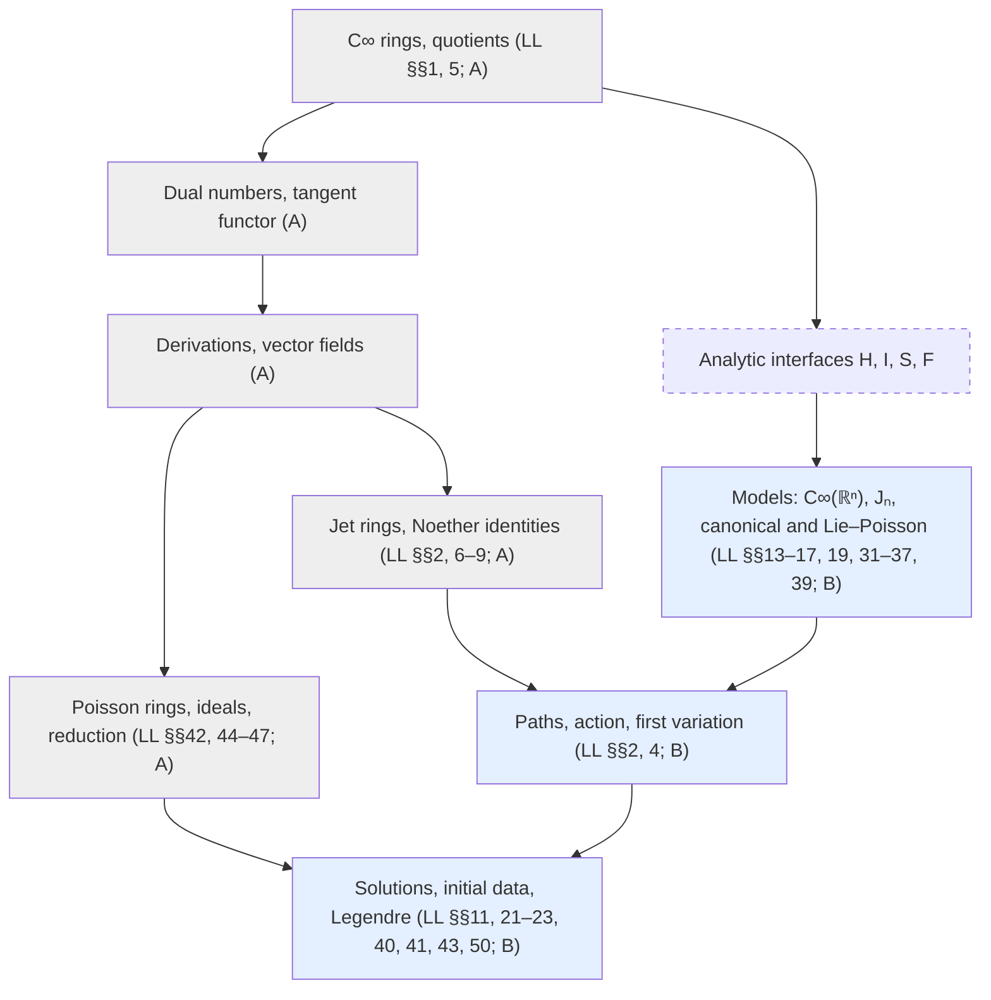

# Research Plan for Classical Mechanics over C∞-Rings

A Lean formalization plan for all 52 sections of Landau and Lifshitz’s *Mechanics*.

The original manuscript, *Classical Mechanics over C∞-Rings*, was dated 10 November 2026 and labeled Draft 0.1. On 11 November 2026, its text, formulas, proposed theorems and proofs, section map, design sketches, experiment ledger, and references were migrated from `tex/cinfty_mechanics.tex` to Markdown. The Mermaid dependency diagram preserves the original nodes and edges. The manuscript below records the research programme, and the implementation summary gives the current proof status.

## Implementation plan and current progress

- The common mathematical foundation lives in `ProjectAInos/SmoothAlgebra/` and `ProjectAInos/SmoothGeometry/`; `ProjectAInos/Variational/` contains variational calculus. The `SmoothAlgebra` work for issue #7 implemented finite-arity smooth operations, C∞-rings and their morphisms, free generation, and the chain rule for concrete directional derivatives. `SmoothRing` adds structure to an existing commutative real algebra. The [shared geometry guide](smooth-geometry.md) records the subsequent spectrum and scheme construction.
- **Algebraic core ([issue #74](https://github.com/MGYamada/ProjectAInos/issues/74)).** `SmoothAlgebra` has partial derivatives of smooth operations, with the chain rule as an identity between operations and commuting second partial derivatives (milestone M1). It has the C∞-ring structure on the dual numbers `A[ε]` and C∞-derivations whose only law is the chain rule. The Leibniz rule and real linearity are theorems, vector fields form a Lie ring under the commutator, derivations of `C∞(ℝⁿ)` correspond to tuples of values on the coordinates, and vector fields correspond to morphisms `A → A[ε]` lifting the identity. This covers Example 2(c), Definitions 15 and 17 and Propositions 16(a) and 18, the first half of milestone M2. A point of a C∞-ring is a morphism to `ℝ` and a tangent vector is a morphism to `ℝ[ε]`; for the free ring the tangent vectors are the pairs of a position and a velocity, a change of co-ordinates acts on them by the Jacobian, and for a ring presented by equations they are the states with the position on the zero set and the velocity tangent to it.
- **Jet algebra ([issue #78](https://github.com/MGYamada/ProjectAInos/issues/78)).** `Mechanics/Jet` has jet C∞-rings over a finite index type, the total derivative as a vector field with the commutators of Lemma 33, Euler operators of every order, and the Euler–Lagrange ideal. It proves that total derivatives are null Lagrangians (Proposition 35), the energy identity (Proposition 36), the Noether identity and its conserved charge (Proposition 37), Newton's equations for natural Lagrangians, and the conservation laws of Corollary 38, including angular momentum of particles in space. The standard jet ring is a jet ring, built from the free C∞-ring without analysis. Conservation here means membership in the Euler–Lagrange ideal. `StandardJet.prolongation` links it to trajectories: a smooth path gives a morphism from the standard jet ring to the smooth functions of time that turns the total derivative into `d/dt`, a path is a solution when this morphism annihilates the Euler–Lagrange expressions, and a conserved element then takes the same value at all times. For natural Lagrangians the solutions are the smooth solutions of Newton's equations, and the energy is constant along them. The general natural Lagrangian `½ Σ aᵢₖ vᵢ vₖ − U`, with kinetic coefficients and potential of order zero, has momenta `Σₖ aᵢₖ vₖ`, Lagrange's equations in closed form, and the energy `½ Σ aᵢₖ vᵢ vₖ + U`, conserved when `a` and `U` do not depend explicitly on time; plane polar co-ordinates are a model with a position-dependent kinetic form. For a Lagrangian given by a smooth function of time, position and velocity, a smooth path is a solution in this sense exactly when the action of the real analytic model is stationary under fixed-endpoint variations on every interval, so the conservation laws hold along the stationary paths of the action. A function of the velocities is quasi-invariant under infinitesimal boosts exactly when it is a polynomial of degree at most two in the velocities, `½ Σ mᵢⱼ vᵢ vⱼ + D(Σ bᵢ qᵢ + c t)`, and if it is also invariant under the orthogonal group it is `½ μ |v|² + c` (Theorem 66); the step from a function of `v` that is also a function of `(t, q)` to a constant uses that an element of a free C∞-ring with vanishing partial derivatives is a constant. The infinitesimal transformations `δqₗ = Σ Aₗₘ qₘ + aₗ + t uₗ` act on the standard jet ring by their prolongations, and the time translation by `∂/∂t`; their commutators are `[X_{A,a,u}, X_{A',a',u'}] = X_{A'A − AA', A'a − Aa', A'u − Au'}` and `[∂ₜ, X_{A,a,u}] = X_{0,u,0}`. The Euler operators satisfy `Eₗ(X F) = X(Eₗ F) + Σ Aᵢₗ Eᵢ(F)`, so a field that changes the Lagrangian by a total derivative preserves the Euler–Lagrange ideal; for a free system of equal masses the ideal is invariant under the Galilei algebra.
- **Poisson C∞-rings ([issue #78](https://github.com/MGYamada/ProjectAInos/issues/78)).** `SmoothAlgebra/Poisson` has Poisson structures on a C∞-ring, with antisymmetry, the chain rule in the first argument and the Jacobi identity as the only laws (Definition 20). It proves that brackets are determined on generators (Lemma 21), Poisson's theorem and the closure of the integrals under smooth operations (Proposition 24), Noether's theorem in Hamiltonian form (Theorem 59), the subring part of coisotropic reduction (Proposition 28), Hamilton–Jacobi (Proposition 54) and Maupertuis–Jacobi (Proposition 55). On a free C∞-ring the Jacobi identity is a condition on generators. The models are the canonical bracket with Hamilton's equations, and the rigid body with Euler's equations and the Casimir `|L|²` (Example 22(a) and (c)). A morphism out of a free C∞-ring is a Poisson morphism if it preserves the brackets of the generators. The angular momentum `M = q × p` of a particle in space satisfies `{Mₐ, M_b} = εₐ_bc M_c` and is an integral of every Hamiltonian that is a smooth function of `|q|²`, `|p|²` and `q · p`; `L ↦ −M` is a Poisson morphism from the rigid-body ring, the momentum map of the rotations (Example 58). The heavy top is the Lie–Poisson system on `ℝ³_L × ℝ³_Γ` with its equations of motion and the Casimirs `|Γ|²` and `L · Γ`. For a free particle the brackets of the Galilei algebra are proved, with the mass as the central term `{Kₐ, p_b} = m δₐ_b`, and the virial identity `{Σ qᵢ pᵢ, T + U} = 2T − kU` holds for a potential that satisfies Euler's relation of degree `k`. A trajectory of a Hamiltonian on a free C∞-ring is a smooth curve whose generators evolve by their brackets with `H`; then `d/dt f(c) = {f, H}(c)` for every observable, and every integral of the motion is constant along every trajectory (Definition 23 with real coefficients). For the canonical bracket the trajectories are the solutions of Hamilton's equations. In a uniformly rotating frame the Hamiltonian `|p|² / 2m + U − Ω · M` gives `{q, H} = p / m − Ω × q`, and the acceleration is `−∇U / m − 2 Ω × v − Ω × (Ω × q)`, with the Coriolis and centrifugal terms. For Kepler's problem the inverse distance `ρ = 1/r` is adjoined as a generator with the brackets it must have, and the relation `ρ² |q|² = 1` is kept as an element whose ideal is a Poisson ideal. The six identities of Proposition 69 for the Runge–Lenz vector are proved with their exact dependence on that relation, and along every smooth solution of Newton's equations for the inverse-square force the Runge–Lenz vector, the angular momentum and the energy are constant. For the Lagrangian `Σ ½ mᵢ q̇ᵢ² − U(q)` the Legendre transformation is a morphism from the phase space to the jet ring that takes `Σ pᵢ²/2mᵢ + U` to the energy, and the trajectories of the Hamiltonian are the solutions of the Euler–Lagrange equations with `pᵢ = mᵢ q̇ᵢ`. Jacobi's theorem is proved: if `S(q, α, t)` satisfies the Hamilton–Jacobi equation and `∂S/∂αᵢ` is constant along a curve `q(t)` with a non-degenerate matrix `∂²S/∂αᵢ∂qₖ`, then `q(t)` with `pᵢ = ∂S/∂qᵢ` is a trajectory. A Hamiltonian vector field of the canonical bracket has zero divergence, and with friction the divergence of the oscillator is `−Σ aᵢ/mᵢ`. For a potential homogeneous of degree `k`, if `γ(t)` solves the Euler–Lagrange equations then so does `α γ(βt)` with `β = α^{(k−2)/2}`, and along a trajectory on which `Σ qᵢ pᵢ` is bounded the time average of `2T − kU` tends to zero. Along a Kepler motion the orbit satisfies `A · q = |M|² − m α r` with constant `A` and `M`, and `λ q(βt)` is again a Kepler motion when `β² λ³ = 1`.
- **Rigid-body kinematics ([issue #78](https://github.com/MGYamada/ProjectAInos/issues/78)).** `Mechanics/Rigid` is linear algebra over the reals and uses no C∞-ring. Skew-symmetric matrices are identified with vectors as Lie algebras, `so(3) ≅ ℝ³`, with the cross product as the bracket. For a differentiable family of orthogonal matrices `Ṙ Rᵀ` is skew-symmetric, the velocity of a body point is `ċ + Ω × (x − c)`, and the angular velocity does not depend on the origin. The inertia tensor of point masses is symmetric and non-negative, `M = I Ω`, the parallel-axis theorem holds, and the principal moments are non-negative and satisfy the triangle inequality. The rotation with Eulerian angles `R_z(φ) R_x(θ) R_z(ψ)` is in `SO(3)`, its angular velocity in the body frame is `(φ̇ sin θ sin ψ + θ̇ cos ψ, φ̇ sin θ cos ψ − θ̇ sin ψ, φ̇ cos θ + ψ̇)`, and the kinetic energy of the symmetric top follows. The angular momentum of the symmetric top in the space frame is `M` along the fixed axis exactly when `θ̇ = 0`, `I₁ φ̇ = M` and `I₃ (φ̇ cos θ + ψ̇) = M cos θ`: the regular precession. On the Lie–Poisson phase space, rotations about the principal axes are equilibria, the angular momentum of the symmetric top turns uniformly about its axis, and `2 Iₐ E − |L|²` is an integral that bounds the deviation from a rotation about the axis of the greatest or the least moment.
- **Two bodies and collisions ([issue #78](https://github.com/MGYamada/ProjectAInos/issues/78)).** `Mechanics/TwoBody` is real vector algebra. The kinetic energy of two particles is that of the centre of mass plus that of the relative motion with the reduced mass. In a disintegration the fragments have `|p|² = 2 μ ε` in the centre-of-mass frame and share the energy in inverse proportion to their masses. A collision conserves momentum and kinetic energy exactly when the velocities afterwards are `V + (m₂/M) w` and `V − (m₁/M) w` for a vector `w` with the length of the initial relative velocity; the formulas for a target at rest follow. On the canonical phase space of two particles the centre-of-mass variables are canonical and the kinetic energy is `|P|²/2M + |p|²/2μ`.
- **Small oscillations ([issue #78](https://github.com/MGYamada/ProjectAInos/issues/78)).** `Mechanics/Oscillations` treats the equation `ẍ + ω² x = 0` in the ring of smooth functions of time. For `ω ≠ 0` every solution is `x(0) cos ωt + (ẋ(0)/ω) sin ωt`, which is `a cos (ωt + α)`; its energy is `½ m ω² a²` and its period is `2π/ω`. The solutions of the Euler–Lagrange equations of the oscillator and the trajectories of its Hamiltonian are these functions, and the flow on each pair `(qᵢ, pᵢ)` is a one-parameter group of matrices of determinant one. For the canonical bracket an equilibrium is a critical point of the Hamiltonian, and the Hamiltonian vector field of the quadratic part `½ Σ H_ab ξ_a ξ_b` is the linearization of the Hamiltonian vector field at that point. For `H = ½ b(q) p² + U(q)` the solutions of the linearized equations at `(q₀, 0)` are free oscillations with `ω² = b(q₀) U''(q₀)`; for the pendulum `ω² = g/l`. The damped equation `ẍ + 2γ ẋ + ω₀² x = 0` is solved in its three cases: the substitution `y = e^{γt} x` gives `ÿ = −(ω₀² − γ²) y`, and the solution is determined by its position and velocity at time zero for all real `γ` and `ω₀`. Friction is the vector field `X = X_H − Σ fᵢ ∂/∂pᵢ` with `fᵢ = Σ αᵢₖ ∂H/∂pₖ`; it satisfies `X(H) = −2F` for the dissipative function `F`, and for a positive semidefinite `α` the energy does not increase along its integral curves. For the forced equation `ẍ + 2γ ẋ + ω₀² x = g` the solutions for one force differ by solutions of the damped equation, which tend to zero for `γ > 0` and `ω₀ ≠ 0`, so every solution approaches the steady state. For the force `F cos Ωt` the steady state is `b cos (Ωt + δ)` with `b = |F| / √((ω₀² − Ω²)² + 4γ² Ω²)`; the mean power absorbed over a period is `m γ b² Ω²`, it is largest at `Ω = ω₀`, and it is half of its largest value exactly at `Ω = √(ω₀² + γ²) ± γ`. Without friction, for every smooth force `g`, the real and imaginary parts of `(ẋ + iωx) e^{−iωt}` are the initial values plus the integrals of `g cos ωt` and `−g sin ωt`; this gives Duhamel's formula `x = x(0) cos ωt + (ẋ(0)/ω) sin ωt + (1/ω) ∫₀ᵗ g(s) sin ω(t − s) ds`, the energy at every time, and a solution for all initial data. At resonance the forced oscillation is `(F/2ω) t sin ωt` and no solution is bounded. For several degrees of freedom, a positive definite `M` and a symmetric `K` are diagonalized together, `Sᵀ M S = 1` and `Sᵀ K S = diag λ`, and the normal co-ordinates `Θ = Sᵀ M x` turn `M ẍ + K x = 0` into `Θ̈ₐ = −λₐ Θₐ`. These are the Euler–Lagrange equations of `½ Σ (mᵢₖ ẋᵢ ẋₖ − kᵢₖ xᵢ xₖ)` and Hamilton's equations of `½ pᵀ M⁻¹ p + ½ qᵀ K q` with `p = M ẋ`. For the canonical bracket, the bracket of elements homogeneous of degrees `j` and `k` is homogeneous of degree `j + k − 2`; the quadratic Hamiltonians correspond to the matrices of `sp(2n, ℝ)` by `{H_A, H_B} = H_{[A, B]}`, and their Hamiltonian vector fields are linear; `Q = Sᵀ M q`, `P = Sᵀ p` is an invertible linear canonical transformation that brings the Hamiltonian to `Σ ½ (Pₐ² + λₐ Qₐ²)` (Proposition 70). For `ẍ + p(t) x = 0` with a periodic coefficient and a given fundamental system, the monodromy matrix has determinant one, `Φ(s + nT) = Φ(s) Mⁿ`, and every solution is bounded for `t ≥ 0` when `|tr M| < 2` or `M = ±1`.
- The common analytic layer implements local first jets, directional derivatives of the action, integration by parts, and the Euler–Lagrange equivalence for compactly supported interior variations.
- **Fixed-endpoint mechanics.** `ProjectAInos/Mechanics/` treats paths `q : ℝ → Q` on a real time interval `[a,b]`. It proves the derivative of the action, the first variation with the boundary term, and the equivalence between fixed-endpoint stationarity and the Euler–Lagrange equations for C² Lagrangians and paths with `a < b`. This includes the generalized coordinates `Q = Fin n → ℝ`. The scalar natural Lagrangian yields Newton’s equation `m q'' = −V'(q)`.
- **Total time derivatives.** In the real first-order model, adding the total time derivative of `F(t,q)` changes the action by `F(b,q(b)) − F(a,q(a))` and preserves fixed-endpoint stationarity and the pointwise Euler–Lagrange residual. Energy and Noether identities and further natural Lagrangian models are next. Quotients of abstract C∞-rings by ordinary ideals, universal cotangent modules, abstract jet rings, and the comparison between abstract jet rings and the analytic model are separate stages.
- Later stages include the Legendre transformation of a general hyperregular Lagrangian, quotients by ideals and the reduced Poisson rings, momentum maps, canonical transformations with generating functions, and the remaining classical models. The fundamental lemma over general nonreduced coefficient rings and representability of solutions remain open targets in the manuscript.

Paths such as `Cinfty/...` and Lean listings in the manuscript are design sketches. The current guides give the implemented names, assumptions, and proof status. Earlier descriptions of Mathlib record the state of the library at the time of the manuscript. [Shared variational calculus](variational.md) · [C∞-rings](smooth-algebra.md) · [Mechanics proof map](mechanics.md#proof-map) · [Mechanics formalization notes](mechanics-notes.md)

| Manuscript target | Status | Lean implementation or research target |
| --- | --- | --- |
| C∞-rings, morphisms, and free generation | Implemented | `SmoothAlgebra` adds structure to an existing real algebra |
| First variation and fixed-endpoint Euler–Lagrange equations | Proved in the real analytic model | `Mechanics.FirstVariation` and `Mechanics.EulerLagrange` |
| Addition of a total time derivative and the boundary term | Proved for `F(t,q)` in the real first-order model | `Mechanics.TotalTimeDerivative`. In every jet ring: `JetRing.euler_totalDeriv` and `JetRing.euler_add_totalDeriv` |
| Connection between smooth observables and the analytic model | Implemented | `Mechanics.ofSmoothOperation` and `stationary_ofSmoothOperation_iff` |
| Partial derivatives of smooth operations, dual numbers `A[ε]`, C∞-derivations and vector fields | Implemented | `SmoothOperation.partialDeriv`, `SmoothRing (DualNumber A)`, `SmoothDerivation`, `SmoothDerivation.equivInfinitesimalAut`. The design sketch calls these `Smooth.partial`, `CinftyDerivation` and `CinftyRing.Derivation.equivInfinitesimalAut` |
| Jet C∞-rings, total derivative, Euler operators, energy and Noether identities, classical conservation laws | Implemented | `JetRing`, `JetRing.totalDeriv`, `JetRing.euler`, `JetRing.totalDeriv_energy`, `JetRing.conserved_noetherCharge`, `JetRing.conserved_angularMomentum`, `StandardJet.jetRing`. The design sketch uses the same name `JetRing` |
| Natural Lagrangians with a position-dependent kinetic form; plane polar co-ordinates | Implemented | `JetRing.metricLagrangian`, `JetRing.momentum_metricLagrangian`, `JetRing.euler_metricLagrangian_eq`, `JetRing.conserved_energy_metricLagrangian`, `JetRing.energy_metricLagrangian_eq_inverse`, `JetRing.conserved_momentum_of_cyclic`, `StandardJet.Polar.euler_radial`, `StandardJet.Polar.conserved_angularMomentum` |
| Prolongation of smooth paths, solutions, and conservation along solutions | Implemented | `StandardJet.prolongation`, `StandardJet.prolongation_totalDeriv`, `StandardJet.IsSolution`, `StandardJet.prolongation_eq_of_conserved`, `StandardJet.isSolution_naturalLagrangian_iff`, `StandardJet.energy_eq_of_isSolution` |
| Solutions in the jet ring are the stationary paths of the action in the real analytic model | Implemented | `StandardJet.firstOrder`, `StandardJet.prolongation_euler_firstOrder_apply`, `StandardJet.isSolution_firstOrder_iff_stationary`, `StandardJet.prolongation_eq_of_stationary`, `StandardJet.energy_eq_of_stationary`. Smooth paths defined for all times |
| Quotients by ordinary ideals, universal cotangent modules, the on-shell ring and regular Lagrangians (Proposition 39) | Planned | Foundation and jet-ring sections below |
| Action, critical subfunctors, and representability of solutions over general coefficient rings | Open research targets | The available variational proofs apply to real coefficients |
| Poisson C∞-rings, integrals of the motion, coisotropic ideals, Hamilton–Jacobi, Maupertuis–Jacobi, the canonical bracket and the rigid body | Implemented | `PoissonStructure`, `PoissonStructure.IsIntegral.bracket`, `PoissonStructure.normalizer`, `PoissonStructure.hamiltonJacobi`, `PoissonStructure.maupertuis`, `FreeSmoothRing.poissonOfCoordinates`, `PhaseSpace.canonical`, `RigidBody.poisson`. The design sketch calls the structure `PoissonCinftyRing` |
| Poisson morphisms, the angular momentum of a particle with its `so(3)` momentum map, and the heavy top | Implemented | `IsPoissonHom`, `FreeSmoothRing.isPoissonHom_of_generators`, `AngularMomentum.canonical_M_M`, `AngularMomentum.isIntegral_M`, `AngularMomentum.isPoissonHom_momentumMap`, `HeavyTop.poisson`, `HeavyTop.poisson_L_hamiltonian` |
| Trajectories of Hamiltonian systems on free C∞-rings and constancy of integrals along them | Implemented | `IsTrajectory`, `IsTrajectory.timeDerivative_lift`, `IsTrajectory.lift_eq_of_isIntegral`, `isTrajectory_canonical_iff`, `FreeSmoothRing.map_derivation_eq`. Existence of trajectories (interface (F)) is not proved |
| Kepler's problem: the Runge–Lenz vector, its brackets, and conservation along Kepler motions | Implemented | `Kepler.IsFrame`, `Kepler.IsFrame.rungeLenz_hamiltonian`, `Kepler.IsFrame.rungeLenz_rungeLenz`, `Kepler.rungeLenz_dotProduct_q`, `KeplerModel.poisson`, `KeplerModel.isPoissonIdeal_constraintIdeal`, `KeplerModel.IsKeplerMotion.rungeLenz_eq`. Kepler's third law is not proved |
| Motion in a uniformly rotating frame: Coriolis and centrifugal terms | Implemented | `RotatingFrame.hamiltonian`, `RotatingFrame.canonical_q_hamiltonian`, `RotatingFrame.canonical_p_hamiltonian`, `RotatingFrame.canonical_velocity_hamiltonian`, `RotatingFrame.hamiltonian_eq_velocity` |
| Rigid-body kinematics: `so(3) ≅ ℝ³`, the angular velocity, the inertia tensor and its principal moments | Implemented | `Rigid.hatEquiv`, `Rigid.hatEquiv_cross`, `Rigid.hasDerivAt_rigidMotion`, `Rigid.velocityField_change_of_origin`, `Rigid.inertia`, `Rigid.inertia_mulVec`, `Rigid.inertia_add_apply`, `Rigid.principalMoments_two_le`. Point masses; no mass distributions |
| Two bodies: reduced mass, disintegration, elastic collisions, canonical centre-of-mass variables | Implemented | `TwoBody.kineticEnergy_eq`, `TwoBody.disintegration_momentum_sq`, `TwoBody.isElastic_iff`, `TwoBody.outgoingOne_rest_dotProduct_self`, `TwoBody.energy_transfer_le`, `TwoBody.canonical_centre_totalMomentum`, `TwoBody.kineticEnergy_eq_centre`. Reduction by translations is not formalized |
| Eulerian angles: the rotation, its angular velocity in the body and space frames, the kinetic energy of the symmetric top | Implemented | `Rigid.eulerMatrix`, `Rigid.eulerMatrix_mul_transpose`, `Rigid.det_eulerMatrix`, `Rigid.transpose_mul_eulerMatrixDeriv`, `Rigid.eulerMatrixDeriv_mul_transpose`, `Rigid.symmetricTop_energy`, `Rigid.det_eulerJacobian`, `Rigid.eulerRotation_mem_specialOrthogonalGroup`, `Rigid.hasDerivAt_eulerRotation`. Surjectivity onto `SO(3)` is not proved |
| Free oscillations in one dimension: the general solution, amplitude and phase, the flow of the oscillator, linearization at an equilibrium | Implemented | `IsHarmonic`, `IsHarmonic.eq_cos_add_sin`, `IsHarmonic.apply_eq_amplitude_mul_cos`, `IsHarmonic.energy_eq_amplitude`, `StandardJet.isSolution_oscillator_iff_isHarmonic`, `Oscillator.isTrajectory_iff_isHarmonic`, `Oscillator.flowMatrix_add`, `Oscillator.apply_eq_flowMatrix_mulVec`, `quadraticPart`, `canonical_bracket_quadraticPart`, `isHarmonic_sqrt_of_isTrajectory_quadraticPart`, `isHarmonic_pendulum`. The comparison of the solutions of the non-linear equations with those of the linearized equations is not proved |
| Damped oscillations: the three cases of the damped linear equation; the dissipative function | Implemented | `IsDamped`, `isDamped_iff_expMul_mul`, `IsDamped.apply_eq_amplitude_mul_exp_mul_cos`, `IsDamped.apply_eq_critical`, `IsDamped.apply_eq_overdamped`, `IsDamped.eq_of_initial`, `isDamped_expMul`, `IsIntegralCurve`, `dissipativeFunction`, `dissipativeField`, `dissipativeField_self`, `lift_dissipativeFunction_nonneg`, `IsIntegralCurve.energy_antitone`, `Oscillator.isIntegralCurve_dissipativeField_iff_isDamped`. The contraction of the phase volume is not proved |
| Forced oscillations under friction: superposition, approach to the steady state, amplitude and phase, the resonance curve | Implemented | `IsForced`, `IsForced.add`, `IsForced.sub`, `IsForced.eq_of_initial`, `IsDamped.tendsto_zero`, `IsForced.tendsto_sub`, `steadyState`, `isForced_steadyState`, `steadyState_apply`, `IsForced.tendsto_sub_steadyState`, `steadyAmplitude_le`, `steadyAmplitude_eq_max`, `absorption`, `mean_dissipation_steadyState`, `absorption_le`, `absorption_resonance`, `absorption_eq_half_max_iff`. The Lorentzian approximation near resonance is not proved |
| Forced oscillations without friction: Duhamel's formula, the energy transfer, existence, resonance | Implemented | `TimeFunction.apply_sub_apply_eq_integral`, `TimeFunction.primitive`, `IsForced.complexAmplitudeRe_eq`, `IsForced.complexAmplitudeIm_eq`, `IsForced.apply_eq_integral`, `IsForced.energy_apply`, `IsForced.energy_transfer`, `duhamel`, `isForced_duhamel`, `exists_isForced`, `isForced_cos_of_sq_ne`, `isForced_resonance`, `IsForced.exists_abs_gt_of_resonance`. The energy transfer is for a finite time; the integrals over all time are not treated |
| Normal modes: simultaneous diagonalization and the equations in normal co-ordinates | Implemented | `NormalModes.exists_simultaneous_diagonalization`, `NormalModes.mul_eq_mul_mul_diagonal`, `NormalModes.det_sub_smul_eq_zero_iff`, `NormalModes.lam_pos`, `NormalModes.IsSmallOscillation`, `NormalModes.isSmallOscillation_iff`, `NormalModes.isSmallOscillation_map_mulVec`, `NormalModes.IsSmallOscillation.apply_eq` |
| Quadratic Hamiltonians: homogeneity of the bracket, the Lie algebra `sp(2n, ℝ)`, the normal form as a linear canonical transformation; the Lagrangian of small oscillations | Implemented | `IsEulerHomogeneous.canonical_bracket`, `PhaseSpace.canonical_bracket_quadraticForm`, `PhaseSpace.canonicalForm_mul_mem_sp_iff`, `PhaseSpace.canonical_bracket_spHamiltonian`, `PhaseSpace.canonical_bracket_generator_spHamiltonian`, `PhaseSpace.spHamiltonian_injective`, `NormalModes.isPoissonHom_linearTransformation`, `NormalModes.quadraticHamiltonian_eq_normalForm`, `NormalModes.linearTransformation_normalForm`, `NormalModes.linearTransformation_comp_inverse`, `NormalModes.isTrajectory_quadraticHamiltonian_iff_isSmallOscillation`, `JetRing.euler_quadraticLagrangian`, `StandardJet.isSolution_quadraticLagrangian_iff`, `NormalModes.isTrajectory_quadraticHamiltonian_iff_isSolution` |
| Parametric resonance: the Wronskian, the monodromy matrix and stability for a trace less than two | Implemented | `Parametric.IsHill`, `Parametric.IsHill.wronskian_eq`, `Parametric.FundamentalSystem`, `Parametric.FundamentalSystem.eq_combination`, `Parametric.FundamentalSystem.det_matrix`, `Parametric.FundamentalSystem.matrix_add_nat_mul_period`, `Parametric.exists_abs_pow_apply_le`, `Parametric.FundamentalSystem.exists_abs_apply_le_of_abs_trace_lt`. The existence of a fundamental system is a hypothesis; the width of the instability zone is not treated |
| Motions of the free rigid body: regular precession, permanent rotations and their stability | Implemented | `Rigid.eulerMatrix_mulVec_symmetricTopMomentum_iff`, `Rigid.regularPrecession_psi_rate`, `RigidBody.isTrajectory_principalRotation`, `RigidBody.isTrajectory_symmetricTop`, `RigidBody.sum_mul_sq_eq`, `RigidBody.mul_sq_le_of_greatest`, `RigidBody.mul_sq_le_of_least`, `RigidBody.linearization_mul_pos_of_middle`. The solution by elliptic functions is not treated |
| Canonical formalism: the chain rule for a substitution, the Legendre transformation of a natural Lagrangian, Jacobi's theorem on complete integrals, Liouville's theorem in infinitesimal form | Implemented | `FreeSmoothRing.derivation_lift`, `legendre`, `legendre_hamiltonian`, `isTrajectory_natural_iff_isSolution`, `CompleteIntegral.IsHamiltonJacobi`, `CompleteIntegral.isTrajectory_of_isHamiltonJacobi`, `CompleteIntegral.isTrajectory_freeAction`, `divergence_hamiltonian`, `Oscillator.divergence_dissipativeField`. The Legendre transformation of a general Lagrangian and the invariance of the measure under a flow are not proved |
| Mechanical similarity, the virial theorem for time averages, the orbit and the similar motions of Kepler's problem | Implemented | `TimeFunction.scale`, `IsHomogeneous`, `IsHomogeneous.dilate_partialDerivation`, `StandardJet.IsSolution.similar`, `similar_apply_add_period`, `TimeFunction.tendsto_average_timeDerivative`, `IsTrajectory.tendsto_average_virial`, `KeplerModel.IsKeplerMotion.conic`, `KeplerModel.IsKeplerMotion.similar`, `KeplerModel.similar_period`. The period of an elliptic orbit is not computed |
| Points and tangent vectors of a C∞-ring; rings presented by equations | Implemented | `Point`, `TangentPoint`, `FreeSmoothRing.tangentPointEquiv`, `FreeSmoothRing.snd_tangentPoint`, `FreeSmoothRing.tangentPoint_map_lift`, `TangentPoint.congr`, `SmoothRingCon.generateHomEquiv`, `FreeSmoothRing.presentedTangentPointEquiv`, `FreeSmoothRing.circleTangentPointEquiv`. The tangent functor as a functor to C∞-rings is not constructed |
| The Lagrangian of a free particle: quasi-invariance under boosts and isotropy; constants of a free C∞-ring | Implemented | `FreeSmoothRing.apply_eq_sum_partialDerivation`, `eq_algebraMap_of_partialDerivation_eq_zero`, `StandardJet.DependsOnVelocities`, `StandardJet.IsBoostQuasiInvariant`, `StandardJet.boost_eq`, `StandardJet.velocityPolynomial`, `StandardJet.isBoostQuasiInvariant_iff`, `StandardJet.velocityPolynomial_eq_add_totalDeriv`, `StandardJet.IsIsotropic`, `StandardJet.eq_smul_one_of_isIsotropic`, `StandardJet.exists_eq_of_isIsotropic`, `StandardJet.freeLagrangian_boost` |
| The Galilei algebra on the jet ring: prolongations as vector fields, commutators, the Euler operators, invariance of the Euler–Lagrange ideal | Implemented | `JetRing.prolongField`, `JetRing.euler_apply`, `JetRing.apply_mem_eulerLagrangeIdeal`, `JetRing.dt_mem_eulerLagrangeIdeal`, `StandardJet.evolutionary`, `StandardJet.evolutionary_totalDeriv`, `StandardJet.evolutionary_apply`, `StandardJet.galileiField`, `StandardJet.galileiField_q`, `StandardJet.commutator_galileiField`, `StandardJet.commutator_dt_galileiField`, `StandardJet.d_galileiField`, `StandardJet.euler_galileiField`, `StandardJet.galileiField_mem_eulerLagrangeIdeal`, `StandardJet.galileiField_naturalLagrangian`, `StandardJet.boost_eq_galileiField`, `StandardJet.IsInertial`, `StandardJet.isInertial_naturalLagrangian` |
| The Galilei algebra of a free particle and the virial identity | Implemented | `Galilei.canonical_K_p`, `Galilei.canonical_K_K`, `Galilei.canonical_M_K`, `Galilei.canonical_K_freeHamiltonian`, `PhaseSpace.canonical_dilation_bracket`, `PhaseSpace.virial`. Time-dependent Hamiltonian systems (Definition 23) are not formalized |
| General momentum maps, the Legendre transformation, reduced Poisson rings, canonical transformations and remaining models | Later stages | Section-by-section map and ledger below |

<a id="ledger"></a>

### Ledger

The ledger gives one status to each section of Landau–Lifshitz, following the policy in [The ledger](#the-ledger): *proved* (Lean, no `sorry`, axioms audited), *proved modulo interface*, *hypothesis*, *evidence* (computer algebra only), or *informal*. The status refers to the main target of the row in [the dictionary](#the-dictionary). A status is only promoted, and a row whose main target is proved only in part stays at the lower status, with the proved part named. [Issue #78](https://github.com/MGYamada/ProjectAInos/issues/78) tracks completion.

| § | Topic | Status | Lean declarations, evidence, or what is missing |
|---:|:---|:---|:---|
| 1 | Generalised co-ordinates | proved | `Point`, `TangentPoint`, `FreeSmoothRing.pointEquiv`, `FreeSmoothRing.tangentPointEquiv`, `FreeSmoothRing.snd_tangentPoint`, `FreeSmoothRing.tangentPoint_map_lift`, `TangentPoint.congr`, `SmoothRingCon.generateHomEquiv`, `FreeSmoothRing.presentedPointEquiv`, `FreeSmoothRing.presentedTangentPointEquiv`, `FreeSmoothRing.circleTangentPointEquiv`. A state is a morphism to `ℝ[ε]`, which is an `ℝ`-point of `TQ` by the definition of the tangent functor; that functor is not constructed as a C∞-ring. A presented ring is the quotient by the C∞-congruence generated by the equations, so an open subset `{f ≠ 0}` is covered by adjoining an inverse of `f`; that the congruence is the one of the ideal (Hadamard's lemma) is not proved and not used |
| 2 | The principle of least action | proved | `JetRing.euler_totalDeriv`, `JetRing.euler_add_totalDeriv`, `JetRing.eulerLagrangeIdeal`. First variation in the real analytic model: `Mechanics.stationary_iff_eulerLagrange`. Solutions as paths whose prolongation annihilates the Euler–Lagrange expressions: `StandardJet.IsSolution`, `StandardJet.prolongation_totalDeriv`. The two notions of solution agree for smooth paths: `StandardJet.isSolution_firstOrder_iff_stationary`. The path-functor form over coefficient rings is open |
| 3 | Galileo's relativity principle | proved | `StandardJet.galileiField`, `StandardJet.commutator_galileiField`, `StandardJet.commutator_dt_galileiField`, `StandardJet.euler_galileiField`, `StandardJet.galileiField_mem_eulerLagrangeIdeal`, `JetRing.dt_mem_eulerLagrangeIdeal`, `StandardJet.galileiField_naturalLagrangian`, `StandardJet.IsInertial`, `StandardJet.isInertial_naturalLagrangian`; on the canonical phase space, `Galilei.canonical_K_p`, `Galilei.canonical_K_K`, `Galilei.canonical_M_K`, `Galilei.canonical_K_freeHamiltonian`. The Galilei algebra acts on the standard jet ring by the vector fields of `δqₗ = Σ Aₗₘ qₘ + aₗ + t uₗ` with `A` antisymmetric, and by `∂/∂t`; the action of the group by finite transformations is not defined. `IsInertial L` is the invariance of the Euler–Lagrange ideal of `L` under these fields; that inertial frames exist is the physical premise (tier P) and is not a theorem |
| 4 | The Lagrangian for a free particle | proved | `StandardJet.isBoostQuasiInvariant_iff`, `StandardJet.velocityPolynomial_eq_add_totalDeriv`, `StandardJet.exists_eq_of_isIsotropic`, `StandardJet.freeLagrangian_boost` (E4f), with `eq_algebraMap_of_partialDerivation_eq_zero` for the step to a constant. The Lagrangian is an element of the standard jet ring that depends only on the velocities. Isotropy is the invariance `L(A v) = L(v)` of its values for every matrix with `Aᵀ A = 1`; the action of the orthogonal group on the jet ring is not defined. The first two steps of §4 (homogeneity of space and time gives `L = L(v)`) are the hypothesis `DependsOnVelocities` |
| 5 | The Lagrangian for a system of particles | proved | Constant masses: `JetRing.naturalLagrangian`, `JetRing.euler_naturalLagrangian`, `Mechanics.stationary_natural_iff`. Position-dependent kinetic form: `JetRing.metricLagrangian`, `JetRing.momentum_metricLagrangian`, `JetRing.euler_metricLagrangian_eq`, `JetRing.energy_metricLagrangian`, `JetRing.energy_metricLagrangian_eq_inverse`, `JetRing.metricLagrangian_diagonal`. The Legendre map of Example 52 as an isomorphism belongs to the row for §40 |
| 6 | Energy | proved | `JetRing.totalDeriv_energy`, `JetRing.conserved_energy`, `JetRing.conserved_energy_naturalLagrangian`. Along smooth solutions: `StandardJet.energy_eq_of_isSolution`. Along stationary paths of the action: `StandardJet.energy_eq_of_stationary` |
| 7 | Momentum | proved | `JetRing.prolong_eq_euler_add_totalDeriv`, `JetRing.conserved_noetherCharge`, `JetRing.conserved_momentum`. Along smooth solutions every conserved element is constant: `StandardJet.prolongation_eq_of_conserved` |
| 8 | Centre of mass | proved | `JetRing.conserved_boost`, `StandardJet.conserved_boost_free`. In Hamiltonian form: `Galilei.canonical_K_freeHamiltonian` with `Galilei.K_sub_K` |
| 9 | Angular momentum | proved | `JetRing.conserved_angularMomentum`, `JetRing.conserved_linear`, `JetRing.axis_cross_dotProduct`. Noether's theorem in Hamiltonian form: `PoissonStructure.isIntegral_iff_hamiltonian_eq_zero`. The `so(3)` momentum map of one particle: `AngularMomentum.canonical_M_M`, `AngularMomentum.isPoissonHom_momentumMap`. Momentum maps of a general Lie algebra (Definition 57) are not formalized |
| 10 | Mechanical similarity | proved | E4e. The identity `{q · p, H} = 2T − kU` is proved for a potential that satisfies Euler's relation of degree `k`: `PhaseSpace.virial`, `PhaseSpace.virial_oscillator`. Scaling: `IsHomogeneous`, `IsHomogeneous.dilate_partialDerivation`, `StandardJet.IsSolution.similar`, `similar_apply_add_period`. Time averages: `TimeFunction.tendsto_average_timeDerivative`, `IsTrajectory.tendsto_average_virial`. The scaling is proved as a symmetry of the solutions of the Euler–Lagrange equations, for `u(αx) = α^k u(x)`; the automorphism of the jet ring that preserves the Euler–Lagrange ideal is not constructed, and Euler's relation is not derived from the scaling property. The virial theorem is the statement that the average of `2T − kU` tends to zero when `Σ qᵢ pᵢ` is bounded |
| 11 | Motion in one dimension | informal | |
| 12 | Determination of the potential energy from the period | informal | |
| 13 | The reduced mass | evidence | E10c. The splitting of the kinetic energy and the canonical centre-of-mass variables are proved: `TwoBody.kineticEnergy_eq`, `TwoBody.canonical_centre_totalMomentum`, `TwoBody.canonical_relative_relativeMomentum`, `TwoBody.kineticEnergy_eq_centre`. The reduction by translations (Example 62(a)) needs quotients by ideals |
| 14 | Motion in a central field | evidence | E10a, E10b. Conservation of `M` for every Hamiltonian that is a smooth function of `q · q`, `p · p` and `q · p` is proved: `AngularMomentum.isIntegral_M`, and along trajectories `AngularMomentum.lift_M_eq`. Polar co-ordinates, the reduced Hamiltonian and the orbit integral are missing |
| 15 | Kepler's problem | evidence | E5a–f. Proposition 69 is proved in a Kepler frame, with `ρ = 1/r` adjoined and the dependence on `ρ² (q · q) = 1` explicit: `Kepler.IsFrame.rungeLenz_hamiltonian`, `Kepler.IsFrame.angularMomentum_rungeLenz`, `Kepler.IsFrame.rungeLenz_rungeLenz`, `Kepler.rungeLenz_dotProduct_angularMomentum`, `Kepler.rungeLenz_dotProduct_self`, `Kepler.rungeLenz_dotProduct_q`. Along solutions: `KeplerModel.IsKeplerMotion.rungeLenz_eq`, the equation of the orbit `KeplerModel.IsKeplerMotion.conic`, and Kepler's third law for similar orbits, `KeplerModel.IsKeplerMotion.similar`, `KeplerModel.similar_period`. The period `2π a^{3/2} √(m/α)` of an elliptic orbit (15.8), which does not depend on the eccentricity, is missing, so the row is not promoted |
| 16 | Disintegration of particles | proved | `TwoBody.disintegration_momentum_sq`, `TwoBody.disintegration_kinetic_one`, `TwoBody.disintegration_kinetic_two`, `TwoBody.disintegration_energy_nonneg`, `TwoBody.disintegration_laboratory`. Two fragments; the angular distributions and the case of several fragments are not treated |
| 17 | Elastic collisions | proved | `TwoBody.IsElastic.relative_speed`, `TwoBody.isElastic_iff`, `TwoBody.outgoingOne_rest_dotProduct_self`, `TwoBody.outgoingTwo_rest_dotProduct_self`, `TwoBody.outgoingOne_headOn`, `TwoBody.energy_transfer_le`, `TwoBody.outgoing_rest_dotProduct_eq_zero`. The angles in the laboratory frame are stated through scalar products, not through trigonometric functions |
| 18 | Scattering | informal | |
| 19 | Rutherford's formula | evidence | E5g |
| 20 | Small-angle scattering | informal | Tier P: the precise theorem is not chosen |
| 21 | Free oscillations in one dimension | proved | `isTrajectory_canonical_const_iff`, `canonical_bracket_quadraticPart`, `linearization_quadraticPart`, `isTrajectory_restPoint_iff`, `isHarmonic_sqrt_of_isTrajectory_quadraticPart`, `IsHarmonic.eq_cos_add_sin`, `IsHarmonic.apply_eq_amplitude_mul_cos`, `IsHarmonic.energy_eq_amplitude`, `Oscillator.isTrajectory_iff_isHarmonic`, `Oscillator.flowMatrix_add`, `Oscillator.det_flowMatrix`, `Oscillator.apply_eq_flowMatrix_mulVec`, `Oscillator.isTrajectory_flowCurve`. The linearization is the derivative of the Hamiltonian vector field at the equilibrium, for `H = ½ b(q) p² + U(q)`; the flow is that of `p²/2m + ½ m ω² q²`. The Legendre transformation from `½ a(q) q̇² − U(q)` and the comparison with the solutions of the non-linear equations are not proved; general quadratic Hamiltonians are in row 23 |
| 22 | Forced oscillations | proved | `IsForced.apply_eq_integral`, `duhamel_apply`, `isForced_duhamel`, `exists_isForced`, `IsForced.eq_of_initial`, `IsForced.complexAmplitudeRe_eq`, `IsForced.complexAmplitudeIm_eq`, `IsForced.energy_apply`, `IsForced.energy_transfer`, `isForced_cos_of_sq_ne`, `IsForced.apply_eq_of_sq_ne`, `isForced_resonance`, `IsForced.exists_abs_gt_of_resonance`. The energy transfer is the formula for a finite time `T`, `E = ((∫₀ᵀ F cos ωt)² + (∫₀ᵀ F sin ωt)²)/2m`; the limit `T → ∞` with improper integrals (22.12), beats (22.7) and the Lagrangian `½ m ẋ² − ½ k x² + x F(t)` with explicit time dependence are not proved |
| 23 | Oscillations of systems with more than one degree of freedom | proved | `NormalModes.exists_simultaneous_diagonalization`, `NormalModes.det_sub_smul_eq_zero_iff`, `NormalModes.lam_pos`, `NormalModes.isSmallOscillation_iff`, `NormalModes.isSmallOscillation_map_mulVec`, `NormalModes.IsSmallOscillation.apply_eq`, `StandardJet.isSolution_quadraticLagrangian_iff`, `NormalModes.isTrajectory_quadraticHamiltonian_iff_isSolution`; for Proposition 70, `IsEulerHomogeneous.canonical_bracket`, `PhaseSpace.canonical_bracket_spHamiltonian`, `PhaseSpace.canonical_bracket_generator_spHamiltonian`, `PhaseSpace.spHamiltonian_injective`, `PhaseSpace.canonicalForm_mul_mem_sp_iff`, `NormalModes.quadraticHamiltonian_eq_normalForm`, `NormalModes.isPoissonHom_normalTransformation`, `NormalModes.linearTransformation_comp_inverse`. Homogeneity is Euler's condition `Σ xₐ ∂ₐ f = k f`, which homogeneous polynomials satisfy. The isomorphism with `sp(2n, ℝ)` is the bijection `A ↦ H_A = −½ xᵀ J A x` with `{H_A, H_B} = H_{[A, B]}`; it is not bundled as an isomorphism of Lie algebras. The matrices `M` and `K` are constants: for a general Hamiltonian the passage to the quadratic part at an equilibrium is `linearization_quadraticPart` (row 21), and the expansion of a general Lagrangian to the second order is not proved |
| 24 | Vibrations of molecules | informal | |
| 25 | Damped oscillations | proved | `isDamped_iff_expMul_mul`, `IsDamped.apply_eq_underdamped`, `IsDamped.apply_eq_amplitude_mul_exp_mul_cos`, `IsDamped.apply_eq_critical`, `IsDamped.apply_eq_overdamped`, `IsDamped.eq_of_initial`, `isDamped_expMul`, `isDamped_time_mul_expMul`, `dissipativeField_self`, `lift_dissipativeFunction_nonneg`, `IsIntegralCurve.energy_antitone`, `Oscillator.isIntegralCurve_dissipativeField_iff_isDamped`. `Ḣ = −2F ≤ 0` is proved as the identity `X(H) = −2F` in the ring, with `F ≥ 0` at every point for a positive semidefinite `α`. The equations are in Hamiltonian form; the Lagrangian form (25.12) and the failure of `X` to preserve the bracket are not proved. The contraction of the phase volume is proved in infinitesimal form for the oscillator: `Oscillator.divergence_dissipativeField` |
| 26 | Forced oscillations under friction | proved | `IsForced.add`, `IsForced.sub`, `IsForced.eq_of_initial`, `IsDamped.tendsto_zero`, `IsForced.tendsto_sub`, `isForced_steadyState`, `steadyState_const_mul`, `steadyState_apply`, `steadyAmplitude_mul_sin_steadyPhase`, `sin_steadyPhase_nonpos`, `IsForced.apply_eq_transient_add_steadyState`, `IsForced.tendsto_sub_steadyState`, `steadyAmplitude_le`, `steadyAmplitude_eq_max`, `mean_dissipation_steadyState`, `absorption_le`, `absorption_resonance`, `absorption_eq_half_max_iff`. The linear response is proved for the force `F cos Ωt`, with superposition for sums of forces; the resonance curve is the exact function `m γ F² Ω² / ((ω₀² − Ω²)² + 4γ² Ω²)`, with its maximum and its width `2γ`. The Lorentzian approximation (26.5), (26.9), the area (26.10), the complex response function, and a general force are not proved |
| 27 | Parametric resonance | informal | With a fundamental system as data, the monodromy matrix is in `SL(2, ℝ)` and stability is proved: `Parametric.FundamentalSystem.det_matrix`, `Parametric.FundamentalSystem.matrix_add_nat_mul_period`, `Parametric.exists_abs_pow_apply_le`, `Parametric.FundamentalSystem.exists_abs_apply_le_of_abs_trace_lt`, `Parametric.FundamentalSystem.exists_abs_apply_le_of_eq`. The existence of a fundamental system for a general coefficient, the unbounded cases, and the width of the instability zone (tier P) are missing |
| 28 | Anharmonic oscillations | evidence | E11 (numerical) |
| 29 | Resonance in non-linear oscillations | informal | Tier P |
| 30 | Motion in a rapidly oscillating field | informal | Tier P and D |
| 31 | Angular velocity | proved | `Rigid.hatEquiv`, `Rigid.hatEquiv_cross`, `Rigid.transpose_deriv_mul_transpose`, `Rigid.hasDerivAt_rigidMotion`, `Rigid.velocityField_change_of_origin`, `Rigid.velocityField_injective` |
| 32 | The inertia tensor | proved | `Rigid.transpose_inertia`, `Rigid.dotProduct_inertia_mulVec_nonneg`, `Rigid.inertia_add_apply`, `Rigid.inertia_mulVec_principalAxes`, `Rigid.principalMoments_nonneg`, `Rigid.principalMoments_two_le`. For finitely many point masses; continuous mass distributions are not treated |
| 33 | Angular momentum of a rigid body | proved | `Rigid.inertia_mulVec`, `Rigid.dotProduct_inertia_mulVec`, `Rigid.eulerMatrix_mulVec_symmetricTopMomentum_iff`, `Rigid.regularPrecession_psi_rate`, `Rigid.eulerRotation_mulVec_symmetricTopMomentum`, and in the body frame `RigidBody.isTrajectory_symmetricTop`. The regular precession is proved as the equivalence, for `sin θ ≠ 0`, between a constant angular momentum `M` along the fixed axis and the uniform rates `θ̇ = 0`, `φ̇ = M/I₁`, `ψ̇ = M cos θ (1/I₃ − 1/I₁)`. That a free motion has a constant angular momentum in the space frame is the equation of motion of row 34 and is not derived here |
| 34 | The equations of motion of a rigid body | informal | The Lie–Poisson systems are proved: `RigidBody.poisson_L_bracket`, and for the heavy top `HeavyTop.poisson`, `HeavyTop.poisson_L_hamiltonian`, `HeavyTop.poisson_Γ_hamiltonian`, `HeavyTop.poisson_Γ_sq_left`, `HeavyTop.poisson_L_dot_Γ_left` (E6f). The equation for the momentum, general torques and the link to the Lagrangian on `T(SO(3))` are missing |
| 35 | Eulerian angles | proved | `Rigid.eulerRotation_mem_specialOrthogonalGroup`, `Rigid.hasDerivAt_eulerRotation`, `Rigid.transpose_mul_eulerMatrixDeriv`, `Rigid.vee_transpose_mul_eulerMatrixDeriv`, `Rigid.eulerMatrixDeriv_mul_transpose`, `Rigid.symmetricTop_energy`, `Rigid.det_eulerJacobian`. The chart property is proved as membership in `SO(3)` and a Jacobian of determinant `−sin θ`; surjectivity onto `SO(3)` and the local inverse are not proved |
| 36 | Euler's equations | proved | `RigidBody.poisson`, `RigidBody.euler_equations`, `RigidBody.euler_equation_zero`, `RigidBody.poisson_casimir_left`. Along trajectories: `RigidBody.lift_casimir_eq`, `IsTrajectory.lift_hamiltonian_eq`. The quotient by `L · L − r²` needs quotients by ideals |
| 37 | The asymmetrical top | evidence | E6e. The two integrals are proved: `RigidBody.isIntegral_kineticEnergy`, `RigidBody.isIntegral_casimir`. Stability is proved: the rotations about the principal axes are equilibria (`RigidBody.isTrajectory_principalRotation`); `Σᵢ (Iₐ/Iᵢ − 1) Lᵢ²` is constant along trajectories and bounds the deviation from the rotation about the axis of the greatest or the least moment (`RigidBody.sum_mul_sq_eq`, `RigidBody.mul_sq_le_of_greatest`, `RigidBody.mul_sq_le_of_least`); the signs of the linearized equations are those of E6e (`RigidBody.linearization_mul_pos_of_middle`, `RigidBody.linearization_mul_neg_of_greatest`, `RigidBody.linearization_mul_neg_of_least`). The solution by elliptic functions (tier D) is missing |
| 38 | Rigid bodies in contact | informal | |
| 39 | Motion in a non-inertial frame of reference | proved | `RotatingFrame.canonical_q_hamiltonian`, `RotatingFrame.canonical_p_hamiltonian`, `RotatingFrame.canonical_velocity_hamiltonian`, `RotatingFrame.hamiltonian_eq_velocity`. One particle in a uniformly rotating frame, with `H = H₀ − Ω · M` as the definition; accelerated translation and a time-dependent `Ω` are not treated |
| 40 | Hamilton's equations | informal | Hamilton's equations of the canonical bracket are proved: `PhaseSpace.canonical_q_bracket`, `PhaseSpace.canonical_p_bracket`, and along curves `isTrajectory_canonical_iff`. For the natural Lagrangian `Σ ½ mᵢ q̇ᵢ² − U(q)` with non-zero masses the Legendre correspondence is proved: `legendre`, `legendre_p_eq_momentum`, `legendre_hamiltonian`, `isTrajectory_natural_iff_isSolution`. Theorem 51 for a general hyperregular Lagrangian, with the symplectic forms, is missing |
| 41 | The Routhian | informal | |
| 42 | Poisson brackets | proved | `PoissonStructure`, `PoissonStructure.IsIntegral.bracket`, `PoissonStructure.integrals`, `AlmostPoissonStructure.bracket_op_op`, `PhaseSpace.canonical`, `PhaseSpace.canonical_bracket`. Integrals are constant along trajectories: `IsTrajectory.lift_eq_of_isIntegral`. See [mechanics notes](mechanics-notes.md) M13 for the bracket-notation constraint |
| 43 | The action as a function of the co-ordinates | informal | |
| 44 | Maupertuis' principle | evidence | E10f. Proposition 55 is proved: `PoissonStructure.maupertuis`. The Jacobi metric and the variational statement for `∫ p dq` are missing |
| 45 | Canonical transformations | informal | The motion is infinitesimally canonical: `PoissonStructure.bracket_bracket`, `PoissonStructure.hamiltonian_bracket`. Poisson morphisms: `IsPoissonHom`, `FreeSmoothRing.isPoissonHom_of_generators`. Generating functions are missing |
| 46 | Liouville's theorem | informal | The infinitesimal statements are proved: a Hamiltonian vector field of the canonical bracket has zero divergence (`divergence_hamiltonian`) and is a derivation of the bracket (`PoissonStructure.bracket_bracket`); the flow of the oscillator has determinant one (`Oscillator.det_flowMatrix`). The invariance of the Lebesgue measure under the flow of a general Hamiltonian is missing |
| 47 | The Hamilton–Jacobi equation | proved | `PoissonStructure.hamiltonJacobi`, `CompleteIntegral.IsHamiltonJacobi`, `CompleteIntegral.isTrajectory_of_isHamiltonJacobi`, `CompleteIntegral.isHamiltonJacobi_freeAction`, `CompleteIntegral.isTrajectory_freeAction`. Jacobi's theorem is proved for a Hamiltonian without explicit dependence on time and for a given curve `q(t)` along which the `∂S/∂αᵢ` are constant; the non-degeneracy of `∂²S/∂αᵢ∂qₖ` is the hypothesis that this matrix has no kernel along the curve. Solving `∂S/∂αᵢ = βᵢ` for `q(t)` by the implicit function theorem is not proved |
| 48 | Separation of the variables | informal | |
| 49 | Adiabatic invariants | informal | Tier D and P |
| 50 | Canonical variables | informal | |
| 51 | Accuracy of conservation of the adiabatic invariant | informal | Tier P and D |
| 52 | Conditionally periodic motion | informal | Tier D |

Count: 25 proved, 7 evidence, 20 informal.

<a id="abstract"></a>

## Abstract

These notes develop Lagrangian and Hamiltonian mechanics, and the symplectic geometry they need, on top of Joyce’s algebraic geometry over $C^\infty$-rings, with one purpose: to turn the fifty-two sections of Landau and Lifshitz’s *Mechanics* into formalization targets for Lean 4. A classical system is a Poisson $C^\infty$-ring together with one element $H$; velocities, variations and flows are morphisms out of the infinitesimal point $D=\operatorname{Spec}\mathbb{R}[\varepsilon]/(\varepsilon^2)$; constraints, critical points and reductions are ideals and quotients. The analysis is isolated in four interface lemmas, so that most statements become algebra over an abstract $C^\infty$-ring. Definitions and results carry a *tier* recording the infrastructure they need. Part III maps each section of Landau–Lifshitz to a precise target and records which parts of the book are theorems, theorems under hypotheses, or physical arguments. Part IV proposes the Lean architecture. Appendix A lists the identities that were checked by computer algebra.

<a id="sec:intro"></a>

## Introduction

<a id="aim"></a>

#### Aim

Landau and Lifshitz [\[LL\]](#bib:LL) derive mechanics from the principle of least action and the symmetries of space and time, in the language of functions of generalised co-ordinates and their infinitesimal variations. A formalization should keep that language rather than replace it by the differential geometry of manifolds, whose formal infrastructure is heavy and still partly missing (Section [sec:lean](#sec:lean)). Algebraic geometry over $C^\infty$-rings [\[Joyce\]](#bib:Joyce) offers a foundation with exactly the three features the book uses:

- functions are the primary objects — they are the observables;

- rings may contain nilpotents — these are the velocities and variations;

- every ideal has a quotient — these are the constraints, conservation laws and reductions.

<a id="what-is-and-is-not-taken-from-joyce."></a>

##### What is and is not taken from Joyce.

Joyce’s memoir treats $C^\infty$-rings, $C^\infty$-schemes, modules, cotangent sheaves and stacks; it does not treat mechanics. Sections [sec:rings](#sec:rings)–[sec:forms](#sec:forms) follow [\[Joyce\]](#bib:Joyce), [\[Dubuc\]](#bib:Dubuc), [\[MoerdijkReyes\]](#bib:MoerdijkReyes). From Section [sec:poisson](#sec:poisson) on, the mathematics is classical [\[Arnold\]](#bib:Arnold), [\[AbrahamMarsden\]](#bib:AbrahamMarsden), [\[MarsdenRatiu\]](#bib:MarsdenRatiu), [\[Souriau\]](#bib:Souriau) and only the packaging is ours; the names *Poisson $C^\infty$-ring* and *jet $C^\infty$-ring* are ours. Statements over non-reduced base rings, in particular Theorem [thm:representable](#thm:representable), were assembled here and have not been compared with the literature. They are the kind of claim a formalization should settle.

<a id="sec:conventions"></a>

#### Conventions

Manifolds are Hausdorff, second countable and without boundary; smooth means $C^\infty$; repeated indices are summed. The symplectic and Poisson conventions are

<a id="eq:conventions"></a>

$$
\begin{gathered}
\omega=\mathrm{d}q^i\wedge \mathrm{d}p_i=-\mathrm{d}\theta,\qquad \iota_{X_H}\omega=\mathrm{d}H,\\
\{f,g\}=\frac{\partial f}{\partial q^i}\frac{\partial g}{\partial p_i}-\frac{\partial f}{\partial p_i}\frac{\partial g}{\partial q^i}=X_g(f),\qquad \dot f=\{f,H\} .
\end{gathered}
$$

 With these, $[X_f,X_g]=-X_{\{f,g\}}$ (E1). Landau–Lifshitz use the opposite sign for the bracket; the dynamics agree.

|  | these notes | Landau–Lifshitz §42 |
|:---|:---|:---|
| bracket | $\{f,g\}=\partial_qf\,\partial_pg-\partial_pf\,\partial_qg$ | $[f,g]=\partial_pf\,\partial_qg-\partial_qf\,\partial_pg=-\{f,g\}$ |
| evolution | $\dot f=\{f,H\}$ | $\dot f=[H,f]$ |
| canonical pair | $\{q^i,p_j\}=\delta^i_j$ | $[p_i,q_k]=\delta_{ik}$ |
| angular momentum | $\{M_i,M_j\}=\epsilon_{ijk}M_k$ | $[M_i,M_j]=-\epsilon_{ijk}M_k$ |

<a id="sec:tiers"></a>

#### Tiers

Each statement carries a tier, the infrastructure needed by its *proof* when earlier statements are used as black boxes. Dependencies between statements are a separate matter, recorded by the import graph (Figure [fig:arch](#fig:arch)).

| tier | meaning |
|:---|:---|
| \[A\] | Algebra over an abstract $C^\infty$-ring, Poisson $C^\infty$-ring or jet $C^\infty$-ring. No analysis. |
| \[A$^{*}$\] | A statement about a concrete ring that reduces to finitely many polynomial or rational identities; dischargeable by `ring`/`field_simp` or by an external certificate. |
| \[B: $\cdot$\] | Needs the listed interface lemmas of Section [sec:interface](#sec:interface) and nothing else: (H) Hadamard’s lemma, (I) smooth parametric integrals, (S) symmetry of second derivatives, (F) smooth flows of vector fields on $\mathbb{R}^N$. |
| \[C\] | Needs geometric infrastructure not specific to mechanics: manifolds, bundles, differential forms on manifolds, sheaves. |
| \[D\] | A deep theorem. To be carried as an explicit hypothesis, never as an axiom. |
| \[P\] | (Part III only.) The text of Landau–Lifshitz is a physical or asymptotic argument; the formal target is a chosen theorem, usually with extra hypotheses. |

<a id="sec:decisions"></a>

#### Three design decisions

1.  *Rings and functors, not spaces.* The formalization works with $C^\infty$-rings and with set-valued functors on them. $C^\infty$-schemes appear only as language (Section [sec:schemes](#sec:schemes)).

2.  *Brackets before forms.* The Poisson bracket is primitive and the symplectic form is derived. Brackets live in tier A; differential forms on manifolds are tier C.

3.  *Co-ordinates first.* Configuration spaces are open subsets of $\mathbb{R}^n$, as in Landau–Lifshitz, and the rigid body is treated on $\mathfrak{so}(3)^*\cong\mathbb{R}^3$. Manifolds enter only in statements of tier C.

<a id="foundations"></a>

## Foundations

<a id="sec:rings"></a>

### $C^\infty$-rings

A $C^\infty$-ring is a ring in which every smooth function of several real variables, not only every polynomial, can be evaluated. The archetype is $C^\infty(X)$ for a manifold $X$.

<a id="def:cinf"></a>

**Definition 1** ($C^\infty$-ring \[A\]). A *$C^\infty$-ring* is a set $A$ with an operation $\Phi_f\colon A^n\to A$ for every $n\ge 0$ and every smooth $f\colon\mathbb{R}^n\to\mathbb{R}$, such that

1.  $\Phi_{\pi_i}(c_1,\dots,c_n)=c_i$ for the co-ordinate projections $\pi_i\colon\mathbb{R}^n\to\mathbb{R}$;

2.  for smooth $g\colon\mathbb{R}^m\to\mathbb{R}$ and $f_1,\dots,f_m\colon\mathbb{R}^n\to\mathbb{R}$,

$$
\Phi_{g\circ(f_1,\dots,f_m)}(c_1,\dots,c_n)=\Phi_g\bigl(\Phi_{f_1}(c_1,\dots,c_n),\dots,\Phi_{f_m}(c_1,\dots,c_n)\bigr).
$$

A morphism is a map commuting with all $\Phi_f$. Equivalently, a $C^\infty$-ring is a finite-product-preserving functor from the category of the spaces $\mathbb{R}^n$ and smooth maps to sets.

**Lean target:** `CinftyRing`

Taking $f$ to be addition, multiplication and the constants makes $A$ a commutative $\mathbb{R}$-algebra, also denoted $A$.

<a id="ex:rings"></a>

**Example 2**.

1.  $\mathbb{R}$; $C^\infty(U)$ for $U\subseteq\mathbb{R}^n$ open \[A\]; $C^\infty(X)$ for a manifold $X$ \[C\]. In each case $\Phi_f(c_1,\dots,c_n)=f\circ(c_1,\dots,c_n)$.

2.  $C^\infty(\mathbb{R}^n)$ is the free $C^\infty$-ring on the co-ordinates $x_1,\dots,x_n$: for every $C^\infty$-ring $A$, morphisms $C^\infty(\mathbb{R}^n)\to A$ correspond to $n$-tuples in $A$, by $\phi\mapsto(\phi(x_i))_i$ with inverse $(c_i)_i\mapsto(f\mapsto\Phi_f(c_1,\dots,c_n))$ \[A\].

3.  *Dual numbers.* For any $C^\infty$-ring $A$ the ring $A[\varepsilon]=A\oplus A\varepsilon$, $\varepsilon^2=0$, is a $C^\infty$-ring with

<a id="eq:dual"></a>

$$
\Phi_f(c_1+\varepsilon b_1,\dots,c_n+\varepsilon b_n)=\Phi_f(c)+\varepsilon\sum_{i}\Phi_{\partial f/\partial x_i}(c)\,b_i .
$$

 Axiom (ii) for $A[\varepsilon]$ is the chain rule \[A\].

4.  Weil algebras ($\mathbb{R}\oplus\mathfrak m$ with $\mathfrak m$ a finite-dimensional nilpotent ideal), rings of germs, and $\mathbb{R}[[x_1,\dots,x_n]]$, the quotient of $C^\infty(\mathbb{R}^n)$ by the functions flat at the origin (Borel’s lemma) \[C\].

<a id="lem:hadamard"></a>

**Lemma 3** (Hadamard \[B: I\]). For smooth $f\colon\mathbb{R}^n\to\mathbb{R}$ there are smooth $g_1,\dots,g_n\colon\mathbb{R}^{2n}\to\mathbb{R}$ with

$$
f(x)-f(y)=\sum_{i=1}^n(x_i-y_i)\,g_i(x,y),\qquad
g_i(x,y)=\int_0^1\frac{\partial f}{\partial x_i}\bigl(y+t(x-y)\bigr)\,\mathrm{d}t .
$$

<a id="cor:quotient"></a>

**Corollary 4** (Quotients \[A\]). If $I$ is an ideal of the $\mathbb{R}$-algebra $A$, then $A/I$ is a $C^\infty$-ring in a unique way such that $A\to A/I$ is a morphism.

**Lean target:** `CinftyRing.quotient`

*Proof.* Read Lemma [lem:hadamard](#lem:hadamard) in $A$: $\Phi_f(b)-\Phi_f(c)=\sum_i(b_i-c_i)\,\Phi_{g_i}(b,c)$, which lies in $I$ when all $b_i-c_i$ do. ◻

So ideals and quotients are those of commutative algebra. A $C^\infty$-ring is *finitely generated* if it is of the form $C^\infty(\mathbb{R}^n)/I$, and *finitely presented* if moreover $I$ is finitely generated. For a manifold $X$, $C^\infty(X)$ is finitely presented [\[Joyce\]](#bib:Joyce) (Prop. 3.1).

<a id="prop:coproduct"></a>

**Proposition 5** (Coproducts \[A\]). The coproduct of $C^\infty$-rings, written $\otimes_\infty$, satisfies

$$
C^\infty(\mathbb{R}^m)/I\ \otimes_\infty\ C^\infty(\mathbb{R}^n)/J\;=\;C^\infty(\mathbb{R}^{m+n})/(I,J).
$$

 In particular $C^\infty(\mathbb{R}^m)\otimes_\infty C^\infty(\mathbb{R}^n)=C^\infty(\mathbb{R}^{m+n})$, which is much larger than the algebraic tensor product, and $A\otimes_\infty\mathbb{R}[\varepsilon]=A[\varepsilon]$.

<a id="prop:localization"></a>

**Proposition 6** (Localization \[C\]). Let $A[s^{-1}]$ denote the universal $C^\infty$-ring in which $s\in A$ becomes invertible. For $f\in C^\infty(\mathbb{R}^n)$ and $U_f=\{x:f(x)\ne0\}$,

$$
C^\infty(\mathbb{R}^n)[f^{-1}]\;\cong\;C^\infty(U_f).
$$

 Every open subset of $\mathbb{R}^n$ is some $U_f$, so restriction to an open set is always a localization.

<a id="def:points"></a>

**Definition 7** (Points, local rings, fair ideals \[A\]). An *$\mathbb{R}$-point* of $A$ is a morphism $x\colon A\to\mathbb{R}$. A $C^\infty$-ring is *local* if it is a local ring with residue field $\mathbb{R}$. The localization $A_x$ of $A$ at all $s$ with $x(s)\ne0$ is local. An ideal $I\subseteq C^\infty(\mathbb{R}^n)$ is *fair* (germ-determined) if $f\in I$ whenever the germ of $f$ at every point lies in the germ of $I$.

The $\mathbb{R}$-points of $C^\infty(\mathbb{R}^n)/I$ are the common zeros of $I$; those of $C^\infty(X)$ are the points of $X$. Finitely generated ideals are fair [\[Joyce\]](#bib:Joyce) (§2.4), and so, directly from the definition, are vanishing ideals of closed sets. Almost every ideal below is of one of these two kinds.

<a id="sec:schemes"></a>

### Spaces as functors; infinitesimals

<a id="cinfty-schemes"></a>

#### $C^\infty$-schemes

For a $C^\infty$-ring $A$, $\operatorname{Spec}A$ is the space of $\mathbb{R}$-points, with the topology generated by the sets $\{x:x(c)\ne0\}$ and the structure sheaf whose stalk at $x$ is $A_x$. A *$C^\infty$-scheme* is a local $C^\infty$-ringed space locally isomorphic to some $\operatorname{Spec}A$. Two differences from ordinary schemes: the only points are $\mathbb{R}$-points, and infinitesimal information is carried only by nilpotents.

<a id="thm:schemes"></a>

**Theorem 8** (Dubuc, Moerdijk–Reyes, Joyce \[C\]).

1.  $X\mapsto\operatorname{Spec}C^\infty(X)$ embeds manifolds fully and faithfully in $C^\infty$-schemes, and it preserves transverse fibre products [\[Joyce\]](#bib:Joyce) (Cor. 3.4, Thm. 3.5).

2.  All finite limits of $C^\infty$-schemes exist. For affine schemes the fibre product is the spectrum of the pushout of $C^\infty$-rings.

3.  Every second countable, metrizable $C^\infty$-scheme is affine; this includes manifolds [\[Joyce\]](#bib:Joyce) (§4.8).

By (c) every space in mechanics is described by one $C^\infty$-ring. This justifies decision D1: the formalization never needs the ringed space.

<a id="def:space"></a>

**Definition 9** (Spaces as functors \[A\]). A *space* is a functor $X$ from $C^\infty$-rings to sets; $X(B)$ is the set of *$B$-points*. The *affine space* of a $C^\infty$-ring $A$ is $h_A=\operatorname{Hom}(A,-)$. Limits of spaces are computed pointwise, and $h_A\times_{h_C}h_B=h_{A\otimes_{\infty,C}B}$.

**Lean target:** `CinftyRing.Space`

<a id="ex:nontransverse"></a>

**Example 10** (A non-transverse intersection \[A\]). The intersection of the parabola $y=x^2$ with the line $y=0$ is the affine space of

$$
C^\infty(\mathbb{R}^2)/(y-x^2,\;y)\;=\;\mathbb{R}[x]/(x^2)=\mathbb{R}[\varepsilon].
$$

 It has one $\mathbb{R}$-point and a two-dimensional ring of functions. Tangency is recorded in the ring.

<a id="the-infinitesimal-point-and-the-tangent-functor"></a>

#### The infinitesimal point and the tangent functor

Put $D=h_{\mathbb{R}[\varepsilon]}$, the affine space of the dual numbers.

<a id="def:tangent"></a>

**Definition 11** (Tangent functor \[A\]). For a space $X$, $TX(B):=X(B[\varepsilon])$. The map $\varepsilon\mapsto0$ gives the projection $TX\to X$, and $B\to B[\varepsilon]$ gives the zero section.

**Lean target:** `CinftyRing.Space.tangent`

<a id="prop:tangent-points"></a>

**Proposition 12** (Points of the tangent functor \[A\]). A $B$-point of $Th_A$ is a pair $(\phi,\delta)$ of a morphism $\phi\colon A\to B$ and a map $\delta\colon A\to B$ with

<a id="eq:derivation-over"></a>

$$
\delta\bigl(\Phi_f(c_1,\dots,c_n)\bigr)=\sum_i\Phi_{\partial f/\partial x_i}\bigl(\phi(c_1),\dots,\phi(c_n)\bigr)\,\delta(c_i).
$$

 In particular an $\mathbb{R}$-point of $Th_A$ is an $\mathbb{R}$-point $x$ of $A$ with a derivation $v\colon A\to\mathbb{R}$ at $x$. For $A=C^\infty(X)$ these are the tangent vectors of $X$.

*Proof.* By [eq:dual](#eq:dual), $\phi+\varepsilon\delta\colon A\to B[\varepsilon]$ commutes with $\Phi_f$ if and only if $\phi$ does and [eq:derivation-over](#eq:derivation-over) holds. ◻

<a id="prop:tangent-zero"></a>

**Proposition 13** (Tangent space of a zero locus \[A\]). If $A=C^\infty(\mathbb{R}^n)/(\varphi_1,\dots,\varphi_k)$ then $Th_A=h_{A'}$ with

$$
A'=C^\infty(\mathbb{R}^{2n}_{x,v})\Big/\Bigl(\varphi_a(x),\ \sum_i\frac{\partial \varphi_a}{\partial x_i}(x)\,v_i\Bigr)_{a=1,\dots,k}.
$$

*Proof.* Expand $\varphi_a(x+\varepsilon v)$ by [eq:dual](#eq:dual). ◻

<a id="rem:sdg"></a>

**Remark 14**. Morphisms out of $h_{\mathbb{R}[\varepsilon]/(\varepsilon^{k+1})}$ are $k$-jets of curves; accelerations live over $\varepsilon^3=0$, and commutators of vector fields are measured on $D\times D$. This is the model side of synthetic differential geometry [\[Kock\]](#bib:Kock), [\[MoerdijkReyes\]](#bib:MoerdijkReyes). Since $D$ is the spectrum of a ring and not a subset of $\mathbb{R}$, the Kock–Lawvere axiom is not assumed and ordinary classical logic is used throughout; compare the axiomatic formalization of [\[BrascaClemente\]](#bib:BrascaClemente).

<a id="sec:forms"></a>

### Derivations, vector fields, differential forms

<a id="def:derivation"></a>

**Definition 15** ($C^\infty$-derivation, cotangent module \[A\]). Let $M$ be an $A$-module. A *$C^\infty$-derivation* $\mathrm{d}\colon A\to M$ is a map with

<a id="eq:chain"></a>

$$
\mathrm{d}\,\Phi_f(c_1,\dots,c_n)=\sum_{i=1}^n\Phi_{\partial f/\partial x_i}(c_1,\dots,c_n)\cdot\mathrm{d}c_i .
$$

 The universal one is $\mathrm{d}\colon A\to\Omega_A$, the *cotangent module*: $\Omega_A$ is generated by symbols $\mathrm{d}c$ subject to [eq:chain](#eq:chain).

**Lean target:** `CinftyRing.Derivation, CinftyRing.Cotangent`

A $C^\infty$-derivation is $\mathbb{R}$-linear and satisfies the Leibniz rule (take $f$ linear, respectively $f=xy$). The converse fails in general: in the module of Kähler differentials of $C^\infty(\mathbb{R})$, $\mathrm{d}(e^x)\ne e^x\,\mathrm{d}x$, and that module is not finitely generated.

<a id="prop:cotangent"></a>

**Proposition 16**.

1.  $\Omega_{C^\infty(\mathbb{R}^n)}$ is free on $\mathrm{d}x_1,\dots,\mathrm{d}x_n$, with $\mathrm{d}f=\sum_i(\partial f/\partial x_i)\,\mathrm{d}x_i$ \[A\].

2.  For $B=A/I$ the sequence $I/I^2\to\Omega_A\otimes_AB\to\Omega_B\to0$ is exact. Hence $\Omega_{C^\infty(\mathbb{R}^n)/I}$ is the free module on the $\mathrm{d}x_i$ modulo the $\mathrm{d}f$, $f\in I$ \[A\].

3.  For a manifold $X$, $\Omega_{C^\infty(X)}$ is the module of sections of $T^*X$ \[C\] [\[Joyce\]](#bib:Joyce) (§5.2).

*Proof of (a).* Since $f=\Phi_f(x_1,\dots,x_n)$, [eq:chain](#eq:chain) gives $\mathrm{d}f=\sum_i\partial_if\cdot\mathrm{d}x_i$ for every $C^\infty$-derivation; conversely $f\mapsto\sum_i\partial_if\cdot m_i$ is a $C^\infty$-derivation for any $m_i\in M$, by the chain rule. ◻

<a id="def:vf"></a>

**Definition 17** (Vector fields \[A\]). $\operatorname{Der}(A)$ is the set of $C^\infty$-derivations $A\to A$. It equals $\operatorname{Hom}_A(\Omega_A,A)$ and is a Lie algebra under the commutator.

<a id="prop:vf"></a>

**Proposition 18** (Vector fields are infinitesimal automorphisms \[A\]). The map $\xi\mapsto(c\mapsto c+\varepsilon\,\xi(c))$ is a bijection from $\operatorname{Der}(A)$ to the morphisms $A\to A[\varepsilon]$ that reduce to the identity at $\varepsilon=0$. Geometrically, a vector field on $X=h_A$ is a map $X\times D\to X$ restricting to the identity on $X$.

**Lean target:** `CinftyRing.Derivation.equivInfinitesimalAut`

*Proof.* By [eq:dual](#eq:dual), $c\mapsto c+\varepsilon\xi(c)$ commutes with $\Phi_f$ exactly when $\xi$ satisfies [eq:chain](#eq:chain). ◻

<a id="rem:flows"></a>

**Remark 19** (Flows \[B: F\]). A complete vector field on $\mathbb{R}^N$ integrates to an action $\mathbb{R}\times\mathbb{R}^N\to\mathbb{R}^N$, that is, a coaction $C^\infty(\mathbb{R}^N)\to C^\infty(\mathbb{R}\times\mathbb{R}^N)$ whose restriction along $D\subset\mathbb{R}$ is $\xi$.

<a id="the-de-rham-complex"></a>

#### The de Rham complex

Put $\Omega^k_A=\Lambda^k_A\Omega_A$. The exterior derivative $\mathrm{d}\colon\Omega^k_A\to\Omega^{k+1}_A$ exists, is unique, and satisfies $\mathrm{d}^2=0$; for $\xi\in\operatorname{Der}(A)$ there are a contraction $\iota_\xi$ and a Lie derivative $L_\xi$ with

<a id="eq:cartan"></a>

$$
L_\xi=\mathrm{d}\,\iota_\xi+\iota_\xi\,\mathrm{d},\qquad[L_\xi,\iota_\eta]=\iota_{[\xi,\eta]},\qquad[L_\xi,L_\eta]=L_{[\xi,\eta]}
$$

 \[A\]. For $A=C^\infty(X)$ this is the usual calculus. Only $\Omega^1$, $\Omega^2$ and [eq:cartan](#eq:cartan) are used below, and by decision D2 a formalization may postpone this subsection. Forms pull back along morphisms; vector fields and brackets do not. Two-forms restrict to subspaces, and Poisson brackets descend to quotients.

<a id="sec:poisson"></a>

### Poisson $C^\infty$-rings and symplectic structures

A classical mechanical system is a Poisson $C^\infty$-ring $P$ together with one element $H$.

<a id="def:poisson"></a>

**Definition 20** (Poisson $C^\infty$-ring \[A\]). A *Poisson $C^\infty$-ring* is a $C^\infty$-ring $P$ with an $\mathbb{R}$-bilinear bracket $\{\cdot,\cdot\}\colon P\times P\to P$ such that

1.  $\{f,g\}=-\{g,f\}$;

2.  $\{\{f,g\},h\}+\{\{g,h\},f\}+\{\{h,f\},g\}=0$;

3.  for every $h$, $X_h:=\{\cdot ,h\}$ is a $C^\infty$-derivation: $\ \{\Phi_f(c_1,\dots,c_n),h\}=\sum_i\Phi_{\partial f/\partial x_i}(c)\,\{c_i,h\}$.

**Lean target:** `PoissonCinftyRing`

(P3) contains the Leibniz rule, and for $P=C^\infty(M)$ it follows from the Leibniz rule.

<a id="lem:generators"></a>

**Lemma 21** (Brackets are determined on generators \[A\]). If every element of $P$ is of the form $\Phi_f(g_1,\dots,g_n)$ with the $g_i$ in a subset $G\subseteq P$, then the bracket is determined by its values on $G\times G$: $\{\Phi_f(g),\Phi_h(g')\}=\sum_{i,j}\Phi_{\partial_if}(g)\,\Phi_{\partial_jh}(g')\,\{g_i,g'_j\}$.

<a id="ex:poisson"></a>

**Example 22**.

1.  *Canonical bracket.* $P=C^\infty(U\times\mathbb{R}^n)$, $U\subseteq\mathbb{R}^n$ open, with $\{q^i,p_j\}=\delta^i_j$ and $\{q^i,q^j\}=\{p_i,p_j\}=0$; by Lemma [lem:generators](#lem:generators) the bracket is [eq:conventions](#eq:conventions). The Jacobi identity uses the symmetry of second derivatives \[B: S\] (E1).

2.  *Lie–Poisson bracket.* For a finite-dimensional Lie algebra $\mathfrak{g}$, $P=C^\infty(\mathfrak{g}^*)$ is the free $C^\infty$-ring on a basis of $\mathfrak{g}$, and $\{\xi,\eta\}:=[\xi,\eta]$ for $\xi,\eta\in\mathfrak{g}$ determines a bracket \[B: S\].

3.  *Rigid body.* $P=C^\infty(\mathbb{R}^3)$ with $\{L_i,L_j\}=-\epsilon_{ijk}L_k$ (the Lie–Poisson bracket of $\mathfrak{so}(3)$ with the opposite sign) and $H=\sum_iL_i^2/2I_i$. The equations of motion are Euler’s equations

$$
\dot L_1=\{L_1,H\}=\Bigl(\frac1{I_3}-\frac1{I_2}\Bigr)L_2L_3\quad\text{and cyclic permutations,}
$$

 and $|L|^2$ is a Casimir, so $P/(|L|^2-r^2)=C^\infty(S^2_r)$ is a Poisson $C^\infty$-ring \[A$^{*}$\] (E6).

<a id="def:hamiltonian"></a>

**Definition 23** (Hamiltonian system \[A\]). A *Hamiltonian system* is a pair $(P,H)$. Its dynamics is the derivation $X_H=\{\cdot ,H\}$, written $\dot f=\{f,H\}$. A *solution with parameters in $B$* is a morphism $\gamma^*\colon P\to C^\infty(\mathbb{R})\otimes_\infty B$ with $\gamma^*\circ X_H=\partial_t\circ\gamma^*$. A *time-dependent system* is $H\in P\otimes_\infty C^\infty(\mathbb{R}_t)$ with $\dot f=\partial_tf+\{f,H\}$.

By Proposition [prop:vf](#prop:vf), $X_H$ is a map $h_P\times D\to h_P$: the dynamics is an infinitesimal automorphism of the phase space.

<a id="prop:poisson-thm"></a>

**Proposition 24** (Poisson’s theorem; L&L §42 \[A\]). The set $\{f:\{f,H\}=0\}$ of integrals of the motion is a Poisson $C^\infty$-subring of $P$.

**Lean target:** `PoissonCinftyRing.integrals`

*Proof.* It is closed under the bracket by (P2) and under every $\Phi_g$ by (P3). ◻

The classical fact that a smooth function of integrals of the motion is again an integral is closure under the operations $\Phi_g$.

<a id="symplectic-structures"></a>

#### Symplectic structures

<a id="def:symplectic"></a>

**Definition 25** (Symplectic structure \[A\]). Let $\Omega_A$ be finitely generated projective (for example $A=C^\infty(M)$). A *symplectic structure* on $A$ is a closed $\omega\in\Omega^2_A$ such that $\xi\mapsto\iota_\xi\omega$ is an isomorphism $\operatorname{Der}(A)\to\Omega_A$. It defines $X_h$ and a bracket by $\iota_{X_h}\omega=\mathrm{d}h$ and $\{f,g\}:=\omega(X_f,X_g)=X_g(f)$.

<a id="prop:closed-jacobi"></a>

**Proposition 26** (Closedness and the Jacobi identity \[A\]). For a non-degenerate two-form $\omega$, closed or not,

$$
\mathrm{d}\omega(X_f,X_g,X_h)=-\bigl(\{\{f,g\},h\}+\{\{g,h\},f\}+\{\{h,f\},g\}\bigr)
$$

 (E2). Hence a symplectic structure is the same as a non-degenerate Poisson structure. Moreover $L_{X_h}\omega=\mathrm{d}\,\iota_{X_h}\omega+\iota_{X_h}\mathrm{d}\omega=0$, so Hamiltonian flows preserve $\omega$ and $\omega^n$ (Liouville’s theorem, L&L §46).

<a id="thm:darboux"></a>

**Theorem 27** (Darboux \[D\]). At every point of a symplectic manifold of dimension $2n$, the local Poisson $C^\infty$-ring of germs is isomorphic to the ring of germs at the origin of $\mathbb{R}^{2n}$ with the canonical bracket.

The proof is Moser’s: join two symplectic forms that agree at $p$ by $\omega_t$, write $\omega_1-\omega_0=\mathrm{d}\alpha$ with $\alpha(p)=0$, and integrate the vector field $\xi_t$ defined by $\iota_{\xi_t}\omega_t=-\alpha$; then $\frac{\mathrm{d}}{\mathrm{d}t}\varphi_t^*\omega_t=\varphi_t^*(\mathrm{d}\,\iota_{\xi_t}\omega_t+\mathrm{d}\alpha)=0$. Landau–Lifshitz never need the theorem, because they work in canonical co-ordinates from the start; under decision D3 neither does the formalization.

<a id="ideals"></a>

#### Ideals

Let $I\subseteq P$ be an ideal, $Z=h_{P/I}$, and $N(I):=\{f\in P:\{f,I\}\subseteq I\}$.

| condition on $I$ | name | consequence |
|:---|:---|:---|
| $\{I,P\}\subseteq I$ | Poisson ideal | $P/I$ is a Poisson $C^\infty$-ring |
| $\{I,I\}\subseteq I$ | coisotropic (first class) | $N(I)/I$ is a Poisson $C^\infty$-ring |
| $(\{\varphi_a,\varphi_b\})$ invertible, $I=(\varphi_a)$ | second class | $P/I$ carries the Dirac bracket |

<a id="prop:coisotropic"></a>

**Proposition 28** (Coisotropic reduction \[A\]). If $I$ is coisotropic, then $N(I)$ is a Poisson $C^\infty$-subring of $P$ containing $I$ as a Poisson ideal, and $N(I)/I$ is a Poisson $C^\infty$-ring.

**Lean target:** `PoissonCinftyRing.reduction`

*Proof.* $N(I)$ is closed under the bracket by (P2). If $c_i\in N(I)$ and $j\in I$, then by (P3) $\{\Phi_f(c),j\}$ is a $P$-linear combination of the $\{c_i,j\}\in I$, so $N(I)$ is a $C^\infty$-subring. The quotient is a $C^\infty$-ring by Corollary [cor:quotient](#cor:quotient), and (P1)–(P3) descend. ◻

<a id="prop:dirac"></a>

**Proposition 29** (Dirac bracket \[A\]). Let $\varphi_1,\dots,\varphi_k\in P$ be such that the matrix $(\{\varphi_a,\varphi_b\})$ is invertible over $P$, with inverse $(C^{ab})$. Then

$$
\{f,g\}_D:=\{f,g\}-\sum_{a,b}\{f,\varphi_a\}\,C^{ab}\,\{\varphi_b,g\}
$$

 is a Poisson $C^\infty$-bracket on $P$ with $\{f,\varphi_c\}_D=0$ for all $f$ (E8). Hence $(\varphi_a)$ is a Poisson ideal for $\{\cdot,\cdot\}_D$.

For the vanishing ideal of a submanifold $Z$ of a symplectic manifold, coisotropic means $TZ^{\omega}\subseteq TZ$, and second class means that $Z$ is a symplectic submanifold; $Z$ is *Lagrangian* if it is coisotropic of half the dimension \[C\].

<a id="sec:cotangent"></a>

### Cotangent bundles

Under decision D3 the phase space of a configuration space $U\subseteq\mathbb{R}^n$ is $U\times\mathbb{R}^n$ with the canonical bracket of Example [ex:poisson](#ex:poisson)(a). The intrinsic description is recorded because it explains the bracket and connects it to quantization.

Let $Q$ be a manifold and $A=C^\infty(Q)$. To a vector field $X$ associate the fibrewise linear function $P_X(q,p)=\langle p,X(q)\rangle$ on $T^*Q$. Then $C^\infty(T^*Q)$ is generated as a $C^\infty$-ring by $A$ and the $P_X$, and extending a morphism $A\to B$ to $C^\infty(T^*Q)$ is the same as giving an $A$-module map $\operatorname{Der}(A)\to B$, for fair $B$ \[C\].

<a id="prop:cotangent-bracket"></a>

**Proposition 30** (The bracket of a cotangent bundle \[C\]; \[B: S\] for $Q\subseteq\mathbb{R}^n$). There is exactly one Poisson $C^\infty$-ring structure on $C^\infty(T^*Q)$ with

$$
\{f,g\}=0,\qquad\{f,P_X\}=X(f),\qquad\{P_X,P_Y\}=-P_{[X,Y]}\qquad(f,g\in A)
$$

 (E3), and it is symplectic. In co-ordinates, $p_i=P_{\partial/\partial q^i}$ and $\{q^i,p_j\}=\delta^i_j$.

Uniqueness is Lemma [lem:generators](#lem:generators). The *tautological one-form* $\theta$ is characterized by $\alpha^*\theta=\alpha$ for every one-form $\alpha$ on $Q$ regarded as a section; locally $\theta=p_i\,\mathrm{d}q^i$ and $\omega=-\mathrm{d}\theta$. Since $\alpha^*\omega=-\mathrm{d}\alpha$, the graph of $\alpha$ is Lagrangian if and only if $\alpha$ is closed; in particular the graph of $\mathrm{d}S$ is Lagrangian. The Hamiltonian vector field of $P_X$ is the natural lift of $X$ to $T^*Q$, so a symmetry of $Q$ is automatically a Hamiltonian symmetry of $T^*Q$.

<a id="rem:quant"></a>

**Remark 31** (Quantization). The ring of differential operators on $Q$ is filtered by order, and its associated graded ring is the ring of fibrewise polynomial functions on $T^*Q$. With $\hat P_X=-i\hbar X$,

$$
[\hat f,\hat P_X]=i\hbar\,\widehat{\{f,P_X\}},\qquad[\hat P_X,\hat P_Y]=i\hbar\,\widehat{\{P_X,P_Y\}},
$$

 so $C^\infty(T^*Q)$ is the classical limit of the ring of differential operators. This is the bridge to Volume 3, and it is not a functor.

<a id="mechanics"></a>

## Mechanics

<a id="sec:jets"></a>

### Jets and the algebra of variations

The first two chapters of Landau–Lifshitz — the Lagrangian up to a total derivative, and the conservation laws — are identities between differential polynomials in the co-ordinates. They can be stated and proved without paths, integrals or limits, in a $C^\infty$-ring that carries a total-derivative operator. This section is tier A throughout and is the recommended first milestone after the algebraic core.

<a id="def:jet"></a>

**Definition 32** (Jet $C^\infty$-ring \[A\]). A *jet $C^\infty$-ring of rank $n$* is a $C^\infty$-ring $J$ with pairwise commuting $C^\infty$-derivations $\partial_t$ and $\partial_i^{(k)}$ ($1\le i\le n$, $k\ge0$) of $J$, and elements $q_i^{(k)}\in J$, such that

1.  $\partial_j^{(l)}q_i^{(k)}=\delta_{ij}\delta_{kl}$ and $\partial_tq_i^{(k)}=0$;

2.  every $F\in J$ has finite order: there is $N$ with $\partial_i^{(k)}F=0$ for all $i$ and all $k>N$. The least such $N$ is $\operatorname{ord}F$ (and $\operatorname{ord}F=-1$ if all $\partial_i^{(k)}F$ vanish).

The *total derivative* is

<a id="eq:D"></a>

$$
DF:=\partial_tF+\sum_{k\ge0}\sum_{i=1}^nq_i^{(k+1)}\,\partial_i^{(k)}F ,
$$

 a finite sum by (J2). We write $q_i=q_i^{(0)}$, $v_i=q_i^{(1)}$, $\partial_i=\partial_i^{(0)}$ and $\partial/\partial v_i=\partial_i^{(1)}$.

**Lean target:** `JetRing`

The *standard model* is $J_n=\varinjlim_NC^\infty\bigl(\mathbb{R}_t\times(\mathbb{R}^n)^{N+1}\bigr)$, the ring of smooth functions of $t$ and finitely many of the variables $q_i^{(k)}$, with the partial derivatives; it is the free object on $t$ and the $q_i^{(k)}$. The only analytic input is that partial derivatives commute \[B: S\].

<a id="lem:D"></a>

**Lemma 33** (The total derivative \[A\]). $D$ is a $C^\infty$-derivation with $Dq_i^{(k)}=q_i^{(k+1)}$ and $\operatorname{ord}DF\le\operatorname{ord}F+1$. Moreover

$$
[\partial_t,D]=0,\qquad[\partial_i^{(0)},D]=0,\qquad[\partial_i^{(k)},D]=\partial_i^{(k-1)}\quad(k\ge1)
$$

 (E9e).

*Proof.* $D$ is a locally finite $J$-linear combination of $C^\infty$-derivations. Applying $\partial_j^{(l)}$ to [eq:D](#eq:D) and using (J1) and commutativity gives $\partial_j^{(l)}DF=D\partial_j^{(l)}F+\partial_j^{(l-1)}F$, with the last term absent for $l=0$. ◻

<a id="def:euler"></a>

**Definition 34** (Euler operators, on-shell ring \[A\]). The *Euler operators* are

$$
E_i:=\sum_{k\ge0}(-D)^k\,\partial_i^{(k)} .
$$

 A *Lagrangian* is an element $L\in J$ of order $\le1$. For it,

$$
E_i(L)=\partial_iL-D\Bigl(\frac{\partial L}{\partial v_i}\Bigr),\qquad p_i:=\frac{\partial L}{\partial v_i},\qquad E_L:=\sum_iv_ip_i-L
$$

 are the Euler–Lagrange expressions, the momenta and the energy. The *Euler–Lagrange ideal* $\mathcal{E}_L\subseteq J$ is generated by the $D^kE_i(L)$, $k\ge0$; it is $D$-stable, and $J/\mathcal{E}_L$ is the *on-shell ring*. An element $F$ is *conserved* if $DF\in\mathcal{E}_L$.

<a id="prop:null"></a>

**Proposition 35** (Total derivatives are null Lagrangians; L&L §2 \[A\]). $E_i\circ D=0$ for every $i$. Hence $L$ and $L+DF$ have the same Euler–Lagrange expressions (E9a,b).

**Lean target:** `JetRing.euler_comp_totalDeriv`

*Proof.* By Lemma [lem:D](#lem:D), with $\partial_i^{(-1)}:=0$,

$$
E_iD=\sum_{k\ge0}(-D)^k\bigl(D\partial_i^{(k)}+\partial_i^{(k-1)}\bigr)
=-\sum_{k\ge0}(-D)^{k+1}\partial_i^{(k)}+\sum_{k\ge1}(-D)^{k}\partial_i^{(k-1)}=0 .\qedhere
$$

 ◻

<a id="prop:energy"></a>

**Proposition 36** (Energy; L&L §6 \[A\]). For $L$ of order $\le1$,

$$
D(E_L)=-\sum_iv_i\,E_i(L)-\partial_tL
$$

 (E9c). Hence $E_L$ is conserved if $\partial_tL=0$.

**Lean target:** `JetRing.totalDeriv_energy`

<a id="prop:noether-jet"></a>

**Proposition 37** (Noether identity; L&L §7–9 \[A\]). Let $\xi_1,\dots,\xi_n\in J$ have order $\le0$ and put $\operatorname{pr}\xi:=\sum_{k\ge0}\sum_i(D^k\xi_i)\,\partial_i^{(k)}$. For $L$ of order $\le1$,

$$
\operatorname{pr}\xi(L)=\sum_i\xi_i\,E_i(L)+D\Bigl(\sum_i\xi_ip_i\Bigr)
$$

 (E9d). Hence if $\operatorname{pr}\xi(L)=DF$ for some $F\in J$, then $\sum_i\xi_ip_i-F$ is conserved.

**Lean target:** `JetRing.noether`

*Proof.* $\operatorname{pr}\xi(L)=\xi_i\partial_iL+(D\xi_i)p_i$ and $D(\xi_ip_i)=(D\xi_i)p_i+\xi_iDp_i$; subtract. ◻

<a id="cor:conservation"></a>

**Corollary 38** (The classical conservation laws \[A\]). Let $L=\sum_a\tfrac12m_a|v_a|^2-U(q_1,\dots,q_N)$ for $N$ particles in $\mathbb{R}^3$.

| symmetry | $\xi_a$ | hypothesis | conserved quantity |
|:---|:---|:---|:---|
| time translation | — | $\partial_tL=0$ | $E_L=\sum_a\tfrac12m_a\vert v_a\vert ^2+U$ (§6) |
| translation along $u$ | $u$ | $\sum_au\cdot\partial_{q_a}U=0$ | $u\cdot P$, $\ P=\sum_ap_a$ (§7) |
| rotation about $n$ | $n\times q_a$ | $\sum_a(n\times q_a)\cdot\partial_{q_a}U=0$ | $n\cdot M$, $\ M=\sum_aq_a\times p_a$ (§9) |
| Galilean boost | $t\,u$ | as for translations | $u\cdot\bigl(tP-\sum_am_aq_a\bigr)$ (§8) |

For the boost $\operatorname{pr}\xi(L)=\sum_am_a\,u\cdot v_a=D\bigl(\sum_am_a\,u\cdot q_a\bigr)$: the Lagrangian is invariant only up to a total derivative, and the conserved quantity is the uniform motion of the centre of mass.

<a id="prop:onshell"></a>

**Proposition 39** (Regular Lagrangians \[B: H\]). In the standard model, let $L$ have order $\le1$ and let the Hessian $(\partial^2L/\partial v_i\partial v_j)$ be invertible over $J_n$. Then

$$
J_n/\mathcal{E}_L\;\cong\;C^\infty(\mathbb{R}_t\times\mathbb{R}^n_q\times\mathbb{R}^n_v),\qquad D\ \longmapsto\ \partial_t+\xi_L ,
$$

 where $\xi_L=v_i\partial_i+F_i\,\partial/\partial v_i$ and $q_i^{(2)}=F_i(t,q,v)$ is the solution of $E_i(L)=0$ for the accelerations.

So the vector field of the motion is the residue of the total derivative on the on-shell ring.

<a id="rem:bicomplex"></a>

**Remark 40**. This is the degree-zero part of the variational bicomplex [\[Anderson\]](#bib:Anderson): $D$ is the horizontal differential, the $\partial_i^{(k)}$ are the components of the vertical differential, and Proposition [prop:noether-jet](#prop:noether-jet) is the first-variation formula $\mathrm{d}_V(L\,\mathrm{d}t)=E_i(L)\,\mathrm{d}_Vq_i\wedge\mathrm{d}t-\mathrm{d}_H(p_i\,\mathrm{d}_Vq_i)$ contracted with a vector field. A total derivative on a ring over the time line is a descent datum along $\mathbb{R}\to\mathbb{R}_{\mathrm{dR}}$; for the synthetic theory of jets see [\[KhavkineSchreiber\]](#bib:KhavkineSchreiber).

<a id="sec:paths"></a>

### Paths, the action, and the critical subfunctor

The space of paths is not a $C^\infty$-scheme, but it is a space in the sense of Definition [def:space](#def:space). The variation $\delta$ is its tangent functor. Throughout, $Q=\mathbb{R}^n$ (decision D3), $B=C^\infty(\mathbb{R}^m)/K$ is a finitely generated $C^\infty$-ring, and $C^\infty(\mathbb{R})\otimes_\infty B=C^\infty(\mathbb{R}^{1+m})/(K)$ by Proposition [prop:coproduct](#prop:coproduct).

<a id="def:paths"></a>

**Definition 41** (Paths \[A\]). The *path space* is the functor $\mathcal{P}(B):=\bigl(C^\infty(\mathbb{R})\otimes_\infty B\bigr)^n$: smooth paths $\gamma=(\gamma_1,\dots,\gamma_n)$ in $\mathbb{R}^n$ with parameters in $B$. The *prolongation* of $\gamma$ is the morphism $j_\gamma\colon J_n\to C^\infty(\mathbb{R})\otimes_\infty B$ with $t\mapsto t$ and $q_i^{(k)}\mapsto\partial_t^k\gamma_i$. It satisfies $j_\gamma\circ D=\partial_t\circ j_\gamma$.

**Lean target:** `PathSpace, PathSpace.prolong`

<a id="lem:integration"></a>

**Lemma 42** (Integration \[B: H, I\]). For $t_0<t_1$ the integral $\int_{t_0}^{t_1}\colon C^\infty(\mathbb{R}^{1+m})\to C^\infty(\mathbb{R}^m)$ maps the ideal generated by $K$ into $K$. It induces a $B$-linear map $\int_{t_0}^{t_1}\colon C^\infty(\mathbb{R})\otimes_\infty B\to B$, natural in $B$, with $\int_{t_0}^{t_1}\partial_tg\,\mathrm{d}t=g(t_1)-g(t_0)$.

<a id="def:action"></a>

**Definition 43** (Action \[A\]). For $L\in J_n$ of order $\le1$, the *action* is the natural transformation $S\colon\mathcal{P}\to h_{C^\infty(\mathbb{R})}$ with $S_B(\gamma)=\int_{t_0}^{t_1}j_\gamma(L)\,\mathrm{d}t\in B$.

<a id="prop:variations"></a>

**Proposition 44** (Variations are tangent vectors \[A\]). $T\mathcal{P}(B)=\mathcal{P}(B[\varepsilon])$ is the set of pairs $(\gamma,\delta\gamma)$ with $\gamma\in\mathcal{P}(B)$ and $\delta\gamma\in(C^\infty(\mathbb{R})\otimes_\infty B)^n$, and

$$
S_{B[\varepsilon]}(\gamma+\varepsilon\,\delta\gamma)=S_B(\gamma)+\varepsilon\;\mathrm{d}S_\gamma(\delta\gamma)
$$

 defines the first variation $\mathrm{d}S_\gamma(\delta\gamma)\in B$ without any limit.

For a general configuration space the same statement is the exponential law $T\,\underline{\operatorname{Hom}}(I,Q)=\underline{\operatorname{Hom}}(I,TQ)$: that a variation is a vector field along the path is a theorem, not a definition.

<a id="prop:first-variation"></a>

**Proposition 45** (First variation formula; L&L §2 \[B: I\]).

$$
\mathrm{d}S_\gamma(\delta\gamma)=\int_{t_0}^{t_1}j_\gamma\bigl(E_i(L)\bigr)\,\delta\gamma_i\,\mathrm{d}t
+\Bigl[\,j_\gamma(p_i)\,\delta\gamma_i\,\Bigr]_{t_0}^{t_1}.
$$

**Lean target:** `PathSpace.firstVariation`

*Proof.* By [eq:dual](#eq:dual),

$$
j_{\gamma+\varepsilon\delta\gamma}(L)=j_\gamma(L)+\varepsilon\bigl(j_\gamma(\partial_iL)\,\delta\gamma_i
+j_\gamma(p_i)\,\partial_t\delta\gamma_i\bigr).
$$

 Write $j_\gamma(p_i)\,\partial_t\delta\gamma_i=\partial_t\bigl(j_\gamma(p_i)\delta\gamma_i\bigr)
-j_\gamma(Dp_i)\,\delta\gamma_i$ and apply Lemma [lem:integration](#lem:integration). ◻

The interior term gives the equations of motion; the boundary term gives the geometry of phase space (Section [sec:boundary](#sec:boundary)).

<a id="def:critical"></a>

**Definition 46** (Critical subfunctor \[A\]). $\mathcal{E}(B):=\{\gamma\in\mathcal{P}(B):j_\gamma(E_i(L))=0\text{ for all }i\}$, the paths whose prolongation kills the Euler–Lagrange ideal $\mathcal{E}_L$.

<a id="rem:fundamental"></a>

**Remark 47** (The fundamental lemma). That $\mathcal{E}(B)$ equals the set of $\gamma$ with $\mathrm{d}S_\gamma(\delta\gamma)=0$ for all variations with fixed end points is the fundamental lemma of the calculus of variations with coefficients in $B$. It is classical for $B=C^\infty(\mathbb{R}^m)$ and trivial for Weil algebras. For general $B$ we expect it to require $K$ to be closed in the Fréchet topology; this has not been checked. Definition [def:critical](#def:critical) avoids the question.

<a id="thm:representable"></a>

**Theorem 48** (Solutions are determined by initial data \[B: F, H, I\]). Let $X$ be a complete smooth vector field on $\mathbb{R}^N$ with flow $\Phi\colon\mathbb{R}\times\mathbb{R}^N\to\mathbb{R}^N$. For finitely generated $B$ put $\mathcal{S}ol_X(B):=\{x\in(C^\infty(\mathbb{R})\otimes_\infty B)^N:\partial_tx=X(x)\}$, where $X(x)$ is computed with the $C^\infty$-ring operations. Then evaluation at $t=0$ is a bijection $\mathcal{S}ol_X(B)\to B^N$, natural in $B$, with inverse $b\mapsto\Phi(t,b)$. Consequently, for a regular time-independent Lagrangian whose Euler–Lagrange vector field $\xi_L$ is complete, $\mathcal{E}\cong h_{C^\infty(\mathbb{R}^{2n})}$: the critical subfunctor of the path space is represented by the velocity phase space.

**Lean target:** `Sol.equivInitialData`

*Proof.* *Existence.* $\Phi(t,b)$ is defined by the $C^\infty$-ring operations of $C^\infty(\mathbb{R})\otimes_\infty B$ and satisfies the equation because $\Phi$ does. *Uniqueness.* Let $\tilde x(t,\lambda)$ lift $x$, so that $\partial_t\tilde x-X(\tilde x)=r$ with $r$ in the ideal $(K)$. Put $\tilde y(t,\lambda)=\Phi(-t,\tilde x(t,\lambda))$. Since $\Phi(s,\cdot)$ maps $X$ to itself, $\partial_t\tilde y=\mathrm{d}_x\Phi(-t,\tilde x)\cdot r\in(K)$, hence $\tilde y(t,\lambda)-\tilde y(0,\lambda)=\int_0^t\partial_s\tilde y\,\mathrm{d}s\in(K)$ by Lemma [lem:integration](#lem:integration). Finally $\tilde x(t,\lambda)=\Phi(t,\tilde y(t,\lambda))\equiv\Phi(t,\tilde x(0,\lambda))$ modulo $(K)$ by Hadamard’s lemma applied to $\Phi$ in its second argument. ◻

So uniqueness for ordinary differential equations holds with nilpotent and non-reduced parameters, and “the space of solutions is a manifold” is a statement about functors.

<a id="sec:boundary"></a>

#### The boundary term

On the velocity phase space $C^\infty(\mathbb{R}^{2n}_{q,v})$ of a time-independent $L$ put

$$
\theta_L:=\frac{\partial L}{\partial v_i}\,\mathrm{d}q^i,\qquad\omega_L:=-\mathrm{d}\theta_L,\qquad E_L=v_i\frac{\partial L}{\partial v_i}-L .
$$

 $L$ is *regular* if its Hessian in $v$ is invertible; then $\omega_L$ is symplectic and $\iota_{\xi_L}\omega_L=\mathrm{d}E_L$, so $(C^\infty(\mathbb{R}^{2n}),\omega_L,E_L)$ is a Hamiltonian system.

<a id="prop:flow-symplectic"></a>

**Proposition 49** (The flow is symplectic; the action generates it; L&L §43 \[B: F\]). Let $\Phi$ be the flow of $\xi_L$ from $t_0$ to $t_1$, and for an initial condition $x$ let $S(x)$ be the action of the solution starting at $x$. Then

$$
\mathrm{d}S=\Phi^*\theta_L-\theta_L ,\qquad\text{hence}\qquad\Phi^*\omega_L=\omega_L .
$$

*Proof.* Vary $x$: the variation is through solutions, so the interior term of Proposition [prop:first-variation](#prop:first-variation) vanishes and the boundary term is the right-hand side. ◻

This proves Liouville’s theorem from the variational principle. Read as a function of the two end points, the same identity is $\mathrm{d}S=p_1\,\mathrm{d}q_1-p_0\,\mathrm{d}q_0$, and with the dependence on the final time, $\mathrm{d}S=p\,\mathrm{d}q-H\,\mathrm{d}t$.

<a id="sec:legendre"></a>

### The Legendre transformation and constraints

<a id="def:legendre"></a>

**Definition 50** (Legendre transformation \[A\]). Let $L\in C^\infty(\mathbb{R}^{2n}_{q,v})$ be time-independent. Its *Legendre transformation* is the map

$$
FL\colon(q,v)\longmapsto(q,p),\qquad p_i=\frac{\partial L}{\partial v_i}.
$$

 Intrinsically, $\langle FL(v),w\rangle$ is the coefficient of $\varepsilon$ in $L(v+\varepsilon w)$.

By construction $\theta_L=FL^*\theta$ and $\omega_L=FL^*\omega$. $L$ is *hyperregular* if $FL$ is a diffeomorphism; then $H:=E_L\circ FL^{-1}$.

<a id="thm:legendre"></a>

**Theorem 51** (L&L §40 \[B: S\]). If $L$ is hyperregular, $FL$ is an isomorphism of Hamiltonian systems $(C^\infty(\mathbb{R}^{2n}_{q,v}),\omega_L,E_L)\cong(C^\infty(\mathbb{R}^{2n}_{q,p}),\omega,H)$, and solutions of the Euler–Lagrange equations correspond to solutions of

$$
\dot q^i=\frac{\partial H}{\partial p_i},\qquad\dot p_i=-\frac{\partial H}{\partial q^i}.
$$

<a id="ex:natural"></a>

**Example 52** (L&L §5). For $L=\tfrac12a_{ik}(q)v_iv_k-U(q)$ with $(a_{ik})$ positive definite, $FL$ is the isomorphism defined by $a$ and $H=\tfrac12a^{-1}_{ik}(q)p_ip_k+U(q)$. For $L$ convex in $v$, $H$ is the Legendre–Fenchel transform $\sup_v(\langle p,v\rangle-L)$.

<a id="constraints"></a>

#### Constraints

*Holonomic constraints* are ideals in the ring of the configuration space: $Q=h_{C^\infty(\mathbb{R}^n)/(\varphi_a)}$, with tangent functor given by Proposition [prop:tangent-zero](#prop:tangent-zero). If the $\mathrm{d}\varphi_a$ are independent on the zero set, $Q$ is a manifold; if not, $Q$ still exists (singular configurations of linkages).

When $FL$ is not an isomorphism the Hamiltonian formalism lives on a closed subspace of phase space, and Dirac’s theory is ideal theory [\[HenneauxTeitelboim\]](#bib:HenneauxTeitelboim):

1.  the ideal of primary constraints is $I_0=\ker(FL^*)$;

2.  $H$ is defined only modulo $I_0$; requiring the constraints to be preserved in time either enlarges the ideal or fixes multipliers; iterate until stable;

3.  split the resulting ideal $I$ into its first-class and second-class parts; remove the second class by Proposition [prop:dirac](#prop:dirac) and reduce the first class by Proposition [prop:coisotropic](#prop:coisotropic).

Dirac’s weak equality $f\approx g$ means $f-g\in I$. The usual regularity conditions say that $I$ is the full vanishing ideal of its zero set and has independent generators, that is, that the constraint space is reduced and smooth. The equations $p=0$ and $p^2=0$ define the same set but different ideals, and different reductions (Example [ex:nonreduced](#ex:nonreduced)).

<a id="rem:tulczyjew"></a>

**Remark 53**. Without any regularity, the dynamics is the Lagrangian submanifold of $T(T^*Q)$ generated by $L$ [\[Tulczyjew\]](#bib:Tulczyjew); for hyperregular $L$ it is the graph of $X_H$. Non-holonomic constraints (L&L §38) are not of this kind; see Section [sec:outside](#sec:outside).

<a id="sec:canonical"></a>

### Canonical transformations and the Hamilton–Jacobi equation

A canonical transformation is an isomorphism of Poisson $C^\infty$-rings (L&L §45) \[A\]. Generating functions, the Hamilton–Jacobi equation and integrability are statements about coisotropic and Lagrangian ideals.

<a id="time-dependent-systems."></a>

##### Time-dependent systems.

For time-dependent $H$ use the extended phase space with co-ordinates $(q,t,p,p_t)$. The ideal $(p_t+H)$ is coisotropic; its characteristic curves are the motions, and on it the tautological form restricts to the Poincaré–Cartan form $p_i\,\mathrm{d}q^i-H\,\mathrm{d}t$, whose integral is the action in phase space.

<a id="generating-functions."></a>

##### Generating functions.

A diffeomorphism $\varphi$ of a symplectic manifold $M$ is symplectic if and only if its graph is Lagrangian in $M\times M$ with the difference of the two symplectic forms \[C\]. For $M=T^*Q$ a function $S$ on $Q\times Q$ whose differential has such a graph defines $(q_0,p_0)\mapsto(q_1,p_1)$ by

$$
p_1=\frac{\partial S}{\partial q_1},\qquad p_0=-\frac{\partial S}{\partial q_0}.
$$

 By Proposition [prop:flow-symplectic](#prop:flow-symplectic) the action is a generating function of the motion. The four types of generating function in the textbooks correspond to the ways of identifying $M\times M$ with a cotangent bundle; the identity map has none of the first type.

<a id="prop:hj"></a>

**Proposition 54** (Hamilton–Jacobi; L&L §47 \[A\]). Let $I\subseteq P$ be a coisotropic ideal and $H-E\in I$ for a constant $E$. Then $\{I,H\}\subseteq I$: the Hamiltonian vector field $X_H$ is tangent to $h_{P/I}$.

**Lean target:** `PoissonCinftyRing.hamiltonJacobi`

*Proof.* $\{I,H\}=\{I,H-E\}\subseteq\{I,I\}\subseteq I$. ◻

Take $I$ to be the ideal of the graph of $\mathrm{d}W$. Then $H-E\in I$ is the Hamilton–Jacobi equation $H(q,\partial W/\partial q)=E$, and the proposition says that a solution reduces the motion to a first-order system on the graph. A *complete integral* $W(q,\alpha)$ foliates phase space by such graphs, and the canonical transformation generated by $W$ makes $H$ a function of $\alpha$ alone (Jacobi’s theorem \[B: S\]). The time-dependent equation $\partial_tS+H(q,\partial S/\partial q,t)=0$ is the same statement in extended phase space.

<a id="prop:maupertuis"></a>

**Proposition 55** (Maupertuis–Jacobi; L&L §44 \[A\]). Let $H,H'\in P$ and $E,E'\in\mathbb{R}$ with $H'-E'=u\,(H-E)$ for a unit $u\in P$, and put $I=(H-E)$. Then for every $g\in P$,

$$
\{g,H'\}\equiv u\,\{g,H\}\pmod I
$$

 (E10f): on the energy surface $h_{P/I}$, $X_{H'}=u\,X_H$. The trajectories of energy $E$ depend only on the ideal $(H-E)$; the generator fixes the time parametrization.

**Lean target:** `PoissonCinftyRing.maupertuis`

For $H=\tfrac12a^{-1}(p,p)+U$ on the region $U<E$, take $u=1/(E-U)$: $H'=a^{-1}(p,p)/2(E-U)$ and $E'=1$. The motions of energy $E$ are the geodesics of the metric $(E-U)\,a$, which is Jacobi’s form of Maupertuis’ principle.

<a id="thm:la"></a>

**Theorem 56** (Liouville–Arnold; L&L §52 \[D\]). Let $F_1,\dots,F_n$ be Poisson-commuting functions with independent differentials on a symplectic manifold of dimension $2n$, and let $H$ be a function of them. A compact connected fibre of $F=(F_1,\dots,F_n)$ is an $n$-torus, near which there are action–angle variables with

$$
\omega=\mathrm{d}\varphi_i\wedge\mathrm{d}I_i,\qquad H=H(I),\qquad\dot\varphi_i=\frac{\partial H}{\partial I_i},\qquad
I_i=\frac1{2\pi}\oint_{\gamma_i}\theta .
$$

In ring terms an integrable system is a Poisson morphism $C^\infty(\mathbb{R}^n)\to P$ from the ring with zero bracket whose generic fibres are Lagrangian. For $n=1$ the theorem is elementary \[B: F\] (L&L §50).

<a id="sec:symmetry"></a>

### Symmetry, momentum maps, reduction

<a id="group-actions."></a>

##### Group actions.

A Lie group $G$ is a group object among spaces; an action $G\times M\to M$ is a coaction $P\to C^\infty(G\times M)$. The Lie algebra $\mathfrak{g}$ is the set of maps $D\to G$ through the identity, and restricting the action to $D$ gives $\xi\mapsto\xi_M\in\operatorname{Der}(P)$. For a left action, $[\xi_M,\eta_M]=-[\xi,\eta]_M$. For the formalization only $\mathfrak{g}$ and the map $\mathfrak{g}\to\operatorname{Der}(P)$ are needed.

<a id="def:moment"></a>

**Definition 57** (Hamiltonian action, momentum map \[A\]). An infinitesimal action $\mathfrak{g}\to\operatorname{Der}(P)$ is *Hamiltonian* if there is a linear map $\mathfrak{g}\to P$, $\xi\mapsto\mu_\xi$, with

$$
X_{\mu_\xi}=\xi_M,\qquad\{\mu_\xi,\mu_\eta\}=\mu_{[\xi,\eta]} .
$$

**Lean target:** `PoissonCinftyRing.MomentumMap`

Since $C^\infty(\mathfrak{g}^*)$ is free on $\mathfrak{g}$, the map $\xi\mapsto\mu_\xi$ extends uniquely to a morphism $C^\infty(\mathfrak{g}^*)\to P$, and the second condition says that it is a Poisson morphism for the Lie–Poisson bracket. The *momentum map* is the corresponding map $\mu\colon h_P\to\mathfrak{g}^*$.

<a id="ex:lifts"></a>

**Example 58**. For an action on $Q$ lifted to $T^*Q$, $\mu_\xi=P_{\xi_Q}$ (Proposition [prop:cotangent-bracket](#prop:cotangent-bracket)). Translations give the momentum $p$, rotations the angular momentum $M=q\times p$, with $\{M_i,M_j\}=\epsilon_{ijk}M_k$ (E4a).

<a id="thm:noether"></a>

**Theorem 59** (Noether; L&L §6–9 \[A\]). If $\xi_M(H)=0$ then $\mu_\xi$ is an integral of the motion. Conversely the Hamiltonian vector field of an integral $f$ is an infinitesimal symmetry of $H$.

**Lean target:** `PoissonCinftyRing.noether`

*Proof.* $\xi_M(H)=\{H,\mu_\xi\}=-\{\mu_\xi,H\}$. ◻

<a id="rem:galilei"></a>

**Remark 60** (Galilean boosts). For a free particle the boost functions $K=mq-tp$ are integrals of the motion with explicit time dependence, $\partial_tK+\{K,H\}=0$, and $\{K_i,P_j\}=m\,\delta_{ij}$ (E4b–d), although boosts and translations commute. So the momentum functions represent the central extension of the Galilei algebra by the mass, not the Galilei algebra itself; Definition [def:moment](#def:moment) must allow a two-cocycle (Section [sec:galilei](#sec:galilei)).

<a id="reduction"></a>

#### Reduction

Let $I_\mu$ be the ideal generated by the $\mu_\xi$. By the second condition of Definition [def:moment](#def:moment) and (P3), $I_\mu$ is coisotropic \[A\]. The *algebraic reduction* is the Poisson $C^\infty$-ring $N(I_\mu)/I_\mu$ of Proposition [prop:coisotropic](#prop:coisotropic); an element of $P$ lies in $N(I_\mu)$ if and only if its class in $P/I_\mu$ is $\mathfrak{g}$-invariant. An invariant $H$ lies in $N(I_\mu)$ and defines the reduced Hamiltonian system.

<a id="thm:mw"></a>

**Theorem 61** (Marsden–Weinstein, Meyer \[D\]). If $0$ is a regular value of $\mu$ and $G$ acts freely and properly on $Z=\mu^{-1}(0)$, then $Z/G$ is a symplectic manifold of dimension $\dim M-2\dim G$, and for connected $G$,

$$
C^\infty(Z/G)=(P/I_\mu)^G=N(I_\mu)/I_\mu .
$$

<a id="ex:reductions"></a>

**Example 62**.

1.  *Reduced mass* (L&L §13). Reduction of two particles by translations at total momentum zero is the one-particle system with mass $m_1m_2/(m_1+m_2)$ (E10c).

2.  *Central field* (L&L §14). Reduction of $T^*\mathbb{R}^3$ by rotations at $|M|=\ell>0$ is the radial system with $H=p_r^2/2m+\ell^2/2mr^2+U(r)$ (E10a,b). The centrifugal potential is produced by the reduction.

3.  *Rigid body* (L&L §36). The invariant functions on $T^*SO(3)$ form $C^\infty(\mathfrak{so}(3)^*)$, and Example [ex:poisson](#ex:poisson)(c) is the reduced system.

4.  *Routhian* (L&L §41). Reduction with respect to a cyclic co-ordinate at a fixed value of its momentum.

<a id="sec:singular"></a>

### Singular reduction and the derived picture

This section is not needed for Volume 1. It records where $C^\infty$-rings are indispensable rather than convenient, and where the framework meets derived geometry.

When $0$ is not a regular value, the zero fibre $h_{P/I_\mu}$ still exists but need not be reduced. Let $I(Z)\supseteq I_\mu$ be the vanishing ideal of the zero set. There are two reductions:

| name | reduced ring | ideal used |
|:---|:---|:---|
| algebraic [\[SniatyckiWeinstein\]](#bib:SniatyckiWeinstein) | $(P/I_\mu)^G$ | $I_\mu$, the scheme-theoretic fibre |
| geometric [\[ACG\]](#bib:ACG), [\[SjamaarLerman\]](#bib:SjamaarLerman) | $P^G/(I(Z)\cap P^G)$ | $I(Z)$, the reduced fibre |

Both are Poisson $C^\infty$-rings. For compact $G$ the geometric reduction is the ring of functions on the stratified symplectic space $Z/G$ [\[SjamaarLerman\]](#bib:SjamaarLerman); conditions for the two to agree are studied in [\[AGJ\]](#bib:AGJ).

<a id="ex:nonreduced"></a>

**Example 63** (Non-reducedness changes the reduction \[B: H\]). In $P=C^\infty(\mathbb{R}^2)$ the ideals $(p)$ and $(p^2)$ are coisotropic with the same zero set, but

$$
N\bigl((p)\bigr)/(p)=\mathbb{R},\qquad N\bigl((p^2)\bigr)/(p^2)=\mathbb{R}\oplus p\,C^\infty(\mathbb{R}_q),\qquad
\{p\,b,p\,c\}=p\,(b'c-bc')
$$

 (E7d,e). The second ring has nilpotents $p\,b(q)$ whose bracket is that of vector fields on the line, up to sign. $(p^2)$ is the zero-energy constraint of the free particle.

<a id="ex:zeroM"></a>

**Example 64** (Zero angular momentum \[A$^{*}$\]). For $M=T^*\mathbb{R}^3$, $G=SO(3)$, $\mu=q\times p$, the invariants $\sigma_1=|q|^2$, $\sigma_2=|p|^2$, $\sigma_3=q\cdot p$ satisfy

$$
\{\sigma_1,\sigma_2\}=4\sigma_3,\qquad\{\sigma_1,\sigma_3\}=2\sigma_1,\qquad
\{\sigma_2,\sigma_3\}=-2\sigma_2,\qquad|\mu|^2=\sigma_1\sigma_2-\sigma_3^2
$$

 (E7a–c): the Lie–Poisson bracket of $\mathfrak{sl}(2,\mathbb{R})$, with $|\mu|^2$ its Casimir. By Schwarz’s theorem [\[Schwarz\]](#bib:Schwarz) \[D\] every smooth invariant is a smooth function of the $\sigma_i$. The reduced space at $\mu=0$ is the half-cone $\{\sigma_1\sigma_2=\sigma_3^2,\ \sigma_1,\sigma_2\ge0\}\cong\mathbb{R}^2/\{\pm1\}$, with the vertex as a separate stratum; at $|\mu|=\ell>0$ it is one sheet of a two-sheeted hyperboloid, the radial phase space of Example [ex:reductions](#ex:reductions)(b). See [\[GotayBos\]](#bib:GotayBos).

<a id="rem:derived"></a>

**Remark 65** (Derived refinements). (a) When the generators of $I_\mu$ are not a regular sequence, $P/I_\mu$ should be replaced by the Koszul complex, and invariants by Lie algebra cochains: this is the classical BRST complex [\[KostantSternberg\]](#bib:KostantSternberg). (b) The critical space of $S\in C^\infty(Q)$ is $h_{C^\infty(Q)/(\mathrm{d}S)}$, the intersection of the Lagrangian graph of $\mathrm{d}S$ with the zero section; its derived version is the classical BV complex, with a $(-1)$-shifted symplectic structure [\[PTVV\]](#bib:PTVV), [\[Pridham\]](#bib:Pridham). (c) The classical paths from $q_0$ to $q_1$ in time $t$ form the intersection of two Lagrangians, the time-$t$ image of the cotangent fibre over $q_0$ and the fibre over $q_1$. It is non-transverse exactly when $q_1$ is conjugate to $q_0$: caustics are non-reduced points of this space. (d) On an interval the $(-1)$-shifted structure fails to be closed by the boundary term of Proposition [prop:first-variation](#prop:first-variation) [\[CMR\]](#bib:CMR).

<a id="landaulifshitz-section-by-section"></a>

## Landau–Lifshitz, section by section

<a id="sec:dictionary"></a>

### The dictionary

Table [tab:dictionary](#tab:dictionary) assigns to each section of [\[LL\]](#bib:LL) a formal target and a tier. When two tiers are given, the first is that of the main target and the second that of the remainder. References of the form (E$n$) are to Appendix [app:evidence](#app:evidence).

<a id="tab:dictionary"></a>

| § | topic | formal target | tier |
|---:|:---|:---|:---|
| **I. The equations of motion** | | | |
| 1 | Generalised co-ordinates | $Q$ an open subset of $\mathbb{R}^s$, or a finitely presented $C^\infty$-ring; a state is an $\mathbb{R}$-point of $TQ$; a change of co-ordinates is an isomorphism of $C^\infty$-rings | A |
| 2 | The principle of least action | first variation (Prop. [prop:first-variation](#prop:first-variation)); Euler–Lagrange ideal; total derivatives are null Lagrangians (Prop. [prop:null](#prop:null)) | A, B |
| 3 | Galileo’s relativity principle | the Galilei algebra acting on $J_n$; an inertial frame is one in which $\mathcal{E}_L$ is invariant; quasi-invariance of $L$ | A, P |
| 4 | The Lagrangian for a free particle | Theorem [thm:free](#thm:free): boost quasi-invariance forces $L$ quadratic in $v$; isotropy gives $\tfrac12m\vert v\vert ^2$ | B |
| 5 | The Lagrangian for a system of particles | $L=\sum\tfrac12m_a\vert v_a\vert ^2-U$; natural Lagrangians $\tfrac12a_{ik}(q)v_iv_k-U$ (Ex. [ex:natural](#ex:natural)); Newton’s equations | A$^*$ |
| **II. Conservation laws** | | | |
| 6 | Energy | Proposition [prop:energy](#prop:energy) | A |
| 7 | Momentum | Proposition [prop:noether-jet](#prop:noether-jet) with $\xi$ constant; additivity | A |
| 8 | Centre of mass | Proposition [prop:noether-jet](#prop:noether-jet) with $\xi=tu$; the boost integral $\sum m_aq_a-tP$ (E4) | A |
| 9 | Angular momentum | Proposition [prop:noether-jet](#prop:noether-jet) with $\xi=n\times q$; $\mathfrak{so}(3)$ momentum map (Ex. [ex:lifts](#ex:lifts)) | A |
| 10 | Mechanical similarity | $\{q\cdot p,H\}=2T-kU$ for $U$ homogeneous of degree $k$ (E4e); scaling as a symmetry of $\mathcal{E}_L$; virial theorem for time averages | A$^*$, B |
| **III. Integration of the equations of motion** | | | |
| 11 | Motion in one dimension | quadrature; the period is the derivative of the area $\oint p\,\mathrm{d}q$ with respect to the energy (Prop. [prop:period](#prop:period)) | B |
| 12 | Determination of the potential energy from the period | Abel’s inversion formula | B |
| 13 | The reduced mass | linear canonical change of variables; Ex. [ex:reductions](#ex:reductions)(a) (E10c) | A$^*$ |
| 14 | Motion in a central field | conservation of $M$; polar canonical co-ordinates (E10a,b); the reduced Hamiltonian of Ex. [ex:reductions](#ex:reductions)(b); the orbit integral | A$^*$, B |
| 15 | Kepler’s problem | Proposition [prop:kepler](#prop:kepler): the orbit is a conic; Kepler’s third law | A$^*$, B |
| **IV. Collisions between particles** | | | |
| 16 | Disintegration of particles | algebra on the level sets of $P$ and $E$ in the centre-of-mass frame | A$^*$ |
| 17 | Elastic collisions | the same; velocities after the collision | A$^*$ |
| 18 | Scattering | the deflection function $\chi(\rho)$; the cross-section as a push-forward of area measure | B, C |
| 19 | Rutherford’s formula | $\cot(\chi/2)=mv_\infty^2\rho/\alpha$ from Proposition [prop:kepler](#prop:kepler) (E5g); change of variables | A$^*$, B |
| 20 | Small-angle scattering | asymptotics of $\chi(\rho)$ for large $\rho$ | P |
| **V. Small oscillations** | | | |
| 21 | Free oscillations in one dimension | linearization at a non-degenerate minimum; flow of a quadratic Hamiltonian | B |
| 22 | Forced oscillations | Duhamel’s formula for $\ddot x+\omega^2x=F(t)/m$; energy transfer | B |
| 23 | Oscillations of systems with more than one degree of freedom | simultaneous diagonalization of $(m_{ik})>0$ and $(k_{ik})$; Proposition [prop:quadratic](#prop:quadratic) | A |
| 24 | Vibrations of molecules | decomposition of the space of normal modes under the symmetry group; counting of modes | A |
| 25 | Damped oscillations | explicit solutions of the damped linear equation; dissipative function, $\dot H=-2F\le0$ (Section [sec:outside](#sec:outside)) | B, A |
| 26 | Forced oscillations under friction | linear response; the resonance curve | B |
| 27 | Parametric resonance | monodromy $M\in SL(2,\mathbb{R})$; all solutions are bounded if $\vert \operatorname{tr}M\vert <2$ or $M=\pm I$; width of the instability zone | B, P |
| 28 | Anharmonic oscillations | Birkhoff normal form in $\mathbb{R}[[q,p]]$ (Prop. [prop:birkhoff](#prop:birkhoff)); the frequency shift (E11) | A$^*$, P |
| 29 | Resonance in non-linear oscillations | amplitude equation for the forced, damped, anharmonic oscillator | P |
| 30 | Motion in a rapidly oscillating field | averaging; the effective potential; a theorem needs an error bound | P, D |
| **VI. Motion of a rigid body** | | | |
| 31 | Angular velocity | $\mathfrak{so}(3)\cong\mathbb{R}^3$; $v=V+\Omega\times r$; $\Omega$ is independent of the origin | A |
| 32 | The inertia tensor | $I_{ik}$ symmetric and non-negative; principal axes; the parallel-axis theorem; $I_1+I_2\ge I_3$ | A |
| 33 | Angular momentum of a rigid body | $M=I\Omega$; regular precession of the symmetric top | A, B |
| 34 | The equations of motion of a rigid body | $\dot P=F$, $\dot M=K$ as a Lie–Poisson system (Section [sec:rigid](#sec:rigid)) | A, C |
| 35 | Eulerian angles | a chart on $SO(3)$; $\Omega$ and the kinetic energy in Euler angles | A$^*$ |
| 36 | Euler’s equations | Example [ex:poisson](#ex:poisson)(c) (E6a–d) | A$^*$ |
| 37 | The asymmetrical top | the integrals $E$ and $\vert M\vert ^2$; stability of the principal rotations (E6e); solution by elliptic functions | A$^*$, D |
| 38 | Rigid bodies in contact | holonomic constraints are ideals; non-holonomic constraints are not (Section [sec:outside](#sec:outside)) | B |
| 39 | Motion in a non-inertial frame of reference | $H=H_0-\Omega\cdot M$; Coriolis and centrifugal forces (E10d,e) | A$^*$ |
| **VII. The canonical equations** | | | |
| 40 | Hamilton’s equations | Theorem [thm:legendre](#thm:legendre) | B |
| 41 | The Routhian | partial Legendre transformation; Ex. [ex:reductions](#ex:reductions)(d) | B |
| 42 | Poisson brackets | Definition [def:poisson](#def:poisson); Proposition [prop:poisson-thm](#prop:poisson-thm); note $[f,g]=-\{f,g\}$ | A |
| 43 | The action as a function of the co-ordinates | Proposition [prop:flow-symplectic](#prop:flow-symplectic): $\mathrm{d}S=p\,\mathrm{d}q-H\,\mathrm{d}t$ on families of solutions | B |
| 44 | Maupertuis’ principle | Proposition [prop:maupertuis](#prop:maupertuis); the Jacobi metric; the variational statement for $\int p\,\mathrm{d}q$ | A, B |
| 45 | Canonical transformations | isomorphisms of Poisson $C^\infty$-rings; generating functions; the motion is canonical | A, B |
| 46 | Liouville’s theorem | $L_{X_H}\omega=0$ (Prop. [prop:closed-jacobi](#prop:closed-jacobi)); invariance of Lebesgue measure | A, B |
| 47 | The Hamilton–Jacobi equation | Proposition [prop:hj](#prop:hj); Jacobi’s theorem on complete integrals | A, B |
| 48 | Separation of the variables | verification of the complete integrals in spherical, parabolic and elliptic co-ordinates | A$^*$ |
| 49 | Adiabatic invariants | $I=\frac1{2\pi}\oint p\,\mathrm{d}q$; the adiabatic theorem with an explicit bound (Section [sec:adiabatic](#sec:adiabatic)) | D, P |
| 50 | Canonical variables | action–angle variables for one degree of freedom | B |
| 51 | Accuracy of conservation of the adiabatic invariant | exponential smallness for analytic dependence on time | P, D |
| 52 | Conditionally periodic motion | Theorem [thm:la](#thm:la); degeneracy and additional integrals (Kepler: Prop. [prop:kepler](#prop:kepler)) | D |

The sections of Landau–Lifshitz, *Mechanics*, as formalization targets.

<a id="tally."></a>

##### Tally.

Counting the first tier of each row: 32 of the 52 sections have a main target of tier A or A$^*$, 14 of tier B, and 6 of tier D or P (§§20, 29, 30, 49, 51, 52). Which target is the main one is a judgment made here, section by section. On this count the algebraic core carries about three fifths of the book, and the analytic content is concentrated in Chapters III and V and in the last four sections.

<a id="sec:notes"></a>

### Notes on the chapters

<a id="sec:galilei"></a>

#### Chapter I: Galilean relativity and the free particle

Landau–Lifshitz argue in three steps: homogeneity of space and time gives $L=L(v)$; isotropy gives $L=L(|v|^2)$; invariance under Galilean boosts gives $L\propto|v|^2$. The last step is the substantial one, and it does not need the first two.

<a id="thm:free"></a>

**Theorem 66** (L&L §4 \[B: S\]). Let $L\in C^\infty(\mathbb{R}^n_v)\subset J_n$. The following are equivalent.

1.  $L$ is quasi-invariant under infinitesimal boosts: for every $u\in\mathbb{R}^n$ there is $F_u\in C^\infty(\mathbb{R}_t\times\mathbb{R}^n_q)$ with $\operatorname{pr}(tu)(L)=u_i\,\partial L/\partial v_i=DF_u$.

2.  $L$ is a polynomial of degree at most two in $v$.

In that case $L=\tfrac12m_{ij}v_iv_j+D(b_iq_i+ct)$ with a constant symmetric matrix $(m_{ij})$ and constants $b_i$, $c$. If moreover $L$ is invariant under $O(n)$, then $L=\tfrac12m|v|^2+c$.

**Lean target:** `JetRing.freeParticle`

*Proof.* (ii)$\Rightarrow$(i): $u_i\partial L/\partial v_i=m_{ij}u_iv_j+b_iu_i=D(m_{ij}u_iq_j+b_iu_it)$. (i)$\Rightarrow$(ii): $DF_u=\partial_tF_u+v_j\partial_jF_u$. Apply $\partial/\partial v_j$ to (i): $u_i\,\partial^2L/\partial v_i\partial v_j=\partial_jF_u$. The left side depends only on $v$ and the right side only on $(t,q)$, so both are constant. A smooth function on $\mathbb{R}^n$ with constant Hessian is a polynomial of degree at most two. An $O(n)$-invariant quadratic form is a multiple of $|v|^2$, and an invariant linear form vanishes. ◻

For finite boosts, $L(v+u)-L(v)=D\bigl(m\,u\cdot q+\tfrac12m|u|^2t\bigr)$ (E4f).

<a id="rem:bargmann"></a>

**Remark 67** (The mass is a cocycle). By Corollary [cor:conservation](#cor:conservation) the boost $\xi=tu$ has Noether charge $-u\cdot K$ with $K=mq-tp$, and $\{K_i,P_j\}=m\,\delta_{ij}$ (E4b). The total-derivative term $F_u=m\,u\cdot q$ is what makes the momentum functions close only on the central extension of the Galilei algebra, the Bargmann algebra, in which the mass is the value of the central element [\[Bargmann\]](#bib:Bargmann), [\[Souriau\]](#bib:Souriau). Landau–Lifshitz’s device of allowing the Lagrangian to change by a total derivative is this cocycle. That $H^2$ of the Galilei algebra of $\mathbb{R}^3$ is one-dimensional is a finite computation in linear algebra and is a possible certificate target \[A$^{*}$\].

<a id="sec:integration"></a>

#### Chapters II and III: integration

<a id="prop:period"></a>

**Proposition 68** (L&L §11 \[B: I\]). Let $H=p^2/2m+U(x)$ and let $E$ be an energy with $U<E$ on $(x_1,x_2)$, $U(x_i)=E$ and $U'(x_i)\ne0$. The level curve is closed, and its period is

$$
T(E)=\sqrt{2m}\int_{x_1}^{x_2}\frac{\mathrm{d}x}{\sqrt{E-U(x)}}=\frac{\mathrm{d}A}{\mathrm{d}E},\qquad
A(E)=\oint p\,\mathrm{d}x=2\int_{x_1}^{x_2}\sqrt{2m\,(E-U(x))}\,\mathrm{d}x .
$$

So the period is the derivative of the action variable $I=A/2\pi$ with respect to the energy; this is the case $n=1$ of Theorem [thm:la](#thm:la). The difficulty in a formalization is the improper integral at the turning points.

<a id="prop:kepler"></a>

**Proposition 69** (Kepler’s problem; L&L §15 \[A$^{*}$\]). In $P=C^\infty(T^*(\mathbb{R}^3\setminus\{0\}))$ let $r=|q|$, $H=|p|^2/2m-\alpha/r$, $M=q\times p$ and

$$
A:=p\times M-m\alpha\,\frac qr .
$$

 Then

$$
\begin{gather*}
\{A_i,H\}=0,\qquad\{M_i,A_j\}=\epsilon_{ijk}A_k,\qquad\{A_i,A_j\}=-2mH\,\epsilon_{ijk}M_k,\\
A\cdot M=0,\qquad|A|^2=m^2\alpha^2+2mH|M|^2,\qquad A\cdot q=|M|^2-m\alpha\,r
\end{gather*}
$$

 (E5a–f).

**Lean target:** `Kepler.rungeLenz`

All six are polynomial identities after adjoining $r$ and $r^{-1}$ subject to $r^2=q\cdot q$. The consequences Landau–Lifshitz obtain by integration follow by algebra. Writing $A\cdot q=|A|\,r\cos\varphi$, the last identity is the equation of a conic,

$$
\frac{|M|^2/m\alpha}{r}=1+e\cos\varphi,\qquad e=\frac{|A|}{m\alpha}=\sqrt{1+\frac{2H|M|^2}{m\alpha^2}} .
$$

 On $H<0$ the functions $M_i$ and $A_i/\sqrt{-2mH}$ span $\mathfrak{so}(4)$, and on $H>0$ the $M_i$ and $A_i/\sqrt{2mH}$ span $\mathfrak{so}(3,1)$; this is the degeneracy discussed in L&L §52. For a hyperbolic orbit with impact parameter $\rho$ and speed $v_\infty$ at infinity, $|M|=m\rho v_\infty$ and $H=\tfrac12mv_\infty^2$, so $e^2-1=(mv_\infty^2\rho/\alpha)^2$; since the deflection angle satisfies $\sin(\chi/2)=1/e$, this is $\cot(\chi/2)=mv_\infty^2\rho/\alpha$ (E5g), from which Rutherford’s formula $\mathrm{d}\sigma=(\alpha/2mv_\infty^2)^2\,\mathrm{d}o/\sin^4(\chi/2)$ follows by a change of variables \[B: I\]. For a repulsive field replace $\alpha$ by $-\alpha$.

<a id="sec:oscillations"></a>

#### Chapter V: small oscillations

<a id="prop:quadratic"></a>

**Proposition 70** (Quadratic Hamiltonians \[A$^{*}$\]). In $C^\infty(\mathbb{R}^{2n})$ with the canonical bracket, the bracket of homogeneous polynomials of degrees $j$ and $k$ is homogeneous of degree $j+k-2$. The quadratic polynomials form a Lie algebra isomorphic to $\mathfrak{sp}(2n,\mathbb{R})$, and $X_H$ is linear for quadratic $H$. If $H=\tfrac12m^{-1}_{ik}p_ip_k+\tfrac12k_{ik}q_iq_k$ with $(m_{ik})$ positive definite, a linear canonical transformation brings $H$ to $\sum_a\tfrac12(P_a^2+\lambda_aQ_a^2)$, where the $\lambda_a$ are the roots of $\det(k_{ik}-\lambda m_{ik})=0$.

<a id="formal-neighbourhoods-and-perturbation-theory."></a>

##### Formal neighbourhoods and perturbation theory.

The ideal $\mathfrak m^\infty$ of functions flat at a point is a Poisson ideal of $C^\infty(\mathbb{R}^{2n})$, because derivatives of flat functions are flat. The quotient is $\mathbb{R}[[q,p]]$, a Poisson $C^\infty$-ring: the formal neighbourhood of the point. Perturbation theory around an equilibrium is exact algebra in this ring; whether the series converge is a separate, analytic question, which Landau–Lifshitz do not raise.

<a id="prop:birkhoff"></a>

**Proposition 71** (Birkhoff normal form, one degree of freedom; L&L §28 \[A\]). Let $H=\tfrac12\omega(p^2+q^2)+\sum_{k\ge3}H_k\in\mathbb{R}[[q,p]]$ with $\omega\ne0$ and $H_k$ homogeneous of degree $k$. There is a Poisson automorphism $\Psi$ of $\mathbb{R}[[q,p]]$ with $\Psi(H)=h(I)$, $I=\tfrac12(p^2+q^2)$, $h(I)=\omega I+c_2I^2+\cdots$. The formal frequency is $h'(I)$.

For $\ddot x+\omega_0^2x=-\alpha x^2-\beta x^3$ the first correction is the frequency shift of L&L §28,

$$
\omega=\omega_0+\Bigl(\frac{3\beta}{8\omega_0}-\frac{5\alpha^2}{12\omega_0^3}\Bigr)b^2+O(b^3)
$$

 for amplitude $b$ (E11); computing $c_2$ is a finite polynomial computation \[A$^{*}$\].

<a id="parametric-resonance-ll-27."></a>

##### Parametric resonance (L&L §27).

Consider $\ddot x+\omega(t)^2x=0$ with continuous $T$-periodic $\omega$ and $T>0$. Let $\Phi$ be the fundamental matrix of the system for $(x,\dot x)$ with $\Phi(0)=I$. By Liouville’s theorem the monodromy $M=\Phi(T)$ belongs to $SL(2,\mathbb{R})$. Periodicity and uniqueness give $\Phi(nT+s)=\Phi(s)M^n$ for integers $n\ge0$ and $0\le s<T$. Since $\Phi$ is bounded on one period, all solutions are bounded on $t\ge0$ exactly when the powers of $M$ are bounded.

For $|\operatorname{tr}M|<2$, the two eigenvalues are distinct complex conjugates of modulus one, so the powers are bounded. For $|\operatorname{tr}M|>2$, one eigenvalue has modulus greater than one. At the boundary $\operatorname{tr}M=2\sigma$ with $\sigma\in\{-1,1\}$, put $N=M-\sigma I$. Cayley–Hamilton gives $N^2=0$, so

$$
M^n=\sigma^n(I+n\sigma N).
$$

 All solutions are bounded at this boundary exactly when $M=\sigma I$. If $N\ne0$, the bounded solutions are exactly those with initial data in $\ker N$. The other solutions grow linearly at the sampled times $nT$ \[B: F\]. The width of the instability zone near $2\omega_0$ is an asymptotic statement \[P\].

<a id="sec:rigid"></a>

#### Chapter VI: the rigid body

The configuration space is $\mathbb{R}^3\rtimes SO(3)$. Under decision D3 the formalization avoids it: kinematics (§§31–33) is linear algebra on $\mathfrak{so}(3)\cong\mathbb{R}^3$, and dynamics (§§34, 36, 37) is the Lie–Poisson system of Example [ex:poisson](#ex:poisson)(c). With a potential depending on the orientation through the vertical unit vector $\Gamma$ in the body frame, the phase space is $C^\infty(\mathbb{R}^3_L\times\mathbb{R}^3_\Gamma)$ with

$$
\{L_i,L_j\}=-\epsilon_{ijk}L_k,\qquad\{L_i,\Gamma_j\}=-\epsilon_{ijk}\Gamma_k,\qquad\{\Gamma_i,\Gamma_j\}=0 .
$$

 For $H=\sum_iL_i^2/2I_i+\mu g\,\Gamma\cdot\chi$ the equations of motion are $\dot L=L\times\Omega+\mu g\,\Gamma\times\chi$ and $\dot\Gamma=\Gamma\times\Omega$ with $\Omega_i=L_i/I_i$, and $|\Gamma|^2$ and $L\cdot\Gamma$ are Casimirs (E6f). Eulerian angles (§35) are a chart on $SO(3)$, and each formula of that section is a trigonometric identity \[A$^{*}$\]. The link to the Lagrangian description on $T(SO(3))$ is Example [ex:reductions](#ex:reductions)(c) \[C\].

<a id="sec:adiabatic"></a>

#### Chapter VII: adiabatic invariants

Sections 49 and 51 are the least algebraic of the book. A precise version of §49 is: for a one-degree-of-freedom Hamiltonian $H(p,q;\lambda)$ with closed level curves and non-vanishing frequency, and $\lambda=\lambda(\varepsilon t)$ slowly varying, the action variable satisfies $|I(t)-I(0)|<c\,\varepsilon$ for $0\le t\le1/\varepsilon$ [\[Arnold\]](#bib:Arnold) (§52) \[D\]. Section 51 asserts that for analytic dependence on time the total change of $I$ over $-\infty<t<\infty$ is exponentially small in $1/\varepsilon$; its derivation by deformation of a contour in complex time is a physical argument \[P\].

<a id="sec:outside"></a>

#### What lies outside the framework

- *Dissipation* (§§25, 26). With a dissipative function $F=\tfrac12\alpha_{ik}v_iv_k$ the motion is the derivation $X=X_H-R$, where $R(f)=\alpha_{ik}\,(\partial H/\partial p_k)\,(\partial f/\partial p_i)$. Then $X(H)=-2F\le0$ \[A\], but $X$ does not preserve the bracket, and phase volume contracts. A Hamiltonian system is the wrong structure; a pair (bracket, symmetric bilinear derivation) is needed.

- *Non-holonomic constraints* (§38). A rolling constraint is a submodule of $\Omega_{C^\infty(Q)}$ that is not generated by exact forms. It is an ideal in the ring of the velocity phase space but not the tangent functor of a subspace of $Q$. The equations $E_i(L)=\lambda_\alpha c_{\alpha i}$ are not the Euler–Lagrange equations of any constrained variational problem, and the natural bracket on the constraint space violates (P2).

- *Measures* (§§18, 19, 46). Cross-sections and phase volume as a measure need measure theory in addition to the algebra.

- *Asymptotics* (§§20, 27, 29, 30, 49, 51). Each needs a choice of theorem and an error estimate, which the text does not supply.

<a id="towards-lean"></a>

## Towards Lean

<a id="sec:lean"></a>

### Architecture

Nothing in this part has been compiled. The listings are design sketches; in them only `ContDiff`, `CommRing`, `Algebra`, `Ideal`, `Bracket` and `Fin` are Mathlib identifiers, and every other name is a proposal.

<a id="sec:core"></a>

#### Core structures

```lean
import Mathlib
open scoped ContDiff

/-- Bundled smooth maps `ℝ^n → ℝ`. -/
structure Smooth (n : ℕ) where
  toFun  : (Fin n → ℝ) → ℝ
  smooth : ContDiff ℝ ∞ toFun

-- To be defined in `namespace Smooth`:
--   proj i, const r : Smooth n        add, mul : Smooth 2
--   comp (g : Smooth m) (f : Fin m → Smooth n) : Smooth n
--   partial (f : Smooth n) (i : Fin n) : Smooth n          -- ∂f/∂x_i
--   partial_comp : the chain rule, as an identity in `Smooth n`

/-- Definition (*@\ref{def:cinf}@*).  The ring structure is a parent, not derived from `op`. -/
class CinftyRing (A : Type*) extends CommRing A, Algebra ℝ A where
  op       : {n : ℕ} → Smooth n → (Fin n → A) → A
  op_proj  : ∀ {n} (i : Fin n) (c : Fin n → A), op (.proj i) c = c i
  op_comp  : ∀ {m n} (g : Smooth m) (f : Fin m → Smooth n) (c : Fin n → A),
               op (g.comp f) c = op g (fun j => op (f j) c)
  op_add   : ∀ a b : A, op .add ![a, b] = a + b
  op_mul   : ∀ a b : A, op .mul ![a, b] = a * b
  op_const : ∀ r : ℝ, op (.const r) ![] = algebraMap ℝ A r
```

```lean
/-- Definition (*@\ref{def:derivation}@*).  Linearity and the Leibniz rule follow from `chain`. -/
structure CinftyDerivation (A M : Type*) [CinftyRing A] [AddCommGroup M] [Module A M] where
  toFun : A → M
  chain : ∀ {n} (f : Smooth n) (c : Fin n → A),
            toFun (CinftyRing.op f c) = ∑ i, CinftyRing.op (f.partial i) c • toFun (c i)
```

```lean
/-- Definition (*@\ref{def:poisson}@*). -/
class PoissonCinftyRing (P : Type*) extends CinftyRing P, Bracket P P where
  skew   : ∀ f g : P, ⁅f, g⁆ = -⁅g, f⁆
  jacobi : ∀ f g h : P, ⁅⁅f, g⁆, h⁆ + ⁅⁅g, h⁆, f⁆ + ⁅⁅h, f⁆, g⁆ = 0
  chain  : ∀ {n} (f : Smooth n) (c : Fin n → P) (h : P),
             ⁅CinftyRing.op f c, h⁆ = ∑ i, CinftyRing.op (f.partial i) c * ⁅c i, h⁆

variable {P : Type*} [PoissonCinftyRing P]

def Ideal.IsCoisotropic (I : Ideal P) : Prop := ∀ f ∈ I, ∀ g ∈ I, ⁅f, g⁆ ∈ I

/-- `N(I)`.  Proposition (*@\ref{prop:coisotropic}@*): a Poisson subring when `I` is coisotropic. -/
def Ideal.poissonNormalizer (I : Ideal P) : Set P := {f | ∀ g ∈ I, ⁅f, g⁆ ∈ I}
```

```lean
/-- Definition (*@\ref{def:jet}@*) (rank `n`).  `d i k` is `∂/∂q_i^(k)` and `q i k` is `q_i^(k)`. -/
structure JetRing (n : ℕ) (J : Type*) [CinftyRing J] where
  dt   : CinftyDerivation J J
  d    : Fin n → ℕ → CinftyDerivation J J
  q    : Fin n → ℕ → J
  d_q  : ∀ i k j l, (d j l).toFun (q i k) = if i = j ∧ k = l then 1 else 0
  dt_q : ∀ i k, dt.toFun (q i k) = 0
  finite_order : ∀ F : J, ∃ N, ∀ i k, N < k → (d i k).toFun F = 0
  -- plus: `dt` and all `d i k` commute pairwise
```

Design notes.

- *Parents, not derived structure.* $\mathbb{R}$, function types and `DualNumber` already have ring instances in Mathlib. Deriving the ring structure from `op` would create a second, propositionally but not definitionally equal one.

- *The chain rule is the only axiom of a derivation.* With $f$ linear or $f=xy$ it gives $\mathbb{R}$-linearity and the Leibniz rule, so a $C^\infty$-derivation coerces to a Mathlib `Derivation`.

- *A bare bracket.* `PoissonCinftyRing` extends `Bracket`, not `LieRing`, to avoid a second additive-group parent; the `LieRing` and `LieAlgebra` instances are then theorems.

- *Spaces* are functors from the category of $C^\infty$-rings to types; the tangent functor is precomposition with $B\mapsto B[\varepsilon]$.

- *Hypotheses of tier D* (Schwarz, Marsden–Weinstein, Liouville–Arnold, the adiabatic theorem) are fields of structures passed as arguments, never `axiom`s.

<a id="sec:interface"></a>

#### The analytic interface

|  | statement | status in the sources consulted |
|:---|:---|:---|
| \(S\) | Second partial derivatives of a $C^2$ function commute. | In Mathlib. |
| \(I\) | For smooth $f$ on $\mathbb{R}^n\times\mathbb{R}$, the function $(x,a,b)\mapsto\int_a^bf(x,t)\,\mathrm{d}t$ is smooth, and derivatives pass under the integral. | First derivatives are in Mathlib. A `ContDiff` version was reported missing in October 2025 [\[ZulipHadamard\]](#bib:ZulipHadamard). |
| \(H\) | Hadamard’s lemma (Lemma [lem:hadamard](#lem:hadamard)). | Follows from (I); reported in progress in the same thread. |
| \(F\) | The flow of a complete smooth vector field on $\mathbb{R}^N$ is smooth in $(t,x)$. | Existence and uniqueness of integral curves and existence of local flows are formalized [\[YinKudryashov\]](#bib:YinKudryashov); smooth dependence on the initial condition was described as planned in early 2025. |

```lean
/-- (H) -/
theorem hadamard {n : ℕ} {f : (Fin n → ℝ) → ℝ} (hf : ContDiff ℝ ∞ f) :
    ∃ g : Fin n → (Fin n → ℝ) × (Fin n → ℝ) → ℝ,
      (∀ i, ContDiff ℝ ∞ (g i)) ∧
      ∀ x y, f x - f y = ∑ i, (x i - y i) * g i (x, y) -- proof to be implemented
```

Under decisions D1–D3 the following are *not* needed for Volume 1: manifolds and their tangent bundles, differential forms on manifolds (not yet defined in Mathlib in November 2025 [\[ZulipStokes\]](#bib:ZulipStokes)), sheaves of $C^\infty$-rings, Lawvere theories. A search on 10 November 2026 found no $C^\infty$-rings in Mathlib; Mathlib’s `SmoothRing` is a different notion. All statuses in this subsection come from sources dated between early 2025 and March 2026 and must be re-checked before work starts.

<a id="modules-and-dependencies"></a>

#### Modules and dependencies

<a id="fig:arch"></a>



Dependencies: grey = tier A, blue = tier B, dashed = analytic interface; LL labels identify the first sections reached.

| file | contents | source |
|:---|:---|:---|
| `Cinfty/Smooth.lean` | `Smooth n`, composition, partial derivatives, chain rule | — |
| `Cinfty/Ring.lean` | `CinftyRing`, morphisms, instances | Def. [def:cinf](#def:cinf) |
| `Cinfty/Free.lean` | $C^\infty(\mathbb{R}^n)$ is free | Ex. [ex:rings](#ex:rings) |
| `Cinfty/Quotient.lean` | quotients, from (H) | Cor. [cor:quotient](#cor:quotient) |
| `Cinfty/DualNumber.lean` | $A[\varepsilon]$, spaces, tangent functor | §[sec:schemes](#sec:schemes) |
| `Cinfty/Derivation.lean` | derivations, cotangent module | §[sec:forms](#sec:forms) |
| `Cinfty/Poisson/Basic.lean` | Poisson rings, integrals of the motion | §[sec:poisson](#sec:poisson) |
| `Cinfty/Poisson/Ideal.lean` | reduction, Dirac bracket, Hamilton–Jacobi, Maupertuis | §§[sec:poisson](#sec:poisson), [sec:canonical](#sec:canonical) |
| `Cinfty/Poisson/Momentum.lean` | momentum maps, Noether | §[sec:symmetry](#sec:symmetry) |
| `Cinfty/Jet/Basic.lean` | jet rings, total derivative | Def. [def:jet](#def:jet) |
| `Cinfty/Jet/Noether.lean` | null Lagrangians, energy, Noether | §[sec:jets](#sec:jets) |
| `Models/` | $C^\infty(\mathbb{R}^{2n})$, Lie–Poisson, $J_n$ | Ex. [ex:poisson](#ex:poisson) |
| `Analysis/` | Hadamard, parametric integrals, flows | §[sec:interface](#sec:interface) |
| `Mechanics/` | paths, action, solutions, Legendre | §§[sec:paths](#sec:paths), [sec:legendre](#sec:legendre) |
| `LL/Ch1.lean`, …, `LL/Ch7.lean` | one statement per row of Table [tab:dictionary](#tab:dictionary) | §[sec:dictionary](#sec:dictionary) |
| `Evidence/` | certificates for the A$^*$ identities | App. [app:evidence](#app:evidence) |

<a id="milestones"></a>

#### Milestones

1.  *Smooth functions.* `Smooth n` with composition, partial derivatives and the chain rule. Pure Mathlib calculus.

2.  *Algebraic core.* `CinftyRing`; the instances $\mathbb{R}$ and $A[\varepsilon]$; derivations; Proposition [prop:vf](#prop:vf); Poisson $C^\infty$-rings; Propositions [prop:poisson-thm](#prop:poisson-thm), [prop:coisotropic](#prop:coisotropic), [prop:dirac](#prop:dirac), [prop:hj](#prop:hj), [prop:maupertuis](#prop:maupertuis); Theorem [thm:noether](#thm:noether). Quotients take (H) as a hypothesis. This covers §§42, 44, 47 of Landau–Lifshitz in abstract form.

3.  *Jet algebra.* Section [sec:jets](#sec:jets) in full. This covers §§2, 6, 7, 8, 9: the conservation laws of Chapter II, with no analysis.

4.  *Models and certificates.* The canonical and Lie–Poisson brackets; the standard jet ring; the identities of Appendix [app:evidence](#app:evidence) as Lean proofs. This covers the algebraic parts of Chapters III, IV and VI.

5.  *The interface.* Proofs of (I), (H), (F); then Lemma [lem:integration](#lem:integration), Propositions [prop:first-variation](#prop:first-variation) and [prop:flow-symplectic](#prop:flow-symplectic), Theorems [thm:representable](#thm:representable), [thm:legendre](#thm:legendre) and [thm:free](#thm:free).

6.  *The remainder.* The tier-B rows of Chapters III, V and VII, and the tier-D statements as explicit hypotheses.

M1 and M2 are independent of every analytic lemma except (H), and are the natural first target.

<a id="the-ledger"></a>

#### The ledger

Each numbered statement and each row of Table [tab:dictionary](#tab:dictionary) should carry exactly one status: *proved* (Lean, no `sorry`, axioms audited); *proved modulo interface* (depends on a named hypothesis among (H), (I), (F)); *hypothesis* (tier D); *evidence* (checked by computer algebra only); *informal*. A status may only be promoted, and this document must not claim more than the ledger. At the time of writing every statement is *informal*, except the identities of Appendix [app:evidence](#app:evidence), which are *evidence*.

<a id="neighbouring-formalizations"></a>

#### Neighbouring formalizations

- Brasca and Clemente [\[BrascaClemente\]](#bib:BrascaClemente) formalize synthetic differential calculus from the Kock–Lawvere axiom, without classical choice, and leave well-adapted models to future work. The $C^\infty$-rings of Section [sec:rings](#sec:rings) are the building blocks of such models, used here in classical logic.

- Eltschig’s *Orbifolds* [\[Orbifolds\]](#bib:Orbifolds) formalizes diffeological and smooth spaces with mapping spaces, and lists the Cahiers topos as a long-term goal. That is the natural home of the path functor of Section [sec:paths](#sec:paths).

- Yin and Kudryashov [\[YinKudryashov\]](#bib:YinKudryashov) formalize integral curves and local flows; this is the starting point for (F).

- PhysLean has a variational-calculus effort aimed at deriving the Euler–Lagrange equations on function spaces [\[PhysLeanVC\]](#bib:PhysLeanVC). Section [sec:jets](#sec:jets) is complementary: it proves the same identities in a jet ring.

- Lawvere theories have been formalized outside Mathlib [\[ZulipAlgTheories\]](#bib:ZulipAlgTheories). They are not needed here, but they would give limits and colimits of $C^\infty$-rings uniformly.

<a id="app:evidence"></a>

### Identities checked by computer algebra

The companion script `experiments/ainos_experiments/verify_identities.py` checks the identities below with SymPy 1.14. All 47 checks pass. “Generic” means with undetermined functions. E11 is numerical: the period is computed by a fourth-order Runge–Kutta integration at three amplitudes and extrapolated; the coefficient agrees with the formula to within $2\times10^{-4}$ for three choices of $(\alpha,\beta)$. All other checks are exact. These checks are evidence, not proof.

| tag | identity | used in |
|:---|:---|:---|
| E1 | Hamilton’s equations from $\dot f=\{f,H\}$; $[X_f,X_g]=-X_{\{f,g\}}$; Jacobi identity of the canonical bracket (generic $f,g,h$) | §[sec:conventions](#sec:conventions), Ex. [ex:poisson](#ex:poisson)(a) |
| E2 | $\{f,g\}=X_g(f)$ and $\mathrm{d}\omega(X_f,X_g,X_h)=-\mathrm{Jac}(f,g,h)$ for a non-closed non-degenerate $\omega$ on $\mathbb{R}^4$ | Prop. [prop:closed-jacobi](#prop:closed-jacobi) |
| E3 | $\{f,P_X\}=X(f)$ and $\{P_X,P_Y\}=-P_{[X,Y]}$ on $T^*\mathbb{R}^2$ (generic $X$, $Y$, $f$) | Prop. [prop:cotangent-bracket](#prop:cotangent-bracket) |
| E4a | $\{M_i,M_j\}=\epsilon_{ijk}M_k$ | Ex. [ex:lifts](#ex:lifts) |
| E4b–d | $\{K_i,P_j\}=m\delta_{ij}$, $\partial_tK+\{K,H_0\}=0$, $\{K_i,K_j\}=0$ for $K=mq-tp$ | Rem. [rem:galilei](#rem:galilei), [rem:bargmann](#rem:bargmann) |
| E4e | $\{q\cdot p,H\}=2T-kU$ for $U=r^k$ and $U=x^2y^{k-2}$ | Table [tab:dictionary](#tab:dictionary), L&L §10 |
| E4f | $L(v+u)-L(v)=D(m\,u\cdot q+\tfrac12m\vert u\vert ^2t)$ for $L=\tfrac12m\vert v\vert ^2$ | Thm. [thm:free](#thm:free) |
| E5a–f | the six identities for the Runge–Lenz vector | Prop. [prop:kepler](#prop:kepler) |
| E5g | $e^2-1=(mv_\infty^2\rho/\alpha)^2$ | §[sec:integration](#sec:integration) |
| E6a–e | rigid body: generators, Euler’s equations, Casimir, Jacobi identity (generic), signs of the linearized stability | Ex. [ex:poisson](#ex:poisson)(c), L&L §37 |
| E6f | heavy top: bracket, equations of motion, Casimirs, Jacobi identity (polynomial test functions) | §[sec:rigid](#sec:rigid) |
| E7a–c | $\mathfrak{sl}(2,\mathbb{R})$ relations of $\sigma_1,\sigma_2,\sigma_3$; $\vert q\times p\vert ^2=\sigma_1\sigma_2-\sigma_3^2$; Casimir | Ex. [ex:zeroM](#ex:zeroM) |
| E7d,e | $\{pb,pc\}=p(b'c-bc')$; $\{f,p^2\}=2p\,\partial_qf$ (generic $b,c,f$) | Ex. [ex:nonreduced](#ex:nonreduced) |
| E8a,b | Dirac bracket for $\varphi_1=\vert q\vert ^2-1$, $\varphi_2=q\cdot p$ on $\mathbb{R}^4$: $\{F,\varphi_a\}_D=0$ (generic $F$); Jacobi identity (polynomial test functions) | Prop. [prop:dirac](#prop:dirac) |
| E9a–e | jet identities for $n=2$ with generic $L$, $F$, $\xi$: $E_i(DF)=0$; energy identity; Noether identity; commutators | Lemma [lem:D](#lem:D), Props. [prop:null](#prop:null)–[prop:noether-jet](#prop:noether-jet) |
| E10a,b | polar co-ordinates are canonical; $\vert p\vert ^2=p_r^2+p_\varphi^2/r^2$ | Ex. [ex:reductions](#ex:reductions)(b) |
| E10c | $\tfrac12m_1w_1^2+\tfrac12m_2w_2^2=\tfrac12(m_1+m_2)V^2+\tfrac12\mu(w_1-w_2)^2$ | Ex. [ex:reductions](#ex:reductions)(a) |
| E10d,e | rotating frame: $\dot q=p/m-\Omega\times q$; $m\dot v=-\nabla U+2m\,v\times\Omega+m\,\Omega\times(q\times\Omega)$ | Table [tab:dictionary](#tab:dictionary), L&L §39 |
| E10f | $\{g,f(H-E)\}-f\{g,H\}=(H-E)\{g,f\}$ (generic) | Prop. [prop:maupertuis](#prop:maupertuis) |
| E11 | anharmonic frequency shift $(3\beta/8\omega_0-5\alpha^2/12\omega_0^3)\,b^2$ (numerical) | Prop. [prop:birkhoff](#prop:birkhoff) |

<a id="references"></a>

### References

<a id="bib:LL"></a>

\[LL\]

L. D. Landau and E. M. Lifshitz, *Mechanics*, 3rd ed., Course of Theoretical Physics, vol. 1, Pergamon Press, 1976.

<a id="bib:Joyce"></a>

\[Joyce\]

D. Joyce, *Algebraic geometry over $C^\infty$-rings*, Mem. Amer. Math. Soc. **260** (2019), no. 1256; [arXiv:1001.0023](https://arxiv.org/abs/1001.0023).

<a id="bib:Dubuc"></a>

\[Dubuc\]

E. J. Dubuc, *$C^\infty$-schemes*, Amer. J. Math. **103** (1981), 683–690.

<a id="bib:MoerdijkReyes"></a>

\[MoerdijkReyes\]

I. Moerdijk and G. E. Reyes, *Models for Smooth Infinitesimal Analysis*, Springer, 1991.

<a id="bib:Kock"></a>

\[Kock\]

A. Kock, *Synthetic Differential Geometry*, 2nd ed., London Math. Soc. Lecture Note Ser. 333, Cambridge Univ. Press, 2006.

<a id="bib:Arnold"></a>

\[Arnold\]

V. I. Arnold, *Mathematical Methods of Classical Mechanics*, 2nd ed., Graduate Texts in Math. 60, Springer, 1989.

<a id="bib:AbrahamMarsden"></a>

\[AbrahamMarsden\]

R. Abraham and J. E. Marsden, *Foundations of Mechanics*, 2nd ed., Benjamin/Cummings, 1978.

<a id="bib:MarsdenRatiu"></a>

\[MarsdenRatiu\]

J. E. Marsden and T. S. Ratiu, *Introduction to Mechanics and Symmetry*, 2nd ed., Springer, 1999.

<a id="bib:Souriau"></a>

\[Souriau\]

J.-M. Souriau, *Structure des systèmes dynamiques*, Dunod, 1970.

<a id="bib:Bargmann"></a>

\[Bargmann\]

V. Bargmann, *On unitary ray representations of continuous groups*, Ann. of Math. **59** (1954), 1–46.

<a id="bib:HenneauxTeitelboim"></a>

\[HenneauxTeitelboim\]

M. Henneaux and C. Teitelboim, *Quantization of Gauge Systems*, Princeton Univ. Press, 1992.

<a id="bib:Tulczyjew"></a>

\[Tulczyjew\]

W. M. Tulczyjew, *Les sous-variétés lagrangiennes et la dynamique lagrangienne*, C. R. Acad. Sci. Paris Sér. A **283** (1976), 675–678.

<a id="bib:Anderson"></a>

\[Anderson\]

I. M. Anderson, *The variational bicomplex*, technical report, Utah State University, 1989.

<a id="bib:KhavkineSchreiber"></a>

\[KhavkineSchreiber\]

I. Khavkine and U. Schreiber, *Synthetic geometry of differential equations: I. Jets and comonad structure*, [arXiv:1701.06238](https://arxiv.org/abs/1701.06238).

<a id="bib:SniatyckiWeinstein"></a>

\[SniatyckiWeinstein\]

J. Śniatycki and A. Weinstein, *Reduction and quantization for singular momentum mappings*, Lett. Math. Phys. **7** (1983), 155–161.

<a id="bib:AGJ"></a>

\[AGJ\]

J. M. Arms, M. J. Gotay and G. Jennings, *Geometric and algebraic reduction for singular momentum maps*, Adv. Math. **79** (1990), 43–103.

<a id="bib:ACG"></a>

\[ACG\]

J. M. Arms, R. H. Cushman and M. J. Gotay, *A universal reduction procedure for Hamiltonian group actions*, in *The Geometry of Hamiltonian Systems*, Math. Sci. Res. Inst. Publ. 22, Springer, 1991, 33–51.

<a id="bib:SjamaarLerman"></a>

\[SjamaarLerman\]

R. Sjamaar and E. Lerman, *Stratified symplectic spaces and reduction*, Ann. of Math. **134** (1991), 375–422.

<a id="bib:GotayBos"></a>

\[GotayBos\]

M. J. Gotay and L. Bos, *Singular angular momentum mappings*, J. Differential Geom. **24** (1986), 181–203.

<a id="bib:Schwarz"></a>

\[Schwarz\]

G. W. Schwarz, *Smooth functions invariant under the action of a compact Lie group*, Topology **14** (1975), 63–68.

<a id="bib:KostantSternberg"></a>

\[KostantSternberg\]

B. Kostant and S. Sternberg, *Symplectic reduction, BRS cohomology, and infinite-dimensional Clifford algebras*, Ann. Physics **176** (1987), 49–113.

<a id="bib:PTVV"></a>

\[PTVV\]

T. Pantev, B. Toën, M. Vaquié and G. Vezzosi, *Shifted symplectic structures*, Publ. Math. Inst. Hautes Études Sci. **117** (2013), 271–328.

<a id="bib:Pridham"></a>

\[Pridham\]

J. P. Pridham, *An outline of shifted Poisson structures and deformation quantisation in derived differential geometry*, [arXiv:1804.07622](https://arxiv.org/abs/1804.07622).

<a id="bib:CMR"></a>

\[CMR\]

A. S. Cattaneo, P. Mnev and N. Reshetikhin, *Classical BV theories on manifolds with boundary*, Comm. Math. Phys. **332** (2014), 535–603.

<a id="bib:BrascaClemente"></a>

\[BrascaClemente\]

R. Brasca and G. Clemente, *Synthetic differential geometry in Lean*, [arXiv:2603.17457](https://arxiv.org/abs/2603.17457).

<a id="bib:YinKudryashov"></a>

\[YinKudryashov\]

W. W. Yin and Y. Kudryashov, *Integral curves and flows on Banach manifolds in Lean*, [arXiv:2602.13247](https://arxiv.org/abs/2602.13247).

<a id="bib:Orbifolds"></a>

\[Orbifolds\]

B. Eltschig, *Orbifolds in Lean*, Lean package, <https://reservoir.lean-lang.org/@peabrainiac/Orbifolds>.

<a id="bib:ZulipHadamard"></a>

\[ZulipHadamard\]

Lean Zulip, *Integral over family of smooth functions is smooth*, stream “Is there code for X?”, October 2025.

<a id="bib:ZulipStokes"></a>

\[ZulipStokes\]

Lean Zulip, *Current status of the Stokes’ theorem*, stream “mathlib4”, November 2025.

<a id="bib:PhysLeanVC"></a>

\[PhysLeanVC\]

Lean Zulip, *Variational calculus*, stream “PhysLean”, June 2025.

<a id="bib:ZulipAlgTheories"></a>

\[ZulipAlgTheories\]

Lean Zulip, *Algebraic theories*, stream “new members”, October 2025; A. Topaz, *Lawvere theories in Lean*, talk, Cambridge, March 2024.
