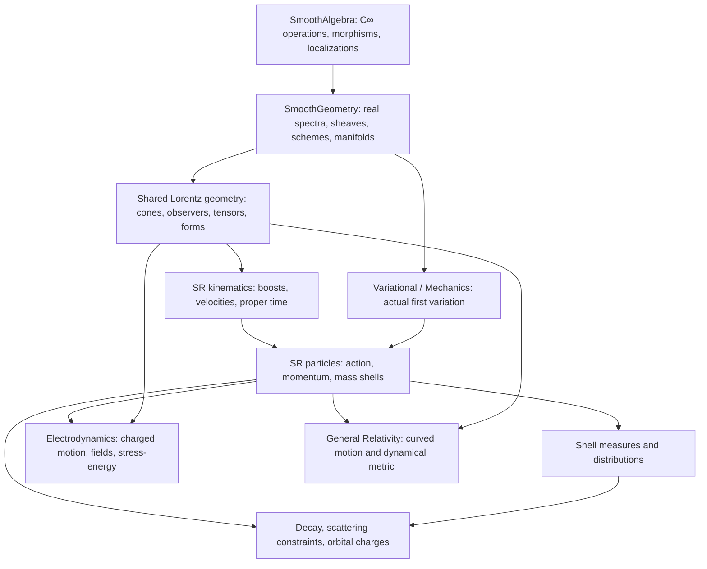

# Research Plan for Special Relativity over C∞ Geometry

A Lean formalization programme for Landau and Lifshitz, *The Classical Theory
of Fields*, fourth revised English edition, Chapters I–II, §§1–14.

This is the first part of the relativity and fields trilogy requested in
[issue #8](https://github.com/MGYamada/ProjectAInos/issues/8). Its companions are
[C∞ electrodynamics](cinfty-electrodynamics.md) and
[C∞ general relativity](cinfty-general-relativity.md). The design follows the
mathematical statements, prerequisite tiers, section correspondence and evidence
ledger of [C∞ mechanics](cinfty-mechanics.md), using the constructed shared
geometry rather than the mechanics manuscript's earlier proposed architecture.
The implementation baseline is `main` at commit `61d8fdf`, inspected on
13 November 2026. This manuscript specifies future formalization; completing
the manuscript does not complete those proofs.

## Implementation plan and current progress

The [research plan](../README.md) assigns Minkowski geometry and kinematics to
§3.1 and relativistic particle dynamics to §3.2. The
[SR implementation guide](special-relativity.md) records the former, while
[`ParticleAction.lean`](../ProjectAInos/SpecialRelativity/ParticleAction.lean)
already supplies part of the latter. Status below refers to actual definitions
and theorem declarations at the baseline, not to every assertion in a textbook
section. Proposed names later in this document are design names.

| Programme component | Baseline status | Public implementation or remaining task |
| --- | --- | --- |
| C∞ real spectra, structure sheaves, schemes, open restrictions and gluing | Implemented | Shared `SmoothAlgebra` and `SmoothGeometry`; see the [geometry guide](smooth-geometry.md) |
| Manifold-to-scheme construction and affine Minkowski comparison | Implemented | `Manifold.scheme`, `Manifold.schemeMap`, `LorentzManifold.toScheme`, `minkowskiSchemeIso` |
| Lorentz signatures, causal cones, affine causal order and metric duality | Implemented with proofs | `Minkowski.{Convention,Basic,Causal,Dual}` |
| Lorentz/Poincaré maps and observer rest spaces | Implemented with proofs | `Minkowski.{Isometry,Matrix,Affine,Observer}` |
| Boosts, velocity transformations and collinear rapidity | Implemented with proofs | `SpecialRelativity.{Boost,Velocity,Rapidity}` |
| Proper time and normalized timelike four-velocity | Implemented with stated regularity | `ProperTime`; null proper time is separate |
| Massive free action, momentum covector and stationarity iff Euler–Lagrange | Implemented on timelike jets | `SpecialRelativity.free_stationary_iff` in `ParticleAction` |
| Observer energy, coordinate-time Hamiltonian and systematic free-particle Noether theory | Targets | Build on the existing free action; do not replace it |
| Mass-shell integration, distributions and invariant collision rates | Targets | A measure-theoretic interface is needed in addition to the shell equations |
| Decays, scattering kinematics and angular-momentum charges | Targets | Finite-particle algebra first; interaction dynamics are additional premises |
| Universal C∞ cotangent comparison and nonreduced families of solutions | Research targets | Not consequences of the present manifold-to-scheme functor |

The existing `Electrodynamics.mass_shell` is a downstream verification of the
normalization of `m • fourVelocity v`. It is not evidence that a complete
SR momentum, collision or mass-shell measure API already exists.

## Abstract

Special relativity supplies the common spacetime and particle language of
classical field theory. This plan treats Minkowski spacetime as an affine
smooth manifold with its actual C∞ structure sheaf, a Lorentz metric, and a
chosen time orientation. Lorentz and Poincaré symmetries act by smooth scheme
isomorphisms. Observers define rest spaces, energies and spatial momenta;
timelike curves carry invariant proper time; particle actions produce
equations of motion under explicit admissibility hypotheses.

The extension from kinematics to dynamics has three distinct parts. Finite
dimensional algebra controls mass shells and collision constraints. Analysis
connects local variations with actual action integrals and constructs invariant
measures. Physical premises choose free-particle actions, conservation laws at
interaction events and rate models. C∞ geometry organizes these parts without
turning empirical premises into axioms or assuming that singular solution
spaces are smooth manifolds.

## Aim and design decisions

The intended reader is a contributor translating the fourteen textbook
sections into Lean statements. Each target must identify its mathematical
objects, hypotheses, conclusion, dependencies and proof status. Existing
theorems are reusable endpoints; statements about additional objects are new
targets even when their coordinate formulas look elementary.

1. **Use the constructed geometry.** Smooth real-point manifolds are the first
   physical models. Their C∞ schemes are constructed, and Poincaré maps already
   act on those schemes. Generalized points and nilpotents remain meaningful
   extension targets, with their comparison theorems stated separately.
2. **Keep common mathematics below physics.** Lorentz linear algebra, forms
   and manifold constructions stay in `SmoothGeometry`. Particle hypotheses
   and interpretations live in `SpecialRelativity`. The shared core does not
   import the project physics modules or the vendored Yang–Mills theory.
3. **Separate equations from dynamics and rates.** A conservation constraint
   determines allowed momenta, not a probability distribution or a scattering
   amplitude. A set of shell equations does not itself supply a measure.
4. **Use coordinate calculations as comparison theorems.** The native metric,
   affine displacement, covector and observer are the primary objects. A
   component identity must be connected to them by proved evaluation laws.

## Conventions and tiers

Physical spacetime has coordinates `(t,x,y,z)`, time first, `c = 1`, metric
`(-+++)` and standard orientation `dt ∧ dx ∧ dy ∧ dz`. Most kinematic results
work with `d` spatial dimensions; cross products and familiar angular momenta
specialize to `d = 3`. The Euclidean norm of `Minkowski.space v` measures
spatial length. The norm on a coordinate-function type is not substituted for
that spatial norm.

The shared API accepts either Lorentz signature explicitly. Write

$$
\langle v,w\rangle_L=v^0w^0-\mathbf v\cdot\mathbf w,
\qquad Q(v)=\langle v,v\rangle_L,
\qquad g(v,w)=-\langle v,w\rangle_L.
$$

Thus timelike means `Q > 0`, whereas the physical metric square is negative.
`Lightlike` excludes zero; `Causal` includes it. Future orientation is a
separate choice from spacetime orientation. Proper Lorentz transformations
preserve orientation; orthochronous transformations preserve the future cone.
Boost formulas below use the passive convention of the existing API.

Momenta with upper indices are vectors. The derivative of a Lagrangian with
respect to velocity is a covector: the implemented `kineticMomentum` is
`m • flat .timeNegative (fourVelocity v)`. Its time component is minus the
energy in the standard observer frame. Raising it gives the momentum vector.
This distinction must remain visible at every action-to-component bridge.

| Tier | Proof prerequisite |
| --- | --- |
| A | Algebra over C∞ rings, modules, or specified algebraic structures; earlier comparison results may be used |
| A* | Concrete finite dimensional polynomial/rational identities and elementary inequalities with their denominators or signs controlled |
| B | Named analytic interfaces: differentiation, integration, ODEs, estimates or measure transport |
| C | Geometry: manifolds, bundles, sheaves, smooth maps, orientations and differential forms |
| D | A substantial theorem awaiting proof, used only as an explicit hypothesis when needed |
| P | A physical or asymptotic argument whose formal replacement must specify a model and hypotheses |

Tiers describe prerequisites, not proof status. A theorem about a real
Minkowski model is not automatically a theorem over every C∞ coefficient
ring. The [ledger](#evidence-and-proof-ledger) distinguishes implemented
results, new proof targets, conditional statements and open research.

## Foundations

### The common C∞ base

For an open spacetime region `U`, observables form `C∞(U)`, with every smooth
finite-arity operation acting pointwise. Restrictions preserve those
operations. The structure sheaf, rather than just the underlying ring at one
global chart, records locality. The present construction supplies the actual
sheaf of smooth functions on a manifold and proves local affineness.

**Existing construction SR-F1 [C].** `Manifold.scheme n M` equips a
boundaryless finite dimensional manifold with its C∞ scheme. A smooth map
induces `Manifold.schemeMap`, respecting identity and composition. The
Minkowski comparison `minkowskiSchemeIso` identifies the resulting scheme
with the constructed spectrum of the smooth algebra of its coordinate model.
The source is the [shared Lorentz interface](../ProjectAInos/SmoothGeometry/Lorentzian.lean)
and the manifold modules documented in the geometry guide.

The metric is additional smooth data on the tangent bundle; changing its
overall sign does not change the scheme. `LorentzManifold.toScheme` does not
assert that all C∞ schemes admit Lorentz metrics. The implemented comparison
also does not establish full faithfulness of the manifold functor or an
isomorphism `A ≅ Γ(Spec A)` for arbitrary C∞ rings.

**Target SR-F2 [A,C].** Construct the universal smooth cotangent module
`Ω_A` and compare it, for the manifold structure sheaf, with sections of the
actual cotangent bundle. The universal derivation must satisfy the full
smooth chain rule, not merely the polynomial Leibniz rule:

$$
d\Phi_f(a_1,\ldots,a_n)
=\sum_i\Phi_{\partial_i f}(a_1,\ldots,a_n)\,da_i.
$$

The comparison must commute with restriction and smooth pullback before
transporting the native metric and tensors into algebraic language. General
C∞ localizations and gluing exist; universal cotangent modules, arbitrary
ordinary ideal quotients, completeness theory and these bundle comparisons
are separate remaining stages. No SR milestone below silently assumes them.

### Affine events, vectors and symmetries

An event is a point of an affine space modeled on `V = ℝ^(1+d)`. Displacements
belong to `V`; no physical equation should depend on the chosen affine origin.
The implementation uses the standard coordinate carrier for convenient
calculation, while `CausallyPrecedes` already works with affine displacement.

**Existing construction SR-F3 [A*,C].** `LorentzGroup d` consists of invertible
linear maps preserving the normalized pairing. `matrix_preserves_metric`
gives `Lᵀ g L = g`, and `matrix_det_eq_one_or_neg_one` gives the determinant
alternatives. `PoincareGroup.ofLinearTranslation L a` acts by `x ↦ Lx+a`;
[`PoincareGroup.toSchemeIso`](../ProjectAInos/SmoothGeometry/Minkowski/Affine.lean)
constructs its actual smooth scheme isomorphism.

For observables, the same transformation acts contravariantly by composition.
A future geometry target is to expose this compatibility directly as a
commuting square between scheme pullback and `C∞(U)` pullback. It is a
comparison API, not a second definition of the Poincaré group.

**Existing construction SR-F4 [A*,C].** An `Observer d` is a future unit
timelike vector `u`. Its clock is `θᵤ(v)=−g(u,v)`, its rest space is the clock
kernel, and its spatial projection is `v−θᵤ(v)u`. The implemented
`Observer.split`, `restSpace_finrank`, `restForm_posDef`, `clock_transform`
and `project_transform` prove unique decomposition, dimension, positivity
and covariance. These are the common inputs to particle measurements and
the electric/magnetic decomposition in the ED manuscript.

### Real causal geometry and infinitesimal extensions

The closed future cone is convex, pointed and stable under nonnegative
scaling. Therefore `q−p` in this cone defines an affine partial order.
This is an implemented property of a real Lorentz vector space. The assertion
that interactions propagate inside the cone is a physical premise about a
chosen theory, not a consequence of convexity.

**Target SR-F5 [A,C; research].** For a C∞ algebra `A` and its dual-number
extension, a generalized tangent point should be a smooth morphism
`A → B[ε]/(ε²)`. On ordinary Minkowski space it must reproduce the actual
native tangent vector and derivative. A Lorentz form on a finite projective
module can be specified algebraically, but signature, future orientation
and positivity must be interpreted on real fibres or by a separately proved
notion over the base. Ordering an arbitrary nonreduced ring is not assumed.

Null constraints can retain infinitesimal information at singular points.
In particular the cone vertex is not discarded when studying a scheme of
constraints, but it is excluded from the physical massless particle shell.
The physical smooth locus and a nonreduced constraint space have different
contracts; their coincidence is never inferred from equality of real points.

## Kinematics and clocks

### Boosts and relative velocities

For `‖β‖<1`, let `γβ=(1−‖β‖²)^(-1/2)`. The existing boost is constructed
using Lorentz reflections, so zero velocity needs no exceptional division.
Its coordinate formula is

$$
t'=\gamma_\beta(t-\boldsymbol\beta\cdot\mathbf x),
\qquad
\mathbf x'=\mathbf x+
\left(\frac{\gamma_\beta^2}{1+\gamma_\beta}
\boldsymbol\beta\cdot\mathbf x-\gamma_\beta t\right)\boldsymbol\beta.
$$

**Existing result SR-K1 [A*,B].** `boost_time`, `boost_space`, `boost_future`,
`boost_neg_inverse` and `boost_det` prove the component formula, future
preservation, inverse and properness. `Velocity.observerEquiv` identifies
velocities with observers; the orthochronous Lorentz group acts on the open
velocity ball. `Velocity.norm_transform_lt_one` supplies subluminality.

For collinear velocities the passive law is `(a−b)/(1−ab)`. Rapidity
`artanh b` is additive for the corresponding active composition
`(a+b)/(1+ab)`. The signs must be checked before identifying these formulas.
The existing theorem covers collinear rapidities; it does not collapse a
product of arbitrary boosts to a single boost.

**Target SR-K2 [A*,B,C].** Factor a proper orthochronous Lorentz transformation
relative to a chosen observer into a standard boost and a rest-space
orthogonal map. Obtain the residual rotation in the composition of two
noncollinear boosts from this factorization. Prove uniqueness with the
factor order fixed, then derive its zero and collinear special cases. This
supplies a controlled extension for Wigner rotations rather than an invalid
commutative velocity-addition rule.

### Proper time and maximal inertial clocks

For a future timelike curve on `[a,b]`, define

$$
\tau[\gamma]=\int_a^b\sqrt{Q(\dot\gamma(s))}\,ds,
\qquad U=\frac{\dot\gamma}{\sqrt{Q(\dot\gamma)}}.
$$

**Existing result SR-K3 [B].** `properTime_integrable` uses C¹ regularity near
every point of the closed parameter interval. `properTime_poincare` proves
affine-isometry invariance. `properTime_reparametrize` permits a C¹ parameter
map with nonnegative derivative, including zeros; it is an integral
substitution theorem, not an inverse-function theorem. `fourVelocity_unit`
and `fourVelocity_metric` require timelikeness and give `Q(U)=1`, `g(U,U)=−1`.
`properTime_null` proves zero elapsed proper time for null derivatives.

**Target SR-K4 [A*,B].** If `γ` is C¹, future timelike on a compact segment,
and `a<b`, its displacement `Δ=γ(b)−γ(a)` is future timelike and

$$
\tau[\gamma]\leq\sqrt{Q(\Delta)}.
$$

Equality holds exactly when all tangent vectors are positive scalar
multiples of one fixed future unit vector. Thus the maximizing curve is an
inertial segment up to increasing reparametrization, not necessarily affine
in the supplied parameter. Prove the reverse Cauchy–Schwarz inequality by
the existing observer split; integrate it against the observer determined
by `Δ`; use continuity for the equality case. Piecewise C¹ curves follow
by finite subdivision with matching endpoints. No assertion compares clocks
whose endpoints or admissibility conditions differ.

### Restoring the light-speed parameter

The baseline APIs use `c=1`. A dimensional comparison should explicitly use
`x⁰=ct`, `β=v/c`, momentum vector `(E/c,p)`, and metric `(-+++)` on those
coordinates. Proper time in physical seconds is `c⁻¹∫sqrt(-g(dx,dx))`.
This prevents a change of units from being mistaken for a limit theorem.

**Target SR-K5 [B].** For a fixed velocity bound `V` and `c≥2V` with `c>0`,
prove uniform Taylor remainder estimates for `γ(v/c)`, clock rates and the
free-particle energy on `‖v‖≤V`. State constants in terms of `m` and `V`.
The limit of a trajectory requires a separate stability argument; estimates
for a Lagrangian or momentum function alone do not prove trajectory convergence.

## Relativistic particle dynamics

### The free action and its degeneracy

For positive mass and timelike reference velocities, the action is

$$
S_m[\gamma]=-m\int_a^b\sqrt{-g(\dot\gamma,\dot\gamma)}\,ds.
$$

**Existing result SR-D1 [B].** `timelikeJets` is open,
`freeLagrangian_contDiffOn` gives the needed regularity there, and
`free_stationary_iff` proves fixed-endpoint stationarity iff the
Euler–Lagrange residual vanishes on `(a,b)`, assuming `a<b`, a C² path and
timelikeness throughout `[a,b]`. The action is an actual interval integral.
The differentiability argument does not extend the square root smoothly
across the null cone.

Its velocity derivative is the implemented momentum covector

$$
\pi=mU^\flat,\qquad p=\pi^\sharp=mU,
\qquad g(p,p)=-m^2.
$$

**Target SR-D2 [A*,B].** Prove directly in the SR layer that positive-mass
free stationarity is equivalent to constancy of `U`, hence to an inertial
image with a regular timelike reparametrization. Compute the velocity
Hessian and show that its kernel is exactly the span of the velocity.
Its rank is `d`, reflecting parameter invariance. A globally invertible
Legendre transform on all spacetime velocities is therefore inappropriate.
The existing curved particle variation theorems provide an independent
Minkowski specialization; SR must not import GR to obtain its basic result.

The physical selection of the length action remains a premise. A possible
uniqueness theorem assumes locality, dependence only on velocity, Lorentz
invariance and positive one-homogeneity on a connected timelike cone. These
assumptions reduce the Lagrangian to a constant multiple of proper speed.
Choosing the constant `−m` is the physical normalization, not an algebraic
consequence of Lorentz symmetry alone.

### Energy and the coordinate-time Hamiltonian

**Target SR-D3 [A*].** For a future unit observer `u` and future massive
momentum `p`, define `Eᵤ=−g(u,p)` and `p⊥=p−Eᵤu`. Prove

$$
p=E_u u+p_\perp,\qquad E_u>0,
\qquad E_u^2=m^2+g(p_\perp,p_\perp),
\qquad \mathbf v_u=p_\perp/E_u.
$$

Use rest-space positivity to show `‖vᵤ‖<1`, with the norm supplied by the
rest-space metric. Jointly transforming the observer and particle leaves
energy unchanged. Changing only the observer gives the familiar energy and
momentum transformation formulas.

**Target SR-D4 [A*,B].** Fix an inertial observer and use its time as the
parameter. For `m>0`, the spatial Lagrangian has an invertible fibre derivative:

$$
L(\mathbf v)=-m\sqrt{1-\|\mathbf v\|^2},\qquad
\mathbf p=m\gamma\mathbf v,\qquad
H(\mathbf p)=\sqrt{m^2+\|\mathbf p\|^2}.
$$

Construct the inverse `v=p/sqrt(m²+‖p‖²)` and prove the Legendre identities
and Hamilton equations. This transform is on the spatial velocity ball;
it is compatible with, but different from, the degenerate spacetime action.
Free spatial momentum and energy are conserved. After restoring units,

$$
E=mc^2\gamma(\mathbf v/c),\qquad
E-mc^2=\tfrac12m\|\mathbf v\|^2+O(c^{-2}).
$$

The `O(c⁻²)` statement uses the uniform compact-velocity contract SR-K5.
Subtracting the constant rest energy preserves Hamilton's equations.

### Massive and massless shells

**Target SR-D5 [A*,C].** Define the positive-energy shell for `m≥0` by

$$
\mathcal H_m^+=\{p\ne0:g(p,p)=-m^2,\ p^0>0\}.
$$

For `m>0`, its graph is `p⁰=sqrt(m²+‖p‖²)` over all spatial momenta.
For `m=0`, the graph is over nonzero spatial momenta. Construct the smooth
manifold and its inherited C∞ scheme on these domains, and prove the
orthochronous Lorentz action is smooth. The cone vertex is singular and
does not represent a physical zero-energy massless particle.

**Target SR-D6 [A*,B,C].** A massless particle uses an auxiliary positive
one-dimensional field `e`, with action

$$
S[x,e]=\frac12\int_a^b
\left(e^{-1}g(\dot x,\dot x)-e m^2\right)ds.
$$

Varying `e` yields `g(ẋ,ẋ)+e²m²=0`; varying `x` yields constancy of
`e⁻¹ẋ` in Minkowski coordinates. Require nonzero velocity for the massless
physical interpretation. For `m>0`, eliminating `e=sqrt(-g(ẋ,ẋ))/m`
recovers the massive action on its timelike domain. For `m=0`, it yields
null motion without normalizing a null vector by its zero proper speed.
The transformation of `e` under parameter changes is part of the action's
invariance theorem. These are new targets, not properties of the existing
total definition `fourVelocity` at a null vector.

## Distributions, collisions and conservation

### Invariant measure and particle distributions

**Target SR-M1 [B,C].** Construct a positive measure on the future shell
whose coordinate expression is

$$
d\mu_m(p)=\frac{d^d\mathbf p}{p^0}.
$$

For the massless shell the domain omits the origin. Fix this normalization
explicitly; conventions using `1/(2p⁰)` differ by a constant. Prove invariance
under orthochronous Lorentz transformations, which preserve this future shell,
through a change-of-variables theorem, with spatial Jacobian
`|det Dp'|=p'⁰/p⁰`, or through the corresponding level-set volume form.
Neither a symbolic Jacobian identity nor the shell equation alone supplies
the measure-theoretic conclusion.

**Target SR-M2 [B,C,P].** A distribution is a nonnegative measurable scalar
on the chosen shell bundle. Given a spacelike hypersurface with future unit
normal `n`, define the number flux by

$$
N_\Sigma=\int_\Sigma\int_{\mathcal H_m^+}
f(x,p)\,[-g(p,n)]\,d\mu_m(p)\,d\Sigma.
$$

Require measurability and integrability before proving invariance under
jointly transformed data. Equality of fluxes through different hypersurfaces
additionally needs a transport equation and boundary-flux conditions.
Independent spatial and momentum volume factors must not each be declared
Lorentz invariant. This is the entry point for later relativistic kinetic
theory; no equilibrium distribution is selected by SR kinematics.

### Decays and two-body constraints

**Target SR-C1 [A*].** For future causal nonzero momenta, prove the reverse
Cauchy–Schwarz inequality and the invariant-mass triangle inequality for
their sum. Identify the degenerate case in which parallel null momenta
have a null sum. A center-of-momentum observer exists for a timelike total
momentum `P`, with `u=P/sqrt(-g(P,P))`; it does not exist for a null total.

**Target SR-C2 [A*].** A two-body decay has parent rest mass `M>0`, daughter
masses `m₁,m₂≥0`, future shell conditions and `P=p₁+p₂`. In the parent rest
frame, prove

$$
E_1=\frac{M^2+m_1^2-m_2^2}{2M},\qquad
E_2=\frac{M^2+m_2^2-m_1^2}{2M},\qquad
|\mathbf p_1|=|\mathbf p_2|
=\frac{\sqrt{\lambda(M^2,m_1^2,m_2^2)}}{2M},
$$

where `λ(a,b,c)=a²+b²+c²−2ab−2ac−2bc`. For `M>m₁+m₂`, every unit spatial
direction supplies an allowed configuration. At threshold, zero spatial
momentum is admissible when both daughter masses are positive. If one daughter
is massless, the equality case would give that daughter zero energy and is
excluded by the shell definition. This distinguishes necessary algebraic
constraints from physical nonzero-particle existence.

**Target SR-C3 [A*].** For elastic two-body scattering, label incoming momenta
`p₁,p₂` and outgoing momenta `p₃,p₄`, impose their future shells and
`p₁+p₂=p₃+p₄`. Use the timelike total momentum to construct the
center-of-momentum frame and parametrize outgoing directions. Define

$$
s=-g(p_1+p_2,p_1+p_2),\qquad
t=-g(p_1-p_3,p_1-p_3),\qquad
u=-g(p_1-p_4,p_1-p_4).
$$

Prove `s+t+u=Σmᵢ²`. Lab-frame formulas follow by the
already constructed boosts. The choice of outgoing angle or interaction law
is not inferred from these conservation identities.

### Cross-sections and event rates

**Target SR-C4 [B,C,P].** Construct the regular part of constrained
multi-particle phase space and its measure from product shell measures and
the total-momentum constraint. Use a coarea or distributional construction
with stated hypotheses; thresholds where the constraint map loses rank
require a separate treatment.

For two incoming particles define the invariant flux factor

$$
\mathcal F=\sqrt{g(p_1,p_2)^2-m_1^2m_2^2}.
$$

Given a nonnegative Lorentz-scalar transition weight `W` and a compatible
normalization of final-state phase space, one may define a rate model with
`dσ=W dΠ/(4ℱ)` where `ℱ>0`. Prove its covariance from the hypotheses.
This is a conditional definition of a cross-section, not a derivation of
`W` from relativity. The often used flux speed `ℱ/(E₁E₂)` is not identified
with the speed of one observer measured by another; those concepts have
different domains and bounds.

### Angular momentum and the center of energy

**Target SR-C5 [A*,B].** For a finite collection of free worldlines sampled
at a common inertial time, define total momentum and orbital angular momentum

$$
P^\mu=\sum_a p_a^\mu,\qquad
J^{\mu\nu}=\sum_a(x_a^\mu p_a^\nu-x_a^\nu p_a^\mu).
$$

Derive conservation from the free equations, and covariance under Lorentz
maps. A transformed common-time slice generally samples different events on
the worldlines. For the free system, use conservation of each worldline's
momentum and orbital charge to justify resampling on the new observer's slice.
Shifting the coordinate origin by `a` gives `J' = J−a∧P`; thus orbital
angular momentum depends on an origin although its conservation does not.
For local interaction events, impose the relevant momentum conservation and
matching conditions explicitly. For extended matter or fields, the missing
contribution is an integral of stress-energy, developed in the ED plan.

With positive total energy $E$, define the spatial center
$\mathbf X=\sum_a E_a\mathbf x_a/E$. Constancy of $J^{0i}$ implies
$d\mathbf X/dt=\mathbf P/E$, where $\mathbf P$ is the spatial part of the
total four-momentum. This energy-weighted center replaces the nonrelativistic
mass-weighted center; it is observer dependent. A universal rigid-body
interpretation or Lorentz-covariant spatial center is not assumed.

**Target SR-C6 [A,A*; conditional].** Once the canonical cotangent Poisson
API from the mechanics programme is available, represent translations and
Lorentz transformations by momentum functions and prove their brackets on
canonical generators. Compare these functions with the action's Noether
boundary terms. This is the Poincaré algebra of classical orbital charges;
intrinsic spin and quantum representations are later extensions.

<a id="landau-lifshitz-correspondence"></a>

## Landau–Lifshitz correspondence

Numbers follow Volume 2, fourth revised English edition. Topic labels below
are descriptive summaries, not a transcription of the book's headings.
Each row specifies a formalization target and its premises. “Partial” means
that the cited building blocks exist, not that the complete textbook section
is proved. The [publisher entry](https://shop.elsevier.com/books/the-classical-theory-of-fields/landau/978-0-08-025072-4)
fixes the edition; the [book preview](https://books.google.com/books/about/The_Classical_Theory_of_Fields.html?id=QIxD3Z82AagC)
supports the numbering. Page numbers vary between reprints.

| § | Topic and formal target | Essential hypotheses | Tier and dependency | Baseline status |
| ---: | --- | --- | --- | --- |
| 1 | Finite signal speed: causal order and covariance of an admissible propagation relation | Chosen future cone; containment of the physical signal relation in it is a premise | A*, P; SR-F3–F4 | Causal order implemented; physical propagation model remains a target |
| 2 | Invariant intervals and causal classification of event displacements | Affine displacement; explicit Lorentz convention | A*; SR-F3 | Implemented by `intervalSq`, causal predicates and Lorentz invariance |
| 3 | Proper-time integral, invariance, dilation and inertial maximality | Local C¹ regularity on a compact segment; timelike/future conditions for clock interpretation | B; SR-K3–K4 | Integral, invariance and dilation implemented; maximality target |
| 4 | Lorentz maps, proper/orthochronous subgroups and boosts | Subluminal boost parameter; explicit convention | A*, B; SR-F3, SR-K1–K2 | Core maps and boosts implemented; factorization/rotation extension target |
| 5 | Relative velocity, subluminality and collinear composition | Future unit observers or velocity-ball elements | A*, B; SR-F4, SR-K1 | Implemented; noncollinear composition retained as a group action |
| 6 | Four-vectors, covectors, tensors and invariant contractions | Specified variance; invertible Lorentz action for mixed tensors | A*, C; SR-F2–F4 and shared tensor APIs | Native operations implemented; universal C∞ cotangent comparison target |
| 7 | Four-velocity, acceleration orthogonality and massive/null distinction | Timelike differentiable curve for normalization; C² for acceleration | A*, B; SR-K3, SR-D5–D6 | Unit four-velocity implemented; systematic acceleration and massless package targets |
| 8 | Massive variational principle, free motion and parameter degeneracy | C² path, `a<b`, timelike reference jets; `m>0` for inertial-motion conclusion | B, P; SR-D1–D2 | Actual action and stationary/EL equivalence implemented; full SR dynamics target |
| 9 | Observer energy/momentum, mass shell, coordinate-time Hamiltonian and Newtonian expansion | Future massive momentum; fixed observer; `m>0`; compact velocity bound for limit | A*, B; SR-D3–D5, SR-K5 | Momentum covector implemented; complete energy/Hamiltonian/limit API targets |
| 10 | Covariance of shell distributions and number flux | Nonnegative measurable distribution; spacelike slice; integrability | B, C; SR-M1–M2 | Target |
| 11 | Two-body decay energies, thresholds and frame conversion | Parent `M>0`; daughter future shells; conservation; nonzero daughter energies | A*; SR-C1–C2 | Target |
| 12 | Invariant phase-space rate and cross-section construction | Regular constraint locus; nonzero incoming flux; scalar transition weight | B, C, P; SR-M1, SR-C4 | Conditional target; no interaction weight is supplied by SR |
| 13 | Elastic two-body kinematics and invariant relations | Future mass shells; timelike total momentum; conservation | A*; SR-C1–C3 | Target |
| 14 | Orbital Lorentz charges and center-of-energy motion | Finite isolated free system or explicit event-balance premises; positive total energy | A*, B; SR-C5–C6 | Target; field contributions belong to ED |

Chapter I is §§1–7 and Chapter II is §§8–14. The ED manuscript owns §§15–80;
the GR manuscript owns §§81–119. Their curved Maxwell and gravitational
particle specializations may cite SR results, while the section ledger keeps
one primary owner for each textbook section.

## Towards Lean

### Architecture and proposed interfaces

The existing public types `Spacetime`, `FourVector`, `FourCovector`,
`Velocity d`, `Observer d`, `LorentzGroup d`, `PoincareGroup d`,
`TimelikeSegment`, `freeAction` and `kineticMomentum` remain the integration
points. New modules should add observer measurements, mass shells, measures
and conservation laws around these definitions. No new field named
“stationarity implies free motion” belongs inside a particle data structure:
the implication is a theorem of the actual action.

Proposed interfaces have the following responsibilities:

| Proposed interface | Data and public contract |
| --- | --- |
| `ParticleMomentum` / `MassShell` | Mass, future nonzero momentum, shell predicate; observer energy and spatial momentum; massive and massless domains distinguished |
| `CoordinateTimeDynamics` | Spatial velocity/momentum equivalence for positive mass, Hamiltonian and comparison to the covariant action |
| `MassShellMeasure` | Chosen measure normalization, chart formula and Lorentz pushforward equality |
| `Distribution` | Measurable nonnegative density and integrability hypotheses; flux through an explicitly supplied hypersurface |
| `CollisionKinematics` | Finite incoming/outgoing particle families, shell conditions and a separate conservation predicate |
| `OrbitalCharges` | Origin-dependent angular momentum, observer-dependent center of energy and proved transformation laws |

Names in this table are proposals, not declarations available at the baseline.
The public mathematical contracts take priority over a premature choice of
Lean structure fields. The algebraic shell predicate and smooth shell manifold
must be related by a comparison theorem rather than being silently identified.



This is a subsystem dependency diagram, not a claim that every displayed
edge is a direct Lean import. The reusable geometric and variational cores
must remain independent of project physics. Current boundaries are enforced
by [`checks/CoreImports.lean`](../checks/CoreImports.lean).

### Analytic interfaces and proof order

| Interface | Required statement | Current use and remaining work |
| --- | --- | --- |
| SR-I1: compact curve calculus | Local C¹/C² regularity, chain rule, interval substitution and integration by parts | Used by existing proper-time and free-action theorems; reuse their actual hypotheses |
| SR-I2: localized variations | Small fixed-endpoint perturbations remain in an open timelike jet domain; actual action differentiation and fundamental lemma | Supplied by `Mechanics.OpenDomain` for the present flat model |
| SR-I3: convexity and clock comparison | Reverse Cauchy–Schwarz, integral inequality and continuous equality case | New proof targets for inertial maximality |
| SR-I4: shell change of variables | Jacobians, integration on smooth level sets and pushforward equality | Needed for distributions and phase-space rates; no placeholder axiom |
| SR-I5: asymptotic estimates | Uniform Taylor remainders on a compact velocity range, with explicit `c` domain | New target; does not substitute for ODE stability |
| SR-I6: generalized coefficients | Cotangent comparison and extension of smooth families to nilpotent coefficient algebras | Research stage; no real-coefficient theorem is promoted without this bridge |

Standard mathlib results should discharge these interfaces where available
in the pinned dependency. A missing substantial theorem may be passed as a
named hypothesis for a conditional theorem, with that dependency visible in
the ledger. It must not be introduced by `axiom`, nor hidden in a structure
whose only role is to assert the desired conclusion.

## Milestones

1. **SR0 — baseline and comparisons.** Preserve existing geometry, clock and
   action APIs. Add consumer examples connecting `kineticMomentum`, metric
   duality and normalized four-velocity. Acceptance: both signatures agree
   on causal classification and clocks; the physics wrapper remains `(-+++)`.
   Review and ratify the proposed shared interfaces with the ED and GR
   consumers before committing to new public APIs. This manuscript records
   the proposal; completing its Markdown does not complete that review gate.
2. **SR1 — free massive dynamics.** Prove SR-D2–D4, acceleration orthogonality
   and observer energy positivity. Acceptance: a nonzero boosted particle,
   a nonlinear regular reparametrization and the spatial Legendre inverse
   all exercise the actual action and momentum definitions.
3. **SR2 — shells and massless motion.** Construct smooth positive shells and
   the auxiliary-field variational model. Acceptance: massive rest momentum,
   a nonzero null momentum and exclusion of the null cone vertex; massive
   elimination reproduces the existing action.
4. **SR3 — algebra of finite reactions.** Prove invariant-mass inequalities,
   two-body decay formulas and elastic collision identities. Acceptance:
   unequal masses, threshold, forbidden threshold with a massless daughter,
   and null total momentum are distinguished explicitly.
5. **SR4 — measures and distributions.** Construct invariant shell measure
   and flux, then regular constrained phase-space rates. Acceptance:
   boost pushforward equality is a measure theorem; rate claims disclose
   the transition-weight and regularity hypotheses.
6. **SR5 — orbital symmetry and limits.** Prove the center-of-energy theorem,
   charge transformation and compact-velocity Newtonian estimates. Extend
   to Poisson momentum maps when the mechanics prerequisite is available.
7. **SR6 — C∞ family refinement.** Implement the universal cotangent bridge
   and selected nonreduced shell/variation examples. Acceptance: native and
   algebraic tangent descriptions agree on the real smooth locus, and every
   generalized-coefficient claim records the additional proved comparison.

SR3 can proceed after the momentum definitions without waiting for shell
integration. SR4 owns analytic rate questions. SR6 enriches the foundations
without blocking the ordinary real-model particle programme.

## Evidence and proof ledger

“Implemented” means the cited declarations exist with proofs at `61d8fdf`;
it does not report a new build performed by this manuscript. “Target” is an
unimplemented theorem in the specified real model. “Conditional target”
includes a named mathematical or physical premise. “Research target” needs
a new framework or comparison. SymPy checks remain evidence rather than
Lean proof, even when they simplify exactly to zero.

| Tag | Claim or regression | Evidence at the baseline | Outstanding acceptance condition |
| --- | --- | --- | --- |
| SR-E1 | Timelike, spacelike, null and zero classification | `Examples.timelike_example`, `spacelike_example`, `lightlike_example`, `zero_causal_not_lightlike` | Retain zero/nonzero distinction in new shells |
| SR-E2 | Velocity `3/5`, Lorentz factor `5/4`, clock rate `4/5` | `Examples.beta_gamma`, `boosted_time`, `boosted_space`, `inverse_boost`, `time_dilation` | Observer-energy example uses the same signs |
| SR-E3 | Signature-independent clock and boost geometry | `Examples.same_clock_both_signs`, `same_boost_both_signs` | Physical wrappers retain an explicit convention |
| SR-E4 | Nonzero exact two-form, closedness and gauge identity | `SpecialRelativity.coordinatePotential_exteriorDerivative`, `coordinateField_nonzero`, `coordinateField_closed`, `coordinatePotential_gauge` in `FormExamples` | ED owns physical field interpretation |
| SR-E5 | Actual free-action differentiation and momentum | `SpecialRelativity.hasFDerivAt_freeLagrangian`, `free_momentum`, `free_stationary_iff` in `ParticleAction` | Derive the complete SR free-motion and energy package |
| SR-E6 | Mass normalization | Downstream `Electrodynamics.mass_shell` proves `g(mU,mU)=−m²` under timelikeness | Add an SR-owned shell theorem without an ED import |
| SR-E7 | Shell measure invariance | Target; no shell-measure theorem claimed | Lean change-of-variables proof with chosen normalization |
| SR-E8 | Decay and elastic kinematics | Target; no newly executed experiment claimed | Exact Lean examples for masses, threshold and boosted data |
| SR-E9 | Rest-energy subtraction and `c→∞` remainder | Target | Quantified uniform estimate, not a formal series alone |
| SR-E10 | Universal C∞/native tangent comparison | Research target | Prove restriction and pullback compatibility before reuse |

The existing experiment package contains
[`verify_electrodynamics.py`](../experiments/ainos_experiments/verify_electrodynamics.py)
and [`verify_lorentz_geometry.py`](../experiments/ainos_experiments/verify_lorentz_geometry.py).
They check related field-invariant and coordinate-geometry identities; they
are not a completed SR collision or distribution experiment suite. Future
short SR checks should use exact SymPy arithmetic first, with parameters,
tolerances and seeds recorded if numerical calculations become necessary.

Future Lean changes require the warning-free library build, root-import
check, relevant default-option consumer checks and transitive axiom audit:

```sh
lake build --wfail ProjectAInos
lake exe mk_all --check --lib ProjectAInos
lake env lean -DwarningAsError=true --run checks/CoreImports.lean
lake env lean -DwarningAsError=true checks/SpecialRelativityAPI.lean
lake env lean -DwarningAsError=true checks/AxiomAudit.lean
```

The axiom allowlist is `propext`, `Classical.choice`, `Quot.sound`. Physical
premises remain hypotheses or predicates. Experiment checks use the separate
non-required workflow; documentation generation follows [docs/build.md](build.md).
For this design deliverable, acceptance additionally requires all fourteen
section rows, valid crosslinks, clear status labels and agreement with the
other two manuscripts' conventions and dependency boundaries.

## References

- L. D. Landau and E. M. Lifshitz, *The Classical Theory of Fields*, fourth
  revised English edition, Course of Theoretical Physics, vol. 2, translated
  by Morton Hamermesh, Chapters I–II, §§1–14.
  [Publisher](https://shop.elsevier.com/books/the-classical-theory-of-fields/landau/978-0-08-025072-4)
  · [Section-number preview, ISBN 9780750627689](https://books.google.com/books/about/The_Classical_Theory_of_Fields.html?id=QIxD3Z82AagC).
  Section numbers are the correspondence keys; reprint page numbers are not.
- D. Joyce, *Algebraic Geometry over C∞-rings*, Memoirs of the AMS **260**
  (2019), no. 1256; [arXiv:1001.0023v7](https://arxiv.org/abs/1001.0023v7),
  §§2–4 and §§5.2, 5.6. Completeness and cotangent comparisons require their
  stated hypotheses; this reference does not itself constitute a Lean proof.
- [C∞ mechanics research plan](cinfty-mechanics.md): tier conventions,
  variational identities, constrained Hamiltonian systems and proof ledger.
- [Shared smooth geometry](smooth-geometry.md) and
  [formalization notes](smooth-geometry-notes.md): constructed spectra,
  manifold schemes, native bundles and the outstanding algebraic comparisons.
- [SR implementation guide](special-relativity.md),
  [ED implementation guide](electrodynamics.md), and
  [GR implementation guide](general-relativity.md): actual public APIs and
  the existing flat/curved comparison results at the recorded baseline.
