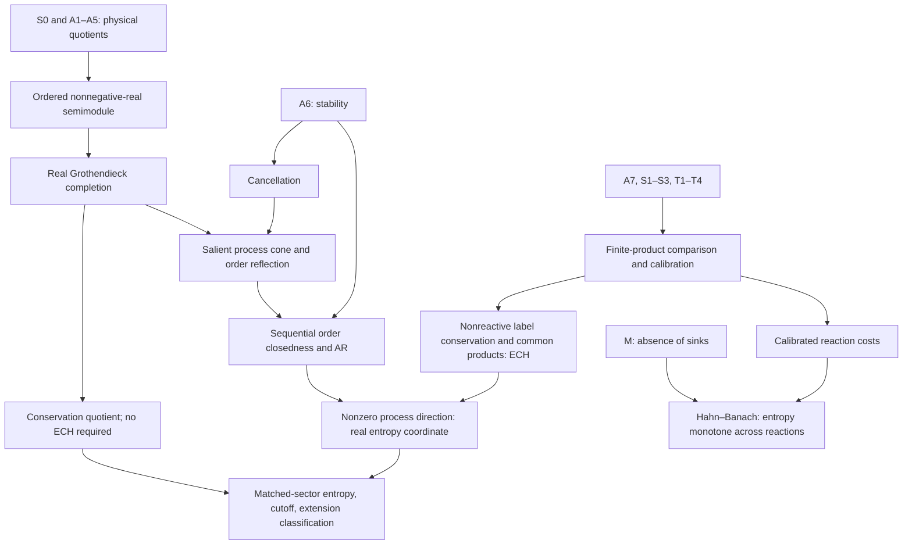

# Axiomatic Thermodynamics in Lean

The thermodynamics library proves the algebraic entropy theorem, derives physical comparison from explicit geometric and thermal premises, and constructs the weaker entropy principle for mixtures and reactions. It also provides diagnostic models and an operational ideal-gas model. Every definition and proof is available through [ProjectAInos.lean](../ProjectAInos.lean).

This guide replaces the local working note `tex/axiomatic_thermodynamics_lean.tex`, *Axiomatic Thermodynamics as an Ordered Grothendieck Completion* (version 1.0, 10 November 2026). It reorganizes the note around the implemented results, replaces proposed interfaces with actual Lean declarations, and preserves the distinctions between proved consequences, physical assumptions, explanatory calculations, and later research.

## Reading guide

| Chapter | Contents |
| --- | --- |
| [Algebraic entropy theorem](thermodynamics-algebra.md) | A6, spectator cancellation, real Grothendieck completion, process cone, SC, ECH, real-cut representation, signed cutoff, conserved sectors, and entropy extensions |
| [Physical systems and reactions](thermodynamics-physical.md) | S0 and A1–A7, the physical quotient, S1–S3 and T1–T4, comparison and calibration, composition labels, D/E/F costs, no sinks, and Hahn–Banach |
| [Models and counterexamples](thermodynamics-models.md) | Rank one, independent monotones, lexicographic order, degenerate and conserved-sector examples, stoichiometry, and the ideal gas |
| [Implementation checklist](thermodynamics-status.md) | The eight implementation stages, public physical endpoints, boundary cases, and checks |
| [Formalization notes](thermodynamics-notes.md) | The mathematical distinctions discovered or made explicit during the proofs |

The [README](../README.md) remains the research plan. The chapters give statements and proof explanations; the linked Lean declarations give the exact types and machine-checked proofs.

## Central result and dependencies

For the monoid `M` of adiabatic-equivalence classes, write

$$
V=K(M),\qquad
P=\{\iota y-\iota x\mid x\le y\},\qquad
W=\operatorname{span}_{\mathbb R}P=P-P,\qquad C=V/W.
$$

Stability gives cancellation, order reflection, and sequential order closedness. Exchange comparison makes the cone order total on `W`. If `P` contains a nonzero process direction, the real-cut construction gives

$$
(W,P)\simeq(\mathbb R,\mathbb R_{\ge0}),\qquad
0\longrightarrow W\longrightarrow V\longrightarrow C\longrightarrow0.
$$

Entropy on states is the restriction of a linear extension of that coordinate. Once the entropy unit is fixed, any two extensions differ by one unique linear conserved quantity. The equivalence between accessibility and entropy order holds within matching conserved sectors. The ambient completion need not be totally ordered.

The proof dependencies are:



The physical proof is essential: group completion does not establish comparison. Conversely, reaction entropy uses a functional selecting compatible normalization constants; it does not assert that all reaction directions form a line.

## Traceability to the former specification

All numbered proof obligations L01–L12 have implementations. The former physical and reaction bridges are now implemented under the explicit premises described in the chapters.

| Former section | Replacement and current status |
| --- | --- |
| §1. Physical system layer | [Physical systems](thermodynamics-physical.md): finite expressions, structural coherence, accessibility axioms, and mutual-accessibility quotient |
| §2. Adiabatic quotient and completion | [Algebra](thermodynamics-algebra.md): semimodule input, cancellation, scalar extension and uniqueness; physical construction in [Physical](../ProjectAInos/Thermodynamics/Physical.lean) |
| §3. Process cone and reflection | [Algebra](thermodynamics-algebra.md): cone closure, injectivity, reflection, salience and disappearance of the radical |
| §4. Stability and Archimedean order | [Algebra](thermodynamics-algebra.md): SC from A6, then AR, without a topology on the completion |
| §5. Exact comparison hypothesis | [Algebra](thermodynamics-algebra.md): ECH iff totality on `W`; [physical chapter](thermodynamics-physical.md): conserved labels and common products |
| §6. Hölder representation and entropy | [Algebra](thermodynamics-algebra.md): real cut, normalized uniqueness, positive-scale freedom, degenerate case, sector condition and relative cutoff |
| §7. Conservation exact sequence | [Algebra](thermodynamics-algebra.md): quotient universal property and affine classification of entropy extensions |
| §8. Mixing and reactions | [Physical chapter](thermodynamics-physical.md): extended-real costs, compatible constants, no sinks and weak entropy; third-law normalization remains outside scope |
| §9. Diagnostic examples | [Models](thermodynamics-models.md): formal results distinguished from supplementary coordinate calculations |
| §10. Lean blueprint and obligations | The table below and [implementation checklist](thermodynamics-status.md) replace the uncompiled interface sketch and proposed `Thermo.*` file names |
| §11. Limits of the algebraic theorem | Physical CH, sector bookkeeping and weak reaction entropy are implemented in separate layers; remaining exclusions are stated below |
| §12. Dependency summary | The dependency diagram above and the linked proof chapters |
| Appendix A. Physical axioms | [Physical chapter](thermodynamics-physical.md): actual A7/S/T/M interfaces, including the precise S3 and scaled-copy T2 premises |

| Obligation | Implemented declaration or construction | Module |
| --- | --- | --- |
| L01. Mutual accessibility is a congruence | `Accessibility`, adiabatic equivalence and its quotient | [Physical](../ProjectAInos/Thermodynamics/Physical.lean) |
| L02. Quotient semimodule and stability | `Accessibility.StateSpace`, splitting and descended A6 | [Physical](../ProjectAInos/Thermodynamics/Physical.lean) |
| L03. Spectator cancellation | `Stability.le_of_add_le_add_right`, `Stability.isOrderedCancelAddMonoid` | [Cancellation](../ProjectAInos/Thermodynamics/Cancellation.lean) |
| L04. Injective embedding | `Completion.of_injective` | [Completion](../ProjectAInos/Thermodynamics/Completion.lean) |
| L05. Unique real action | `Completion.realEndHom`, `Completion.module_unique` | [Completion](../ProjectAInos/Thermodynamics/Completion.lean) |
| L06. Cone, salience, reflection | `processCone`, `processCone_salient`, `processCone_reflects` | [Cone](../ProjectAInos/Thermodynamics/Cone.lean) |
| L07. A6 implies SC | `processCone_sequentialOrderClosed` | [Cone](../ProjectAInos/Thermodynamics/Cone.lean) |
| L08. SC implies AR | `SequentialOrderClosed.archimedean`, `coneSpan_archimedean` | [Representation](../ProjectAInos/Thermodynamics/Representation.lean) |
| L09. ECH iff totality | `exchangeComparison_iff_coneTotal` | [Cone](../ProjectAInos/Thermodynamics/Cone.lean) |
| L10. Real-cut representation | `coneEntropyEquiv`, `entropyCoordinate` | [Representation](../ProjectAInos/Thermodynamics/Representation.lean), [Entropy](../ProjectAInos/Thermodynamics/Entropy.lean) |
| L11. Matched-sector entropy principle | `EntropyExtension.state_le_iff`, `exists_normalized_entropy` | [Entropy](../ProjectAInos/Thermodynamics/Entropy.lean) |
| L12. Conservation and extension classification | `conservation_exact`, `existsUnique_process_factor_iff`, `EntropyExtension.equivConserved` | [Conservation](../ProjectAInos/Thermodynamics/Conservation.lean) |

The original `Thermo.Stability` proposal is implemented across `Basic`, `Cone`, and `Representation`; `Thermo.Holder` became `Representation`; the physical quotient and comparison occupy multiple modules. Actual modules live under `ProjectAInos.Thermodynamics` and are exported by the root module.

## Scope and proof conventions

Physical premises are arguments and structure fields, not new Lean axioms. The abstract core uses classical real suprema and linear extensions. The reaction layer uses algebraic Hahn–Banach on the finite-cost subspace of formal system differences. The allowed transitive axioms are `propext`, `Classical.choice`, and `Quot.sound`; there are no proof placeholders.

All admitted primitive simple systems in the current physical endpoints satisfy T4. For this scope T1–T4 suffice. The former note's T5 inventory is retained as context for extensions to systems without T4 and for temperature theory; those results are not claimed here. Third-law or absolute-zero normalization, a constructive replacement for the classical proofs, and a universal converse to entropy monotonicity across different reaction labels are also outside the implemented theorem.

The ideal-gas construction added during implementation proves the macroscopic formula and operational accessibility criterion, plus a composite consistency model. It does not derive that formula from microscopic phase volume; that is part of the [statistical-mechanics research plan](../README.md).

Two statements in the old design note require precision in the replacement: the reference cutoff is an entropy **difference**, and S3 in the implemented physical interface concerns a **path-connected relative boundary**. The physical chapter also retains the positive scaled-copy thermal clause of T2. The [formalization notes](thermodynamics-notes.md) explain these distinctions and the later calibration arguments.

## Library interfaces and verification

The implementation uses mathlib's `Algebra.GrothendieckAddGroup` and its universal additive lift, `PointedCone` with the separate `ConvexCone.Salient` property, `Archimedean`, `Submodule` quotients, `LinearMap.exists_extend`, `EReal`, and the algebraic cone-extension form of Hahn–Banach. The repository's toolchain and Lake manifest pin the versions used by the proofs. See [building the API reference](build.md) for generated documentation.

From the repository root, the required checks are

```sh
lake build --wfail ProjectAInos
lake exe mk_all --check --lib ProjectAInos
```

The required CI job additionally audits transitive axioms for all project declarations. Symbolic and numerical experiments are separate from these proofs.

## References

- E. H. Lieb and J. Yngvason, *The Physics and Mathematics of the Second Law of Thermodynamics*, Physics Reports **310** (1999), 1–96. [DOI](https://doi.org/10.1016/S0370-1573(98)00082-9); [arXiv](https://arxiv.org/abs/cond-mat/9708200); [HTML text](https://arxiv.org/html/cond-mat/9708200v2). Principal correspondences: cancellation (2.1), entropy from comparison (2.5), simple-system comparison (3.7), scaled-copy comparison (4.4), isotherm dichotomy (4.6), calibrators (4.7), finite-product comparison (4.8), and reaction entropy (6.2).
- T. Fritz, *Resource Convertibility and Ordered Commutative Monoids*, Mathematical Structures in Computer Science **27** (2017), 850–938, especially §9.2. [DOI](https://doi.org/10.1017/S0960129515000444). This is background for the ordered-monoid viewpoint; the Lean results above identify their actual implementation dependencies separately.
- mathlib, [Grothendieck group API](https://leanprover-community.github.io/mathlib4_docs/Mathlib/GroupTheory/MonoidLocalization/GrothendieckGroup.html) and [Archimedean ordered algebra API](https://leanprover-community.github.io/mathlib4_docs/Mathlib/Algebra/Order/Archimedean/Basic.html). Published API pages may track a different revision from the repository's pinned dependency.
